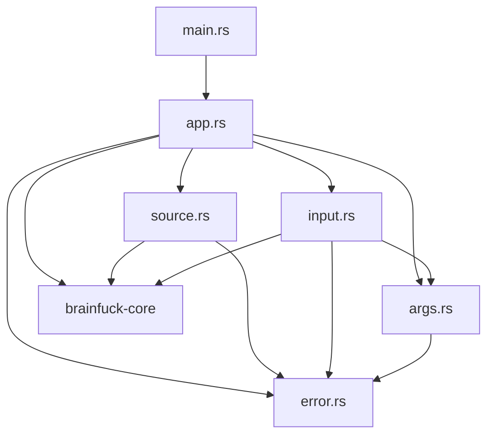
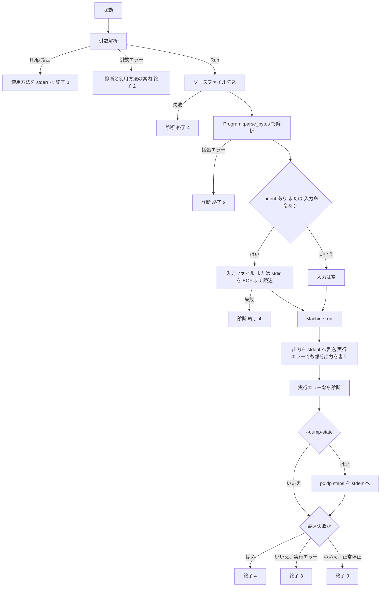

# Design Document: brainfuck-cli

## Overview

`brainfuck-cli` は、`brainfuck-core` をプロセス境界(ファイル、標準入出力、終了コード)から再現可能に利用する単一のバイナリ crate である。`brainfuck-cli [OPTIONS] <PROGRAM>` は、ソースファイルを core の `Program` に解析し、入力バイト列を供給して `Machine::run` を実行し、プログラム出力のバイト列だけを標準出力へ、診断・状態表示・使用方法を標準エラーへ書き、結果を終了コード 0 / 2 / 3 / 4 で返す。

**Purpose**: 後続の `desktop-gui`・最適化インタプリタ・コンパイラ比較が「同一入力に対する正解」として参照できる、決定的でスクリプト可能な実行環境を提供する。
**Users**: Brainfuck 学習者(手元での実行確認)と、CLI の標準出力・終了コードを比較基準とする後続 spec の開発者・テスト実装者。
**Impact**: greenfield。`crates/brainfuck-cli`、`examples/hello.bf`、ルート `README.md` の更新を追加する。core の公開 API は読み取り利用のみで変更しない。

### Goals
- 仕様書 §7 の CLI(5 オプション、既定上限 10,000,000、標準出力/標準エラーの分離、終了コード 0/2/3/4)を実装する
- 出力・入力をバイト列のまま扱い、診断からパスと入力内容を除外する
- `examples/hello.bf` と README の検証手順を提供し、プロセス単位の結合テストで契約を固定する

### Non-Goals
- 実行意味論・解析規則・上限強制(core の責務)。対話 UI、デバッガ機能、設定ファイル
- ストリーミング出力(実行中の逐次書き出し)。出力は実行完了後に一括で書く
- 引数解析ライブラリの採用、`-h` 等の短縮オプション、`--` 区切り

## Boundary Commitments

### This Spec Owns
- `crates/brainfuck-cli` crate 一式(引数解析、入力取得、実行の呼び出し、出力・診断・状態表示、終了コード決定)
- CLI の観測可能な契約: オプション名と意味、既定上限 10,000,000、標準出力はプログラム出力のみ、診断の文面テンプレート、`--dump-state` の書式、終了コード割り当てと複数失敗時の決定規則
- ソースファイルのバイト列を core の `Program::parse_bytes` へ渡す呼び出し(非 UTF-8 バイトは core がコメント扱いにし、バイトオフセットは実バイト位置になる。CLI は前処理を持たない)
- `examples/hello.bf` とルート `README.md` の検証手順・使用方法の記述
- CLI 結合テスト一式とそのフィクスチャ(`crates/brainfuck-cli/tests/`)

### Out of Boundary
- 実行意味論、解析規則、括弧エラーの位置決定規則、上限判定の境界、`Display` 文面の決定(core)。CLI は core の値と文面を加工せずに用いる
- ブレークポイント、キャンセル、バッチ実行、表示窓、行・列変換(`debugger-state`)
- `StopReason::{StepLimitReached, Breakpoint, Cancelled}` を返す実行経路(core は現状返さない。CLI は防御的に扱うのみ)
- 端末ごとの文字コード処理(OS・端末の責務)。CLI は出力バイトを変換しない

### Allowed Dependencies
- Rust 標準ライブラリ(`std::env` / `std::fs` / `std::io` / `std::process` / `std::path` / `std::ffi`)
- `brainfuck-core`(path 依存): `Program`, `Instruction`, `Machine`, `MachineConfig`, `MachineSnapshot`, `StopReason`, `ParseError`, `RuntimeError` の公開 API のみ。core の内部実装・非公開項目へ依存しない
- 外部 crate は本番・dev とも **一切追加しない**(引数解析 crate、テスト補助 crate を含む)
- 依存方向(厳守): `error` ← `args` ← `input`、`error` ← `source`、`input` / `source` / `args` ← `app` ← `main`。逆向きの import 禁止(`input` は `RunOptions` のために `args` を参照する)

### Revalidation Triggers
以下を変更する場合、`desktop-gui`(CLI 一致検証)・README・結合テストを再確認する。
- オプション名、値の書式、既定上限、`--help` の挙動
- 標準出力に出す内容(プログラム出力のみ)、標準エラーの文面テンプレート、`--dump-state` の書式
- 終了コードの割り当て、複数失敗時の優先規則(特に実行エラー後の書き込み失敗=4)
- 標準入力を読む条件(`,` を含むプログラムのみ)
- 上流 core の変更: `Instruction` の入力命令バリアント名、`Program::instructions()`、`Machine::run` の戻り値規約、`RuntimeError` / `ParseError` の `Display` 文面、`MachineSnapshot` の公開フィールド

## Architecture

### Existing Architecture Analysis
core は I/O を持たない値型 + 状態機械で、入力は `Vec<u8>`、出力は `&[u8]` で受け渡す(core design)。CLI はこの境界の外側に置かれ、ファイル・標準入出力・終了コードだけを所有する。core の `RuntimeError` / `ParseError` は数値と列挙値のみで機微情報を含まず、`Display` が固定文面であるため、CLI はそのまま標準エラーへ表示できる。

### Architecture Pattern & Boundary Map

純粋な処理段(引数解析、ソース変換、入力取得、実行、状態整形)を小さな関数に分け、`app` が標準ストリームを注入されて段を直列に結合する。ストリームを `dyn Read` / `dyn Write` で受け取ることで、書き込み失敗や未読の標準入力をプロセス起動なしに単体テストできる。



**Architecture Integration**:
- Selected pattern: パイプライン(段ごとの `Result<_, CliError>`)+ 終了コードの単一決定点(`CliError::exit_code`)
- Domain boundaries: `args` は argv の解釈のみ、`source`/`input` はバイト列の取得と変換のみ、`app` は段の結合・出力・状態表示のみ。実行意味論は持たない
- Existing patterns preserved: steering の `crates/<name>/` 配置、kebab-case crate 名、`unsafe` 禁止、core のエラー型を型で区別して扱う方針
- New components rationale: `error` は終了コードと診断文を一箇所に集約、`source`/`input` は変換規則を単体テスト可能にするため分離。それ以上の抽象(trait、設定ファイル)は追加しない
- Steering compliance: 出力はバイト列、UTF-8 前提にしない、診断に絶対パスと入力バイト列を含めない、既定上限 10,000,000

### Technology Stack

| Layer | Choice / Version | Role in Feature | Notes |
|-------|------------------|-----------------|-------|
| CLI | Rust stable(1.99.x)、edition 2021、`std::env::args_os` による手書き解析 | 引数解析・I/O・終了コード | clap は不採用(詳細は research.md) |
| Core | `brainfuck-core`(path 依存) | 解析・実行・エラー | 公開 API のみ使用 |
| Process exit | `std::process::ExitCode` | 終了コード 0/2/3/4 | `main` が `ExitCode::from(u8)` を返す |
| Build / Test | Cargo workspace、`cargo test --workspace` | ビルドとテスト | 結合テストは `CARGO_BIN_EXE_brainfuck-cli` と `CARGO_TARGET_TMPDIR` を使用 |
| Lint | `[lints] workspace = true` + `#![forbid(unsafe_code)]` | `unsafe` 禁止 | core の workspace lint 設定を継承 |

## File Structure Plan

### Directory Structure
```
Cargo.toml                                  # (core が作成済み) members = ["crates/*"] により自動的に cli を含む。変更不要
crates/
└── brainfuck-cli/
    ├── Cargo.toml                          # bin crate 定義。依存は brainfuck-core(path)のみ。[lints] workspace = true
    ├── src/
    │   ├── main.rs                         # #![forbid(unsafe_code)]、mod 宣言、標準ストリーム取得、ExitCode 返却のみ
    │   ├── error.rs                        # CliError / ArgsError / IoTarget、終了コード定数、exit_code、Display(診断テンプレート)
    │   ├── args.rs                         # RunOptions / Command、parse_args、USAGE、DEFAULT_MAX_STEPS
    │   ├── source.rs                       # read_source_file、parse_source(Program::parse_bytes を呼び、括弧エラーを CliError へ包む)
    │   ├── input.rs                        # requires_stdin、acquire_input(--input ファイル / 標準入力 / 空)
    │   └── app.rs                          # Streams、run_cli、execute、run_program、classify_stop、format_state
    └── tests/
        ├── common/mod.rs                   # run_cli ヘルパ(タイムアウト付き)、StdinMode、temp ファイル、fixture/example パス
        ├── args.rs                         # 引数エラー、--opt=value、順序、--help(優先)、診断への値非出力
        ├── source.rs                       # 非 UTF-8 コメント、オフセット、括弧エラー、読込失敗、段階の優先順位
        ├── input.rs                        # エコー(stdin / --input)、EOF=0、標準入力を読まない条件、入力ファイル失敗
        ├── streams.rs                      # ストリーム分離、バイト透過(0..=255、CR/LF)、部分出力、成功時の stderr 空
        ├── limits.rs                       # 既定上限、--max-steps 境界、--dump-state、矛盾指定、値の不正
        ├── exit_codes.rs                   # 0/2/3/4 の代表ケース、標準出力クローズ時の 4、診断のパス非含有
        ├── examples.rs                     # hello.bf、README の検証コマンド、core との差分一致
        ├── regression.rs                   # tests/regression/*.bf を実行する回帰テスト
        ├── fixtures/
        │   ├── echo.bf                     # ,[.,]
        │   └── input.bin                   # 0xFF 0x0A 0x41 0x00 0xFF 0x0A(バイナリ。echo は最初の 0x00 で停止)
        └── regression/
            └── empty_program.bf            # 空ファイル(初期の回帰ケース)
examples/
└── hello.bf                                # Hello World!\n を出力する標準サンプル
```

### Modified Files
- `README.md` — 現状は見出し 1 行のみ。概要、検証手順(`cargo test --workspace` / `cargo run -p brainfuck-cli -- examples/hello.bf`)、使用方法、オプション表、終了コード表、ストリーム分離、端末表示の注意を日本語で記載する
- ルート `Cargo.toml` — 変更しない(core が `members = ["crates/*"]` を定義済みであることが前提。未作成の場合は core の実装が先行する)

## System Flows

### 実行パイプラインと終了コード決定



決定の要点:
- **段の順序は固定**(引数 → ソース読込 → 解析 → 入力取得 → 実行 → 書き出し)。最初に失敗した段の分類が終了コードを決める(3.7)。たとえば括弧エラーと入力ファイル不在が同時にあれば、解析が先に失敗して 2
- `--input` 指定時は入力ファイルを常に読む(不在なら入力命令の有無によらず 4)。標準入力は「`--input` なし かつ 入力命令あり」の場合に限って読む。これにより `cargo run -p brainfuck-cli -- examples/hello.bf` が端末で入力待ちにならない
- 実行後は、実行エラーでも部分出力を先に標準出力へ書き、その後で診断・状態表示を標準エラーへ書く。標準出力の書き込みに失敗した場合は、実行エラーの有無によらず終了コード 4(両方の診断を出す)
- `--help` は argv を最後まで走査し、`--help` を見つけたら他の引数エラーより優先する(最初の引数エラーは保持するが、`--help` があれば捨てる)。ただし `--input --help` のようにオプションの値として消費されたトークンは `--help` として扱わない

## Requirements Traceability

| Requirement | Summary | Components | Interfaces | Flows |
|-------------|---------|------------|------------|-------|
| 1.1, 1.2, 1.3, 1.4, 1.11 | オプション集合、`--opt=value`、順序非依存、フラグの冪等 | ArgParser | `parse_args` | 実行パイプライン |
| 1.5, 1.6, 1.7, 1.8, 1.9, 1.10 | 引数エラー(欠落/余剰/未知/値なし/重複)は終了 2、読込前に失敗 | ArgParser, CliError | `ArgsError`, `CliError::exit_code` | 実行パイプライン |
| 2.1, 2.2, 2.3, 2.4 | `--help` は stderr、終了 0、優先、内容 | ArgParser, App | `Command::Help`, `USAGE` | 実行パイプライン |
| 3.1, 3.2, 3.3, 3.4 | ソース読込、非 UTF-8 バイトのコメント扱い、オフセット保存、空プログラム | SourceLoader | `read_source_file`, `parse_source` | 実行パイプライン |
| 3.5, 3.6, 3.7 | 括弧エラー=2、読込失敗=4、段の順序 | SourceLoader, CliError, App | `CliError::{Parse, Io}` | 実行パイプライン |
| 4.1, 4.2, 4.3, 4.4, 4.7, 4.8 | 入力ファイル/標準入力/読まない条件/失敗=4 | InputLoader | `acquire_input`, `requires_stdin` | 実行パイプライン |
| 4.5, 4.6 | EOF=0 を core の結果として反映、空入力 | InputLoader, App(core 委譲) | `Machine::run` | - |
| 5.1, 5.2, 5.3, 5.7 | 出力バイトの無加工書き込み、空出力は 0 バイト | App | `write_output` | 実行パイプライン |
| 5.4, 5.5, 5.6 | ストリーム分離、成功時 stderr 空、部分出力 | App | `Streams` | 実行パイプライン |
| 6.1, 6.2, 6.3, 6.4, 6.5, 6.6 | 既定上限、`--max-steps`、境界、無効化、上限到達=3 | ArgParser, App | `RunOptions.max_steps`, `MachineConfig` | 実行パイプライン |
| 6.7, 6.8 | 矛盾指定=2、値の不正=2 | ArgParser | `ArgsError::{ConflictingStepLimit, InvalidValue}` | - |
| 7.1, 7.2, 7.3, 7.4, 7.5, 7.6, 7.7 | `--dump-state` の表示条件・書式・値 | App | `format_state`, `MachineSnapshot` | 実行パイプライン |
| 8.1, 8.2, 8.3, 8.4, 8.5, 8.6, 8.7, 8.8 | 終了コード 0/2/3/4、複数失敗、予約停止理由、決定性 | CliError, App | `CliError::exit_code`, `classify_stop` | 実行パイプライン |
| 9.1, 9.2, 9.3, 9.4, 9.5, 9.6, 9.7 | 診断の内容、機微情報の除外、固定文面 | CliError, ArgParser | `Display`、診断テンプレート表 | - |
| 10.1, 10.2, 10.3 | `examples/hello.bf`、既定実行、入力待ちなし | Example, InputLoader | `examples/hello.bf` | 実行パイプライン |
| 10.4, 10.5, 10.6 | README の検証手順・使用方法・端末表示の注意 | README | `README.md` | - |
| 11.1, 11.2 | 意味論は core に委譲、core 直接実行と一致 | App, Test suite | `Machine::new/run/snapshot` | 実行パイプライン |
| 11.3, 11.4 | `unsafe` なし、ワークスペースからビルド/テスト | Crate | `Cargo.toml`, `forbid(unsafe_code)` | - |
| 12.1, 12.2, 12.3, 12.4, 12.5, 12.6, 12.7 | 結合テスト(hello、エコー、終了コード、分離、stdin 非読込、パス非含有) | Test suite | `tests/*.rs` | - |
| 12.8, 12.9, 12.10 | タイムアウト、環境非依存、回帰規約 | Test suite | `tests/common/mod.rs`, `tests/regression/` | - |

## Components and Interfaces

| Component | Domain/Layer | Intent | Req Coverage | Key Dependencies | Contracts |
|-----------|--------------|--------|--------------|------------------|-----------|
| Crate | Build | bin crate 定義、lint、core への path 依存 | 11.3, 11.4 | brainfuck-core (P0) | - |
| CliError | Domain | エラー分類・終了コード・診断文の集約 | 3.5, 3.6, 8.1-8.8, 9.1-9.7 | brainfuck-core (P0) | Service |
| ArgParser | Boundary | argv から `Command` を決定的に構築 | 1.1-1.11, 2.1-2.4, 6.1, 6.2, 6.5, 6.7, 6.8 | CliError (P0) | Service |
| SourceLoader | Boundary | ソースファイルの読込とバイト列解析 | 3.1-3.6 | CliError (P0), core Program (P0) | Service |
| InputLoader | Boundary | 入力バイト列の取得(ファイル/stdin/空) | 4.1-4.8 | CliError (P0), core Program (P0) | Service |
| App | Orchestration | 段の直列結合、実行、出力・診断・状態表示、終了コード決定 | 2.1, 3.7, 4.5, 4.6, 5.1-5.7, 6.3, 6.4, 6.6, 7.1-7.7, 8.1-8.8, 11.1, 11.2 | 全 Component (P0) | Service, State |
| Example | Content | `examples/hello.bf` | 10.1, 10.2, 10.3 | なし | - |
| README | Content | 検証手順・使用方法・注意の文書 | 10.4, 10.5, 10.6 | なし | - |
| Test suite | QA | プロセス単位の結合テストと単体テスト | 12.1-12.10 | 全 Component (P0) | - |

### Domain

#### CliError

| Field | Detail |
|-------|--------|
| Intent | 失敗の分類(引数/解析/実行/未完了/I/O)と、終了コード・診断文の対応を一箇所に定める |
| Requirements | 3.5, 3.6, 8.1, 8.2, 8.3, 8.4, 8.5, 8.6, 8.7, 9.1, 9.2, 9.3, 9.4, 9.5, 9.6, 9.7 |

**Responsibilities & Constraints**
- 終了コードの唯一の決定点(`exit_code`)。0 は `CliError` にならない成功経路であり、本型は 2 / 3 / 4 のみを返す
- 診断は固定テンプレートで、コマンドラインの値(パス文字列、`--max-steps` の値)を一切保持も表示もしない。`ArgsError` は静的文字列(既知のオプション名)と列挙値のみを持つ。`Io` は `IoTarget` と OS の `io::Error`(`Display` は OS メッセージであり、Rust 標準ライブラリの `File::open` などの `io::Error` はパスを含まない)
- core の `ParseError` / `RuntimeError` は `Display` をそのまま埋め込む(数値と列挙値のみ。core 側で固定)
- usage の案内で用いるプログラム名は固定文字列 `brainfuck-cli`。`argv[0]` は使用しない(パスを含み得るため)

##### Service Interface
```rust
pub const EXIT_SUCCESS: u8 = 0;
pub const EXIT_USAGE: u8 = 2;     // 引数エラー / 括弧エラー
pub const EXIT_RUNTIME: u8 = 3;   // 実行エラー(範囲外 / 上限超過 / 未完了停止)
pub const EXIT_IO: u8 = 4;        // I/O エラー

#[derive(Debug, Clone, Copy, PartialEq, Eq)]
pub enum ArgsError {
    MissingProgram,
    ExtraProgram,
    UnknownOption,
    MissingValue(&'static str),      // 既知のオプション名
    DuplicateOption(&'static str),
    ConflictingStepLimit,
    InvalidValue(&'static str),
}

#[derive(Debug, Clone, Copy, PartialEq, Eq)]
pub enum IoTarget { ProgramFile, InputFile, StandardInput, StandardOutput }

#[derive(Debug)]
pub enum CliError {
    Args(ArgsError),
    Parse(brainfuck_core::ParseError),
    Runtime(brainfuck_core::RuntimeError),
    Incomplete,                       // run() が Halted 以外の Ok を返した場合(防御)
    Io { target: IoTarget, source: std::io::Error },
}

impl CliError { pub fn exit_code(&self) -> u8; }
impl std::fmt::Display for CliError { /* 下表のテンプレート */ }
impl std::error::Error for CliError {}
```
- Postconditions: `exit_code`: `Args`/`Parse` → 2、`Runtime`/`Incomplete` → 3、`Io` → 4。他の値は返さない

**診断テンプレート(固定文面。テストで固定する)**

| 分類 | 標準エラーの書式 |
|------|------------------|
| 引数エラー | `error: <原因>` の後に `Try 'brainfuck-cli --help' for usage.` を 1 行。原因は `missing program path` / `unexpected extra argument` / `unknown option` / `missing value for --input`(`--max-steps`)/ `option --input specified more than once` / `--max-steps and --no-step-limit cannot be used together` / `invalid value for --max-steps (expected a non-negative integer)` |
| 括弧エラー | `error: parse error: <core ParseError の Display>` |
| 実行エラー | `error: runtime error: <core RuntimeError の Display>` |
| 未完了停止 | `error: execution stopped before completion` |
| I/O エラー | `error: I/O error: failed to read program file: <OS メッセージ>`(`input file` / `standard input` は read、`standard output` は `failed to write standard output: <OS メッセージ>`) |
| 状態表示 | `state: pc=<N> dp=<N> steps=<N>` + 改行(`--dump-state` 指定時のみ) |

#### ArgParser

| Field | Detail |
|-------|--------|
| Intent | `args_os` の列(argv[0] を除く)から `Command::Help` または `Command::Run(RunOptions)` を決定的に構築する |
| Requirements | 1.1, 1.2, 1.3, 1.4, 1.5, 1.6, 1.7, 1.8, 1.9, 1.10, 1.11, 2.1, 2.3, 2.4, 6.1, 6.2, 6.5, 6.7, 6.8 |

**Responsibilities & Constraints**
- トークンを先頭から順に走査する。`--input` / `--max-steps` は次のトークンを(内容によらず)値として消費する。`--name=value` 形式は最初の `=` で分割する。`-` で始まる既知でないトークン(`-` 単独を除く。UTF-8 かどうかは問わない)は `UnknownOption`、それ以外(`-` で始まらない、または `-` 単独)は位置引数(プログラムパス)。`--name=value` の値と `--input` の値は UTF-8 でなくても変換せずに保持する
- `--input` の値が空文字列の場合は `MissingValue("--input")`。`--max-steps` の値は ASCII 数字のみ・1 文字以上・`u64` に収まる場合に限り受理(`+`/`-` 符号、空白、16 進、`_` は `InvalidValue`)。`--max-steps 0` は有効
- 最初の引数エラーを保持して走査を続け、`--help` を見つけたら `Command::Help` を返す。`--help` が無ければ保持した最初のエラーを返す
- 値付きオプションの重複は `DuplicateOption`、`--no-step-limit` と `--max-steps` の併用は `ConflictingStepLimit`。値なしフラグの重複は冪等
- `max_steps` の解決: `--max-steps N` → `Some(N)`、`--no-step-limit` → `None`、どちらも無し → `Some(DEFAULT_MAX_STEPS)`
- ファイルシステムには一切触れない(ファイルの存在確認は後段)

##### Service Interface
```rust
pub const DEFAULT_MAX_STEPS: u64 = 10_000_000;
pub const USAGE: &str = /* 起動形式、全オプション、既定上限、終了コード表(英語) */;

#[derive(Debug, Clone, PartialEq, Eq)]
pub enum Command { Help, Run(RunOptions) }

#[derive(Debug, Clone, PartialEq, Eq)]
pub struct RunOptions {
    pub program: std::path::PathBuf,
    pub input: Option<std::path::PathBuf>,
    pub max_steps: Option<u64>,       // None は制限なし
    pub dump_state: bool,
}

pub fn parse_args<I>(args: I) -> Result<Command, ArgsError>
where I: IntoIterator<Item = std::ffi::OsString>;
```
- Preconditions: `args` は argv[0] を含まない
- Postconditions: 同じ入力から常に同じ結果(決定的)。`Err` の `ArgsError` は利用者の指定値を含まない
- Invariants: `max_steps == None` ⇔ `--no-step-limit` 指定あり

#### SourceLoader

| Field | Detail |
|-------|--------|
| Intent | ソースファイルをバイト列で読み、core の `Program::parse_bytes` でそのまま解析する |
| Requirements | 3.1, 3.2, 3.3, 3.4, 3.5, 3.6 |

**Responsibilities & Constraints**
- `read_source_file` は `std::fs::read` の失敗を `CliError::Io { ProgramFile, .. }` へ変換する(パスは保持しない)
- `parse_source` はバイト列を加工せず `Program::parse_bytes` へ渡す。8 命令は ASCII であり 0x80 以上のバイトは core が常にコメントとして扱うため、命令列は変わらず、core が報告するソースバイトオフセットはファイル先頭からの実バイト位置になる(UTF-8 検証は行わない。BOM もコメントとして扱われる)。CLI 側に文字の置換・変換の前処理は持たない(core の要件 2.8)
- `Program::parse_bytes` の `ParseError` を `CliError::Parse` へ包む

##### Service Interface
```rust
pub fn read_source_file(path: &std::path::Path) -> Result<Vec<u8>, CliError>;
pub fn parse_source(bytes: &[u8]) -> Result<brainfuck_core::Program, CliError>;
```
- Postconditions: `parse_source` は非 UTF-8 バイトを含んでも失敗しない(失敗は括弧エラーのみ)

#### InputLoader

| Field | Detail |
|-------|--------|
| Intent | プログラムへ渡す入力バイト列を、ファイル・標準入力・空のいずれかから無変換で取得する |
| Requirements | 4.1, 4.2, 4.3, 4.4, 4.6, 4.7, 4.8 |

**Responsibilities & Constraints**
- 判定順: `options.input` が `Some` → そのファイルの全バイトを読む(失敗は `Io { InputFile }`、標準入力には触れない)。`None` かつ `requires_stdin(program)` → 標準入力を EOF まで読む(失敗は `Io { StandardInput }`)。それ以外 → 空の `Vec`、標準入力には触れない
- `requires_stdin` は `program.instructions()` に入力命令が 1 個でも含まれるかを返す(解析済み命令列の線形走査。実行中の探索ではない)
- 取得したバイト列は変換せず core へ渡す(UTF-8 検証、改行変換なし)

##### Service Interface
```rust
pub fn requires_stdin(program: &brainfuck_core::Program) -> bool;
pub fn acquire_input(
    options: &RunOptions,
    program: &brainfuck_core::Program,
    stdin: &mut dyn std::io::Read,
) -> Result<Vec<u8>, CliError>;
```
- Postconditions: 標準入力の `read` 呼び出しは `options.input.is_none() && requires_stdin(program)` のときに限る

### Orchestration

#### App

| Field | Detail |
|-------|--------|
| Intent | 標準ストリームを注入され、パイプラインを直列に実行して出力・診断・状態表示を書き、終了コードを返す |
| Requirements | 2.1, 3.7, 4.5, 4.6, 5.1, 5.2, 5.3, 5.4, 5.5, 5.6, 5.7, 6.3, 6.4, 6.6, 7.1, 7.2, 7.3, 7.4, 7.5, 7.6, 7.7, 8.1, 8.5, 8.6, 8.7, 8.8, 11.1, 11.2 |

**Responsibilities & Constraints**
- `run_cli(args, streams) -> u8`: `parse_args` → `Help` なら `USAGE` を標準エラーへ書き 0 を返す。`Err` なら診断(+ usage の案内行)を標準エラーへ書き 2。`Run` なら `execute`
- `execute`: `read_source_file` → `parse_source` → `acquire_input` → `run_program` → `write_output` → 診断/状態表示 → 終了コード決定、の固定順序(フロー図参照)
- `run_program`: `Machine::new(program, input, config)` を作り(`config` は `max_steps` に応じ `MachineConfig::with_max_steps(n)` または `MachineConfig::unlimited()`)、`run()` を 1 回呼ぶ。結果にかかわらず `machine.output()` と `machine.snapshot()` を取得して返す(core はエラー時も状態を保持する)。実行意味論・上限判定は core に委ね、CLI は再実装しない
- `classify_stop`: `Ok(StopReason::Halted)` → 成功。`Ok(その他の停止理由)`(`#[non_exhaustive]` のためワイルドカード必須。現状 core は返さない)→ `CliError::Incomplete`。`Err(e)` → `CliError::Runtime(e)`
- `emit_results(options, report, streams) -> u8`: ファイルに依存しない出力段。`RunReport` を受け取り、標準出力への書き込み、診断、状態表示、終了コード決定を行う(`RunReport` を直接組み立てて単体テストできる)
- `write_output`: 出力が 1 バイト以上なら `write_all` + `flush` で無加工に書く。0 バイトなら何も書かない。失敗は `Io { StandardOutput }`
- 終了コード: 書き込み失敗 → 4(実行エラーの診断も併記)、それ以外で実行エラー/未完了 → 3、正常 → 0。診断は標準エラーに書き、**標準エラーへの書き込み失敗は無視**する(`eprintln!` のパニックを避けるため `writeln!` の結果を捨てる)
- 状態表示は `--dump-state` 指定時、`run_program` が戻った後(実行が停止または中断した場合)に、標準出力の書き込み結果によらず書く
- 非 UTF-8 の `OsString` 引数でもパニックしない。本番コードで `unwrap` / `expect` / `panic!` を使わない

##### Service Interface
```rust
pub struct Streams<'a> {
    pub stdin: &'a mut dyn std::io::Read,
    pub stdout: &'a mut dyn std::io::Write,
    pub stderr: &'a mut dyn std::io::Write,
}

pub fn run_cli<I>(args: I, streams: &mut Streams<'_>) -> u8
where I: IntoIterator<Item = std::ffi::OsString>;
```
- Preconditions: `args` は argv[0] を含まない
- Postconditions: 戻り値は 0 / 2 / 3 / 4 のいずれか。標準出力に書かれる内容は、プログラム出力バイト列のみ(他の経路で標準出力へ書かない)
- Invariants: 同一の args・ファイル内容・標準入力から常に同じ標準出力・標準エラー・戻り値

##### State Management
- State model: 内部状態は持たない(各 run_cli 呼び出しが独立)。core の `Machine` は `run_program` 内のローカル
- Concurrency strategy: 単一スレッド。出力は実行完了後に一括で書く(core は出力を内部バッファへ蓄積する)

**Implementation Notes**
- Integration: `main.rs` は `io::stdin().lock()` / `io::stdout().lock()` / `io::stderr().lock()` を `Streams` に詰め、`ExitCode::from(run_cli(std::env::args_os().skip(1), &mut streams))` を返すのみ
- Validation: 状態表示は `MachineSnapshot` の `pc` / `data_pointer` / `steps_executed` を `state: pc=<N> dp=<N> steps=<N>` に整形する(core の値をそのまま用いる)
- Risks: (1) `--no-step-limit` と無限出力ループの併用は出力バッファが無制限に増える(利用者の明示的な選択。README に注記)。(2) Windows の端末(コンソール)へ直接出力する場合、標準ライブラリは UTF-8 として不正なバイトの書き込みに失敗し得る(エラーは 4 で診断される)。パイプ/ファイルでは無加工で書ける。README に注記(10.6)

### Content

#### Example (`examples/hello.bf`)
標準的な Hello World(`++++++++[>++++[>++>+++>+++>+<<<<-]>+>+>->>+[<]<-]>>.>---.+++++++..+++.>>.<-.<.+++.------.--------.>>+.>++.`)を 1 行で置く。この文字列は参照実装で検証済み: 出力は `Hello World!\n`、命令数 106、実行済み命令数 906、停止時 `pc=106 dp=6`。したがって `--dump-state` の期待表示は `state: pc=106 dp=6 steps=906`(core の意味論が変わらない限り不変であり、回帰オラクルとして使う)。`,` を含まない。

#### README
日本語。構成: 概要、前提、検証手順(`cargo test --workspace`、`cargo run -p brainfuck-cli -- examples/hello.bf`)、使用方法とオプション表、命令数上限の既定値、終了コード表、標準出力/標準エラーの役割、標準入力の読み取り条件、端末表示とリダイレクトの注意(10.6)、`--no-step-limit` の注意。

### QA

#### Test suite

| Field | Detail |
|-------|--------|
| Intent | CLI の観測可能な契約(ストリーム・終了コード・バイト透過・非漏洩)をプロセス単位で固定する |
| Requirements | 12.1, 12.2, 12.3, 12.4, 12.5, 12.6, 12.7, 12.8, 12.9, 12.10, 11.2 |

- `tests/common/mod.rs`: `run_cli(args, StdinMode) -> CliOutput { stdout, stderr, code }`。`StdinMode::{Null, Bytes(Vec<u8>), OpenUnused}`(`OpenUnused` は書き込まず閉じないパイプ=端末相当)。stdout/stderr は別スレッドで並行読み取り(デッドロック回避)、`try_wait` のポーリングで有限時間(30 秒)を超えたら `kill` して失敗(12.8)。`run_cli_closed_stdout` は子の標準出力の読み取り側を即座に閉じる(書き込み失敗=4 の再現)。`write_temp(name, bytes)` は `env!("CARGO_TARGET_TMPDIR")` 配下に一意名で作成する(外部 crate 不要)。`example_path("hello.bf")` / `fixture_path(..)` は `CARGO_MANIFEST_DIR` 基準
- 単体テスト(`src/*.rs` の `#[cfg(test)]`): `parse_args` の表駆動、`CliError::exit_code` と `Display`(値の非エコー)、`parse_source` の非 UTF-8 バイトの扱いとオフセット、`acquire_input` が読み取り不可の `Read` を触らない条件、`classify_stop` が `Cancelled` / `Breakpoint` / `StepLimitReached` を `Incomplete`(3)へ写すこと、書き込み失敗する `Write` による 4 と実行エラー併記、`format_state`

## Data Models

### Domain Model
- `RunOptions`(値オブジェクト・不変): argv の解釈結果。`max_steps` は解決済み(既定値適用後)
- `RunReport`(`app` 内の私的な値): `output: Vec<u8>`、`snapshot: MachineSnapshot`、`result: Result<(), CliError>`。`run_program` の戻り値で、出力・状態・判定を 1 か所に束ねる
- 永続化なし。設定ファイル・環境変数は読まない(12.9)

## Error Handling

### Error Strategy
- すべての失敗は `CliError` に集約し、段ごとに `Result` で伝播する。パニックしない(`unwrap` / `expect` 禁止)。終了コードは `CliError::exit_code` のみが決める
- 診断はテンプレート固定。指定値(パス、`--max-steps` の値、未知のトークン)を表示しない。I/O の対象は役割名(`program file` 等)で示し、OS が返すメッセージ(パスを含まない)を添える

### Error Categories and Responses
- **Usage(2)**: 引数エラー、括弧エラー。実行前に判明し標準出力は空。引数エラーでは usage の案内行を併記
- **Runtime(3)**: ポインタ範囲外、命令数上限超過、予約停止理由(防御)。部分出力は先に標準出力へ書く。診断に core の数値情報(`pc` / `dp` / 方向 / 上限)を含む
- **I/O(4)**: ソース・入力ファイル・標準入力の読み取り失敗、標準出力の書き込み失敗。対象種別と OS の原因を含む。標準出力の書き込み失敗は実行エラーより優先して 4

## Testing Strategy

### Integration Tests(`crates/brainfuck-cli/tests/`、実バイナリを起動)
- **examples.rs**(12.2, 10.1-10.3, 11.2): `examples/hello.bf` の標準出力が `Hello World!\n`・標準エラー空・終了 0。`--dump-state` で `state: pc=106 dp=6 steps=906`。標準入力が `OpenUnused` でも終了する。README に 2 つの検証コマンドが含まれる(`include_str!("../../../README.md")`)。同一ソース・入力を core で直接実行した出力・実行数・エラー種別と CLI の結果が一致する(core を直接利用)
- **input.rs**(12.3, 12.6, 4.x): `fixtures/echo.bf`(`,[.,]`)は入力中の 0x00 または EOF で停止するため、0xFF 0x0A 0x41 0x00 0xFF 0x0A を標準入力と `--input fixtures/input.bin` の両方から与えると最初の 0x00 の手前(0xFF 0x0A 0x41)が同一に出る。全バイト値(0x00〜0xFF)の無変換は、`,[.,]` が 0x00 で停止するため `,.` を 256 個並べたプログラムを標準入力と `--input` の両方から与えて検証する(12.3)。`,.` に 0x00 を 1 バイト与える検証も残す。入力が尽きた後の `,` が 0。空入力。入力命令なしのプログラム、および `--input` 指定では `OpenUnused` の標準入力でも終了。入力ファイル不在は命令の有無によらず 4
- **streams.rs**(12.5, 5.x): 全 256 バイト値(`.+` を 256 回)と `\r\n` が無加工で標準出力へ出る。成功時の標準エラー空。失敗時の標準出力空(括弧/引数/読込エラー)。実行エラー時は部分出力が標準出力にあり診断が標準エラーのみにある。空出力は 0 バイト
- **limits.rs**(6.x, 7.x): `+[]` が既定で 10,000,000 命令後に終了 3 になり診断に `limit=10000000`、`--dump-state` に `steps=10000000`。`+++` に対し `--max-steps 3` は 0、`2` と `0` は 3、空プログラムは `--max-steps 0` でも 0。`--max-steps=3` 形式。`--max-steps` と `--no-step-limit` 併用は 2。値の不正(空、`-1`、`+3`、`abc`、`18446744073709551616`)は 2。`--dump-state` の表示条件(成功/実行エラー/解析エラーでは出ない)
- **exit_codes.rs**(12.4, 12.7, 8.x, 9.x): 0(hello)、2(括弧不一致・引数エラー)、3(`<` で範囲外 → 診断に `pc` / `dp` / `direction=left`)、4(ソース不在、ディレクトリを指定、標準出力クローズ)。存在しない絶対パスと不正値を指定した診断に、そのパス文字列・親ディレクトリ名・指定値が含まれない。段の優先順位(括弧エラー + 入力ファイル不在 → 2)
- **args.rs**(1.x, 2.x): プログラム欠落/余剰/未知/値なし/重複、`--input=PATH`、オプションの前後入れ替え、`--help`(標準エラーに usage・標準出力空・0、他の引数エラーと同時でも 0)
- **source.rs**(3.x): 0xFF を含むコメントの後ろの括弧エラーが実バイト位置のオフセットを報告する。UTF-8 日本語コメントとの混在。空ファイル/コメントのみ → 0
- **regression.rs**(12.10): `tests/regression/empty_program.bf`(空ファイル)→ 終了 0・標準出力空。以降は不具合ごとに「最小 `.bf` + 対応テスト + 事象コメント」を追加

### Unit Tests(`src/` 内)
- `args.rs`: 表駆動で全 `ArgsError` 経路、`--help` 優先、値として消費された `--help`、デフォルト/`None`/`Some(N)` の `max_steps` 解決(`--no-step-limit` が `None`、既定が `Some(10_000_000)`)
- `error.rs`: 全 `CliError` の `exit_code`(2/3/4)、`Display` が指定値を含まない
- `source.rs`: 非 UTF-8 バイトを含んでもオフセットが実バイト位置になる、全 256 バイト値で失敗しない
- `input.rs`: `requires_stdin` の真偽、`acquire_input` の判定順(呼ばれたら失敗する `Read` を使用)
- `app.rs`: `classify_stop` の予約停止理由、書き込み失敗 `Write` で 4(実行エラー併記)、`--dump-state` が書き込み失敗時にも出る

### Performance
- 通常のテストで重い実行は計 3 件のみ。既定上限(10,000,000 命令)への到達テストが `tests/limits.rs` の 2 件(`default_limit_*`)、無制限実行の単体テストが `src/app.rs` の 1 件(33,554,432 命令、既定上限を超えて完走することを確認)。実測はデバッグビルドで各テスト 1 秒未満、合計 1 秒強。`--no-step-limit` の引数解決は単体テスト(`max_steps == None`)で担保し、これ以上の長時間実行テストは作らない

## Security Considerations

- 任意ソースは信頼しない入力: 既定で 10,000,000 命令の上限を有効にし、無効化は `--no-step-limit` の明示指定に限る。テープは core が固定長
- 診断にパス(指定文字列・絶対パス・親ディレクトリ・カレントディレクトリ)、ソース全文、入力・出力バイト列、利用者の引数値を含めない。usage 案内のプログラム名は固定文字列
- ソース・入力ファイルは全体をメモリへ読む(ファイルサイズに比例)。出力は core の蓄積バッファ(上限有効時は最大で命令数上限と同数のバイト)
- `unsafe` はコード(`#![forbid(unsafe_code)]`)と workspace lint の二重で禁止
- 外部 crate 依存なし(サプライチェーン面の追加なし)
