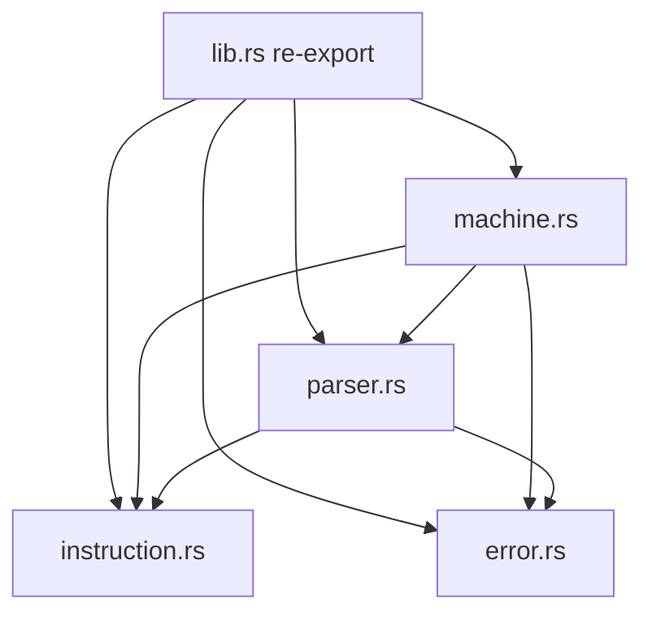
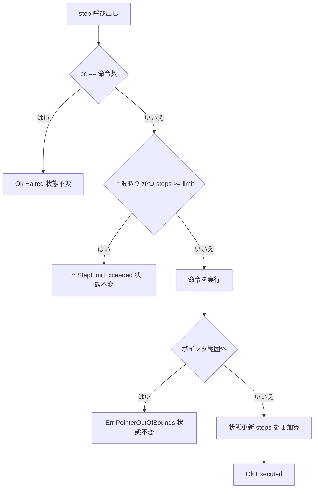

# Design Document: brainfuck-core

## Overview

`brainfuck-core` は、Brainfuck Studio の全機能が依存する「素朴インタプリタ」の実行エンジンを提供する単一 Rust crate である。8 命令・30,000 セル・`u8` ラップ・範囲外ポインタエラー・バイト I/O・EOF=0 の意味論を実装し、ソース解析(`Program::parse`)、1 命令実行(`Machine::step`)、完走実行(`Machine::run`)、状態観測(`snapshot` / `tape` / `output`)を GUI・標準入出力・ファイルシステムなしで提供する。

**Purpose**: 後続の CLI、デバッガ状態、最適化インタプリタ、コンパイラ比較に対し、出力・最終テープ・エラーの正解オラクルとなる単一の意味論を提供する。
**Users**: `brainfuck-cli`・`debugger-state`・`optimized-interpreter` の実装者と、Phase 1 受け入れ基準を検証するテスト実装者。
**Impact**: greenfield。Cargo workspace ルートと `brainfuck-core` crate を新規に作成する。

### Goals
- 仕様書 §4〜§6 の公開 API(`Program` / `Machine` / `MachineConfig` / `StepResult` / `StopReason` / `MachineSnapshot` / `ParseError` / `RuntimeError`)を実装する
- 括弧対応を解析時に一度だけ構築し、実行中に探索しない
- 外部クレート依存ゼロ・`unsafe` ゼロで、外部プロセスなしに全テストが実行できる
- 仕様書 §11 の単体・結合・回帰テストを整備する

### Non-Goals
- CLI、ファイル/標準入出力、終了コード(`brainfuck-cli`)
- ブレークポイント・キャンセル・バッチ実行・テープ表示窓・行/列変換(`debugger-state`)
- 最適化・コンパイル、テープの動的拡張、Step Back
- CLI 既定ステップ上限(10,000,000)の定義(CLI が設定する)

## Boundary Commitments

### This Spec Owns
- Cargo workspace ルート(`Cargo.toml`)と `crates/brainfuck-core` の雛形・lint 設定(`unsafe_code` 禁止)
- Brainfuck 意味論の唯一の定義: 命令遷移、`u8` ラップ、30,000 セル、EOF=0、範囲外エラー、実行数の数え方、ステップ制限の境界
- 命令列・ソースバイトオフセット・`jump_table` の生成と保持(命令添字 ↔ ソースバイトオフセットの対応)
- 公開契約: `Program` / `Instruction` / `Machine` / `MachineConfig` / `StepResult` / `StopReason` / `MachineSnapshot` / `ParseError` / `RuntimeError` / `PointerDirection` / `TAPE_SIZE`
- Parse / Runtime エラーの型区別と、機微情報を含まない `Display`
- 仕様書 §11 の core 範囲のテストとテストフィクスチャ(`.bf`)

### Out of Boundary
- 入出力の実体(ファイル、stdin/stdout)と終了コード、I/O エラー型(CLI)
- `StopReason::Breakpoint` / `Cancelled` を返す実行経路、バッチ実行、表示窓、行・列変換(debugger-state)。型バリアントの予約のみ本 spec が行う
- 最適化 IR・コンパイラ(別実装として core の意味論を参照するのみ)
- `examples/hello.bf`・README(CLI spec)。core のテストは `crates/brainfuck-core/tests/fixtures/` の独自フィクスチャを使用する

### Allowed Dependencies
- Rust 標準ライブラリ(`core` / `alloc` 相当の機能のみ。`std::fs` / `std::io` / `std::env` は使用しない)
- 外部 crate への依存は **一切追加しない**(本番・dev とも)。エラー実装は `std::error::Error` と `fmt::Display` を手書きする
- 依存方向(厳守): `error` / `instruction`(互いに非依存の葉) ← `parser` ← `machine` ← `lib`(re-export)。逆向きの import 禁止

### Revalidation Triggers
以下を変更する場合、下流 spec(cli / debugger-state / optimized-interpreter / compiler-comparison)は統合を再確認する。
- `Program`(`parse` / `parse_bytes` / `matching_bracket` を含む)/ `Machine` / `MachineConfig`(コンストラクタ) / `MachineSnapshot` / `StopReason` / `RuntimeError` / `ParseError` の公開シグネチャ・バリアント・フィールド
- 実行数の定義(`steps_executed` の加算規則)、ステップ制限の境界、停止判定(`pc == len`)
- 意味論(テープ長、セル幅、EOF 挙動、範囲外時の状態不変)
- `run()` がステップ制限をエラーで返す規約
- 命令添字 ↔ ソースバイトオフセットの対応規則

## Architecture

### Architecture Pattern & Boundary Map

純粋関数的な値型(`Program`)と、その実行状態を持つ状態機械(`Machine`)の 2 層構成。I/O は境界に持たず、入力は `Vec<u8>`、出力は `&[u8]` で受け渡す。



**Architecture Integration**:
- Selected pattern: 値型 + 状態機械(仕様書 §4 のモジュール分割を踏襲)
- Domain boundaries: `parser` は静的構造(命令・オフセット・括弧対応)のみ所有、`machine` は動的状態のみ所有
- Existing patterns preserved: なし(greenfield)。steering の `src/{lib,instruction,parser,machine,error}.rs` 構成に一致
- New components rationale: 4 モジュールは仕様書が規定。それ以上の抽象(trait、I/O 抽象)は追加しない
- Steering compliance: Tauri/stdin/fs/UI 非依存、`unsafe` 禁止、`wrapping_add/sub`、解析時のみ括弧探索

### Technology Stack

| Layer | Choice / Version | Role in Feature | Notes |
|-------|------------------|-----------------|-------|
| Language | Rust stable(開発環境 1.99.x)、edition 2021 | 実装全体 | `rust-version` は workspace に明記しない(stable 追従) |
| Dependencies | なし(std のみ) | - | `thiserror` 等は採用しない(詳細は research.md) |
| Build / Test | Cargo workspace、`cargo test --workspace` | ビルドとテスト | resolver = "2" |
| Lint | `#![forbid(unsafe_code)]` + workspace `[lints.rust] unsafe_code = "forbid"` | `unsafe` 禁止の機械的強制 | 要件 1.4 |

## File Structure Plan

### Directory Structure
```
Cargo.toml                                  # workspace ルート: members = ["crates/*"]、resolver、workspace.package、workspace.lints
crates/
└── brainfuck-core/
    ├── Cargo.toml                          # crate 定義(依存なし、[lints] workspace = true)
    ├── src/
    │   ├── lib.rs                          # #![forbid(unsafe_code)]、モジュール宣言、公開型と TAPE_SIZE の re-export(定義は machine.rs)
    │   ├── instruction.rs                  # Instruction 列挙体、バイト→命令変換
    │   ├── error.rs                        # ParseError / RuntimeError / PointerDirection、Display と std::error::Error
    │   ├── parser.rs                       # Program(命令列・オフセット・jump_table)と Program::parse
    │   └── machine.rs                      # TAPE_SIZE 定数、MachineConfig / StepResult / StopReason / MachineSnapshot / Machine
    └── tests/
        ├── common/mod.rs                   # 共通ヘルパ(run_source, machine_from 等)
        ├── parser.rs                       # 解析・オフセット・括弧対応・括弧エラー
        ├── instructions.rs                 # 8 命令、ラップ、I/O、EOF
        ├── pointer.rs                      # 境界・エラー時状態不変
        ├── loops.rs                        # スキップ・反復・ネスト・ジャンプ先
        ├── execution.rs                    # step 一命令性、停止後冪等、ステップ上限境界、run、run と step の一致
        ├── observation.rs                  # snapshot / tape / output / エラー Display
        ├── integration.rs                  # Hello World、エコー
        ├── regression.rs                   # tests/regression/*.bf を include_str! で読む回帰テスト
        ├── fixtures/
        │   ├── hello.bf                    # "Hello World!\n" を出力する標準プログラム
        │   └── echo.bf                     # ,[.,]
        └── regression/                     # 発見した不具合ごとの最小 .bf(初期は規約実証用の loop_end_halts.bf 1 件)
```

> `Cargo.lock` は workspace ルートで生成される(バイナリ crate が後続 spec で追加されるためコミット対象)。`.gitignore` は既に `target` を除外済みで変更不要。

### Modified Files
- なし(greenfield)。既存の `README.md` は CLI spec の担当であり本 spec では変更しない

## System Flows

### `step()` の決定フロー



判定順序の決定: **停止判定 → 上限判定 → 命令実行**。この順序により「ちょうど上限と同数の命令で終了するプログラムは正常終了」(10.5)、「上限 0 かつ空プログラムは停止」(10.8)、「上限到達かつ未停止ならエラー」(10.3)が成立する。命令実行は「検証 → 状態更新」の 2 段で行い、エラーは検証段で返すため状態不変が構造的に保証される(5.5, 9.7)。

## Requirements Traceability

| Requirement | Summary | Components | Interfaces | Flows |
|-------------|---------|------------|------------|-------|
| 1.1, 1.6 | workspace 構成、契約の後方互換拡張 | Workspace, lib.rs | `#[non_exhaustive]` 付き公開型 | - |
| 1.2, 1.3, 1.4, 1.5 | 非依存・バイト列境界・unsafe 禁止・外部プロセス不要 | Workspace, Machine | `Machine::new(program, input, config)`、lint 設定 | - |
| 2.1, 2.2, 2.5 | 有効命令抽出、コメント無視、空プログラム | Program, Instruction | `Program::parse`, `Instruction::from_byte` | - |
| 2.3, 2.4, 2.6, 2.7 | バイトオフセット対応・問い合わせ | Program | `source_offset(index) -> Option<usize>`, `source_offsets()` | - |
| 2.8 | 非 UTF-8 バイト列の解析 | Program | `Program::parse_bytes(&[u8])` | - |
| 3.1, 3.2, 3.3 | 括弧対応の解析時構築 | Program | `matching_bracket(index)`(内部表は crate 内部のみ) | - |
| 3.4, 3.5, 3.6, 3.7 | 括弧エラーと決定的規則 | Program, ParseError | `ParseError::{UnmatchedClosingBracket, UnmatchedOpeningBracket}` | - |
| 4.1, 4.2, 4.3, 4.4, 4.5 | 初期状態・固定テープ・独立性 | Machine | `Machine::new`, `TAPE_SIZE` | - |
| 5.1, 5.2, 5.3, 5.4, 5.5, 5.6 | ポインタ移動・範囲外・状態不変 | Machine, RuntimeError | `RuntimeError::PointerOutOfBounds`, `PointerDirection` | step 決定フロー |
| 6.1, 6.2, 6.3, 6.4, 6.5 | セル演算とラップ | Machine | `step` | - |
| 7.1, 7.2, 7.3, 7.4, 7.5, 7.6 | バイト I/O と EOF=0 | Machine | `step`, `output()` | - |
| 8.1, 8.2, 8.3, 8.4, 8.5, 8.6, 8.7, 8.8 | ループ分岐・ジャンプ先 | Machine, Program | `step`, `matching_bracket`(Machine は crate 内部の括弧対応表を参照) | - |
| 9.1, 9.2, 9.3, 9.4, 9.5, 9.6, 9.7, 9.8 | 一命令性・停止・冪等・実行数 | Machine | `step`, `StepResult` | step 決定フロー |
| 10.1, 10.2, 10.3, 10.4, 10.5, 10.6, 10.7, 10.8, 10.9 | ステップ制限 | Machine, MachineConfig, RuntimeError | `MachineConfig.max_steps`, `RuntimeError::StepLimitExceeded` | step 決定フロー |
| 11.1, 11.2, 11.3, 11.4, 11.5, 11.8 | `run` と step との一致 | Machine | `run() -> Result<StopReason, RuntimeError>` | step 決定フロー |
| 11.6, 11.7 | 停止理由の種別と予約 | StopReason | `StopReason::{Halted, StepLimitReached, Breakpoint, Cancelled}` | - |
| 12.1, 12.2, 12.5, 12.6, 12.7 | スナップショット | Machine, MachineSnapshot | `snapshot()`, `is_halted()` | - |
| 12.3, 12.4 | テープ・出力の読み取り専用参照 | Machine | `tape() -> &[u8]`, `output() -> &[u8]` | - |
| 13.1, 13.2, 13.3, 13.8 | エラー型の区別と標準エラー | ParseError, RuntimeError | `impl Error`, `impl Display` | - |
| 13.4, 13.5, 13.6, 13.7 | 診断情報と機微情報の除外 | ParseError, RuntimeError | `Display` 文面(数値フィールドのみ) | - |
| 14.1, 14.2, 14.3, 14.4, 14.5, 14.6, 14.7, 14.8 | テスト | tests/ 一式 | `tests/common`、`tests/regression/*.bf` | - |

## Components and Interfaces

| Component | Domain/Layer | Intent | Req Coverage | Key Dependencies | Contracts |
|-----------|--------------|--------|--------------|------------------|-----------|
| Workspace | Build | workspace と lint 設定の提供 | 1.1, 1.2, 1.4, 1.5 | なし | - |
| Instruction | Domain | 8 命令の列挙と文字→命令変換 | 2.1, 2.2 | なし | Service |
| Error types | Domain | Parse / Runtime エラーと診断文 | 3.4, 3.5, 5.3, 5.4, 10.3, 13.1-13.8 | std::fmt, std::error | Service |
| Program | Domain | 命令列・オフセット・jump_table の保持 | 2.1-2.8, 3.1-3.7 | Instruction (P0), ParseError (P0) | Service |
| Machine | Domain | 実行状態と step/run/観測 | 4.1-12.7 | Program (P0), RuntimeError (P0) | Service, State |
| Test suite | QA | 仕様書 §11 の検証 | 14.1-14.8 | 全 Component (P0) | - |

### Domain

#### Instruction

| Field | Detail |
|-------|--------|
| Intent | 有効 8 文字を型として表現する |
| Requirements | 2.1, 2.2 |

**Responsibilities & Constraints**
- 命令は 8 バリアントのみ。ソース位置は保持しない(位置は `Program` が並列配列で保持する)

##### Service Interface
```rust
#[derive(Debug, Clone, Copy, PartialEq, Eq, Hash)]
pub enum Instruction {
    MoveRight, MoveLeft, Increment, Decrement,
    Output, Input, LoopStart, LoopEnd,
}

impl Instruction {
    /// ASCII バイトを命令へ変換する。8 文字以外は None(コメント)。
    pub fn from_byte(byte: u8) -> Option<Instruction>;
    /// 対応するソース文字(`>` `<` `+` `-` `.` `,` `[` `]`)。
    pub fn as_char(self) -> char;
}
```
- Preconditions: なし
- Postconditions: `from_byte(b'+') == Some(Increment)` など 8 文字のみ Some。`from_byte(x).map(as_char)` は元の文字に一致
- Invariants: 非 ASCII バイト(0x80 以上)は常に None

#### Error types

| Field | Detail |
|-------|--------|
| Intent | Parse と Runtime のエラーを型で区別し、位置と原因を持つ診断を提供する |
| Requirements | 3.4, 3.5, 5.3, 5.4, 10.3, 13.1, 13.2, 13.3, 13.4, 13.5, 13.6, 13.7, 13.8 |

**Responsibilities & Constraints**
- フィールドは数値(添字、オフセット、`pc`、`dp`、上限)と列挙値のみ。ソース文字列、入力バイト列、パスを一切保持しない(13.7)
- `Display` は英語の固定文面(CLI が標準エラーへそのまま表示可能)。`std::error::Error` を実装(`source()` は None)

##### Service Interface
```rust
#[derive(Debug, Clone, Copy, PartialEq, Eq)]
pub enum PointerDirection { Left, Right }

#[derive(Debug, Clone, Copy, PartialEq, Eq)]
#[non_exhaustive]
pub enum ParseError {
    /// 対応する `[` を持たない `]`。走査中に最初に見つかった位置。
    UnmatchedClosingBracket { instruction_index: usize, source_offset: usize },
    /// 解析終了時に残った未解決 `[` のうち最初のもの。
    UnmatchedOpeningBracket { instruction_index: usize, source_offset: usize },
}

#[derive(Debug, Clone, Copy, PartialEq, Eq)]
#[non_exhaustive]
pub enum RuntimeError {
    /// 範囲外移動。発生時の pc / dp と移動方向。状態は変更されない。
    PointerOutOfBounds { pc: usize, dp: usize, direction: PointerDirection },
    /// 上限到達済みで未停止。実行済み数は常に limit に等しい。
    StepLimitExceeded { limit: u64, pc: usize },
}
// ParseError / RuntimeError は fmt::Display と std::error::Error を実装、PointerDirection は Display のみ実装
```
- Display 文面の規約(テストで固定): 先頭に原因(`unmatched closing bracket` / `unmatched opening bracket` / `data pointer out of bounds` / `step limit exceeded`)、続けて `instruction #N`、`source offset N`、`pc=N`、`dp=N`、`direction=left|right`、`limit=N` を含む
- 実行済み数(§10)は `StepLimitExceeded` で `limit` と等しいため文面に `after N steps` として `limit` を表示する(フィールド追加は不要)

**Implementation Notes**
- Integration: CLI は `ParseError` → 終了コード 2、`RuntimeError` → 3 に対応付ける(対応付けは CLI の責務)
- Risks: `#[non_exhaustive]` により下流の `match` はワイルドカード必須。意図的(後方互換拡張のため)

#### Program

| Field | Detail |
|-------|--------|
| Intent | 解析済みの不変プログラム。命令列、各命令のソースバイトオフセット、括弧対応表を保持する |
| Requirements | 2.1-2.8, 3.1-3.7, 8.1, 8.3 |

**Responsibilities & Constraints**
- 不変(構築後に変更不可)。`parse` / `parse_bytes` が成功した `Program` は括弧が完全に対応していることを型の不変条件として保証する(3.6)
- `jump_table.len() == instructions.len()`。`[` の要素は対応する `]` の命令添字、`]` の要素は対応する `[` の命令添字。括弧以外の要素の値は未規定。表は **crate 内部専用**(`pub(crate)`)で、`Machine` だけが括弧命令の位置でのみ読む。外部(後続 crate)は `matching_bracket` 経由でのみ参照でき、括弧以外の値を読む経路は存在しない
- 走査は **バイト単位**で行う。8 命令文字は ASCII であり UTF-8 の継続バイトと衝突しないため、`char` 走査と同結果で、オフセットは自然にバイト位置になる(2.4)
- 解析の実体は `parse_bytes(&[u8])` に置き、`parse(&str)` は `source.as_bytes()` を渡して委譲する。0x80 以上のバイトは常にコメントなので、非 UTF-8 のソース(旧エンコーディングのコメント等)を呼び出し側が前処理せずに解析でき、報告されるオフセットは入力バイト列上の実位置になる(2.8)
- 構築: スタックで未解決の `[` の命令添字を保持。`]` でスタックが空なら即座に `UnmatchedClosingBracket`。終了時にスタックが空でなければ **スタックの底(最初に積まれた=最も早い未解決 `[`)**の位置で `UnmatchedOpeningBracket`(3.5, 3.7)

##### Service Interface
```rust
#[derive(Debug, Clone, PartialEq, Eq)]
pub struct Program { /* instructions, source_offsets, jump_table (private) */ }

impl Program {
    /// 文字列を解析する。`parse_bytes(source.as_bytes())` と同一。
    pub fn parse(source: &str) -> Result<Program, ParseError>;
    /// UTF-8 を要求しないバイト列を解析する。8 命令の ASCII バイト以外はすべてコメント。
    pub fn parse_bytes(source: &[u8]) -> Result<Program, ParseError>;
    pub fn instructions(&self) -> &[Instruction];
    pub fn len(&self) -> usize;
    pub fn is_empty(&self) -> bool;
    /// 命令添字に対応するソースバイトオフセット。範囲外は None。
    pub fn source_offset(&self, instruction_index: usize) -> Option<usize>;
    pub fn source_offsets(&self) -> &[usize];
    /// 括弧命令の対応先の命令添字。括弧以外または範囲外は None。
    pub fn matching_bracket(&self, instruction_index: usize) -> Option<usize>;
    // 括弧対応表(`jump_table`)の全体参照は公開しない。`Machine` が使う
    // `pub(crate) fn jump_table(&self) -> &[usize]` は crate 内部専用で、
    // 括弧以外の要素の値は未規定(公開 API から読めないため契約にならない)。
}
```
- Preconditions: `parse` の入力は任意の `&str`、`parse_bytes` の入力は任意のバイト列
- Postconditions: `source_offsets()` は厳密単調増加で、各要素は元ソース上でその命令文字が現れる位置。`matching_bracket` は対称(`matching_bracket(matching_bracket(i)) == i`)。有効な UTF-8 のバイト列に対し `parse_bytes(s.as_bytes())` と `parse(s)` の結果(`Program` / `ParseError`)は等しい
- Invariants: 実行中に括弧を探索する API は存在しない

#### Machine

| Field | Detail |
|-------|--------|
| Intent | 1 つの `Program` の実行状態を保持し、1 命令実行・完走実行・観測を提供する |
| Requirements | 4.1-4.5, 5.1-5.6, 6.1-6.5, 7.1-7.6, 8.1-8.8, 9.1-9.8, 10.1-10.9, 11.1-11.8, 12.1-12.7 |

**Responsibilities & Constraints**
- 状態: `program: Program`、`tape: Box<[u8; TAPE_SIZE]>`、`pc: usize`、`dp: usize`、`steps_executed: u64`、`output: Vec<u8>`、`input: Vec<u8>`、`input_pos: usize`、`config: MachineConfig`
- 停止判定は `pc == program.len()` のみ(別フラグを持たず二重管理を避ける)
- 命令実行は「検証 → 状態更新」の 2 段。エラーは検証段で返し、`pc` / `dp` / テープ / 出力 / `input_pos` / `steps_executed` を一切変更しない
- セル演算は `wrapping_add(1)` / `wrapping_sub(1)`。`>` は `dp == TAPE_SIZE - 1` で、`<` は `dp == 0` で `PointerOutOfBounds`
- `[`: セル 0 → `pc = jump[pc] + 1`、非 0 → `pc + 1`。`]`: セル非 0 → `pc = jump[pc] + 1`、0 → `pc + 1`。ジャンプ先は添字の算術のみ(探索なし)。`jump[pc] + 1` が `program.len()` になる場合は停止状態(8.8)
- `steps_executed` は成功した命令実行の最後に `saturating_add(1)`(u64 の実到達は不可能だが debug ビルドでの panic を避ける)
- `Machine` は `Clone` / `Debug` / `PartialEq` / `Eq` を実装(状態不変テストの比較に使用。30KB 程度の複製で許容)

**Dependencies**
- Inbound: brainfuck-cli, debugger-state, optimized-interpreter(テスト) — 実行と観測 (P0)
- Outbound: Program — 命令・括弧対応の参照 (P0); RuntimeError — エラー返却 (P0)
- External: なし

**Contracts**: Service [x] / State [x]

##### Service Interface
```rust
pub const TAPE_SIZE: usize = 30_000;

#[derive(Debug, Clone, Copy, PartialEq, Eq)]
#[non_exhaustive]
pub struct MachineConfig {
    /// None は制限なし。値 N は「N 個の命令を実行した後、未停止なら次の命令を実行しない」。
    pub max_steps: Option<u64>,
}
impl MachineConfig {
    pub const fn unlimited() -> Self;
    pub const fn with_max_steps(limit: u64) -> Self;
}
// Default は実装しない: 上限の有無を呼び出し側が明示する(CLI/GUI が既定値を設定する)。
// `#[non_exhaustive]` により外部 crate は構造体リテラルで構築できず、必ず上記コンストラクタを使う。
// 読み取り(`config.max_steps`)は引き続き可能。将来フィールドを追加しても下流は壊れない(1.6)。

#[derive(Debug, Clone, Copy, PartialEq, Eq)]
pub enum StepResult { Executed, Halted }

#[derive(Debug, Clone, Copy, PartialEq, Eq)]
#[non_exhaustive]
pub enum StopReason { Halted, StepLimitReached, Breakpoint, Cancelled }

#[derive(Debug, Clone, Copy, PartialEq, Eq)]
#[non_exhaustive]
pub struct MachineSnapshot {
    pub pc: usize,
    pub data_pointer: usize,
    pub current_cell: u8,
    pub steps_executed: u64,
    pub halted: bool,
}

impl Machine {
    pub fn new(program: Program, input: Vec<u8>, config: MachineConfig) -> Machine;
    pub fn step(&mut self) -> Result<StepResult, RuntimeError>;
    pub fn run(&mut self) -> Result<StopReason, RuntimeError>;
    pub fn snapshot(&self) -> MachineSnapshot;
    pub fn tape(&self) -> &[u8];          // 長さ TAPE_SIZE
    pub fn output(&self) -> &[u8];
    pub fn is_halted(&self) -> bool;
    pub fn program(&self) -> &Program;    // デバッガが命令添字→オフセット変換に使用
    pub fn input_position(&self) -> usize; // 読取済みバイト数(状態観測・テスト用)
}
```
- Preconditions: `Machine::new` は任意の `Program` / 入力 / 設定を受け付ける(失敗しない)
- Postconditions:
  - `step()`: 停止済み → `Ok(Halted)` で状態不変。上限到達済み未停止 → `Err(StepLimitExceeded { limit, pc })` で状態不変。それ以外は命令 1 個を実行し `steps_executed + 1` で `Ok(Executed)`。範囲外 → `Err(PointerOutOfBounds { pc, dp, direction })` で状態不変
  - `run()`: `step()` を `Executed` の間繰り返し、`Halted` で `Ok(StopReason::Halted)`。`Err` は即座に伝播し、その時点の状態は保持される(11.4)。停止済みなら状態不変で `Ok(Halted)`(11.5)
  - `snapshot()`: 状態を変更しない。`halted == (pc == program.len())`。`current_cell == tape[dp]`
- Invariants: `dp <= TAPE_SIZE - 1`、`pc <= program.len()`、`input_pos <= input.len()`、ステップ上限エラー後も再度 `step()` すると同一エラー(10.9)
- **`StopReason::StepLimitReached` の扱い(決定)**: 仕様書 §12-5 は上限到達を「エラーを返す」と規定し、CLI の終了コード 3(実行エラー)にも対応するため、`run()` は上限到達を `Err(RuntimeError::StepLimitExceeded)` で返し、`StepLimitReached` は **返さない**。このバリアントは型としてのみ存在し、`debugger-state` のバッチ実行(バッチ上限到達の通知)が利用できる契約として予約する。`Breakpoint` / `Cancelled` も同様に予約(11.6, 11.7)
- **終了通知の 2 つの規約(明文化)**: 同じ「命令数の上限に達した」出来事が層によって異なる形で現れる。取り違えを防ぐため、`StopReason` と `Machine::run` の rustdoc に次の表を載せる(5.1 で確認)。

  | 層 | 上限の種類 | 通知の形 |
  |----|-----------|----------|
  | core `Machine::run` | `MachineConfig.max_steps`(総実行数の上限) | `Err(RuntimeError::StepLimitExceeded)` |
  | debugger-state のバッチ | バッチ幅(1 回の呼び出しの実行数) | `Ok(StopReason::StepLimitReached)` |

  core の `run()` が `Ok` で返す `StopReason` は常に `Halted` である(他のバリアントは debugger-state だけが返す)。下流は core 由来の `Err(StepLimitExceeded)` を「実行エラー(終了コード 3)」、バッチ由来の `StepLimitReached` を「続行可能な中断」として区別する

##### State Management
- State model: 上記フィールド。外部から直接書き換える API は提供しない(`Machine::new` と `step` / `run` のみが状態を遷移させる)
- Persistence & consistency: メモリ内のみ。エラー時の状態不変を「検証 → 更新」の分離で保証
- Concurrency strategy: `&mut self` の排他借用のみ。内部可変性・スレッド共有なし

**Implementation Notes**
- Integration: 後続 spec は `snapshot()` / `tape()` / `output()` / `program()` / `input_position()` で観測し、機械内部へ書き込まない。`debugger-state` は別型を追加するか `#[non_exhaustive]` 型へ項目を追加して拡張する
- Validation: 入力と出力は `Vec<u8>` のバイト列で、UTF-8 検証・変換を行わない(7.4, 7.5)
- Risks: `run()` は無制限設定 + 無限ループで終了しない。呼び出し側(CLI)が既定上限を設定する責務を負う。core のドキュメントコメントに明記する

### QA

#### Test suite

| Field | Detail |
|-------|--------|
| Intent | 仕様書 §11 を自動テストで検証し、後続 spec のオラクルの信頼性を担保する |
| Requirements | 14.1-14.8 |

- `tests/common/mod.rs`: `machine_from(source, input, config) -> Machine` の共有ヘルパ。状態の完全一致比較用に `assert_same_state(actual: &Machine, expected: &Machine)`(snapshot / tape / output / input_position 等を比較)を提供
- `tests/regression.rs`: `tests/regression/*.bf` を `include_str!` で読み、各ファイルに対応するテスト関数を持つ規約。初期ケースとして規約の実証用に `+[-]`(末尾 `]` で停止、8.8)を 1 件置く。不具合ごとに「最小 `.bf` + 対応テスト関数 + コメントで事象を記述」を追加(14.7)

## Data Models

### Domain Model
- `Program`(値オブジェクト・不変): `instructions[i]` / `source_offsets[i]` / `jump_table[i]` の 3 並列配列。添字 `i` は「命令添字」で、全 spec が共通に使う座標系
- `Machine`(エンティティ・可変): `Program` を所有。状態遷移は `step` のみ(`run` はその反復)
- 不変条件: 停止 ⇔ `pc == len`。エラーは状態を変更しない。`steps_executed` = 成功した `step`(`Executed`)の累計

## Error Handling

### Error Strategy
- 解析エラーは `Program::parse` の戻り値でのみ発生し、実行可能な `Program` は括弧整合が保証されるため、`Machine` は括弧不一致を扱わない(3.6)
- 実行エラーは `step` / `run` の戻り値でのみ発生。panic は使用しない(配列添字は上記不変条件で安全。`jump_table` 参照は解析済みの括弧に対してのみ行う)
- 診断文は数値と列挙値のみ。ソース断片・入力・パスは含めない(13.7)

### Error Categories and Responses
- **Parse**: 閉じ括弧不一致 / 開き括弧不一致 → 種類、命令添字、ソースバイトオフセット
- **Runtime**: ポインタ範囲外 → `pc`、`dp`、方向。ステップ制限超過 → `limit`、`pc`。いずれも状態不変で、呼び出し側は観測 API で到達状態を取得できる
- **I/O**: 本 spec の対象外(CLI)

## Testing Strategy

### Unit / Integration Tests(`crates/brainfuck-core/tests/`)
- **parser.rs**(14.1): `"a+b>c"` の命令抽出と順序、マルチバイト文字を挟んだバイトオフセット(例 `"あ+"` で `+` のオフセットが 3)、ネスト `[[]]` の `matching_bracket`(内側から対応)、`"]"` / `"[]]"` の `UnmatchedClosingBracket`(添字・オフセット)、`"[["` / `"[[]"` の `UnmatchedOpeningBracket`(最初の未解決 `[`)、空・コメントのみの入力、範囲外 `source_offset` が None、`parse_bytes` の非 UTF-8 バイト(0xFF / 0x80 以上の全値)がコメント扱いで失敗しないこと・後続の括弧エラーが入力バイト列上の実オフセットを示すこと・有効 UTF-8 では `parse` と結果が等しいこと(2.8)
- **instructions.rs**(14.2): 8 命令それぞれの `pc` / `dp` / セル / 出力 / `steps` の遷移、255+1=0、0-1=255、入力 1 バイト格納、EOF で 0 格納、非 UTF-8 バイト(0xFF 等)が出力にそのまま残る
- **pointer.rs**(14.3): `dp=0` で `<`、`dp=29999` で `>` が `PointerOutOfBounds`(`pc` / `dp` / 方向を検証)、エラー前後で `Machine` が `==`(状態不変)、0→29999→0 の往復成功
- **loops.rs**(14.4): セル 0 の `[` スキップ(スキップ内命令が `steps` に加算されない)、反復回数と `steps` の正確な値、ネスト、ジャンプ先が対応括弧の **次** であること(`pc` の値で確認)、末尾 `]` からの終了(8.8)
- **execution.rs**(14.5): 1 回の `step` で `steps` がちょうど +1、コメント文字はステップにならない、停止後 `step` を複数回呼んでも状態不変かつ `Ok(Halted)`、空プログラム、`max_steps = N-1 / N / N+1` の境界(ちょうど N 命令のプログラムで N は成功・N-1 はエラー、`limit` と `pc` を検証)、`max_steps = Some(0)`(空/非空)、エラー後の再 `step` が同一エラー、`run` のエラー中断後の観測、`run` と `step` 反復の最終状態一致(11.8)、停止済み `run` の冪等
- **observation.rs**: `snapshot` の各フィールドと `halted`、`tape().len() == TAPE_SIZE`、`Display` 文面に原因・数値が含まれ、ソース文字列や入力バイト列が含まれないこと(13.4-13.7)、`Error` トレイトとして `Box<dyn Error>` へ変換できること(13.8)
- **integration.rs**(14.6): `fixtures/hello.bf` で出力が `b"Hello World!\n"`、`fixtures/echo.bf`(`,[.,]`)に 0x01〜0xFF(0xFF を含む)のバイト列を与えて同一バイト列が出力され EOF で停止。入力中の 0x00 は EOF と同じくセルが 0 になるためループを抜けて停止する(0x00 を含む任意バイト列の同一出力は原理的に不可能)
- **regression.rs**(14.7): 追加規約と、規約の実証用の初期ケース 1 件(`+[-]` が末尾 `]` 後に停止すること)。以降は不具合発生ごとに追加

### Performance
- 通常の `cargo test --workspace` では性能ベンチマークを実行しない(ベンチマークは optimized-interpreter が正規テストと分離して扱う)。ただし 10,000,000 ステップ級の `run` を使うテストは作らず、ステップ上限テストは小さな上限値(0 / 1 / 数十)で行う

## Security Considerations

- 任意ソースは信頼しない入力: テープ 30,000 セル固定、外部入力でメモリ量が決まらない(`Program` の大きさはソース長に比例するのみ)。ステップ上限は呼び出し側が設定し、core は上限の強制を担う(10 の要件)
- `unsafe` はコード(`#![forbid(unsafe_code)]`)と workspace lint の二重で禁止(1.4)
- エラー型は数値と列挙値のみで、入力バイト列・ソース全文・絶対パスを保持しない(13.7)
