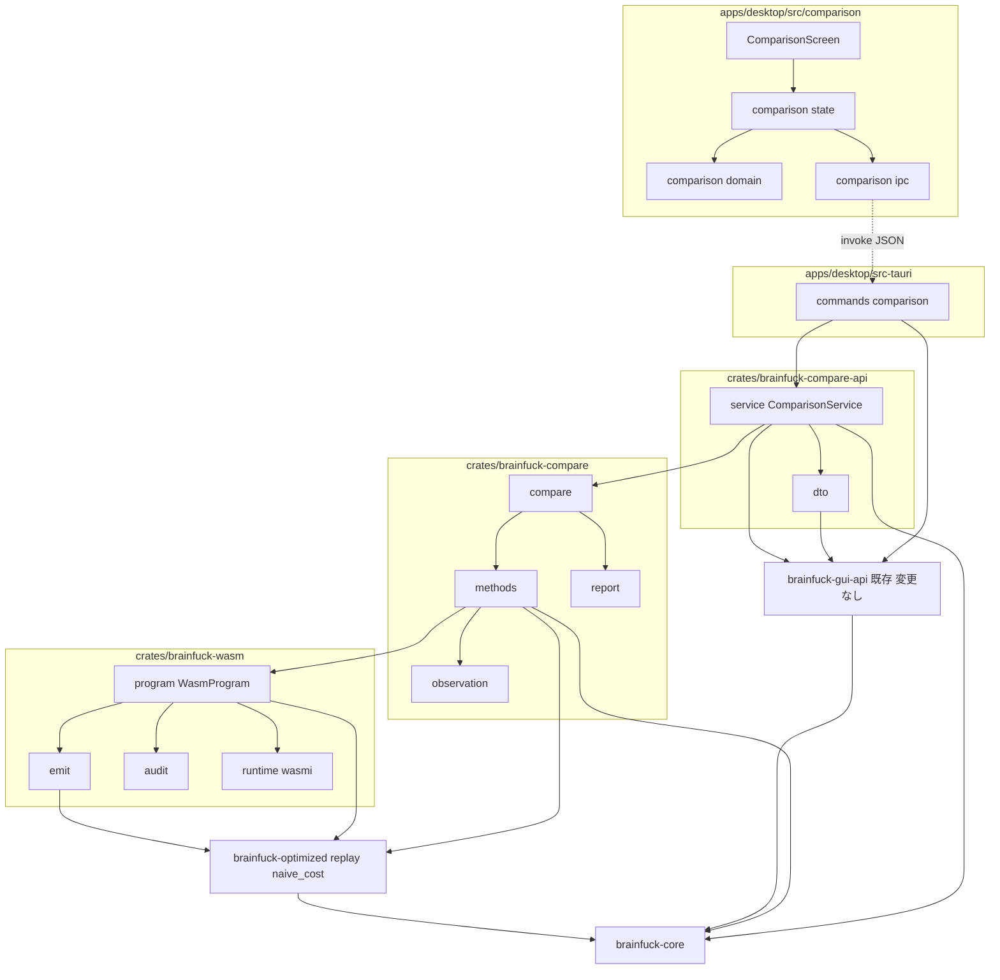
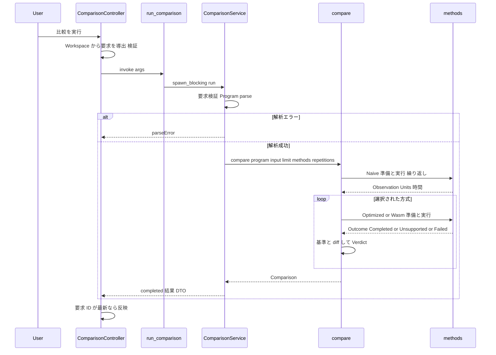
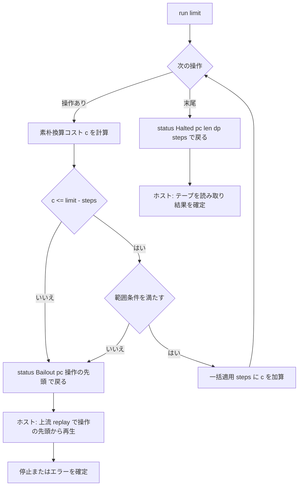

# Design Document: compiler-comparison

## Overview

`compiler-comparison` は、Phase 4 として **WASM コンパイル実行方式**を追加し、同一のプログラム・入力・命令数上限を 素朴インタプリタ / 最適化インタプリタ / WASM の 3 方式で実行した結果を、`desktop-gui` に追加する「比較」画面で並べて観察できるようにする。WASM 方式は最適化 IR(`optimized-interpreter` の `OptimizedProgram`)から WASM バイナリを生成し、`wasmi`(インタプリタ)上で、import が入出力 2 つだけのサンドボックスとして実行する。結果は素朴インタプリタと**完全状態一致**(エラー値・エラー時点の状態・実行数を含む)し、実行のたびにオラクルとの一致判定を行って画面に示す。

**Purpose**: 実行方式による準備時間・実行時間・実行数・終了状態の差を、一致の保証つきで学習・比較できる。
**Users**: 学習者(比較画面)、比較画面の保守者、Phase 4 受け入れ基準を検証するテスト実装者。
**Impact**: workspace に crate `crates/brainfuck-wasm`(生成・監査・隔離実行。離脱後の再生は上流 `brainfuck_optimized::replay` を呼ぶ)、`crates/brainfuck-compare`(観測・方式実行・比較・メトリクス)、`crates/brainfuck-compare-api`(比較用 DTO・`ComparisonService`・ts-rs 生成。`brainfuck-compare` と `brainfuck-gui-api` に一方向で依存)を追加する。`apps/desktop` に比較コマンドと比較画面を**追加のみ**で足す(`desktop-gui` の拡張点に従う)。`brainfuck-gui-api` は**変更しない**ため、デバッガ API は WASM・`wasmi` 等の重い依存を持たない(ユーザー決定: spec は分割せず、crate で分離する)。`brainfuck-core` / `brainfuck-optimized` / 既存コマンド / デバッガ画面も変更しない。

### 方式の確定(WASM か ネイティブ AOT か)
**WASM を採用し、ネイティブ AOT は採用しない。** 実行エンジンは `wasmi`(インタプリタ)。理由(詳細は `research.md`):
- ネイティブ AOT は、外部のコンパイラ起動(要件 5.4 に反し、任意コード実行の非目標に近接)か、機械語の生成と実行(`unsafe` と実行可能メモリが必須。`unsafe` 禁止・JIT スコープ外に反する)のいずれかを要する
- WASM は外部との接点が宣言された import のみで、生成物を機械的に監査でき、`unsafe` を自コードに含めずに済む
- `wasmi` は実行時に機械語を生成せず、燃料計測とメモリ制限を標準で持つ。実行時間の優劣は保証対象外のため、`wasmtime` より低速でも許容する(エンジンは `runtime.rs` に隔離し、差し替え可能)

### Goals
- 要件 1〜14 を満たす WASM 方式と、3 方式の比較画面
- 素朴インタプリタとの完全状態一致(命令数上限の操作途中の境界、ポインタ範囲外、入出力を含む)を、生成コードの事前検査 + ホスト再生で構造的に達成し、差分テストと実行時の一致判定で二重に検証する
- 能力の限定(import は入出力のみ)、メモリ固定、命令数上限の厳密適用、燃料による第二の防御を持つサンドボックス方針
- `cargo test --workspace` が WebView やフロントのビルド成果物なしで成功する構成
- デバッガ API(`brainfuck-gui-api`)を重い依存(WASM 生成・実行系)から隔離する。比較の契約とサービスは別 crate に置く
- 素朴意味論の再生・コスト式・テープ窓・出力チャンクの変換を、上流の公開部品から再利用し、複製しない

### Non-Goals
- ネイティブ AOT、JIT、`wasmtime` 等の機械語生成エンジン、IR を超える最適化、成果物の配布
- 比較中のステップ実行 / ブレークポイント / 一時停止、結果の永続化・エクスポート・履歴
- 実行時間の優劣・順位の判定、性能の保証
- 上限なしの比較、外部が供給する WASM / コードの実行

## Boundary Commitments

### This Spec Owns
- crate `crates/brainfuck-wasm`: IR → WASM のコード生成、生成物の方針監査、`wasmi` 上のサンドボックス実行(燃料・メモリ・出力量の制限)、離脱後の再生の統括(線形メモリの状態を上流 `brainfuck_optimized::replay` へ渡して読み戻す接続のみ。再生の意味論は持たない)、`WasmProgram` / `WasmRun`
- crate `crates/brainfuck-compare`: `Observation`(完全状態の観測値)と差分、3 方式の実行、繰り返し・中央値・メトリクス、基準との一致判定、総合結果、比較用の上限値
- 実行数の表示定義: 全方式の「素朴実装換算の実行数」+ 方式固有の単位(素朴 = 実行命令数、最適化 = IR 操作回数、WASM = なし)
- crate `crates/brainfuck-compare-api`: 比較用 DTO(`dto.rs`)、`ComparisonService`(`service.rs`)、ts-rs 生成物の書き出しと一致検査(比較用 DTO のファイルのみが対象)、`brainfuck-gui-api` が比較・WASM 系の依存を持たないことの自動検査
- Tauri コマンド `get_comparison_info` / `run_comparison` と、フロントの比較画面(`apps/desktop/src/comparison/`)
- 方式選定・サンドボックス方針・使い方を説明する文書 `docs/compiler-comparison.md`

### Out of Boundary
- 基準意味論(命令遷移、テープ長、EOF、範囲外、上限境界、`step()` の判定順序)— `brainfuck-core`。IR の定義と最適化 — `brainfuck-optimized`。本 spec は参照のみ
- デバッガ画面・既存コマンド(`load_source` ほか)・既存 DTO・`DebuggerService`・`Workspace` の定義 — `desktop-gui`。本 spec は拡張点を使って追加するのみ
- 素朴意味論の再生・操作の素朴換算コストと到達範囲の式(`optimized-interpreter` の公開 `replay` と `Op::naive_cost` / `Op::static_reach`)、テープ窓(`debugger-state` の `tape_window_of`)、出力チャンク・各 DTO 変換・Base64・`limits`(`desktop-gui` の `brainfuck-gui-api`)の実装。本 spec は呼ぶだけで、複製しない
- `brainfuck-gui-api` の変更(`Cargo.toml`・ソース・`export_bindings`・`bindings_up_to_date` を含め一切触れない)。再利用に必要な公開項目が欠ける場合は `desktop-gui` の公開項目として扱う(Revalidation Triggers)
- ネイティブ AOT、JIT、`wasmtime` 採用、外部ツールチェーン起動
- `.kiro/steering/` の変更、ルート `Cargo.toml` の変更(`members = ["crates/*"]` が新 crate を自動で取り込む)

### Allowed Dependencies
- Rust ワークスペース内(依存方向、厳守): `brainfuck-core` ← `brainfuck-optimized` ← `brainfuck-wasm` ← `brainfuck-compare` ← `brainfuck-compare-api` ← `apps/desktop/src-tauri`。あわせて `brainfuck-core` ← `brainfuck-gui-api` ← `brainfuck-compare-api`(`brainfuck-compare-api` が `brainfuck-compare` と `brainfuck-gui-api` の双方に一方向で依存する。どちらも `brainfuck-compare-api` に依存しない)。`src-tauri` は `brainfuck-gui-api` と `brainfuck-compare-api` の双方に path 依存する。**`brainfuck-gui-api` は `brainfuck-compare` / `brainfuck-wasm` / `brainfuck-optimized` / `wasmi` / `wasm-encoder` / `wasmparser` のいずれにも依存しない**(`cargo tree -p brainfuck-gui-api` と `brainfuck-compare-api` のテストで検証)。逆向きの依存は禁止。`brainfuck-compare` は `brainfuck-core`・`brainfuck-optimized`・`brainfuck-wasm` の公開 API のみ。`brainfuck-compare-api` は `brainfuck-compare`、`brainfuck-gui-api` の公開 API(`ApiError`・共通 DTO・`convert`・`codec`・`limits`・テストでの `DebuggerService`)、`brainfuck-core` の公開 API(`Program`・`tape_window_of`・`DEFAULT_WINDOW_RADIUS`)のみを用い、`brainfuck-wasm` / `brainfuck-optimized` を直接 import しない
- 外部 crate(本 spec が追加する外部依存): `wasm-encoder`(生成)、`wasmparser`(監査。`wasm-encoder` と同一リリース系列)、`wasmi`(実行)— いずれも `brainfuck-wasm` のみが依存。`brainfuck-compare` は外部 crate を追加しない。`brainfuck-compare-api` は `serde` / `ts-rs`(`brainfuck-gui-api` と同一バージョン)と、テスト用の `serde_json`(dev-dependency。gui-api・ルートのロックと同一バージョン)のみ。新しい外部 crate なし。テスト用の追加外部 crate もなし(擬似乱数は自前 xorshift)。`src-tauri` の専用 `Cargo.lock` には上記が推移的に加わるため、`serde` / `ts-rs` / `wasmi` / `wasm-encoder` / `wasmparser` はルートの `Cargo.lock` と同一バージョンに揃える
- `brainfuck-wasm` 内の依存方向: `limits` / `abi` / `error` ← `emit` / `audit` / `runtime`(3 者は互いに import しない)← `program`(統括。`emit` → `audit` → `runtime` のロード、実行後の離脱時のみ上流 `brainfuck_optimized::replay` を呼ぶ)← `lib`(re-export)。`wasmi` の型は `runtime.rs` の外へ出さない。素朴意味論の再生コードは持たない(`replay.rs` は存在しない)
- `brainfuck-compare` 内の依存方向: `limits` / `observation` / `report` ← `methods` ← `compare` ← `lib`
- `brainfuck-compare-api` 内の依存方向: `dto` ← `service` ← `lib`(`service` が `brainfuck-compare` / `brainfuck_gui_api::{convert, codec, limits}` / `brainfuck_core::tape_window_of` を呼ぶ)
- フロント: `generated` ← `comparison/ipc` ← `comparison/domain` ← `comparison/state` ← `comparison/components` ← `comparison/ComparisonScreen`。`desktop-gui` の `state/workspace`(`useWorkspace()` と `WorkspaceValues` 型)、`ipc/backend.ts` の `invokeCommand<T>()`(`{ args }` 1 個の規約と `ApiError` の正規化を含む)、`domain/{inputBytes,stepLimit,base64,outputBuffer,outputFormat}`、`ipc/errors` は**読み取り利用のみ**(逆向きに `desktop-gui` が `comparison/` を import しない。登録は `app/screens.ts` の 1 行のみ)。invoke の呼び出しと `ApiError` の正規化を再実装しない。比較コントローラはアプリの生存期間で `app/screens.ts` の `createScreens`(DI)に 1 つ置き、画面切替で結果・実行状態・古い結果判定を保持する(チェックボックスと繰り返し回数はローカル状態で初期値に戻る)
- 禁止: 外部供給の WASM の読み込み、WASI、`std::process` / ファイル / ネットワークの使用、`unsafe`、`any`

### Revalidation Triggers
本 spec が依存する上流の変更は、以下で本 spec の再確認を要する。
- `optimized-interpreter`: `OptimizedProgram::ops()` / `OptimizedProgram::source()` / `Op::source_range()` / `OpKind` のバリアント・フィールド、`OptimizedMachine` / `OptimizedSnapshot` の公開形、`steps_executed` と `ir_ops_executed` の定義、完全状態一致の定義。**公開モジュール `brainfuck_optimized::replay`**(`ReplayState` / `ReplayParts` / `ReplayStateError` / `Replayed` / `replay` の署名、判定順序、`start_pc` が命令数以上のときの停止扱い、`Replayed.pc` の定義、エラー時に状態を変更しないこと)。**`Op::naive_cost` / `Op::static_reach`**(署名、閉形式、`Scan` の反復数 `k` の定義、`static_reach` の適用条件)
- `brainfuck-core`: `Program` / `Machine` / `MachineConfig` / `RuntimeError` / `StopReason` の公開形、`step()` の判定順序(停止 → 上限 → 検証 → 更新)、`,` の EOF 規約(入力位置を進めない)、`TAPE_SIZE`、`Machine::input_position()` の存在。`debugger-state` の追加分として `tape_window_of` / `DEFAULT_WINDOW_RADIUS` / `TapeWindow` の署名と、`dp` が範囲外のとき空の窓を返す規則
- `desktop-gui`: `brainfuck-gui-api` が**ライブラリとして再利用できること** — クレートルートから公開される `ApiError`(クレート外から構築可能: 公開フィールドまたは構築関数)・`ParseErrorDto` / `RuntimeErrorDto` / `OutputChunkDto` / `TapeWindowDto`(依存する `SourcePositionDto` ほかを含み、`TS` 実装つき)、`pub mod convert`(`output_chunk` / `tape_window_dto` / `parse_error_dto` / `runtime_error_dto`)、`pub mod codec`(上限検査つき Base64)、`pub mod limits`(`MAX_SOURCE_BYTES` / `MAX_INPUT_BYTES` / `OUTPUT_TAIL_LIMIT`)、`DebuggerService`(パリティテスト用)のいずれかの非公開化・改名・規則変更。`kind` 判別子と camelCase / UTF-16 の規約。gui-api の `bindings_up_to_date` が他 crate 由来のファイルを `generated/` に置いても失敗しないこと(ファイル集合の完全一致検査にしない)と、`generated/` の型名(ファイル名)の衝突。`ScreenDefinition` と `screens.ts`、`WorkspaceValues` 型、`ipc/backend.ts` の `invokeCommand<T>()`(`ApiError` の正規化を含む)、`commands/mod.rs` を `generate_handler!` の唯一の入力とする規約、`build.rs` / `capabilities/default.json` の構成、`AppState` の形、`src-tauri` の独立ワークスペースと自前の `[lints.rust] unsafe_code = "forbid"`・専用 `Cargo.lock`
- `brainfuck-cli`: 共有サンプル `examples/hello.bf` の場所と内容(`Hello World!
` を出力し、素朴実装換算の実行数が 906)。wasm / compare / compare-api のテストと手動確認が `include_str!` で参照する
- 本 spec 自身の変更で、下流(なし)ではなく**文書と画面**の再確認を要するもの: 比較用の上限値(最大ステップ、繰り返し、モジュール上限)、`UnitDto` の種類、`MethodResultDto` の `kind` 値

## Architecture

### Existing Architecture Analysis
- workspace は `crates/*` の Cargo workspace(core ← cli / optimized / gui-api)と、独立ワークスペースの `apps/desktop/src-tauri`(gui-api に path 依存)。UI は薄い境界の外側で、フロントは JSON DTO のみ扱う(steering)
- `OptimizedProgram` は読み取り専用の操作列で、各操作が core の命令添字の半開区間を持つ。`OptimizedMachine` が素朴との完全状態一致を提供する(本 spec はこの正当性論拠を、WASM では「生成コードの事前検査 + ホスト再生」に写す)
- `optimized-interpreter` は素朴意味論の再生を公開モジュール `replay` として、コスト式を `Op::naive_cost` / `Op::static_reach` として提供する。`debugger-state` は `tape_window_of` を、`desktop-gui` は `brainfuck-gui-api` の `convert` / `codec` / `limits` を提供する。本 spec はこれらを呼ぶ側であり、複製しない
- desktop-gui の拡張点の表(画面 / コマンド / 状態 / 入力の受け渡し / フロントの呼び出し / 出力・テープの DTO 化 / 結果の一致基準)に沿って追加する。DTO とサービスは、デバッガ API を重い依存から隔離するため `brainfuck-gui-api` ではなく新 crate `brainfuck-compare-api` に置く(gui-api の公開部品は再利用する)。比較は `DebuggerService` のセッションを使わない一括実行

### Architecture Pattern & Boundary Map



矢印は依存方向を表す。`brainfuck-gui-api` は `brainfuck-core` のみに依存し、比較・WASM 系の crate・外部ライブラリへの矢印を持たない。`Program --> Opt` は IR の読み取りに加え、離脱後の再生に上流の公開 `replay` を使うことを表す。

**Architecture Integration**:
- Selected pattern: 「方式 = 準備 + 実行 → `Observation`」の共通形に 3 方式を揃え、比較・メトリクス・差分テストを方式非依存にする。WASM は「生成コードの事前検査 + 操作境界での離脱 + 上流 `replay` による再生」で完全状態一致を構造的に保つ
- Domain boundaries: `brainfuck-wasm` はセキュリティ境界(生成・監査・隔離実行)、`brainfuck-compare` は観測と比較の意味論(UI 非依存)、`brainfuck-compare-api` は DTO 変換と要求検証(`brainfuck-gui-api` の変換・コーデックを再利用)、Tauri 層は薄い委譲、フロントは表示と入力検証
- Existing patterns preserved: core の値型 + 状態機械、`#![forbid(unsafe_code)]`、エラーは数値/列挙のみ、`kind` 判別・camelCase・`args` 1 個・UTF-16、巨大データを送らない、`Workspace` 共有、ts-rs 生成物のコミット
- New components rationale: 生成器(変更理由 = 安全方針と WASM)と比較器(変更理由 = 表示と集計)を分離。`brainfuck-compare` を gui-api から切り離すことで、比較を Tauri・JSON なしでテスト・再利用できる。比較の DTO・サービスは `brainfuck-compare-api` に分離し(spec は分割しない)、`brainfuck-gui-api`(デバッガ API)が `wasmi` などの重い依存を持たないようにする
- Steering compliance: `unsafe` 禁止、Phase 3/4 の結果は Phase 1 と観測的に完全一致、ベンチ/時間は正規テストと分離(時間をアサートしない)、任意コード実行の非目標を守る

### Technology Stack

| Layer | Choice / Version | Role in Feature | Notes |
|-------|------------------|-----------------|-------|
| Code generation | `wasm-encoder`(実装時の最新安定。調査時点 0.263.0) | IR → WASM バイナリ | 純 Rust。API 名は実装前に docs.rs で再確認 |
| Policy audit | `wasmparser`(`wasm-encoder` と同一系列) | import・メモリ・命令の監査 | 生成直後に実行 |
| Execution | `wasmi`(実装時の最新安定。調査時点 2.0.0) | サンドボックス実行 | `consume_fuel`、`ResourceLimiter`、`allow_start_fn(false)`、不要な提案(SIMD・浮動小数点など)の無効化 |
| Core crates | `brainfuck-core`、`brainfuck-optimized`(path) | 基準意味論、IR、素朴再生(`replay`)、コスト式(`Op::naive_cost`)、テープ窓(`tape_window_of`) | 変更なし |
| DTO / 型生成 | `serde`(camelCase)、`ts-rs`(`u64` は `number`) | 比較 DTO と TypeScript 型 | `brainfuck-compare-api` が定義。gui-api の運用(生成物のコミットと一致検査)を踏襲し、共通 DTO は gui-api のものを参照 |
| Desktop | Tauri 2(既存) | `get_comparison_info` / `run_comparison` | 実行は `spawn_blocking` |
| UI | React + TypeScript(strict)+ Vite(既存) | 比較画面 | `any` 禁止。Vitest + Testing Library |
| Test | `cargo test --workspace`、Vitest | 差分・契約・表示 | 固定シードの xorshift。時間はアサートしない |

## File Structure Plan

### Directory Structure
```
crates/brainfuck-wasm/                       # 新規。生成・監査・隔離実行(セキュリティ境界)。離脱後の再生は上流 brainfuck_optimized::replay を呼ぶ
├── Cargo.toml                               # brainfuck-core, brainfuck-optimized (path), wasm-encoder, wasmparser, wasmi。[lints] workspace = true
├── src/
│   ├── lib.rs                               # #![forbid(unsafe_code)]、モジュール宣言、公開型の re-export、方式と安全方針のクレートドキュメント
│   ├── limits.rs                            # MAX_MODULE_BYTES(8 MiB)、MAX_LOOP_DEPTH(256)、FUEL_PER_STEP(64)、FUEL_BASE、MAX_OUTPUT_BYTES(64 MiB)
│   ├── abi.rs                               # import 名(bf.read / bf.write)、export 名(run / memory)、署名、メモリ配置(テープ = 先頭 30,000 バイト、1 ページ)、状態コード(Halted / Bailout)
│   ├── error.rs                             # CompileError(ModuleTooLarge / NestingTooDeep / PolicyViolation / Engine)、RunError(WatchdogTripped / OutputLimitExceeded / InvalidState / Engine)、PolicyViolation
│   ├── emit.rs                              # OptimizedProgram → WASM バイト列。OpKind ごとの生成規則(コスト検査・範囲検査・一括適用・離脱)。コスト・範囲の定数は `Op::naive_cost` / `Op::static_reach` から得る
│   ├── audit.rs                             # 生成物の監査(import 集合、メモリ宣言、テーブル/start/グローバルの不在、export 集合、memory.grow 不在)
│   ├── runtime.rs                           # wasmi の Engine / Store / Linker、ホスト関数(read / write)、ResourceLimiter、燃料。エンジンの型はここで閉じる
│   └── program.rs                           # WasmProgram::compile / run、WasmRun。emit → audit → ロード、実行 → 離脱時は線形メモリの状態を上流 `brainfuck_optimized::replay` へ渡して読み戻す(ReplayStateError → RunError::InvalidState)
├── tests/
│   ├── emit_loops.rs                        # 一般ループ(LoopStart / LoopEnd)を含むプログラムの WASM 生成に対する差分テストと構造テスト(素朴実装が正解)
│   ├── emit_clear_transfer.rs               # クリア(`[-]` / `[+]`)と移動/加算/乗算ループ(Transfer)の WASM 生成に対する差分テストと構造テスト
│   ├── emit_scan.rs                         # 走査(Scan)の WASM 生成に対する差分テストと構造テスト
│   ├── linear_diff.rs                       # 直線的な操作のみ(加減算・移動・入出力・空プログラム)の WASM 実行と素朴実装の差分テスト
│   └── common/mod.rs                        # WasmRun と core の Machine の完全比較ヘルパ、上限掃引(この crate のテスト専用)
└── (crate 内の #[cfg(test)]: audit.rs = 監査の肯定/否定(手組みの違反モジュール: 余分な import / メモリ拡張可 / テーブル / start / memory.grow など。外部モジュールを受け取る公開入口を作らないため)、emit.rs = 公開窓口の実装前の構造確認、runtime.rs = 燃料の枯渇・メモリ拡張の拒否・出力量上限、program.rs = 手組みの不整合な途中状態が `RunError::InvalidState` になること)

crates/brainfuck-compare/                    # 新規。観測・方式実行・比較・メトリクス(UI/JSON 非依存)
├── Cargo.toml                               # brainfuck-core, brainfuck-optimized, brainfuck-wasm (path) のみ
├── src/
│   ├── lib.rs                               # #![forbid(unsafe_code)]、re-export、実行数の 2 定義のクレートドキュメント
│   ├── limits.rs                            # MAX_COMPARISON_STEPS(50,000,000)、MAX_REPETITIONS(5)、DEFAULT_REPETITIONS(3)、REPEAT_TIME_BUDGET(2 秒)
│   ├── observation.rs                       # Observation、Field、diff()、tape_digest()(FNV-1a 64)
│   ├── report.rs                            # Method、Units、UnsupportedReason、FailureKind、Metrics、Verdict、Outcome、MethodReport、Overall、Comparison
│   ├── methods.rs                           # run_naive / run_optimized / run_wasm: 準備 + 実行 → Observation + Units(時間計測を含む)
│   └── compare.rs                           # compare(): 基準を先に実行、選択方式を実行、繰り返し・中央値・一貫性、判定・総合結果、要求の検証
├── tests/
│   ├── common/mod.rs                        # run_pair(方式 vs 素朴の完全状態比較)、enumerate_balanced、XorShift64、sweep_limits
│   ├── helpers_selftest.rs                  # 共通基盤(tests/common)の自己テスト(壊した観測の注入・件数の既知値で差分テストの検出力を確認)
│   ├── observation.rs                       # diff が項目ごとに不一致を検出する、digest の決定性(要件 13.9)
│   ├── diff_smoke.rs                        # スモーク(13.1, 13.9): 手書き数本で最適化・WASM が素朴と一致し、一致判定が項目ごとの破損を検出すること
│   ├── exhaustive_random.rs                 # 網羅・乱数の差分テスト(13.1, 13.2, 13.3, 13.11): WASM 方式を素朴と全数・固定シードで比較
│   ├── patterns.rs                          # パターン別の差分テスト(13.4): 連続命令・クリア・移動/加算/乗算・走査のテンプレートと、近いが条件を満たさない形
│   ├── limits_edges.rs                      # 上限掃引・端・入出力の差分テスト(13.1, 13.5–13.7, 13.11): 代表プログラムを WASM 方式で素朴と比較
│   ├── regression.rs                        # 回帰規約(13.10): tests/regression/*.bf を 1 ファイル 1 テストで読み、全数で比較する
│   └── regression/                          # 最小再現(初期は規約実証用に 1 件: comment_only.bf)
└── (README は設けない。文書は docs/compiler-comparison.md に集約)

crates/brainfuck-compare-api/                # 新規。比較の契約とサービス(brainfuck-gui-api には一切触れない)
├── Cargo.toml                               # brainfuck-compare, brainfuck-gui-api, brainfuck-core (path), serde, ts-rs(gui-api と同一バージョン)、dev: serde_json。[lints] workspace = true
├── src/
│   ├── lib.rs                               # #![forbid(unsafe_code)]、dto / service の宣言と re-export
│   ├── dto.rs                               # 比較用 DTO(serde + ts-rs)。共通 DTO は brainfuck-gui-api のものを参照
│   └── service.rs                           # ComparisonService(要求検証、compare 呼び出し、DTO 変換、直列化ガード)
├── examples/export_bindings.rs              # 比較用 DTO の TypeScript を apps/desktop/src/generated へ書き出す(手動更新用)
└── tests/
    ├── comparison_contract.rs               # DTO の JSON 形、要求検証
    ├── comparison_service.rs                # 解析エラー、素朴行とデバッガ経路(brainfuck_gui_api::DebuggerService)の一致、出力末尾・テープ窓、総合結果、直列化
    ├── bindings_up_to_date.rs               # 比較用 DTO の生成結果とコミット済み generated/ の該当ファイルの一致(共通 DTO のファイルは gui-api 側の検査が所有)
    ├── dependency_isolation.rs              # brainfuck-gui-api の Cargo.toml が比較・WASM 系の依存を含まないこと
    └── reuse_surface.rs                     # 再利用する公開項目がクレート外から使えることのコンパイル確認(欠ければコンパイルエラー)

apps/desktop/src-tauri/src/commands/comparison.rs   # 新規: get_comparison_info / run_comparison(spawn_blocking)

apps/desktop/src/comparison/                 # 新規: 比較画面
├── ipc.ts                                   # ComparisonBackend インタフェースと、desktop-gui の `invokeCommand<T>()` を使う実装、テスト用 FakeComparisonBackend
├── domain/
│   ├── comparisonRequest.ts                 # WorkspaceValues(desktop-gui の型)+ 選択 → RunComparisonRequest | 無効理由(純粋関数)
│   ├── comparisonFormat.ts                  # 時間・単位・終了状態・判定・不一致項目・失敗/未対応理由の日本語表示、総合結果の文言
│   └── definitions.ts                       # 実行数の 2 定義の凡例文、免責(時間は観察対象)
├── state/comparisonStore.ts                 # 結果・実行中・古さ・要求 ID の reducer と ComparisonController(run / 結果破棄)
├── components/                              # MethodOptions、ResultTable、ExitStateDetail、TapeStrip、UnitLegend、OverallBanner
├── ComparisonScreen.tsx                     # 画面: 選択 + 実行 + 結果。useWorkspace() で共有値を読む
└── **/*.test.ts(x)                          # 各モジュールの単体テスト(同じ階層)

docs/compiler-comparison.md                  # 新規: 使い方、方式と安全方針、実行数の定義、上限値、制約、手動確認手順
```

> 繰り返し構造: `brainfuck-compare/tests/diff_*.rs` は `tests/common` の基盤のみ共有し、パターンテンプレートや生成器は各ファイル内に置く(共有編集の衝突を避ける)。`components/` は 1 ファイル 1 コンポーネントで、`props` は DTO または `domain` の戻り値のみ。

### Modified Files
- `apps/desktop/src-tauri/Cargo.toml` — `brainfuck-compare-api`(path)を依存に追加(`brainfuck-gui-api` への依存は既存のまま)。専用 `Cargo.lock` を更新し、`serde` / `ts-rs` / `wasmi` / `wasm-encoder` / `wasmparser` をルートの `Cargo.lock` と同一バージョンに揃える
- `apps/desktop/src-tauri/src/app_state.rs` — `comparison: Arc<ComparisonService>`(`brainfuck_compare_api`)を追加し `manage`
- `apps/desktop/src-tauri/src/commands/mod.rs` — `comparison` モジュールと登録一覧への 2 コマンドの追加(`generate_handler!` は `commands/mod.rs` の一覧からのみ構築されるため、`lib.rs` にコマンド名を足さない)
- `apps/desktop/src-tauri/src/commands/names.rs` — `COMMAND_NAMES` に 2 コマンドを追記(`build.rs` がこの一覧を `AppManifest::commands` へ渡すため、`build.rs` 自体は変更しない)
- `apps/desktop/src/ipc/backend.ts` — `COMMANDS` に `getComparisonInfo` / `runComparison` を追加のみ(既存のキーと形は変えない。`comparison/ipc.ts` の名前はここを参照する)
- `apps/desktop/e2e/support/bridge/commandContract.test.ts` — 除外一覧 `EXCLUDED_COMMANDS` に 2 件を理由つきで追加(比較画面はブラウザ E2E の対象外。ブリッジに brainfuck-compare-api と wasmi の依存を持ち込まない)
- `crates/brainfuck-e2e-bridge/src/dispatch.rs` — 除外した 2 コマンドが未対応として文字列エラーで拒否されることを確かめるテストを追加(ブリッジの対応表は変更しない)
- `apps/desktop/src-tauri/capabilities/default.json` — 2 コマンドの allow を追記(ファイル/シェル/HTTP/ダイアログの権限は付与しない)
- `apps/desktop/src/app/screens.ts` — `ScreenDefinition` を 1 件追加(`id: "comparison"`、タイトル「比較」)
- `apps/desktop/src/generated/` — 比較用 DTO の生成物を追加コミット(既存ファイルは変更しない)
- **`crates/brainfuck-gui-api/` 配下は一切変更しない**(`Cargo.toml`・`lib.rs`・`examples/export_bindings.rs`・`tests/bindings_up_to_date.rs` を含む)。再利用に必要な公開項目が欠けている場合は、本 spec で編集せず `desktop-gui` の公開項目として扱う(Revalidation Triggers)
- 既存のコマンド・DTO・デバッガ画面・`Workspace`・`Backend` インタフェースは変更しない

## System Flows

### 比較の実行(`run_comparison`)



フロー上の決定: 基準(素朴)は常に先頭で実行する。`Unsupported` / `Failed` は他方式の実行を妨げない。サービスは `Mutex<()>` で比較を直列化する(キューイング。ガードはデータを持たないため、パニック後の汚染は `into_inner` で無害に回復する)。画面側の「結果の破棄」は要求 ID の照合で行い、バックエンドの実行は上限により有界時間で完了する。

### WASM の実行と離脱 / 再生



判断: 生成コードは「コスト ≤ 残り予算」と「範囲条件」を**状態を変更する前に**検査し、不成立なら操作の先頭の状態(テープ・`dp`・実行数は正確)で `Bailout` を返す。ホストは線形メモリからテープを取り出して `ReplayParts` に詰め、`ReplayState::from_parts` → `replay(program, Some(limit), pc, &mut state)` → `into_parts` の順に上流 `brainfuck_optimized::replay` を呼ぶ。`replay` は素朴実装と同じ判定順序(停止 → 上限 → 検証 → 更新)で当該操作の先頭命令から進め、`PointerOutOfBounds` / `StepLimitExceeded` を構造的に同一の値と状態で確定する。再生後に WASM 実行へは戻らない。未知の `OpKind` は常に離脱する(結果は常に素朴意味論)。

## Requirements Traceability

| Requirement | Summary | Components | Interfaces | Flows |
|-------------|---------|------------|------------|-------|
| 1.1 | 上流・既存を変更しない | Workspace 構成、全 crate | 追加のみの Modified Files | - |
| 1.2 | UI/stdin/fs/network 非依存の中核 | brainfuck-wasm, brainfuck-compare | 依存方向、外部 crate 制限 | - |
| 1.3 | 入出力はバイト列 | WasmProgram, methods | `run(input: &[u8], limit)`, `Observation.output` | - |
| 1.4 | unsafe 禁止 | 新規 crate 全体 | `#![forbid(unsafe_code)]` + workspace lint | - |
| 1.5 | 外部プロセス・画面なしでテスト完走 | tests 一式 | `cargo test --workspace` | - |
| 1.6 | 定数・EOF・ラップを素朴と同一 | emit, program(上流 `replay`) | `TAPE_SIZE` 再利用、`i32.store8` による 8 ビット化、離脱後は上流の再生 | WASM 実行フロー |
| 1.7 | テープ量が入力に比例しない | runtime | 線形メモリ 1 ページ固定 | - |
| 1.8 | デバッガ API を重い依存から隔離 | brainfuck-compare-api | 別 crate への分離、依存方向(gui-api は比較・WASM 系に依存しない)、`tests/dependency_isolation.rs` | - |
| 1.9 | 上流の公開部品を再利用し複製しない | program, emit, ComparisonService | `brainfuck_optimized::replay`、`Op::naive_cost` / `Op::static_reach`(コストのオラクル)、`tape_window_of`、`convert` / `codec` / `limits` | WASM 実行フロー |
| 2.1 | コンパイル実行方式を少なくとも 1 つ | WasmProgram | `compile` / `run` | - |
| 2.2 | 同一プログラムから同一成果物 | emit | 純粋関数(入力・上限に非依存) | - |
| 2.3 | 再コンパイル不要、独立実行 | WasmProgram, runtime | 実行ごとに新しい Store / インスタンス | - |
| 2.4 | 空プログラムは初期状態で停止 | emit, program | 操作 0 個 → Halted | WASM 実行フロー |
| 2.5 | 規模・構造超過は未対応 | emit, methods | `CompileError::ModuleTooLarge` / `NestingTooDeep` → `Unsupported` | - |
| 2.6 | 解析エラーを新設しない | ComparisonService | `Program::parse` の結果をそのまま DTO 化 | 比較の実行 |
| 2.7 | コンパイル失敗が他方式に影響しない | compare | 方式ごとに独立した `Outcome` | 比較の実行 |
| 3.1 | 出力・テープ・終了種別の一致 | emit, program(上流 `replay`), Observation | `Observation::diff` | WASM 実行フロー |
| 3.2 | エラー時点の状態一致 | program(上流 `replay`) | 事前検査 + 上流の再生(`ReplayState::from_parts` → `replay` → `into_parts`) | WASM 実行フロー |
| 3.3 | エラーのフィールド一致 | program(上流 `replay`) | 上流の `replay` が core の `RuntimeError` を返す | WASM 実行フロー |
| 3.4 | 停止時の dp・入力位置・実行数・pc 一致 | program, Observation | `WasmRun` | - |
| 3.5 | 同値性で検証できる観測結果 | Observation | `PartialEq` 相当の `diff` | - |
| 3.6 | エラー以外の失敗なし | emit, runtime | 範囲検査後のみ演算、`RunError` は別分類 | - |
| 3.7 | 不一致を正解として扱わず項目を報告 | compare, Verdict | `Verdict::Mismatch(Vec<Field>)` | 比較の実行 |
| 4.1 | 上限は素朴換算に適用 | emit | コスト ≤ 残り予算の検査 | WASM 実行フロー |
| 4.2 | ちょうど上限は正常停止 | emit | `c <= remaining` で適用 | WASM 実行フロー |
| 4.3 | 上限 -1 でエラー | program(上流 `replay`) | 離脱 → 再生で上限判定 | WASM 実行フロー |
| 4.4 | 操作途中の上限で素朴と同一状態 | emit, program(上流 `replay`) | 操作先頭から再生 | WASM 実行フロー |
| 4.5 | 上限 0 かつ非空はエラー | emit, program(上流 `replay`) | 最初の操作で離脱 → `StepLimitExceeded { 0, 0 }` | WASM 実行フロー |
| 4.6 | 比較は有限上限必須、最大値 | compare, ComparisonService | `MAX_COMPARISON_STEPS`、`maxSteps: number` | - |
| 4.7 | メモリを増やさない | runtime, audit | メモリ 1 ページ固定 + `ResourceLimiter` | - |
| 4.8 | 実行時間の有界化(第二の防御) | runtime | 燃料 `limit × FUEL_PER_STEP + FUEL_BASE + 生成物のバイト数` | - |
| 4.9 | 資源違反を方式の失敗として区別 | runtime, report | `RunError` → `FailureKind` | - |
| 5.1 | 自己生成物のみ実行 | WasmProgram | 外部モジュールを受け取る API なし | - |
| 5.2 | import は入出力のみ | abi, audit, runtime | `bf.read` / `bf.write` のみ定義、WASI なし | - |
| 5.3 | 生成後・実行前の方針監査 | audit | `audit(bytes)`。違反は実行しない | - |
| 5.4 | 外部プロセス不使用 | brainfuck-wasm | `std::process` 不使用(依存方向の禁止事項) | - |
| 5.5 | 機微情報を診断へ出さない | error, ComparisonService | 列挙値のみのエラー、固定文面 | - |
| 5.6 | 方式と安全根拠の文書 | docs/compiler-comparison.md, crate docs | 文書 | - |
| 6.1 | `.` の出力順 | emit | `call bf.write` | WASM 実行フロー |
| 6.2 | `,` で 1 バイト格納 | emit, runtime | `call bf.read` | WASM 実行フロー |
| 6.3 | EOF は 0、位置を進めない | runtime | ホスト関数 `read` の規約 | - |
| 6.4 | バイト列として扱う | runtime, Observation | `Vec<u8>` | - |
| 6.5 | 入出力の順序・回数を保つ | emit | 入出力操作を IR のまま生成 | - |
| 7.1 | 全方式で素朴換算の実行数 | methods, Observation | `steps_executed` | - |
| 7.2 | 素朴 = 命令数、最適化 = IR 操作回数 | methods, Units | `Units::NaiveInstructions` / `IrOperations` | - |
| 7.3 | WASM は「なし」を明示 | Units, UnitDto | `Units::None` / `{ kind: "none" }` | - |
| 7.4 | エラー中断時も換算値が一致 | program(上流 `replay`), Observation | 再生は 1 命令ごとに +1 | - |
| 7.5 | 定義を判別できる | UnitDto, definitions.ts | 名称付き単位、凡例 | - |
| 7.6 | 一致判定は換算値のみ | Observation::diff | `Field::StepsExecuted`、単位は対象外 | - |
| 8.1 | 準備時間と実行時間を別計測 | methods, Metrics | `Metrics.prepare` / `run` | 比較の実行 |
| 8.2 | 全方式を同一条件で実行 | compare | 同一 `program` / `input` / `limit` | 比較の実行 |
| 8.3 | 繰り返しの中央値と回数 | compare, Metrics | `repetitions` | 比較の実行 |
| 8.4 | 既定の繰り返し回数 | limits, ComparisonInfoDto | `DEFAULT_REPETITIONS` | - |
| 8.5 | 全回の観測一致を確認 | compare | 不一致は `Failed(InconsistentRepetitions)` | 比較の実行 |
| 8.6 | 成果物の大きさ | WasmProgram, Metrics | `artifact_bytes` | - |
| 8.7 | 時間を判定に使わない | compare, tests | 時間は `Verdict` / 成否に不関与 | - |
| 8.8 | 整形・転送を計測に含めない | methods | 計測区間は準備と `run` 呼び出しのみ | - |
| 9.1 | 要求を受け方式ごとの結果を返す | ComparisonService | `run_comparison` | 比較の実行 |
| 9.2 | 素朴を常に基準として実行 | compare | 先頭の `Oracle` | 比較の実行 |
| 9.3 | 選択された方式のみ追加実行 | compare | `methods` | 比較の実行 |
| 9.4 | 完全一致 → 一致 | compare | `Verdict::Match` | 比較の実行 |
| 9.5 | 不一致項目の報告 | Observation, Verdict | `Field`(9 項目) | 比較の実行 |
| 9.6 | 解析エラーは方式を実行せず報告 | ComparisonService | `ComparisonResultDto::parseError` | 比較の実行 |
| 9.7 | 未対応・失敗の区別と非妨害 | report, MethodResultDto | `Outcome` / `kind` | 比較の実行 |
| 9.8 | 総合結果 | compare, Overall | `Overall`(allMatch / mismatch / incomplete) | 比較の実行 |
| 9.9 | 出力は末尾 + 長さ、テープは窓 | ComparisonService, ExitStateDto | `convert::output_chunk(output, 0)`(末尾 64 KiB の規則は gui-api)、`tape_window_of` + `DEFAULT_WINDOW_RADIUS`(±16)→ `convert::tape_window_dto` | - |
| 9.10 | 基準が CLI・デバッガ画面と一致 | methods, comparison_service tests | `Machine::run` の観測、パリティテスト | - |
| 9.11 | 同一要求は時間を除き同一結果 | compare, tests | 決定的な実行 | - |
| 10.1 | 「比較」画面の追加 | screens.ts, ComparisonScreen | `ScreenDefinition` | - |
| 10.2 | 表の表示項目 | ResultTable, comparisonFormat | `MethodResultDto` | - |
| 10.3 | 終了状態の詳細 | ExitStateDetail, TapeStrip | `ExitStateDto` | - |
| 10.4 | 実行数の凡例 | UnitLegend, definitions.ts | 凡例文 | - |
| 10.5 | 単位なしを明示表示 | ResultTable, comparisonFormat | `UnitDto.none` → 「なし」 | - |
| 10.6 | 不一致を色以外で示す | ResultTable, comparisonFormat | 記号 + 文言 + 項目名 | - |
| 10.7 | 未対応・失敗の分類表示 | ResultTable, comparisonFormat | 理由列挙の日本語 | - |
| 10.8 | 総合結果の表示 | OverallBanner | `overall` | - |
| 10.9 | 解析エラーの表示 | ComparisonScreen | `parseError` DTO | - |
| 10.10 | 日本語 | comparisonFormat, definitions.ts | 文言テーブル | - |
| 10.11 | 順位・優劣を表示しない | ResultTable | 時間は数値のみ、免責を表示 | - |
| 11.1 | Workspace の共有値を使用 | comparisonRequest.ts, ComparisonScreen | `useWorkspace()` | - |
| 11.2 | 共有値 + 選択で比較開始 | ComparisonController | `run()` | 比較の実行 |
| 11.3 | 実行中表示と再実行の無効化 | comparisonStore | `running` | - |
| 11.4 | 画面切替・デバッガ操作を妨げない | ComparisonController, Tauri command | 非同期 + `spawn_blocking` | 比較の実行 |
| 11.5 | 上限なし・不正値で無効化 | comparisonRequest.ts | 無効理由 `unlimited` / `invalidLimit` | - |
| 11.6 | 最大値超過で無効化 | comparisonRequest.ts, ComparisonInfoDto | `maxSteps` | - |
| 11.7 | 入力不正で無効化 | comparisonRequest.ts | 無効理由 `invalidInput` | - |
| 11.8 | 古い結果の表示 | comparisonStore, ComparisonScreen | 実行時スナップショットと現在値の比較 | - |
| 11.9 | 方式選択と繰り返し指定 | MethodOptions | `methods` / `repetitions` | - |
| 11.10 | キーボード操作 | components | ネイティブ要素 + ラベル | - |
| 11.11 | デバッガの状態を変えない | ComparisonService, comparisonStore | `DebuggerService` 非共有、`debuggerStore` 非参照 | - |
| 12.1 | エラー分類の区別 | report, dto(compare-api) | `parseError` / `Mismatch` / `failed` / `unsupported` / `ApiError` | - |
| 12.2 | 素朴と同じ型・フィールド | dto(compare-api) | `RuntimeErrorDto`, `ParseErrorDto` を gui-api から再利用(`convert::runtime_error_dto` / `parse_error_dto`) | - |
| 12.3 | 範囲外要求の拒否 | ComparisonService | `ApiError.invalidArgument` + `field` | - |
| 12.4 | 機微情報を含めない | ComparisonService, error | 固定文面・列挙値 | - |
| 12.5 | 内部失敗でも継続可能 | Tauri command, ComparisonService | `JoinError` → `internal`、ガードの回復 | - |
| 13.1 | 差分テスト | tests/diff_* | `run_pair` | - |
| 13.2 | 網羅列挙 | diff_exhaustive.rs | `enumerate_balanced` | - |
| 13.3 | 固定シード乱数 | diff_random.rs | `XorShift64` | - |
| 13.4 | パターン + 非適用境界 | diff_patterns.rs | テンプレート | - |
| 13.5 | 上限掃引 | diff_limits.rs | `sweep_limits` | - |
| 13.6 | 左右端 | diff_edges_io.rs | 前置き `>` 連続 | - |
| 13.7 | 入力のバリエーション | diff_edges_io.rs | 空 / 尽きる / 0・255 | - |
| 13.8 | 監査と資源制限の検証 | audit / runtime のテスト専用モジュール | 手組み違反モジュール、燃料枯渇、拡張拒否 | - |
| 13.9 | 一致判定が不一致を検出 | observation.rs, diff_smoke.rs | 意図的に異なる観測の `diff` | - |
| 13.10 | 回帰の構成 | regression.rs | `tests/regression/*.bf` | - |
| 13.11 | 時間に依存しない | 全 tests | 時間のアサート禁止 | - |
| 14.1 | 使い方・方式・定義・上限の文書 | docs/compiler-comparison.md | 文書 | - |
| 14.2 | 方式概要・安全方針・制約の文書 | docs/compiler-comparison.md | 文書 | - |
| 14.3 | 時間は観察対象である旨 | docs/compiler-comparison.md, definitions.ts | 免責文 | - |
| 14.4 | 手動確認手順 | docs/compiler-comparison.md | 手順 | - |

## Components and Interfaces

| Component | Domain/Layer | Intent | Req Coverage | Key Dependencies (P0/P1) | Contracts |
|-----------|--------------|--------|--------------|--------------------------|-----------|
| emit | brainfuck-wasm | IR → WASM バイナリ生成 | 1.6, 1.9, 2.2, 2.4, 2.5, 3.1-3.6, 4.1-4.5, 6.1-6.5 | OptimizedProgram (P0), `Op::naive_cost` / `Op::static_reach` (P0), wasm-encoder (P0) | Service |
| audit | brainfuck-wasm | 生成物の方針監査 | 4.7, 5.2, 5.3, 13.8 | wasmparser (P0) | Service |
| runtime | brainfuck-wasm | wasmi 上の隔離実行 | 1.7, 2.3, 4.7-4.9, 5.2, 6.2, 6.3 | wasmi (P0) | Service, State |
| WasmProgram | brainfuck-wasm | compile / run の公開窓口。離脱時は上流の再生へ接続 | 1.3, 1.9, 2.1-2.5, 3.2-3.4, 4.3-4.5, 5.1, 7.4, 8.6 | emit, audit, runtime (P0), `brainfuck_optimized::replay` (P0) | Service |
| Observation | brainfuck-compare | 完全状態の観測値と差分 | 3.5, 3.7, 6.4, 7.1, 7.4, 7.6, 9.5 | brainfuck-core (P0) | Service |
| methods | brainfuck-compare | 3 方式の準備 + 実行 + 計測 | 7.1-7.3, 8.1, 8.6, 8.8, 9.10 | core, optimized, wasm (P0) | Service |
| compare | brainfuck-compare | 基準・選択方式・繰り返し・判定・総合結果 | 2.7, 3.7, 4.6, 8.2-8.5, 8.7, 9.1-9.9, 9.11 | methods (P0) | Service |
| dto / ComparisonService | compare-api | DTO と要求検証・変換(gui-api の変換・コーデック・制限値を再利用) | 1.8, 1.9, 2.6, 4.6, 5.5, 9.1, 9.6, 9.9, 12.x | compare (P0), gui-api の共通 DTO / convert / codec / limits (P0), core の tape_window_of (P0) | Service, API |
| comparison command | Tauri 層 | 非同期委譲 | 11.4, 12.5 | ComparisonService (P0) | API |
| comparison フロント | UI | 画面・要求導出・表示 | 10.x, 11.x | Workspace (P0), ipc (P0) | State |
| Test suite | QA | 差分・契約・表示 | 1.5, 13.x | 全 Component (P0) | - |

### brainfuck-wasm

#### emit(`emit.rs`)

| Field | Detail |
|-------|--------|
| Intent | `OptimizedProgram` を、事前検査つきの WASM バイナリへ決定的に変換する |
| Requirements | 1.6, 1.9, 2.2, 2.4, 2.5, 3.1-3.6, 4.1-4.5, 6.1-6.5 |

**Responsibilities & Constraints**
- 純粋関数。入力は IR のみ(ソース文字列・入力・上限に依存しない)。出力は `Vec<u8>` のモジュール。同一 IR から同一バイト列(要件 2.2)
- モジュール構造: 型(`bf.read: () -> i32`、`bf.write: (i32) -> ()`、`run: (i64) -> (i32, i32, i32, i64)`)、import 2 つ、関数 1 つ(`run`)、メモリ 1 つ(最小 1・最大 1 ページ)、export は `run` と `memory` のみ。テーブル・グローバル・start・データセグメントなし。`memory.grow` は生成しない
- `run(limit: i64)` の戻り値は `(status, pc, dp, steps)`。`status = 0` は停止(`pc` = 命令数)、`status = 1` は離脱(`pc` = 離脱した操作の先頭の命令添字)。ローカル: `dp: i32`、`steps: i64`、作業用 `i32` / `i64`
- 全体を最外の `block`(離脱先)で包む。一般ループ(`LoopStart` / `LoopEnd`)は `block { ... loop { ... } }` の入れ子で表す。ループ入れ子が `MAX_LOOP_DEPTH`(256)を超える、またはモジュールが `MAX_MODULE_BYTES`(8 MiB)を超える場合は `CompileError` を返す(`Unsupported`)
- 操作の生成規則(`remaining = limit - steps`、`steps ≤ limit` を不変条件とする。**検査はすべて状態更新の前**。不成立は `pc = 操作の先頭` を設定して離脱先へ分岐。コスト `c` と範囲は上流の `Op::naive_cost` / `Op::static_reach` に従い、下表はその生成規則の要約):

  | OpKind | コスト `c` | 離脱条件(いずれか) | 一括適用 |
  |--------|-----------|---------------------|----------|
  | `Add(n)` | `source_len` | `c > remaining` | `tape[dp] = (tape[dp] + n)`(`i32.store8` で 8 ビット化)、`steps += c` |
  | `Move(n)` | `\|n\|` | `c > remaining`、`dp + n` が `0..=29999` の外 | `dp += n`、`steps += c` |
  | `Output` | 1 | `c > remaining` | `call bf.write(tape[dp])`、`steps += 1` |
  | `Input` | 1 | `c > remaining` | `tape[dp] = call bf.read()`、`steps += 1` |
  | `LoopStart{..}` | 1 | `c > remaining` | `steps += 1`。セルが 0 なら対応するループの外へ分岐 |
  | `LoopEnd{..}` | 1 | `c > remaining` | `steps += 1`。セルが非 0 ならループ先頭へ分岐 |
  | `Clear{increments}` | `v == 0 ? 1 : 1 + 2v`(`increments` なら `1 + 2(256 - v)`) | `c > remaining` | セル = 0、`steps += c` |
  | `Transfer{terms, body_len, reach_min, reach_max}` | `v == 0 ? 1 : 1 + v(body_len + 1)` | `c > remaining`、`v != 0` かつ `dp + reach_min < 0` または `dp + reach_max > 29999` | `v != 0` のとき各 term について `tape[dp + off] += v * factor`(`store8`)、セル = 0、`steps += c` |
  | `Scan{stride}` | `1 + k(\|stride\| + 1)`(`k` = 最初に 0 のセルへ至るまでの反復数) | 走査中に `1 + (k + 1)(\|stride\| + 1) > remaining` となる、または 0 のセルに至る前にテープ範囲を出る | `dp += k * stride`、`steps += c` |
  | 未知の `OpKind`(`_`) | - | 常に離脱 | なし |

- コスト式と範囲条件の出典は `optimized-interpreter` の公開ヘルパ `Op::naive_cost` / `Op::static_reach`(閉形式の表)で、`emit` は式を独自に定義しない。セル値に依存しない定数(`Add` / `Move` / `Output` / `Input` / `LoopStart` / `LoopEnd` のコスト、`Move` / `Transfer` の範囲 `(min, max)`、`Transfer` の `body_len`、`Scan` の `stride`)は、生成時にこれらのヘルパを呼んで得た値を WASM 命令へ埋め込む。セル値 `v` や反復数 `k` に依存する式(`Clear`: `1 + 2v`、`Transfer`: `1 + v(body_len + 1)`、`Scan`: `1 + k(|stride| + 1)`)は WASM 命令表現への転記が不可避だが、`tests/cost_oracle.rs` が生成コードの実行数を `Op::naive_cost(v, k)` と突き合わせ(`v` ∈ {0, 1, 2, 127, 128, 255}。`Scan` の `k` は実行時にテープから決まるためテストが独立に求める)、離脱条件を `Op::static_reach` と突き合わせる。`Scan` の走査は作業用ローカルで行い、離脱時に `dp` を変更しない。`Transfer` の `v * factor` は `v ≤ 255`、`factor ≤ 255` で `i32` に収まる
- 停止時: `status = 0`、`pc = ソースの命令数`、現在の `dp` / `steps` を返す

**Contracts**: Service [x]

##### Service Interface
```rust
pub(crate) fn emit(ir: &OptimizedProgram) -> Result<Vec<u8>, CompileError>;
```
- Preconditions: `ir` は `OptimizedProgram::compile` の結果
- Postconditions: 戻り値は `audit` を通り、`wasmparser` の検証に成功するモジュール。`run` の実行結果(離脱がなければ)は素朴実装が当該プログラムを完走した状態(`steps` を含む)と一致する。離脱時は離脱した操作の直前の素朴状態と一致する
- Invariants: 範囲検査の前にインデックス演算・メモリアクセスを行わない(トラップしない)

**Implementation Notes**
- Integration: 生成コード 1 操作あたりの WASM 命令数は、素朴換算コストに対して定数倍に収まる(`Add` 約 15 命令 / ≥ 1 ステップ、`Transfer` は term あたり約 12 命令 / 少なくとも `body_len + 1` ステップ、`Scan` は 1 反復約 15 命令 / ≥ 2 ステップ)。`FUEL_PER_STEP = 64` はこれに十分な余裕を持つ
- Validation: `tests/emit_structure.rs` で全 `OpKind` を含むプログラムを生成し、`wasmparser` 検証・決定性・上限超過時の `CompileError` を確認する。`tests/cost_oracle.rs` でコスト式・離脱条件を上流ヘルパと照合する(必要以上に離脱しないことも確認する)
- Risks: 事前検査の不足(適用してはならない操作の適用)が完全状態一致を損なう唯一の経路。差分テスト(上限掃引・左右端・パターン近傍)で重点検証する

#### audit(`audit.rs`)

| Field | Detail |
|-------|--------|
| Intent | 生成物が方針の範囲内であることを、実行前に機械的に検査する |
| Requirements | 4.7, 5.2, 5.3, 13.8 |

**Responsibilities & Constraints**
- `wasmparser` で次をすべて検査し、1 つでも外れれば `PolicyViolation` を返す(実行しない): import 集合が `{ bf.read: () -> i32, bf.write: (i32) -> () }` に厳密一致、メモリが 1 つで最小 = 最大 = 1 ページ・共有でも 64 ビットでもない、テーブルなし、グローバルの定義・import・export なし、start 関数なし、export 集合が `{ run, memory }` に厳密一致、関数本体に `memory.grow` と間接呼び出し(`call_indirect`)と浮動小数点命令が存在しない
- エンジン側でも不要な提案(SIMD、浮動小数点、スレッド、参照型、バルクメモリなど)を無効化して二重化する(`runtime.rs`)

```rust
pub(crate) fn audit(module: &[u8]) -> Result<(), PolicyViolation>;
```
- Postconditions: `Ok` なら外部と行える操作は `bf.read` / `bf.write` のみ

#### 離脱後の再生(`program.rs`。上流 `brainfuck_optimized::replay` の利用)

| Field | Detail |
|-------|--------|
| Intent | 離脱した操作の先頭命令から、素朴意味論で停止またはエラーまで進める。再生の意味論は上流の公開 `replay` を唯一の実装とし、本 crate は状態の受け渡しだけを行う(素朴意味論の再実装を持たない) |
| Requirements | 1.9, 3.2, 3.3, 4.3, 4.4, 4.5, 7.4 |

**Responsibilities & Constraints**
- 離脱(`status = Bailout`)のとき、`RawRun`(線形メモリ先頭 30,000 バイトのテープ、`dp`、`steps`、入力位置、出力)と呼び出し元の `input` から `ReplayParts { tape, dp, steps_executed, input, input_pos, output }` を組み、`ReplayState::from_parts` で再生状態を得る。`dp`(`i32`)・`steps`(`i64`)は検査つきで変換する(負値は不整合として扱う)
- **`ReplayStateError` は明示的に扱う**: `InvalidTapeLength` / `DataPointerOutOfRange` / `InputPositionOutOfRange` と、将来追加されうるバリアント(`_`)はすべて `RunError::InvalidState` に写す。これは生成コードまたは取り出し処理の不整合(Brainfuck の実行結果ではない)であり、素朴のエラーに偽装せず、panic もしない。`brainfuck-compare` では「方式の失敗(エンジン)」に分類する
- `replay(&self.source, Some(limit), raw.pc, &mut state)` で停止またはエラーまで進め、`Replayed { pc, result }` を読む(`Replayed` は `#[non_exhaustive]` のため読み取りのみ)。上流の判定順序は core の `step()` と同一(停止 → 上限 → 検証 → 更新)で、エラー時は状態を変更しない
- `state.into_parts()` で状態を取り戻し、`WasmRun` を構成する: `result` / `pc` は `Replayed`、`data_pointer` / `steps_executed` / `input_position` / `output` / `tape` は `ReplayParts`、`bailed_out = true`、`replayed_steps = 再生後の steps_executed − raw.steps`
- 離脱なし(`status = Halted`)のときは再生を呼ばず、`RawRun` から直接 `WasmRun` を作る(`pc` = 命令数、`result = Ok(Halted)`、`bailed_out = false`、`replayed_steps = 0`)。再生後に WASM 実行へは戻らない
- コピーは離脱時のみ(テープ 30,000 バイトと入力 ≤ 1 MiB を再生状態へ所有させる)。上流 spec の設計と同じ受け渡しである

```rust
// program.rs 内部。手組みの RawRun をテストから渡せるよう関数に分離する
fn finish(program: &Program, raw: RawRun, input: &[u8], limit: u64) -> Result<WasmRun, RunError>;
```
- Preconditions: `raw.pc` は操作境界の命令添字(生成コードが保証)。`start_pc` が命令数以上の場合、上流は状態を変えずに停止として扱う
- Postconditions: `Ok(WasmRun)` は、素朴実装が同じ状態・上限から継続した場合の結果と一致する(上流 spec の `tests/replay.rs` と、本 spec の全差分テストが保証)

**Implementation Notes**
- Risks: 上流 `replay` の署名・意味論の変更は Revalidation Trigger。事前検査の不足(適用してはならない操作の適用)による正しさの毀損は `tests/vs_core.rs` と `brainfuck-compare` の差分テストで検出する
- Validation: `program.rs` の `#[cfg(test)]` で、手組みの不整合な `RawRun`(`dp = 30000`、テープ長 29,999、入力位置 > 入力長)が `RunError::InvalidState` になること。再生の意味論そのもの(core の `Machine::run` との一致)は上流の `tests/replay.rs` が持つため、本 crate では重複して検証しない


#### runtime(`runtime.rs`)

| Field | Detail |
|-------|--------|
| Intent | `wasmi` 上でモジュールをインスタンス化し、制限つきで `run` を呼ぶ。エンジンの型をここで閉じる |
| Requirements | 1.7, 2.3, 4.7, 4.8, 4.9, 5.2, 6.2, 6.3 |

**Responsibilities & Constraints**
- エンジン設定: 燃料計測を有効化、start 関数を禁止、浮動小数点・SIMD・スレッド・参照型などの提案を無効化
- `Linker` に定義するのは `bf.read` と `bf.write` のみ(WASI なし)。`HostState { input, input_pos, output, output_cap, limits }` を `Store` のデータとする
  - `bf.read`: 未読バイトがあれば 1 バイト返して位置を進め、なければ 0 を返し位置を進めない
  - `bf.write`: `output.len() >= MAX_OUTPUT_BYTES` ならトラップ(`OutputLimitExceeded`)、そうでなければ末尾へ追加
- `ResourceLimiter`: メモリの成長を拒否(1 ページ固定)、テーブルなし、インスタンス・メモリ数の上限 1
- 燃料: `fuel = limit.saturating_mul(FUEL_PER_STEP).saturating_add(FUEL_BASE).saturating_add(static_fuel)`(`static_fuel` = 生成物のバイト数)。枯渇(`OutOfFuel`)は `RunError::WatchdogTripped`
  - コンパイルは `CompilationMode::Eager`(読み込み時に全関数を翻訳)とする。既定の遅延翻訳では関数本体の翻訳費用が最初の run の燃料から引かれ、実行順序で結果が変わるため(要件 4.8 の有界化の根拠(燃料の挙動が実行順序に依存せず決定的であること)を損なう)。`static_fuel` は、直線的な本体が入口で一括に請求される分を上限 0 でも賄うために加える
- 実行ごとに新しい `Store` とインスタンス(線形メモリはゼロ初期化される = 初期テープ)。`Module` はコンパイル済みを再利用する
- 実行後: 戻り値 `(status, pc, dp, steps)` を読み、線形メモリ先頭 30,000 バイトをテープとしてコピーし、`HostState` から入力位置・出力を取り出す

```rust
pub(crate) struct Loaded { /* wasmi Engine, Module (private) */ }
pub(crate) struct RawRun { pub status: Status, pub pc: usize, pub dp: usize, pub steps: u64, pub tape: Box<[u8]>, pub input_pos: usize, pub output: Vec<u8> }
pub(crate) fn load(module: &[u8]) -> Result<Loaded, CompileError>;
pub(crate) fn run(loaded: &Loaded, input: &[u8], limit: u64) -> Result<RawRun, RunError>;
```
- Invariants: ホストのメモリ確保は「テープ 30,000 + 入力のコピー + 出力(≤ `MAX_OUTPUT_BYTES`)」に限られる

#### WasmProgram(`program.rs`)

| Field | Detail |
|-------|--------|
| Intent | `compile` と `run` の公開窓口。生成 → 監査 → ロード、実行 → 離脱時の上流 `replay` への接続を統括する |
| Requirements | 1.3, 1.9, 2.1-2.5, 3.2-3.4, 4.3-4.5, 5.1, 7.4, 8.6 |

```rust
pub struct WasmProgram { /* source Program (clone), module bytes, runtime::Loaded (private) */ }
impl WasmProgram {
    /// IR からコンパイルする。外部供給のモジュールを受け取る API は存在しない。
    pub fn compile(ir: &OptimizedProgram) -> Result<WasmProgram, CompileError>;
    pub fn module_bytes(&self) -> &[u8];
    /// `limit` は有限(命令数上限)。実行ごとに独立した状態で実行する。
    pub fn run(&self, input: &[u8], limit: u64) -> Result<WasmRun, RunError>;
}

#[derive(Debug, Clone, PartialEq, Eq)]
pub struct WasmRun {
    pub result: Result<StopReason, RuntimeError>,
    pub pc: usize,
    pub data_pointer: usize,
    pub steps_executed: u64,          // 素朴実装換算
    pub input_position: usize,
    pub output: Vec<u8>,
    pub tape: Box<[u8]>,              // 長さ TAPE_SIZE
    pub bailed_out: bool,             // 生成コードが離脱し、上流 replay で継続したか
    pub replayed_steps: u64,          // ホスト再生が実行した命令数(離脱がなければ 0。離脱しても再生が 1 命令も進めずに終わる場合も 0)
}
#[derive(Debug, Clone, Copy, PartialEq, Eq)] #[non_exhaustive]
pub enum CompileError { ModuleTooLarge, NestingTooDeep, PolicyViolation(PolicyViolation), Engine }
#[derive(Debug, Clone, Copy, PartialEq, Eq)] #[non_exhaustive]
pub enum RunError { WatchdogTripped, OutputLimitExceeded, InvalidState, Engine }   // InvalidState = 再生の前提を満たさない途中状態(ReplayStateError)
```
- Postconditions: `Ok(WasmRun)` の `bailed_out` / `replayed_steps` を除く全項目は、同一のプログラム・入力・上限で実行した core の `Machine` の観測値と一致する(`halted` は `result == Ok(Halted)`)。`CompileError` / `RunError` は列挙値のみで、ソース・入力・パスを含まない
- Invariants: `run` は `&self` で、複数回・異なる引数で呼べ、互いに影響しない

### brainfuck-compare

#### Observation(`observation.rs`)

```rust
#[derive(Debug, Clone, PartialEq, Eq)]
pub struct Observation {
    pub result: Result<StopReason, RuntimeError>,
    pub pc: usize,
    pub data_pointer: usize,
    pub current_cell: u8,
    pub steps_executed: u64,          // 素朴実装換算
    pub input_position: usize,
    pub tape: Box<[u8]>,              // 長さ TAPE_SIZE
    pub output: Vec<u8>,
}
#[derive(Debug, Clone, Copy, PartialEq, Eq)] #[non_exhaustive]
pub enum Field { Termination, ErrorValue, Pc, DataPointer, CurrentCell, StepsExecuted, InputPosition, Output, Tape }
impl Observation {
    pub fn halted(&self) -> bool;                       // result == Ok(Halted)
    pub fn diff(&self, other: &Observation) -> Vec<Field>;   // 終了種別が同じでエラー値が異なる場合は ErrorValue。種別が異なる場合は Termination
    pub fn tape_digest(&self) -> u64;                   // FNV-1a 64(表示用の指紋。暗号用途ではない)
}
```
- `diff` は項目ごとに独立して比較し、空なら完全一致。`units`(方式固有の単位)は含めない(要件 7.6)

#### methods(`methods.rs`)と report(`report.rs`)

```rust
#[derive(Debug, Clone, Copy, PartialEq, Eq)] #[non_exhaustive]
pub enum Method { Naive, Optimized, Wasm }
#[derive(Debug, Clone, Copy, PartialEq, Eq)] #[non_exhaustive]
pub enum Units { NaiveInstructions(u64), IrOperations(u64), None }
#[derive(Debug, Clone, Copy, PartialEq, Eq)] #[non_exhaustive]
pub enum UnsupportedReason { ModuleTooLarge, NestingTooDeep }
#[derive(Debug, Clone, Copy, PartialEq, Eq)] #[non_exhaustive]
pub enum FailureKind { WatchdogTripped, OutputLimitExceeded, EngineError, PolicyRejected, InconsistentRepetitions }
pub struct Metrics {
    pub prepare: Option<Duration>,     // 素朴は None(準備なし)。最適化 = IR 生成、WASM = IR 生成 + 生成 + 監査 + ロード
    pub run: Duration,                  // 中央値
    pub repetitions: u32,               // 実際に実行した回数
    pub units: Units,
    pub artifact_bytes: Option<usize>,  // WASM のモジュールサイズ
    pub replayed_steps: Option<u64>,    // WASM のみ
}
pub enum Verdict { Oracle, Match, Mismatch(Vec<Field>) }
pub enum Outcome { Completed { observation: Observation, verdict: Verdict, metrics: Metrics }, Unsupported(UnsupportedReason), Failed(FailureKind) }
pub struct MethodReport { pub method: Method, pub outcome: Outcome }
#[derive(Debug, Clone, Copy, PartialEq, Eq)]
pub enum Overall { AllMatch, Mismatch, Incomplete }    // Mismatch = 1 つでも不一致。Incomplete = 不一致はないが未対応/失敗あり
```
- `methods` の 3 つの実行関数(`run_naive` / `run_optimized` / `run_wasm`)は crate の公開 API で、命令数上限は 0 を含む任意の `u64` を受け付ける(差分テストの上限掃引が 0 から使う。`compare` の検証は比較の入口にのみ適用する)。`compare` は内部の `compare_with(runner, budget)` に実方式実行と実時間予算を渡して呼ぶ(繰り返しの不一致・時間打ち切りのテスト用の差し替え点)
- `methods` は方式ごとに「準備 → 実行(`Instant` で計測。結果の整形・転送を含めない)→ `Observation` と `Units`」を返す。素朴 = `Machine::new` + `run()` + snapshot/`tape()`/`output()`/`input_position()`、最適化 = `OptimizedProgram::compile` + `OptimizedMachine`(`Units::IrOperations(ir_ops_executed)`)、WASM = `OptimizedProgram::compile` + `WasmProgram::compile` + `run`(`Units::None`)。入力は呼び出しごとに複製する(コピー時間は計測対象に含めてよいが全方式で同条件)。`CompileError::{ModuleTooLarge, NestingTooDeep}` は `Unsupported`、`CompileError::{PolicyViolation, Engine}` と `RunError::{Engine, InvalidState}` は `Failed(PolicyRejected / EngineError)`、`RunError::WatchdogTripped` / `OutputLimitExceeded` は `Failed(WatchdogTripped / OutputLimitExceeded)` に分類する

#### compare(`compare.rs`)

```rust
pub struct ComparisonRequest<'a> {
    pub program: &'a Program,
    pub input: &'a [u8],
    pub limit: u64,                    // 1..=MAX_COMPARISON_STEPS
    pub methods: &'a [Method],         // 追加で実行する方式。Naive は常に実行され、重複は無視する
    pub repetitions: u32,              // 1..=MAX_REPETITIONS
}
pub struct Comparison { pub limit: u64, pub reports: Vec<MethodReport>, pub overall: Overall }  // reports[0] は Naive(Verdict::Oracle)
#[derive(Debug, Clone, Copy, PartialEq, Eq)] #[non_exhaustive]
pub enum CompareError { InvalidLimit, InvalidRepetitions }
pub fn compare(req: &ComparisonRequest<'_>) -> Result<Comparison, CompareError>;
```
- 手順: 検証(`limit` が 0 または最大超過、`repetitions` が範囲外は `CompareError`)→ 基準を実行(繰り返しは `REPEAT_TIME_BUDGET`(2 秒)を超えたら打ち切り、`repetitions` に実回数を記録)→ 選択方式を順に実行 → 各回の観測が最初の回と一致しなければ `Failed(InconsistentRepetitions)` → 基準との `diff` で `Verdict` → `Overall` を決定
- 実行時間の中央値は偶数回のとき下側の中央値。時間は `Verdict` / 成否に影響しない(要件 8.7)
- 基準のあとに比較対象を保持する観測は、順に比較して破棄する(巨大出力のメモリを抑える)

### brainfuck-compare-api(新規 crate。`brainfuck-gui-api` は変更しない)

#### dto / ComparisonService

| Field | Detail |
|-------|--------|
| Intent | 比較の JSON 契約と、要求検証・`compare` 呼び出し・DTO 変換。デバッガ API(`brainfuck-gui-api`)を重い依存から隔離するため、独立した crate に置く |
| Requirements | 1.8, 1.9, 2.6, 4.6, 5.5, 9.1, 9.6, 9.9, 12.1-12.5 |

**Responsibilities & Constraints**
- DTO は `#[derive(Serialize, Deserialize, TS)]`、`#[serde(rename_all = "camelCase")]`、判別付き enum は `#[serde(tag = "kind", rename_all = "camelCase")]`、`u64` は `#[ts(type = "number")]`(時間は μs、2^53−1 以下)。共通部品(`ParseErrorDto`、`RuntimeErrorDto`、`OutputChunkDto`、`TapeWindowDto`)は `brainfuck-gui-api` のものを参照し、再定義しない。TypeScript の型名は gui-api の生成物と衝突させない
- 本 crate が `brainfuck-gui-api` から使う公開項目(`desktop-gui` への要求。欠ければ Revalidation Trigger として `desktop-gui` 側で公開する):

  | 項目 | 用途 |
  |------|------|
  | `ApiError`(クレート外から構築可能。`invalidArgument` + `field` / `sourceTooLarge` / `inputTooLarge` / `internal`) | 操作エラー |
  | `ParseErrorDto` / `RuntimeErrorDto` / `OutputChunkDto` / `TapeWindowDto`(依存する `SourcePositionDto` ほかを含み `TS` 実装つき) | DTO の再利用 |
  | `convert::{parse_error_dto, runtime_error_dto, output_chunk, tape_window_dto}` | 変換(位置計算・窓の切り詰め・出力末尾 64 KiB の規則は gui-api / 上流にある) |
  | `codec`(上限検査つき Base64) | `inputBase64` |
  | `limits::{MAX_SOURCE_BYTES, MAX_INPUT_BYTES, OUTPUT_TAIL_LIMIT}` | 要求検証、テスト |
  | `DebuggerService`(テストのみ) | 素朴行とデバッガ経路のパリティ |

- コマンド引数は `args` 1 個。位置の単位は既存の規約(UTF-16)に従う
- `ComparisonService { guard: Mutex<()> }`(`Send + Sync`)。`DebuggerService` を共有・参照しない。`info()` は定数のみを返す。`run(req)`: 要求検証(`limits`、`codec`)→ `Program::parse`(失敗は `convert::parse_error_dto(source, &e)` で `parseError`。種類・命令添字・位置は gui-api の規則と同一で、本 crate は位置を計算しない)→ `compare` → DTO 変換。パニックしない(`unwrap` / `expect` を本番コードで使わない)
- 終了状態の DTO(`exit_state(obs)`)は上流部品の組み立てのみ: `termination` = `convert::runtime_error_dto`、`outputTail` = `convert::output_chunk(&obs.output, 0)`、`tapeWindow` = `tape_window_of(&obs.tape, obs.data_pointer, DEFAULT_WINDOW_RADIUS)` の結果を `convert::tape_window_dto` へ。窓が空(`dp` が範囲外)の場合は観測値の不変条件違反であり、`ApiError { kind: "internal" }`(固定文面)を返す(panic しない)

##### API Contract(DTO。TypeScript 表記は生成物と同形)
```typescript
type ComparisonMethodDto = "naive" | "optimized" | "wasm";
type ComparisonInfoDto = {
  maxSteps: number;                      // 50_000_000
  maxRepetitions: number;                // 5
  defaultRepetitions: number;            // 3
  methods: ComparisonMethodDto[];        // このビルドで利用できる方式
};
type RunComparisonRequest = {
  source: string;                        // 未保存の編集内容を含む。<= MAX_SOURCE_BYTES
  inputBase64: string;                   // <= MAX_INPUT_BYTES
  maxSteps: number;                      // 1..=maxSteps(上限なしは存在しない)
  methods: ComparisonMethodDto[];        // 追加で実行する方式。"naive" は常に実行され、重複は invalidArgument
  repetitions: number;                   // 1..=maxRepetitions
};
type TerminationDto = { kind: "halted" } | { kind: "error"; error: RuntimeErrorDto };
type ExitStateDto = {
  termination: TerminationDto;
  pc: number; dp: number; currentCell: number;
  stepsExecuted: number;                 // 素朴実装換算
  inputConsumed: number; inputTotal: number;
  outputTail: OutputChunkDto;            // convert::output_chunk(output, 0)。dataStart = max(0, totalLen - 65_536) から末尾まで
  tapeWindow: TapeWindowDto;             // tape_window_of(tape, dp, DEFAULT_WINDOW_RADIUS)。dp 周辺 ±16
  tapeDigest: string;                    // FNV-1a 64 の 16 桁 16 進
};
type UnitDto =
  | { kind: "naiveInstructions"; count: number }   // 素朴: 実行した命令数
  | { kind: "irOperations"; count: number }        // 最適化: IR 操作の実行回数
  | { kind: "none" };                              // 方式固有の単位なし(WASM)
type MetricsDto = {
  prepareMicros: number | null;          // null = 準備なし(素朴)
  runMicros: number;                     // 中央値
  repetitions: number;                   // 実際に実行した回数
  unit: UnitDto;
  artifactBytes: number | null;          // WASM のモジュールサイズ
  replayedSteps: number | null;          // WASM のホスト再生の命令数(0 = 離脱なし、または再生が 1 命令も進めず終了)
};
type MismatchFieldDto =
  "termination" | "errorValue" | "pc" | "dataPointer" | "currentCell" | "stepsExecuted" | "inputPosition" | "output" | "tape";
type VerdictDto = { kind: "oracle" } | { kind: "match" } | { kind: "mismatch"; fields: MismatchFieldDto[] };
type MethodResultDto =
  | { kind: "completed"; method: ComparisonMethodDto; verdict: VerdictDto; exit: ExitStateDto; metrics: MetricsDto }
  | { kind: "unsupported"; method: ComparisonMethodDto; reason: "moduleTooLarge" | "nestingTooDeep" }
  | { kind: "failed"; method: ComparisonMethodDto;
      failure: "watchdogTripped" | "outputLimitExceeded" | "engineError" | "policyRejected" | "inconsistentRepetitions" };
type OverallDto = "allMatch" | "mismatch" | "incomplete";
type ComparisonResultDto =
  | { kind: "parseError"; error: ParseErrorDto }
  | { kind: "completed"; limit: number; overall: OverallDto; methods: MethodResultDto[] };   // methods[0] は常に naive
```
- Preconditions: 要求は `limits` と比較用上限の範囲内。範囲外は `ApiError`(`sourceTooLarge` / `inputTooLarge` / `invalidArgument` + `field`)で拒否し、実行しない
- Postconditions: `methods[0]` は `naive`(`verdict.kind = "oracle"`)。`exit.stepsExecuted` は全方式で素朴実装換算。素朴行は、同一のソース・入力・上限で `DebuggerService`(CLI と一致)が返す最終状態・エラーと一致する
- Invariants: すべての DTO は `serde_json` で往復可能。`kind` 値は変更しない(Revalidation Trigger)

```rust
pub struct ComparisonService { /* guard: Mutex<()> */ }
impl ComparisonService {
    pub fn new() -> Self;
    pub fn info(&self) -> ComparisonInfoDto;
    pub fn run(&self, req: RunComparisonRequest) -> Result<ComparisonResultDto, ApiError>;
}
```

**Implementation Notes**
- Integration: テープ窓の計算・出力末尾の切り詰め・位置変換・エラー DTO 化を本 crate は持たず、`tape_window_of` / `convert` を呼ぶのみ。素朴行の `tapeWindow` が `DebuggerService` の同半径の窓と一致することを `tests/comparison_service.rs` で確認する
- Validation: Base64 は復号前に長さから上限を検査する(gui-api の `codec` を使用)。`tapeDigest` は 16 桁ゼロ埋め小文字 16 進。`tests/dependency_isolation.rs` は `brainfuck-gui-api` の `Cargo.toml` を読み、比較・WASM 系の依存名を含まないことを検査する(1.8)
- Risks: 比較後に基準の出力(最大 50 MB)を保持している間に別方式の出力が加わる。ピークは 2 方式分(約 100 MB)で、上限から有界。gui-api の公開項目の欠落・非公開化は本 crate のビルド失敗になるため、`desktop-gui` の Revalidation Trigger に含める


### Tauri 層

#### comparison コマンド(`commands/comparison.rs`)

| コマンド | 引数 | 戻り値 | 備考 |
|----------|------|--------|------|
| `get_comparison_info` | なし | `ComparisonInfoDto` | 定数。上限値の単一の真実 |
| `run_comparison` | `{ args: RunComparisonRequest }` | `ComparisonResultDto` | `tauri::async_runtime::spawn_blocking` で実行し、UI とデバッガのコマンドを妨げない |

- 薄い委譲のみ(検証・変換は `brainfuck_compare_api::ComparisonService`)。`AppState.comparison: Arc<ComparisonService>` を複製してクロージャへ渡す。`JoinError`(パニック等)は `brainfuck_gui_api::ApiError { kind: "internal" }`(固定文面)へ変換し、アプリは継続する(要件 12.5)
- `build.rs` の `AppManifest::commands` と `capabilities/default.json` に 2 コマンドを追記するのみ。`generate_handler!` は `commands/mod.rs` の一覧からのみ構築されるため `lib.rs` は変更しない。WebView へファイル / シェル / HTTP の権限は付与しない

### フロントエンド: `apps/desktop/src/comparison`

#### domain / ipc / state

```typescript
interface ComparisonBackend {
  getInfo(): Promise<ComparisonInfoDto>;
  run(req: RunComparisonRequest): Promise<ComparisonResultDto>;
}   // TauriComparisonBackend: desktop-gui の invokeCommand<T>() を使う(invokeCommand<ComparisonInfoDto>("get_comparison_info") / invokeCommand<ComparisonResultDto>("run_comparison", req))。`{ args }` への包みと ApiError の正規化は invokeCommand が行い、ここでは再実装しない(シグネチャは desktop-gui の design に従う)

type Selection = { optimized: boolean; wasm: boolean; repetitions: number };
type InvalidReason =
  | { kind: "unlimited" } | { kind: "invalidLimit" } | { kind: "limitTooLarge"; max: number }
  | { kind: "invalidInput" } | { kind: "sourceTooLarge" } | { kind: "inputTooLarge" }
  | { kind: "invalidRepetitions"; max: number };
function deriveRequest(ws: WorkspaceValues, sel: Selection, info: ComparisonInfoDto):
  { ok: true; request: RunComparisonRequest } | { ok: false; reason: InvalidReason };
```
- `deriveRequest` は純粋関数(`WorkspaceValues` は desktop-gui の Workspace モジュールが export する `Pick<WorkspaceState, "source" | "input" | "limit">`)。`parseStepLimit`(上限なしは `unlimited`、1 未満・非整数は `invalidLimit`、`info.maxSteps` 超過は `limitTooLarge`)、`parseInput`(16 進不正は `invalidInput`)、Base64 化、ソースの UTF-8 サイズ検査(1 MiB)を行う
- `comparisonStore`(reducer + `ComparisonController`): `{ phase: "idle" | "running" | "done" | "failed", requestId, result | null, usedSnapshot | null, error: ApiError | null }`。`run()` は要求 ID を採番し、応答の要求 ID が最新のときだけ反映する(古い応答は破棄)。実行時の `{source, input, limit}` を `usedSnapshot` に保持し、現在の `Workspace` と値が異なれば「古い結果」とする(要件 11.8)。デバッガの `debuggerStore` / `RunController` を参照・変更しない(要件 11.11)。比較コントローラはアプリの生存期間で `app/screens.ts` の `createScreens`(DI)に 1 つ置き、画面切替で結果・実行状態・古い結果判定を保持する(チェックボックスと繰り返し回数はローカル状態で初期値に戻る)
- `comparisonFormat`: 時間は μs → 「1.23 ms」などの自動単位、単位は「素朴: 実行命令数」「最適化: IR 操作回数」「なし」、終了状態は「正常停止 / ポインタ範囲外(pc, dp, 方向) / 命令数上限超過(上限, pc)」、判定は「基準」「一致 ✓」「不一致 ✗(項目名の日本語)」「未対応」「失敗」(記号 + 文言で、色だけに頼らない)、総合は「すべて一致」「不一致あり」「未対応または失敗あり」
- `definitions`: 凡例文 — 「素朴実装換算の実行数: 素朴インタプリタが同じ実行で数える命令数。全方式で同じ定義・同じ値になる」「方式固有の単位: 素朴 = 実行した命令数、最適化 = IR 操作の実行回数(連続命令やループを 1 回と数える)、WASM = 数えない」。免責文 —「実行時間は観察の対象であり、性能や正しさの保証ではありません」

#### components / ComparisonScreen
- `ComparisonScreen`: `useWorkspace()` で共有値を読み、`MethodOptions`(最適化・WASM のチェックボックス、繰り返し回数の数値入力。ラベル付き)、実行ボタン(無効時は理由を `aria-describedby` で結び付けて表示)、実行中表示(`aria-busy`)、`OverallBanner`、`ResultTable`、`UnitLegend`、免責文を並べる。解析エラー時は `ParseErrorDto` の種類・命令添字・行/列を表示し、表は出さない。古い結果には「条件が変更されています(再実行してください)」を表示。比較コントローラはアプリの生存期間で `app/screens.ts` の `createScreens`(DI)に 1 つ置き、画面切替で結果・実行状態・古い結果判定を保持する(チェックボックスと繰り返し回数はローカル状態で初期値に戻る)
- `ResultTable`: 1 方式 1 行(`<table>` + 行見出し)。列: 方式 / 判定 / 準備時間 / 実行時間(回数) / 換算実行数 / 方式固有の単位 / 終了状態 / 成果物(WASM のみ。再生がある場合は「ホスト再生 N 命令」)。行ごとに `<details>` で `ExitStateDetail`(エラーのフィールド、`pc`/`dp`/現在セル/入力読取位置、出力の長さと末尾(テキスト / 16 進は desktop-gui の `outputFormat` を再利用)、`TapeStrip`(窓のセルを 16 進で横に並べ `dp` を枠 + ラベルで強調)、テープのダイジェスト)を展開。時間の大小に基づく並び替え・順位・色分けはしない
- キーボード: すべてネイティブの `button` / `input` / `details` で操作でき、タブ順は論理順。画面切替は desktop-gui のシェル(`screens.length > 1` で出るタブ)に従う

**Contracts**: State [x]

## Data Models

### Domain Model
- `Observation`(値オブジェクト): 完全状態。`diff` が一致判定の唯一の定義
- `Comparison`(集約): 基準 1 + 選択方式の `MethodReport` と `Overall`。永続化しない
- `WasmProgram`(値オブジェクト・不変): IR 由来のモジュール + ロード済みエンジン資源。複数回の `run` で共有
- 不変条件: 全 `Completed` の `Observation.steps_executed` は素朴換算。`Verdict::Oracle` は先頭のみ。`Overall = AllMatch` ⇔ すべて `Completed` かつ `Mismatch` なし

### Data Contracts & Integration
- 直列化: JSON(camelCase)。バイト列は Base64(標準、パディングあり)。`u64` は 2^53−1 以下の `number`。位置は UTF-16
- バージョニング: アプリ内部の契約。変更は `generated/` の差分と `brainfuck-compare-api` の `bindings_up_to_date` で検出。`kind` 値の変更は Revalidation Trigger

## Error Handling

### Error Strategy
- 5 分類を型で区別する: (1) 実行エラー(`TerminationDto.error` = `RuntimeErrorDto`。素朴と同一型)、(2) 解析エラー(`parseError`)、(3) 方式の失敗(`failed`: 監視違反・出力量・エンジン・方針違反・繰り返し不一致)、(4) 方式の未対応(`unsupported`: 規模・入れ子)、(5) 操作エラー(`ApiError`)。「不一致」は (1)〜(5) とは別の判定(`verdict`)
- 生成コードの事前検査により、ポインタ範囲外・上限超過は WASM のトラップではなく離脱 + 再生で素朴と同一の値になる。WASM のトラップ(燃料枯渇、出力量上限)は Brainfuck の実行結果ではなく「方式の失敗」
- エラーは列挙値・数値のみ。ソース・入力・パス・エンジンの内部文言を含めない

### Error Categories and Responses
- **入力エラー**: 上限なし / 不正値 / 最大超過 / 入力不正 / サイズ超過 → 実行ボタンを無効化し理由を表示(11.5-11.7)。バックエンドでも同じ検査をして拒否(12.3)
- **解析エラー**: 括弧不整合 → 種類・命令添字・行/列を表示し、方式は実行しない(9.6, 10.9)
- **未対応**: `moduleTooLarge` / `nestingTooDeep` → 他方式の結果は通常どおり表示し、当該方式のみ「未対応(理由)」(2.5, 9.7)
- **方式の失敗**: 該当方式のみ「失敗(分類)」。画面とアプリは継続(4.9, 12.5)
- **不一致**: 当該方式を「不一致(項目)」として表示。総合は `mismatch`(3.7, 9.5)
- **内部エラー**: `spawn_blocking` の失敗等 → `ApiError internal` を通知として表示し、以降の比較を継続(12.5)

### Monitoring
- ログは Rust 側の標準エラー出力に限り、ソース・入力・パスを含めない。テレメトリは送らない

## Testing Strategy

### Unit / Integration — `crates/brainfuck-wasm/`
- **emit_structure.rs**(2.2, 2.4, 2.5): 全 `OpKind`(`Add` `Move` `Output` `Input` `LoopStart/End` `Clear` `Transfer` `Scan`)を含むプログラムで生成物が `wasmparser` 検証と `audit` を通ること、同一 IR から同一バイト列、空プログラム、ループ入れ子 256 は成功し 257 は `NestingTooDeep`、モジュールサイズ上限超過の合成プログラムが `ModuleTooLarge`
- **audit の `#[cfg(test)]`**(5.2, 5.3, 13.8): 手組みの違反モジュール(余分な import、メモリ拡張可・2 ページ、テーブル、start 関数、グローバル、余分な export、`memory.grow`、間接呼び出し、浮動小数点命令)がそれぞれ `PolicyViolation` で拒否され実行されないこと。生成物は常に通ること
- **run_basic.rs**(2.3, 2.4, 3.4, 6.x): 同一 `WasmProgram` を異なる入力・上限で連続実行して互いに独立、hello(ワークスペースの `examples/hello.bf` を `include_str!`。コピーを置かない)/ echo(`,[.,]` を直接記述。0x00・0xFF 入力)、空プログラム、`bailed_out` が離脱なしで `false`(`replayed_steps` は 0)
- **vs_core.rs**(WASM 側の核との差分テスト。1.6, 3.1-3.4, 4.1-4.5, 6.x): 直線的な操作・一般ループ・クリア・乗算・走査の代表プログラムを、上限 0〜N+2 の全数、左右端、入力 空 / 尽きる / `0x00`・`0xFF` で core の `Machine` と完全比較(`WasmRun` の全項目)。広い網羅(括弧対応の全列挙・乱数・パターン)は `brainfuck-compare` の `diff_*` が持つ
- **cost_oracle.rs**(1.9, 4.1, 4.2, 4.8): 各 `OpKind` について、前置きで現在セルを `v` ∈ {0, 1, 2, 127, 128, 255} にした単一操作のプログラムを大きな上限で実行し、`steps_executed − 前置きの実行数` が `Op::naive_cost(v, k)`(`Scan` の `k` は前置きで並べたセル数からテストが独立に求める)と一致すること。`Move` / `Transfer` は `dp` を端へ運び、離脱の有無(`WasmRun.bailed_out`。範囲外が最初の命令で起きると `replayed_steps` は 0 のままなので使わない)が `Op::static_reach` の範囲条件(`Transfer` は `v != 0` のとき)と一致すること(必要以上に離脱しない)。最悪ケース(`body_len` の大きい `Transfer`、長い `Scan`、`v = 255`)で `FUEL_PER_STEP` 内に収まり枯渇しないこと
- **runtime / program の `#[cfg(test)]`**(4.7, 4.8, 4.9, 13.8, 3.2): 無限ループの手組みモジュールが燃料枯渇で `WatchdogTripped`、`memory.grow` を含む手組みモジュールの成長が拒否される、出力量上限でトラップ(`OutputLimitExceeded`)、手組みの不整合な `RawRun`(`dp = 30000`、テープ長 29,999、入力位置 > 入力長)が `ReplayStateError` 経由で `RunError::InvalidState` になり panic しない。再生の意味論(core との一致)は上流 `optimized-interpreter` の `tests/replay.rs` が持つため、本 crate では重複しない

### Unit / Integration — `crates/brainfuck-compare/`(差分テストの主体)
- **common/mod.rs**: `run_pair(source, input, limit, method)`(素朴と方式を実行し `Observation::diff` が空であることを検査。不一致時はソース・入力・上限・項目をメッセージに含めて panic)、`enumerate_balanced`、`XorShift64`、`sweep_limits`(上限 `None` の素朴実行で必要数 `N` を求め、上限 `0..=N+2` で比較。停止しないプログラムは小さな打ち切り上限を使う)。以降の `diff_exhaustive` / `diff_random` / `diff_patterns` / `diff_limits` / `diff_edges_io` は **WASM を素朴と比較**する(最適化方式は `optimized-interpreter` が同等の差分テストを持つため、`diff_smoke.rs` のスモークに限る)。hello は `include_str!("../../../examples/hello.bf")` で読み、コピーを置かない
- **observation.rs**(13.9): 各項目(終了種別、エラー値、`pc`、`dp`、現在セル、実行数、入力位置、出力、テープ)を 1 つだけ変えた観測の `diff` が該当項目だけを返すこと、同一観測で空、`tape_digest` の決定性
- **diff_smoke.rs**(13.1, 13.9): 手書き数本で最適化・WASM が素朴と一致(最適化方式の差分テストはスモークのみ)、意図的に壊した観測を一致判定が検出
- **diff_exhaustive.rs**(13.2): 全 8 文字・長さ ≤ 4 と、`+-<>[]`・長さ ≤ 6 の括弧対応プログラムを網羅。各プログラムを接頭辞 `""` / `"+++>++<"` の後ろに置き、安全上限 512 と固定入力で WASM を素朴と比較(WASM はモジュール生成のコストがあるため、上流の網羅範囲より小さくする)
- **diff_random.rs**(13.3): 固定シード N 本(例 1,000 本)・長さ 5〜80・括弧対応・`+ - > <` を高め配分。失敗メッセージにシードとソース
- **diff_patterns.rs**(13.4): 連続命令 / `[-]` `[+]` / 移動・加算・乗算 / 走査のテンプレート(ランダム係数・オフセット・初期セル値 0, 1, 2, 127, 128, 255)と非適用の近傍形(正味変化 -2、ポインタ正味非 0、本体に `.` `,` `[]`、逆向き混在の走査)
- **diff_limits.rs**(13.5, 4.x): 代表プログラム群(融合操作、`[-]`、`[+]`、乗算、走査、一般ループ、空、`+[]`)で `sweep_limits`。上限 0、`N-1`、`N`、`N+1`、操作途中の上限が全数カバーされる
- **diff_edges_io.rs**(13.6, 13.7, 6.x): `dp` を 29,990〜29,999 へ運ぶ前置きの後に `>` 連続・乗算ループ・走査ループ・`<` 連続を置いた範囲外 / 境界上の成功、`dp = 0` の左側、セル 0 の乗算ループが範囲外に触れうる場合、入力が空 / 尽きる / `0x00,0xFF` を含む `,`(EOF = 0、入力位置)
- **comparison_api.rs**(8.x, 9.x): 基準が先頭で `Oracle`、方式選択の反映、繰り返しの中央値と回数、同一要求の決定性、`CompareError`。時間打ち切りと「観測が回ごとに異なる → `Failed(InconsistentRepetitions)`」は、`compare.rs` 内の内部入口(`compare_with(runner, budget)`)を使う `#[cfg(test)]` で検証する。`Unsupported` が他方式を妨げない、`MAX_COMPARISON_STEPS ≤ MAX_OUTPUT_BYTES`
- **regression.rs**(13.10): `tests/regression/*.bf` 規約と初期 1 件

### Unit / Integration — `crates/brainfuck-compare-api/`(`brainfuck-gui-api` のテストは変更しない)
- **comparison_contract.rs**(12.1, 12.2): 全 DTO の JSON 形(`kind`、camelCase)、`unit` の 3 種、`verdict` の 3 種、`method` 結果の 3 種、範囲外要求(上限 0 / 最大超過、繰り返し 0 / 6、重複する方式、不正な Base64、1 MiB 超のソース・入力)が `ApiError` で拒否され状態不変
- **comparison_service.rs**(9.6, 9.9, 9.10, 9.11, 12.3-12.5, 1.9): 解析エラー(括弧不整合 2 種)で方式が実行されず `parseError`(`convert::parse_error_dto` と同一の位置)、素朴行が `DebuggerService` 経路(複数バッチ幅)と最終状態・エラー値・窓・出力で一致(hello(`include_str!` で `examples/hello.bf`)、echo、範囲外 左右、上限超過、入力尽き)、`outputTail` が `convert::output_chunk(output, 0)` と一致し 64 KiB 超で切り詰められる、`tapeWindow` が `DebuggerService` の同半径(16)の窓と一致し端でクランプされる、窓が空になる(`dp` 範囲外の)観測値は panic せず `internal`(内部関数の `#[cfg(test)]`)、全方式一致で `overall = allMatch`、`ComparisonService` の `Send + Sync`、並行呼び出しの直列化
- **bindings_up_to_date.rs**(型生成の一致): 比較用 DTO の ts-rs 生成結果とコミット済み `generated/` の該当ファイルが一致すること(共通 DTO のファイルは gui-api 側の検査が所有するため対象外。不一致時は更新手順をメッセージに表示)
- **dependency_isolation.rs**(1.8): `brainfuck-gui-api` の `Cargo.toml` に `brainfuck-compare` / `brainfuck-wasm` / `brainfuck-optimized` / `wasmi` / `wasm-encoder` / `wasmparser` が含まれないこと


### Unit / Integration — フロント(Vitest、ウィンドウ起動なし)
- **domain**: `deriveRequest`(上限なし / 不正 / 最大超過 / 16 進不正 / サイズ超過 / 正常、Base64 化)、`comparisonFormat`(時間の単位換算、単位 3 種、終了状態 3 種、判定、不一致項目の日本語、失敗・未対応理由、総合 3 種)、`definitions`(凡例文の存在)
- **state**: `ComparisonController` + `FakeComparisonBackend`: 実行中フラグと再実行の抑止、最新の要求 ID のみ反映、古い応答の破棄、`Workspace` 変更後に「古い結果」、`ApiError` を通知に変換(正規化は desktop-gui の `invokeCommand` が行うため、ここでは通知への変換のみ)、`debuggerStore` に触れないこと
- **components**(Testing Library): 結果表の列と行(基準・一致・不一致・未対応・失敗)、方式固有の単位「なし」が空欄でない、不一致が記号 + 文言 + 項目名で示される(10.6)、順位・優劣の表示がない(10.11)、総合結果、解析エラー時に表を出さない、無効理由の表示と `aria-describedby`、実行中の `aria-busy`、キーボードで `details` が開閉でき操作可能、凡例と免責の表示

### 手動スモーク(`docs/compiler-comparison.md` に手順化、14.4)
`examples/hello.bf` で比較 → 3 方式すべて「一致」・換算実行数 906 → 乗算ループ入りプログラムで最適化・WASM の方式固有単位の差(最適化は IR 操作回数、WASM は「なし」)を確認 → 上限を小さくして命令数上限超過が全方式で同一表示 → `>` 連続で範囲外が全方式で同一表示 → 括弧不整合で解析エラー → 上限なし / 最大超過で実行ボタンが理由つきで無効 → 巨大入れ子の合成プログラムで WASM が「未対応」・他方式は表示

## Security Considerations

- **任意コード実行の非目標との整合**: 実行されるコードは本 feature が Brainfuck IR から生成した WASM のみで、供給元は Brainfuck ソース(信頼しない入力)だが、生成物の外部との接点は `bf.read` / `bf.write` に限定され(監査で強制)、メモリは 1 ページ固定、実行時間は命令数上限(厳密)と燃料(第二の防御)で有界。機械語は生成しない(`wasmi` はインタプリタ)。外部供給の WASM を読み込む経路は存在しない
- **資源**: 比較上限 50,000,000 命令、出力 ≤ 64 MiB(上限と整合)、モジュール ≤ 8 MiB、入れ子 ≤ 256、繰り返し ≤ 5(時間打ち切りつき)。上限なしの比較は拒否。ソース・入力は desktop-gui の 1 MiB 上限
- **権限**: WebView へ追加する権限は 2 コマンドの allow のみ。ファイル / シェル / HTTP / ダイアログの権限を付与しない。CSP は変更しない
- **情報漏えい**: エラー・ログに、ソース全文、入力、絶対パス、エンジンの内部文言を含めない(列挙値と数値のみ)
- **`unsafe`**: 新規 crate は `#![forbid(unsafe_code)]` と workspace lint の二重で禁止。外部 crate(`wasmi` ほか)の内部実装は本 spec の `unsafe` 禁止の対象外だが、自コードからは安全 API のみ使用する

## Performance & Scalability

- 実行時間は観察対象であり、閾値・優劣・成否に使わない。`wasmi` はインタプリタのため、パターン主体のプログラム以外では素朴インタプリタより遅い場合がある(文書に明記)
- 比較のコストは「素朴 + 最適化 + WASM の準備と実行 × 繰り返し」。繰り返しは 2 秒の時間予算で打ち切り、`repetitions` に実回数を記録する

## Cross-Spec Decisions(他 spec への影響)

- **`optimized-interpreter`**: 変更なし(公開済みの `replay` モジュールと `Op::naive_cost` / `Op::static_reach` を利用する側)。`brainfuck-wasm` は自前の再生を持たず、`ReplayState::from_parts` → `replay` → `into_parts` で上流の唯一の実装を使う。`OpKind` が `#[non_exhaustive]` のため、WASM 生成の未知バリアントは常に離脱 + 再生に倒す(結果は常に素朴意味論)。新しい `OpKind` が追加されても正しさは保たれ、性能のみ劣化する。`replay` の署名・意味論、コスト式・範囲条件の変更は Revalidation Trigger
- **`debugger-state`**: 変更なし。`tape_window_of(tape, dp, radius)` と `DEFAULT_WINDOW_RADIUS` を `ComparisonService` が呼ぶ(窓の計算を独自に持たない)。範囲外 `dp` の空の窓は観測値の不変条件違反として `internal` にする
- **`desktop-gui`(拡張点の利用のみ。`brainfuck-gui-api` は変更しない)**: ユーザー決定により、比較の DTO・サービス・ts-rs 生成は `brainfuck-gui-api` ではなく新 crate `brainfuck-compare-api` に置く(デバッガ API が `wasmi` などの重い依存を持たないため。spec は分割しない)。`desktop-gui` の「Extension Points」の DTO の行は DTO の置き場を gui-api 内の `dto_comparison.rs` と想定しているため、別 crate から再利用する形への改版を推奨する。`brainfuck-gui-api` への要求は、ライブラリとして再利用できる公開項目(`ApiError` の構築、共通 DTO、`convert`、`codec`、`limits`、`DebuggerService`)、`bindings_up_to_date` が他 crate 由来の `generated/` ファイルを許容すること、型名の非衝突であり、Revalidation Triggers に列挙した。`src-tauri` は `brainfuck-compare-api` への path 依存と 2 コマンドの登録・許可の追記のみ。フロントは `WorkspaceValues` と `invokeCommand<T>()` を使う。`screens.ts` に 1 件、`commands/mod.rs` / `build.rs` / `capabilities/default.json` / `app_state.rs` に追記
- **`brainfuck-core`**: 変更なし。`Machine::input_position()` が公開されていることに依存する(`optimized-interpreter` の差分テスト設計と同じ前提)
- **実行数の定義**: 全方式で `stepsExecuted` は素朴実装換算。方式固有の単位は素朴 = 実行命令数、最適化 = IR 操作回数、WASM = 「なし」。`optimized-interpreter` の Cross-Spec 注記(AOT/WASM が換算値を数えられない場合の扱い)に対し、WASM は**換算値を厳密に数える**と決定した
