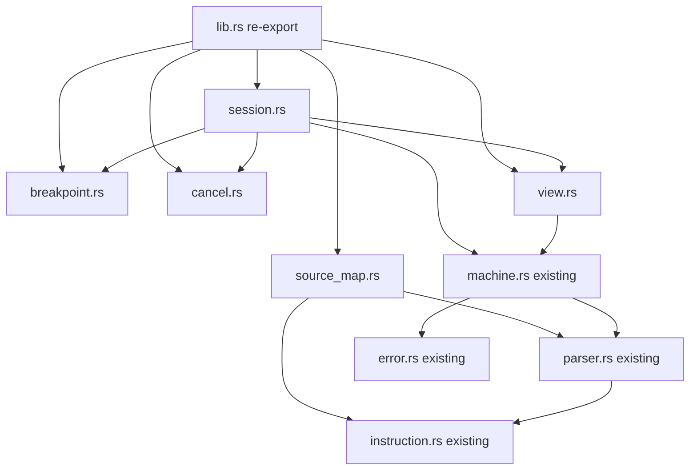
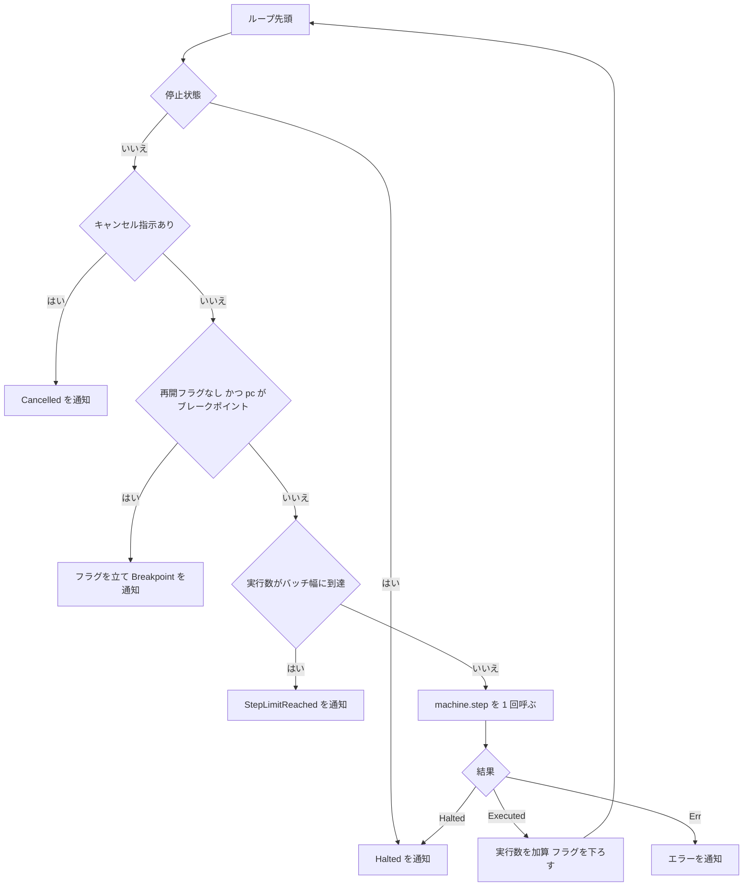

# Design Document: debugger-state

## Overview

`debugger-state` は、`brainfuck-core` の公開 API の上に「デバッグ契約」を後方互換で追加する。GUI(`desktop-gui`)が UI を固めずに Run / Pause / Step Into / Reset を行い、停止理由・ブレークポイント・テープ表示窓・現在命令のソース範囲を表示するために必要な Rust 側の状態と操作を、Tauri・スレッド生成・標準入出力・JSON なしの純粋な値型と関数として提供する。

**Purpose**: GUI が `brainfuck-core` の意味論を再実装することなく、バッチ単位の実行、ブレークポイント停止、キャンセル、1 命令ステップ、リセット、ポインタ周辺のテープ取得、命令添字からソース範囲(行・列・エディタ向けオフセット)への変換を行えるようにする。
**Users**: `desktop-gui` の実装者(主要)、およびデバッグ契約を検証するテスト実装者。
**Impact**: `brainfuck-core` crate に新規モジュール 5 つを追加する(本 spec の型・関数はすべて `brainfuck-core` crate 内のモジュールであり、別 crate は作らない。`desktop-gui` / `compiler-comparison` は `brainfuck_core::...` として利用する)。既存ファイルの変更は `lib.rs` のモジュール宣言と re-export のみ。`Machine` / `Program` / `StopReason` 等の既存定義、`run()` の挙動、CLI の挙動は変わらない。

### Goals
- `Halted` / `StepLimitReached` / `Breakpoint` / `Cancelled` を実際に生成する実行経路(バッチ実行)を、core の `step()` の上に構築する
- ブレークポイントを命令添字で管理し、停止前に現在 `pc` と照合する(再開時前進・バッチ境界の見逃し無しを含む)
- 呼び出し側が供給するキャンセル指示を命令ごとに確認し、中断後に再開しても最終結果が変わらない
- ポインタ周辺のテープ窓(既定 ±16)と、命令添字 ↔ ソース範囲(バイト・行・列・UTF-16)の相互変換を提供する
- 任意のバッチ幅・ブレークポイントなしの条件で、バッチ反復の結果が core の `run()` と完全に一致する
- 位置(行・列・UTF-16)・テープ窓・UTF-16 逆引きの規則を**本 spec の 1 か所だけ**に置く。`desktop-gui`(解析エラー位置、UTF-16 → 命令の正規化)と `compiler-comparison`(機械を持たない観測値からの ±16 窓)は、これらを自前実装せず `SourceMap::position_at` / `SourceMap::instruction_at_or_after_utf16` / `tape_window_of` を呼ぶ

### Non-Goals
- Step Back / 可逆実行、Step Over / Step Out、条件付きブレークポイント、ウォッチポイント
- Tauri コマンド、JSON DTO、IPC、スレッドの生成・管理、UI(`desktop-gui`)
- core の意味論・エラー型・ステップ制限規約の変更
- 命令数上限(`max_steps`)の既定値の決定(CLI / GUI が設定する)

## Boundary Commitments

### This Spec Owns
- デバッグセッション(`Machine` を所有し、入力・設定・ブレークポイント・直近の停止理由・再開用フラグを保持する単位)とそのリセット
- 停止理由 `Halted` / `StepLimitReached` / `Breakpoint` / `Cancelled` を**生成する**実行経路と、その意味(`StepLimitReached` は「バッチ命令数に到達」)
- ブレークポイント集合(命令添字)とその検証・列挙・照合規則(再開時前進を含む)
- バッチ実行(既定 1,000 命令)、キャンセル指示の契約、Step Into
- テープ表示窓(既定半径 16)と状態ビュー
- 命令添字 ↔ ソース範囲変換(`SourceMap`)と、ソース位置から命令添字への正規化規則。プログラムを持たない位置変換(`SourceMap::position_at`)と UTF-16 オフセットからの逆引き
- 機械を持たない呼び出し元向けのテープ窓(`tape_window_of`)
- 上記の公開契約と自動テスト

### Out of Boundary
- 基本意味論、`Machine::step` / `run` の挙動、`StopReason` / `RuntimeError` / `MachineSnapshot` の型定義、命令添字 ↔ ソースバイトオフセットの保持(`brainfuck-core` が所有。本 spec は参照のみ)
- シリアライズ形式、IPC、Run ループの反復と Pause 操作の配線、スレッド管理、表示(`desktop-gui`)
- 命令数上限の既定値(CLI は 10,000,000。GUI の既定は `desktop-gui`)
- Step Back、最適化・コンパイル実行のデバッグ

### Allowed Dependencies
- `brainfuck-core` 内の既存モジュール(`error` / `instruction` / `parser` / `machine`)の**公開 API のみ**。既存モジュールの内部フィールドへアクセスしない
- Rust 標準ライブラリ(`std::sync::atomic` / `std::sync::Arc` / `std::num::NonZeroU64` / `std::fmt` / `std::error`)。外部 crate は追加しない(本番・dev とも)。`std::fs` / `std::io` / `std::env` / `std::thread` は使用しない
- 依存方向(厳守): `error` ← `instruction` ← `parser` ← `machine` ← {`breakpoint` / `cancel` / `view` / `source_map`} ← `session` ← `lib`(re-export)。**既存モジュール(`error` / `instruction` / `parser` / `machine`)は新規モジュールを import しない**。`breakpoint` / `cancel` / `view` / `source_map` は互いに import しない

### Revalidation Triggers
以下を変更する場合、`desktop-gui`(および本 spec を参照する後続 spec)は統合を再確認する。
- `DebugSession` / `BatchReport` / `BatchSize` / `CancelSignal` / `BreakpointSet` / `TapeWindow` / `StateView` / `SourceMap` の公開シグネチャ・フィールド
- `SourceMap::position_at` / `instruction_at_utf16` / `instruction_at_or_after_utf16` / `tape_window_of` のシグネチャと規則(`desktop-gui` の `convert`(位置の DTO 変換)と UTF-16 正規化、`compiler-comparison` の観測値からのテープ窓が依存する)。特に、`position_at` がソース末尾のオフセットを有効とすること、`\r\n` の `\n` 位置が直前の `\r` と同じ行に属すること、`tape_window_of` が範囲外ポインタで空の窓を返すこと
- 停止理由の通知順序(Halted → Cancelled → Breakpoint → バッチ到達)と `StepLimitReached` の意味
- 再開時前進フラグの規則(`Breakpoint` 停止後・Step Into 後に次の 1 命令の照合を省略)
- 行・列・UTF-16 の数え方(列はスカラ値個数、行区切りは `\n` / `\r\n` / `\r`)、ブレークポイントの正規化規則(位置以降で最初の命令)
- core 側の変更: `Machine::step` の判定順序・エラー時の状態不変、`Program::source_offsets` の規則、`Program` / `Machine` の `Clone`、`MachineSnapshot` のフィールド

## Architecture

### Existing Architecture Analysis
- core は「`Program`(不変・命令/オフセット/jump_table)+ `Machine`(状態機械)」の 2 層で、`Machine::step` が停止判定 → 上限判定 → 実行の順に動き、エラー時は状態不変。デバッガ層はこの契約の外側に立ち、`step()` を繰り返し呼ぶだけで済む
- `Machine` は `Clone`、`Program` は `Clone`/`Eq`。リセットは `Machine::new(program.clone(), input.clone(), config)`
- `StopReason` の 4 バリアントは core に予約済みで、`run()` は `Halted` のみ返す。上限到達は `Err(StepLimitExceeded)`
- 保持される位置情報はソースバイトオフセットのみ(行・列・UTF-16 は無い)。`Program` はソース文字列を持たない

### Architecture Pattern & Boundary Map

外側ラッパ(`DebugSession`)が `Machine` を所有し、`step()` の公開 API のみで実行を制御する。ブレークポイント・キャンセル・表示窓・位置変換は独立した小モジュールに分け、`session` が組み合わせる。



**Architecture Integration**:
- Selected pattern: 既存状態機械の外側ラッパ + 小さな純粋モジュール(`research.md` の評価参照)
- Domain boundaries: `session` は「実行制御と停止理由」のみ。`breakpoint`(集合)、`cancel`(指示の契約)、`view`(表示用の読み取り)、`source_map`(静的な位置対応)は互いに独立
- Existing patterns preserved: 外部依存ゼロ、`unsafe` 禁止、`#[non_exhaustive]`、`Display` は数値と列挙値のみの固定英語文面、エラー時の状態不変
- New components rationale: 5 モジュールはそれぞれ 1 責務。trait は `CancelSignal` のみ(キャンセル供給元の多様性とテストの決定性のため)
- Steering compliance: core は UI/IO/スレッド非依存、デバッガの単位は実行命令、巨大テープを返さず表示窓のみ、既定バッチ 1,000・既定窓 ±16

### Technology Stack

| Layer | Choice / Version | Role in Feature | Notes |
|-------|------------------|-----------------|-------|
| Language | Rust stable、edition 2021(core と同一) | 実装全体 | 新規 crate なし |
| Dependencies | なし(std のみ) | - | `thiserror` 等は採用しない(core と同方針) |
| Build / Test | `cargo test --workspace` | 検証 | 統合テストは `crates/brainfuck-core/tests/` |
| Lint | core の `#![forbid(unsafe_code)]` と workspace lint を継承 | `unsafe` 禁止 | 新規ファイルにも適用 |

## File Structure Plan

### Directory Structure
```
crates/brainfuck-core/
├── src/
│   ├── lib.rs               # Modified: 新規 5 モジュールの mod 宣言と公開型の re-export のみ
│   ├── breakpoint.rs        # BreakpointSet(命令添字の集合・検証・列挙)、BreakpointError
│   ├── cancel.rs            # CancelSignal trait、NeverCancel、CancelFn、AtomicBool/Arc/参照への実装
│   ├── view.rs              # DEFAULT_WINDOW_RADIUS、TapeWindow、tape_window_of()(スライス版)、tape_window()(機械版・委譲)、StateView
│   ├── source_map.rs        # SourcePosition、SourceRange、SourceMap(position_at / UTF-16 逆引きを含む)、SourceMapError
│   └── session.rs           # DEFAULT_BATCH_SIZE、BatchSize、BatchReport、DebugSession(バッチ/Step Into/リセット)
└── tests/
    ├── debug_common/mod.rs      # 共有ヘルパ(session_from, run_to_completion_in_batches, Cell ベースの CancelFn 等)。core の tests/common/mod.rs は変更しない
    ├── debug_session.rs         # 停止理由、バッチ境界、Step Into、リセット、last_stop、エラー中断
    ├── debug_breakpoints.rs     # 集合操作、停止/再開、ループ内、Step Into 後、バッチ境界、正規化の合成
    ├── debug_cancel.rs          # 開始前/途中(N 回確認後)、再開後の最終結果、Halted 優先、ブレークポイント同時
    ├── debug_differential.rs    # 複数バッチ幅でのバッチ反復と core の run() の完全一致
    ├── debug_view.rs            # テープ窓(端・半径 0・全体・既定・スライス版・範囲外ポインタ)と状態ビュー
    ├── debug_source_map.rs      # 位置変換(ASCII/マルチバイト/サロゲート/改行 3 種/空/不整合/逆引き/position_at/UTF-16 逆引き)
    ├── debug_regression.rs      # tests/regression/debug_*.bf を使う回帰(core の規約を踏襲)
    └── regression/              # core 既存の tests/regression/ に同居するが、本 spec の最小 .bf は必ず `debug_` 接頭辞(`debug_*.bf`)。core の既存ファイルは変更しない
```

> `tests/debug_*.rs` は core の既存テストと独立した統合テストバイナリ。core の `tests/common/mod.rs` と `tests/regression.rs` は変更しない。本 spec のフィクスチャは `tests/regression/debug_*.bf` と命名し、core の回帰テスト(`tests/regression.rs`)が同ディレクトリを列挙・読み込む場合でも名前が衝突しない(`debug_regression.rs` は `debug_` 接頭辞のファイルだけを `include_str!` で参照する)。

### Modified Files
- `crates/brainfuck-core/src/lib.rs` — 新規モジュール宣言と公開型の re-export を追加(既存の re-export は不変)

## System Flows

### `run_batch` の決定フロー



判定順序の決定: **停止 → キャンセル → ブレークポイント → バッチ幅 → 実行**。
- 停止を最優先にすることで「バッチの最後の 1 命令でプログラムが終了」は `StepLimitReached` ではなく `Halted` になる(4.6)。停止済みでは常に `Halted`、実行数 0(4.7, 5.8, 6.7)
- ブレークポイントをバッチ幅より前に判定することで、バッチ境界ちょうどの `pc` のブレークポイントを見逃さない(5.7)。バッチ幅は 1 以上なので、再開フラグが立っていれば 1 命令は必ず前進する(5.4)
- キャンセルをブレークポイントより前に判定する(6.9)。キャンセル時はフラグを変更しない
- 命令実行は core の `step()` のみ。`step()` が `Err` を返した場合、機械は core の規約で状態不変であり、同じ呼び出しを繰り返すと同じエラーになる(4.8, 4.9)

### 再開フラグ(`skip_breakpoint_once`)の遷移

| イベント | フラグ | 理由 |
|----------|--------|------|
| セッション生成 / リセット | 偽 | 初期 `pc` のブレークポイントで最初に停止する(5.3) |
| `Breakpoint` で停止 | 真 | 同じ位置で再び停止し続けない(5.4) |
| Step Into が命令を実行 | 真 | ユーザーが観察済みの位置から Run しても前進する(5.6) |
| 命令が 1 つ実行された(バッチ内) | 偽 | 以降は通常照合(ループの反復ごとに停止、5.5) |
| `Cancelled` / `Halted` / `StepLimitReached` / `Err` | 不変 | バッチ到達はフラグが既に偽(実行済みなので)。`Cancelled` ではブレークポイントを承認済みとしない(6.9) |

## Requirements Traceability

| Requirement | Summary | Components | Interfaces | Flows |
|-------------|---------|------------|------------|-------|
| 1.1 | 既存契約を変更しない追加のみ | lib.rs(宣言のみ) | - | - |
| 1.2 | UI/標準入力/FS/スレッド非依存 | 全モジュール | 依存規約 | - |
| 1.3 | `unsafe` 禁止 | 全モジュール | workspace lint | - |
| 1.4 | 外部プロセス不要のテスト | Test suite | - | - |
| 1.5 | シリアライズ非依存の値型 | 全モジュール | `Debug`/`Clone`/`PartialEq` のみ | - |
| 1.6 | 後方互換に拡張可能 | 全公開 struct/enum | `#[non_exhaustive]` | - |
| 1.7 | スレッド間移動可能 | DebugSession, SourceMap | `Send` のコンパイル時検証 | - |
| 1.8 | 非使用時に core の結果不変 | 全モジュール(既存コード不変) | - | - |
| 2.1 | 生成直後の初期状態 | DebugSession | `DebugSession::new` | - |
| 2.2 | 停止理由 4 種を区別 | DebugSession | core の `StopReason` を再利用 | run_batch フロー |
| 2.3 | `StepLimitReached` = バッチ到達 | DebugSession, BatchSize | `BatchReport.stop` | run_batch フロー |
| 2.4 | 機械の上限超過はエラー | DebugSession | `BatchReport.stop = Err(StepLimitExceeded)` | run_batch フロー |
| 2.5 | ポインタ範囲外はエラー | DebugSession | `BatchReport.stop = Err(PointerOutOfBounds)` | run_batch フロー |
| 2.6 | リセット | DebugSession | `reset()` | 再開フラグ遷移 |
| 2.7 | 読み取り専用の参照 | DebugSession | `machine()` / `snapshot()` / `last_stop()` | - |
| 2.8 | セッションの独立性 | DebugSession | 値所有(共有状態なし) | - |
| 2.9 | 直近の停止理由の更新 | DebugSession | `last_stop()` | - |
| 2.10 | エラー時に停止理由を消去 | DebugSession | `last_stop()` | - |
| 3.1 | 追加(新規) | BreakpointSet | `insert` | - |
| 3.2 | 追加(既存) | BreakpointSet | `insert` | - |
| 3.3 | 範囲外はエラー | BreakpointSet, BreakpointError | `insert` / `toggle` | - |
| 3.4 | 削除 | BreakpointSet | `remove` | - |
| 3.5 | トグル | BreakpointSet | `toggle` | - |
| 3.6 | 全消去 | BreakpointSet | `clear` | - |
| 3.7 | 昇順列挙 | BreakpointSet | `iter` | - |
| 3.8 | 問い合わせ | BreakpointSet | `contains` | - |
| 3.9 | 実行前後・リセット前後の編集 | DebugSession | `breakpoints_mut()` | - |
| 4.1 | 既定 1,000、1 以上を指定可 | BatchSize | `DEFAULT_BATCH_SIZE`, `BatchSize::new` | - |
| 4.2 | 0 は受け付けない | BatchSize | `BatchSize::new(0) == None` | - |
| 4.3 | core と同一意味論での反復 | DebugSession | `run_batch` | run_batch フロー |
| 4.4 | 停止理由・実行数・スナップショットの通知 | BatchReport | `BatchReport` | - |
| 4.5 | バッチ到達の通知 | DebugSession | `StepLimitReached` | run_batch フロー |
| 4.6 | 最終命令での停止 | DebugSession | `Halted` | run_batch フロー |
| 4.7 | 停止済みは実行数 0 | DebugSession | `Halted` | run_batch フロー |
| 4.8 | エラー中断と実行数 | DebugSession, BatchReport | `stop = Err(..)` | run_batch フロー |
| 4.9 | エラー後の再呼び出し | DebugSession | core の step 規約 | run_batch フロー |
| 4.10 | `run()` との完全一致 | DebugSession | 差分テスト | - |
| 4.11 | 実行数の加算規則 | DebugSession | core の `steps_executed` | - |
| 5.1 | 実行直前の照合で停止 | DebugSession | `run_batch` | run_batch フロー |
| 5.2 | 停止時に状態不変 | DebugSession | `run_batch` | run_batch フロー |
| 5.3 | 初期 pc での即時停止 | DebugSession | 再開フラグ初期値 | 再開フラグ遷移 |
| 5.4 | 再開時の前進 | DebugSession | 再開フラグ | 再開フラグ遷移 |
| 5.5 | ループ内の反復ごと停止 | DebugSession | 再開フラグの消去 | 再開フラグ遷移 |
| 5.6 | Step Into 後の再開 | DebugSession | `step_into` | 再開フラグ遷移 |
| 5.7 | バッチ境界の見逃し無し | DebugSession | 判定順序 | run_batch フロー |
| 5.8 | 停止状態では Halted | DebugSession | 判定順序 | run_batch フロー |
| 5.9 | 次のバッチから変更後の集合 | DebugSession | 集合は毎回参照 | - |
| 5.10 | コメントでは停止しない | BreakpointSet, DebugSession | 添字は命令のみ | - |
| 6.1 | キャンセル指示の供給 | CancelSignal | `run_batch(size, &C)`, `NeverCancel` | - |
| 6.2 | 各命令の直前に確認 | DebugSession | ループ先頭で確認 | run_batch フロー |
| 6.3 | 観測後は実行せず中断 | DebugSession | `Cancelled` | run_batch フロー |
| 6.4 | 開始前の指示 | DebugSession | `Cancelled`、実行数 0 | run_batch フロー |
| 6.5 | 中断時の一貫性 | DebugSession | 命令境界でのみ確認 | - |
| 6.6 | 再開で最終結果一致 | DebugSession | 差分テスト | - |
| 6.7 | 停止済みは Halted | DebugSession | 判定順序 | run_batch フロー |
| 6.8 | 共有フラグと決定的な指示 | CancelSignal | `AtomicBool` / `CancelFn` | - |
| 6.9 | 同時該当は Cancelled | DebugSession | 判定順序 | run_batch フロー |
| 7.1 | ちょうど 1 命令 | DebugSession | `step_into` | 再開フラグ遷移 |
| 7.2 | 停止状態での Step Into | DebugSession | `step_into` | - |
| 7.3 | エラー時の状態不変 | DebugSession | `step_into` | - |
| 7.4 | 停止到達で Halted | DebugSession | `last_stop()` | - |
| 7.5 | 未停止成功で消去 | DebugSession | `last_stop()` | - |
| 7.6 | 前後のスナップショットで効果観測 | DebugSession | `snapshot()` | - |
| 8.1 | 既定半径 16 | view | `DEFAULT_WINDOW_RADIUS` | - |
| 8.2 | `dp ± r` の切り詰め | view | `tape_window_of`(`tape_window` が委譲) | - |
| 8.3 | 先頭添字とポインタ位置 | view | `TapeWindow.start` / `pointer_offset` | - |
| 8.4 | 端での切り詰め | view | `tape_window_of` | - |
| 8.5 | 半径 0 | view | `tape_window_of` | - |
| 8.6 | 全体を覆う半径 | view | `tape_window_of` | - |
| 8.7 | テープ全体との一致 | view | `TapeWindow.cells` は `tape()` / 与えられたテープのスライス | - |
| 8.8 | 状態不変・大きさの上限 | view | `&Machine` / `&[u8]` のみ受け取る | - |
| 8.9 | 状態ビュー | view, DebugSession | `state_view` | - |
| 8.10 | 出力はバイト列のまま | view | `StateView.output` | - |
| 8.11 | 機械なしのテープ窓(スライス版)と機械版の一致 | view, DebugSession | `tape_window_of`, `tape_window`, `DebugSession::tape_window` | - |
| 9.1 | 構築後は再解析不要 | SourceMap | `SourceMap::new` | - |
| 9.2 | 不整合の検出 | SourceMap, SourceMapError | `SourceMap::new` | - |
| 9.3 | 半開区間の範囲 | SourceMap | `range_of` | - |
| 9.4 | 4 種の位置値 | SourceMap | `SourcePosition` | - |
| 9.5 | 改行 3 種 | SourceMap | `SourceMap::new` | - |
| 9.6 | マルチバイトの区別 | SourceMap | `SourcePosition` | - |
| 9.7 | 範囲外は None | SourceMap | `range_of` | - |
| 9.8 | 現在命令の範囲 | SourceMap | `range_of(snapshot.pc)` | - |
| 9.9 | オフセット→命令(厳密) | SourceMap | `instruction_at_offset` | - |
| 9.10 | オフセット→命令(以降) | SourceMap | `instruction_at_or_after_offset` | - |
| 9.11 | 行→命令 | SourceMap | `first_instruction_on_line` | - |
| 9.12 | 命令 0 個 | SourceMap | すべて None | - |
| 9.13 | エラーに機微情報を含めない | SourceMapError | 数値のみ | - |
| 9.14 | プログラム無しの位置変換と `SourceMap::new` との一致 | SourceMap | `SourceMap::position_at` | - |
| 9.15 | UTF-16 → 命令(厳密) | SourceMap | `instruction_at_utf16` | - |
| 9.16 | UTF-16 → 命令(以降) | SourceMap | `instruction_at_or_after_utf16` | - |
| 10.1 | オフセットでの正規化 | SourceMap + BreakpointSet | `instruction_at_or_after_offset` → `insert` | - |
| 10.2 | 行での正規化 | SourceMap + BreakpointSet | `first_instruction_on_line` → `insert` | - |
| 10.3 | 命令が無ければ設定しない | SourceMap | `None` を返し `insert` を呼ばない | - |
| 10.4 | 正規化後の範囲の取得 | SourceMap | `range_of` | - |
| 10.5 | 命令添字として保持 | BreakpointSet | 添字のみ保持 | - |
| 10.6 | UTF-16 オフセットでの正規化 | SourceMap + BreakpointSet | `instruction_at_or_after_utf16` → `insert` | - |
| 11.1 | 停止理由・バッチ境界のテスト | Test suite | `debug_session.rs` | - |
| 11.2 | ブレークポイントのテスト | Test suite | `debug_breakpoints.rs` | - |
| 11.3 | キャンセルのテスト | Test suite | `debug_cancel.rs` | - |
| 11.4 | 差分テスト | Test suite | `debug_differential.rs` | - |
| 11.5 | 表示窓のテスト | Test suite | `debug_view.rs` | - |
| 11.6 | 位置変換のテスト | Test suite | `debug_source_map.rs` | - |
| 11.7 | 既存 core テスト無変更で成功 | Test suite | `cargo test --workspace` | - |
| 11.8 | 回帰テストの構成 | Test suite | `debug_regression.rs`, `regression/` | - |
| 11.9 | 全テスト成功 | Test suite | `cargo test --workspace` | - |
| 11.10 | 追加 API(`position_at` / UTF-16 逆引き / `tape_window_of`)のテスト | Test suite | `debug_source_map.rs`, `debug_view.rs` | - |

## Components and Interfaces

| Component | Domain/Layer | Intent | Req Coverage | Key Dependencies | Contracts |
|-----------|--------------|--------|--------------|------------------|-----------|
| BreakpointSet | Domain | 命令添字のブレークポイント集合 | 3.1-3.8, 5.10, 10.5 | なし | Service, State |
| CancelSignal | Domain | キャンセル指示の契約 | 6.1, 6.8 | std::sync::atomic (P1) | Service |
| view (TapeWindow / StateView) | Domain | テープ窓と状態ビューの読み取り | 8.1-8.11 | Machine (P0) | Service |
| SourceMap | Domain | 命令添字 ↔ ソース範囲/行/列/UTF-16、プログラム無しの位置変換、UTF-16 逆引き | 9.1-9.16, 10.1-10.4, 10.6 | Program (P0), Instruction (P0) | Service, State |
| DebugSession | Application | 実行制御・停止理由・リセット | 1.7, 2.1-2.10, 3.9, 4.1-4.11, 5.1-5.9, 6.1-6.9, 7.1-7.6 | Machine (P0), BreakpointSet (P0), CancelSignal (P0), view (P1) | Service, State |
| Test suite | QA | デバッグ契約の検証 | 1.4, 11.1-11.10 | 全 Component (P0) | - |

### Domain

#### BreakpointSet

| Field | Detail |
|-------|--------|
| Intent | 命令添字のブレークポイント集合。範囲検証と昇順列挙を持つ |
| Requirements | 3.1, 3.2, 3.3, 3.4, 3.5, 3.6, 3.7, 3.8, 5.10, 10.5 |

**Responsibilities & Constraints**
- 内部は「命令数と同じ長さの真偽値配列」+「件数」。照合は O(1)、件数 0 のときは配列参照を省略できる
- 有効な添字は `0..instruction_count`。範囲外の `insert` / `toggle` は集合を変更せずエラー(3.3)
- 保持するのは命令添字のみ(ソース位置は持たない)。コメント位置は表現できない(5.10, 10.5)
- `contains` は範囲外に対して `false`(エラーにしない)

**Contracts**: Service [x] / State [x]

##### Service Interface
```rust
#[derive(Debug, Clone, PartialEq, Eq)]
pub struct BreakpointSet { /* flags, count (private) */ }

#[derive(Debug, Clone, Copy, PartialEq, Eq)]
#[non_exhaustive]
pub enum BreakpointError {
    /// 命令添字が命令数以上。
    OutOfRange { instruction_index: usize, instruction_count: usize },
}
// Display: "breakpoint instruction index out of range: instruction #N, instruction count M"。std::error::Error を実装

impl BreakpointSet {
    pub fn new(instruction_count: usize) -> BreakpointSet;
    pub fn instruction_count(&self) -> usize;
    /// 新規に追加したら Ok(true)、既に存在したら Ok(false)。
    pub fn insert(&mut self, instruction_index: usize) -> Result<bool, BreakpointError>;
    /// 存在して削除したら true、存在しなければ false。範囲外も false。
    pub fn remove(&mut self, instruction_index: usize) -> bool;
    /// 追加したら Ok(true)、削除したら Ok(false)(戻り値は操作後に設定されているか)。
    pub fn toggle(&mut self, instruction_index: usize) -> Result<bool, BreakpointError>;
    pub fn clear(&mut self);
    pub fn contains(&self, instruction_index: usize) -> bool;
    pub fn is_empty(&self) -> bool;
    pub fn len(&self) -> usize;
    /// 命令添字の昇順(重複なし)。
    pub fn iter(&self) -> impl Iterator<Item = usize> + '_;
}
```
- Preconditions: `new` の `instruction_count` はセッションの `Program::len()`
- Postconditions: 失敗した `insert` / `toggle` は集合を変更しない。`iter` は昇順で重複しない
- Invariants: 件数 = 真の要素数

#### CancelSignal

| Field | Detail |
|-------|--------|
| Intent | 呼び出し側が供給するキャンセル指示を、スレッド・UI 非依存の契約として受け取る |
| Requirements | 6.1, 6.8 |

**Responsibilities & Constraints**
- `is_cancelled` は副作用を持たず、呼び出しごとに現在の指示状態を返す。`run_batch` は各命令の直前に 1 回呼ぶ(6.2)
- 実装: `AtomicBool`(`load(Acquire)`)、`&T`、`Arc<T>`(`T: CancelSignal + ?Sized`)、`NeverCancel`(常に偽)、`CancelFn<F>`(クロージャ。テストは `Cell` カウンタで「N 回確認後に有効」を決定的に再現)
- 設定側(desktop-gui)は `Release` または `SeqCst` で `store` する(契約としてドキュメントに明記)

##### Service Interface
```rust
pub trait CancelSignal {
    fn is_cancelled(&self) -> bool;
}

#[derive(Debug, Clone, Copy, Default)]
pub struct NeverCancel;

#[derive(Debug, Clone, Copy)]
pub struct CancelFn<F>(pub F);   // F: Fn() -> bool

impl CancelSignal for NeverCancel { /* false */ }
impl CancelSignal for std::sync::atomic::AtomicBool { /* load(Acquire) */ }
impl<F: Fn() -> bool> CancelSignal for CancelFn<F> { /* (self.0)() */ }
impl<T: CancelSignal + ?Sized> CancelSignal for &T { /* delegate */ }
impl<T: CancelSignal + ?Sized> CancelSignal for std::sync::Arc<T> { /* delegate */ }
```
- Postconditions: 一度 `true` を返した後に `false` を返してよい(呼び出し側が指示を取り下げる場合)。デバッガは `true` を観測した時点で中断する

#### view (TapeWindow / StateView)

| Field | Detail |
|-------|--------|
| Intent | 状態を変更せずにテープ窓と状態ビューを組み立てる |
| Requirements | 8.1, 8.2, 8.3, 8.4, 8.5, 8.6, 8.7, 8.8, 8.9, 8.10, 8.11 |

**Responsibilities & Constraints**
- テープ窓の計算は純粋関数 `tape_window_of(tape: &[u8], dp, radius)` の 1 か所だけに置く。`TapeWindow<'a>` は元から `&'a [u8]` を借用する型(機械への借用ではない)なので、機械を持たない呼び出し元(`compiler-comparison` の観測値など)は、保持している `&[u8]` のテープと `dp` をそのまま渡して同じ `TapeWindow` を得る。所有版(`Vec<u8>` を持つ型)は追加しない(呼び出し側が `cells.to_vec()` で所有できる)
- 機械版 `tape_window(machine, radius)` と `DebugSession::tape_window` は `tape_window_of(machine.tape(), machine.snapshot().data_pointer, radius)` へ委譲するだけで、独自の計算をしない(8.11)
- テープ窓はテープのスライスを借用して返す(コピー・割り当て無し)。窓の大きさは `min(2 * radius + 1, tape.len())` 以下で、半径とテープ長のみで決まる(8.8)。機械のテープ長は 30,000(`TAPE_SIZE`)
- `start = dp.saturating_sub(radius)`、`end_inclusive = min(dp.saturating_add(radius), tape.len() - 1)`。`pointer_offset = dp - start`(`start <= dp <= end` が常に成り立つ)
- `dp >= tape.len()`(空テープを含む)は機械では起こらないが、スライス版では起こり得る。panic せず**空の窓**(`start = tape.len()`、`cells = &[]`、`pointer_offset = 0`)を返す(この場合に限り `start + pointer_offset == dp` は成り立たない。説明コメントに明記)
- 端では切り詰める(パディングもずらしもしない。`research.md` の決定)
- 状態ビューは `snapshot()`・窓・`output()`・直近の停止理由を同一の `&Machine` / セッション参照から一度に作る(`&self` のみなので一貫した時点の値、8.9)

##### Service Interface
```rust
pub const DEFAULT_WINDOW_RADIUS: usize = 16;

#[derive(Debug, Clone, Copy, PartialEq, Eq)]
#[non_exhaustive]
pub struct TapeWindow<'a> {
    /// 窓の先頭セルのテープ上の添字。
    pub start: usize,
    /// start から昇順の連続セル値(テープ全体の同じ添字の現在値と一致)。
    pub cells: &'a [u8],
    /// 窓内での dp の位置(cells[pointer_offset] が現在セル)。
    pub pointer_offset: usize,
}

#[derive(Debug, Clone, Copy, PartialEq, Eq)]
#[non_exhaustive]
pub struct StateView<'a> {
    pub snapshot: MachineSnapshot,
    pub tape_window: TapeWindow<'a>,
    pub output: &'a [u8],            // バイト列のまま(UTF-8 変換なし)
    pub last_stop: Option<StopReason>,
}

/// 機械を持たない呼び出し元向け。`tape` の `dp` を中心に `dp - radius ..= dp + radius` を
/// `0..tape.len()` に切り詰めて借用する(パディングもずらしもしない)。
/// `dp >= tape.len()` のときは空の窓(start = tape.len(), cells = [], pointer_offset = 0)。panic しない。
pub fn tape_window_of(tape: &[u8], dp: usize, radius: usize) -> TapeWindow<'_>;

/// 機械版。`tape_window_of(machine.tape(), machine.snapshot().data_pointer, radius)` と同一。
pub fn tape_window(machine: &Machine, radius: usize) -> TapeWindow<'_>;
```
- Preconditions: なし(任意の `radius`、任意の `tape` / `dp`)
- Postconditions: `dp < tape.len()` のとき空でない(現在セルを必ず含む)。`cells.len() <= tape.len()`(機械版は `<= TAPE_SIZE`)。`dp < tape.len()` のとき `start + pointer_offset == dp`(機械版は `== snapshot.data_pointer`)。`cells` は `tape[start..start + cells.len()]` と同一。引数を変更しない
- `StateView` の生成は `DebugSession::state_view` が行う(`last_stop` はセッション所有のため)

#### SourceMap

| Field | Detail |
|-------|--------|
| Intent | 解析済みプログラムとそのソースから、命令添字 ↔ ソース範囲/行/列/UTF-16 の変換表を一度だけ構築する |
| Requirements | 9.1, 9.2, 9.3, 9.4, 9.5, 9.6, 9.7, 9.8, 9.9, 9.10, 9.11, 9.12, 9.13, 9.14, 9.15, 9.16, 10.1, 10.2, 10.3, 10.4, 10.6 |

**Responsibilities & Constraints**
- 行・列・UTF-16 の数え方はこのモジュールの非公開の走査処理 1 か所にだけ実装し、`SourceMap::new` と `SourceMap::position_at` の両方がそれを使う(規則の二重実装を作らない。`desktop-gui` の `convert` と `compiler-comparison` は独自の数え方を持たない)
- `position_at(source, byte_offset)`: `Program` 不要の関連関数で、`source` を先頭から `byte_offset` まで走査して位置を返す(O(byte_offset))。`byte_offset == source.len()` は有効(末尾位置。`ParseError` の位置やカーソル末尾に使える)。`byte_offset > source.len()` と文字境界でない位置は `None`。改行規則: `\n`・`\r\n`(1 個)・`\r`。改行は直後から次の行を開始する。したがって `\r\n` の `\n` のバイト位置(`\r` と `\n` の間)は `\r` と同じ行に属し、列は `\r` の列 + 1、UTF-16 は `\r` の位置 + 1。`\r\n` の直後は次の行の列 1。列は行頭からのスカラ値個数 + 1、UTF-16 オフセットはドキュメント先頭からのコード単位数(BMP 外の文字は 2)
- 構築時に `source` を 1 パス走査し、全命令分の始点位置(バイト・行・列・UTF-16)と行頭バイトオフセット表を事前計算する。ソース文字列は保持しない。メモリは O(命令数 + 行数)
- 行区切りは `\n`、`\r\n`(1 個)、`\r` の 3 種(CodeMirror 6 の既定に一致)。行番号・列番号は 1 始まり。列は Unicode スカラ値の個数、UTF-16 オフセットはドキュメント先頭からの UTF-16 コード単位数
- 命令文字は ASCII の 1 バイトで改行ではないので、終点 = 始点のバイト・列・UTF-16 を各 +1(同じ行)
- 整合検証(構築時): ソース上の全 ASCII 命令文字が `Program` の命令列・`source_offsets` と 1 対 1 で一致すること。不一致は `SourceMapError`
- 逆引き: `instruction_at_offset` は `source_offsets` の厳密一致(二分探索)、`instruction_at_or_after_offset` は下限探索、`first_instruction_on_line(line)` は行頭オフセット以降の下限探索。範囲外・存在しない行・該当命令無しは `None`(panic しない)
- UTF-16 逆引き: 構築時に保持済みの各命令の始点位置(`utf16_offset` は命令添字に対して狭義単調増加)に対する二分探索。`instruction_at_utf16` は厳密一致(コメント文字・サロゲートペアの途中・範囲外は `None`)、`instruction_at_or_after_utf16` は下限探索(コメント上・サロゲートペアの途中は次の命令、末尾以降は `None`)。バイトオフセット版と同一の意味論で、`desktop-gui` が UTF-16 の始点表を自前構築する必要はない
- 順引き(命令 → UTF-16)は既存の `range_of(i)` の `start.utf16_offset` / `end.utf16_offset` で足りるため追加の API は設けない。全命令の列挙は `0..instruction_count()` を `range_of` に渡す
- ブレークポイント正規化(10.1〜10.3, 10.6): 呼び出し側は `instruction_at_or_after_offset` / `instruction_at_or_after_utf16` / `first_instruction_on_line` の結果が `Some(i)` のときのみ `BreakpointSet::insert(i)` を呼ぶ。`None` なら設定しない。`range_of(i)` で実際の停止位置を表示できる(10.4)

##### Service Interface
```rust
#[derive(Debug, Clone, Copy, PartialEq, Eq)]
#[non_exhaustive]
pub struct SourcePosition {
    pub byte_offset: usize,   // ソース先頭からの UTF-8 バイトオフセット
    pub line: usize,          // 1 始まり
    pub column: usize,        // 1 始まり、行頭からの Unicode スカラ値の個数 + 1
    pub utf16_offset: usize,  // ドキュメント先頭からの UTF-16 コード単位数
}

#[derive(Debug, Clone, Copy, PartialEq, Eq)]
#[non_exhaustive]
pub struct SourceRange {
    pub start: SourcePosition,   // 命令文字の位置
    pub end: SourcePosition,     // 半開区間の終点(命令文字の直後)
}

#[derive(Debug, Clone, Copy, PartialEq, Eq)]
#[non_exhaustive]
pub enum SourceMapError {
    /// プログラムの instruction_index 番目の命令が、ソースの該当位置の文字と一致しない/位置が存在しない。
    InstructionMismatch { instruction_index: usize },
    /// ソースに、プログラムの命令列に無い命令文字が source_offset にある。
    UnexpectedInstruction { source_offset: usize },
}
// Display は固定英語文面+数値のみ。std::error::Error を実装

#[derive(Debug, Clone, PartialEq, Eq)]
pub struct SourceMap { /* start positions, line_starts (private) */ }

impl SourceMap {
    pub fn new(program: &Program, source: &str) -> Result<SourceMap, SourceMapError>;
    pub fn instruction_count(&self) -> usize;
    pub fn line_count(&self) -> usize;
    pub fn range_of(&self, instruction_index: usize) -> Option<SourceRange>;
    pub fn instruction_at_offset(&self, byte_offset: usize) -> Option<usize>;
    pub fn instruction_at_or_after_offset(&self, byte_offset: usize) -> Option<usize>;
    pub fn first_instruction_on_line(&self, line: usize) -> Option<usize>;

    /// UTF-16 コード単位オフセット(エディタ向け)の厳密一致。命令文字の位置のみ Some。
    /// コメント文字・サロゲートペアの途中・範囲外は None。
    pub fn instruction_at_utf16(&self, utf16_offset: usize) -> Option<usize>;
    /// UTF-16 オフセット以降で最初の命令。コメント上・サロゲートペアの途中は次の命令、
    /// 末尾以降・命令無しは None。
    pub fn instruction_at_or_after_utf16(&self, utf16_offset: usize) -> Option<usize>;

    /// Program 不要のバイトオフセット → 位置(行は 1 始まり、列はスカラ値個数 + 1、UTF-16 はコード単位数)。
    /// 改行は `\n` / `\r\n`(1 個)/ `\r`。byte_offset == source.len() は有効(末尾位置)。
    /// source.len() 超過・文字境界でない位置は None。SourceMap::new と同一の規則(内部で共有)。
    pub fn position_at(source: &str, byte_offset: usize) -> Option<SourcePosition>;
}
```
- Preconditions: `source` は `program` の生成に使った文字列と同一(違えば `Err`)。`position_at` は任意の `&str` と任意のオフセットで呼べる
- Postconditions: 任意の命令 `i` について `SourceMap::position_at(source, program.source_offset(i).unwrap()) == range_of(i).map(|r| r.start)`(一貫性。テストで固定)。`instruction_at_utf16(range_of(i).start.utf16_offset) == Some(i)`。`instruction_at_or_after_utf16(u)` は `range_of(i).start.utf16_offset >= u` を満たす最小の `i`(無ければ `None`)。`range_of(i).unwrap().start.byte_offset == program.source_offset(i).unwrap()`、`end.byte_offset == start.byte_offset + 1`。`instruction_at_offset(range_of(i).start.byte_offset) == Some(i)`。`line_count()` は行区切り数 + 1(空ソースは 1)
- Invariants: 命令 0 個のとき `range_of` / 逆引きはすべて `None`
- 現在命令の範囲は `range_of(snapshot.pc)`。停止状態(`pc == len`)は `None`(9.8)

### Application

#### DebugSession

| Field | Detail |
|-------|--------|
| Intent | `Machine` を所有し、`step()` の上でバッチ実行・ブレークポイント停止・キャンセル・Step Into・リセットを提供する |
| Requirements | 1.7, 2.1, 2.2, 2.3, 2.4, 2.5, 2.6, 2.7, 2.8, 2.9, 2.10, 3.9, 4.1-4.11, 5.1-5.9, 6.1-6.9, 7.1-7.6, 8.9 |

**Responsibilities & Constraints**
- 状態: `machine: Machine`、`initial_input: Vec<u8>`、`config: MachineConfig`、`breakpoints: BreakpointSet`、`last_stop: Option<StopReason>`、`skip_breakpoint_once: bool`
- 機械の状態を変更する唯一の経路は `Machine::step`(`run_batch` / `step_into`)と `reset`(`Machine::new` での置換)。`Machine` の内部へは書き込まない(core の Implementation Notes に従う)
- `run_batch` は失敗しない関数で、結果を `BatchReport` に包む(エラーも `BatchReport.stop` に載せ、`executed` と `snapshot` を常に返す)
- 停止理由 `StepLimitReached` は「指定したバッチ命令数を実行し終え、未停止」の意。機械の `max_steps` 超過は `stop = Err(RuntimeError::StepLimitExceeded { .. })`(core の契約どおり)
- 実行数は core の `steps_executed` をそのまま使う。`BatchReport.executed` は当該呼び出しで `step()` が `Executed` を返した回数
- `last_stop` は、`run_batch` が `Ok(reason)` で終わったら `Some(reason)`、`step_into` が停止状態に達したら(または停止済みで呼ばれたら)`Some(Halted)`、`step_into` が未停止で成功したら `None`、いずれかが `Err` なら `None`、`reset` で `None`
- `Send`: すべてのフィールドが `Send`(`Machine` / `Vec` / `BreakpointSet`)。コンパイル時テストで固定(1.7)。内部可変性・共有状態なし(2.8)

**Dependencies**
- Inbound: desktop-gui — Run ループ、Pause(キャンセル指示)、Step Into、Reset、状態取得 (P0)
- Outbound: Machine — `step` / `snapshot` / `tape` / `output` / `program` / `is_halted` (P0); BreakpointSet — 照合 (P0); CancelSignal — 中断判定 (P0); view — 窓と状態ビュー (P1)

**Contracts**: Service [x] / State [x]

##### Service Interface
```rust
pub const DEFAULT_BATCH_SIZE: u64 = 1_000;

#[derive(Debug, Clone, Copy, PartialEq, Eq)]
pub struct BatchSize(std::num::NonZeroU64);
impl BatchSize {
    pub const DEFAULT: BatchSize;                 // 1,000
    pub const fn new(n: u64) -> Option<BatchSize>; // 0 は None
    pub const fn get(self) -> u64;
}
impl Default for BatchSize { /* DEFAULT */ }

#[derive(Debug, Clone, Copy, PartialEq, Eq)]
#[non_exhaustive]
pub struct BatchReport {
    /// Ok: 停止理由(Halted / StepLimitReached / Breakpoint / Cancelled)。Err: 実行エラー(状態は core の規約どおり不変)。
    pub stop: Result<StopReason, RuntimeError>,
    /// この呼び出しで実際に実行した命令数。
    pub executed: u64,
    /// 通知時点のスナップショット。
    pub snapshot: MachineSnapshot,
}

#[derive(Debug, Clone)]
pub struct DebugSession { /* private */ }

impl DebugSession {
    pub fn new(program: Program, input: Vec<u8>, config: MachineConfig) -> DebugSession;

    pub fn machine(&self) -> &Machine;           // snapshot / tape / output / program はここから
    pub fn snapshot(&self) -> MachineSnapshot;
    pub fn last_stop(&self) -> Option<StopReason>;
    pub fn breakpoints(&self) -> &BreakpointSet;
    pub fn breakpoints_mut(&mut self) -> &mut BreakpointSet;

    pub fn run_batch<C: CancelSignal + ?Sized>(&mut self, size: BatchSize, cancel: &C) -> BatchReport;
    pub fn step_into(&mut self) -> Result<StepResult, RuntimeError>;
    pub fn reset(&mut self);

    pub fn tape_window(&self, radius: usize) -> TapeWindow<'_>;   // view::tape_window(machine) → tape_window_of へ委譲
    pub fn state_view(&self, radius: usize) -> StateView<'_>;
}
```
- Preconditions: `new` は任意の `Program` / 入力 / 設定(失敗しない)。`breakpoints` の命令数は `program.len()` に一致
- Postconditions:
  - `run_batch`: 上記フローに従う。`executed <= size.get()`。`stop = Ok(StepLimitReached)` のとき `executed == size.get()` かつ未停止。`stop = Ok(Halted)` のとき `snapshot.halted`。`stop = Ok(Breakpoint)` のとき `breakpoints.contains(snapshot.pc)` かつそれ以降の命令は未実行。`stop = Ok(Cancelled)` は命令境界で発生し、`executed` までの命令の効果が反映されている
  - `step_into`: 停止済みなら `Ok(Halted)` で機械不変。未停止なら 1 命令実行して `Ok(Executed)`(ブレークポイント・キャンセルを無視)。エラーは core と同一で機械不変
  - `reset`: `machine = Machine::new(program.clone(), initial_input.clone(), config)`、`last_stop = None`、`skip_breakpoint_once = false`、`breakpoints` は保持
- Invariants: ブレークポイントとキャンセルは機械の意味論に影響しない。ブレークポイントなし・キャンセルなしでバッチを `Ok(StepLimitReached)` 以外が返るまで繰り返した最終状態・エラーは、同条件の `Machine::run()` と一致する(4.10)

**Implementation Notes**
- Integration(desktop-gui 向け利用パターン): Run ループは `loop { report = session.run_batch(size, &cancel_flag); 通知; match report.stop { Ok(StepLimitReached) => 継続, _ => break } }`。Pause は `cancel_flag.store(true, Release)`。セッションは `Mutex` 内に保持してよい(`Send`)。DTO では `StepLimitReached`(バッチ到達・継続可)と `Err(StepLimitExceeded)`(上限超過・致命)を別ラベルにする
- Validation: `step()` の戻り値 `Ok(Halted)` はループ先頭で停止判定済みのため到達しないが、防御的に `Halted` として扱う
- Risks: 命令ごとの `snapshot()` 呼び出し(数フィールドのコピー)。1,000 命令バッチで無視できる程度。問題が出たら core に `Machine::pc()` を後方互換で追加する(別途 core の Revalidation として扱う)

##### State Management
- State model: 上記フィールド。`machine` は `step` と `reset` のみで遷移
- Persistence & consistency: メモリ内のみ。`run_batch` は命令境界でのみ中断するため、`Cancelled` でも `Breakpoint` でも機械は常に一貫した状態
- Concurrency strategy: `&mut self` の排他借用のみ。キャンセル指示だけが共有され、`CancelSignal` 側が同期を負う

### QA

#### Test suite

| Field | Detail |
|-------|--------|
| Intent | 要件 11 に従い、デバッグ契約と core との一致を自動検証する |
| Requirements | 1.4, 11.1-11.9 |

- `tests/debug_common/mod.rs`: `session_from(source, input, config)`、`run_in_batches(session, size) -> Vec<BatchReport>`(`StepLimitReached` の間反復)、`assert_same_final_state(&Machine, &Machine)`(出力・テープ・`snapshot`・エラー種別の比較)。core の `tests/common/mod.rs` は変更しない(必要なら複製して使う)
- 差分テストの正解は `Machine::run()`(オラクル)。ブレークポイントなし・`NeverCancel`

## Data Models

### Domain Model
- `DebugSession`(エンティティ・可変): `Machine` を所有。`BreakpointSet`(値・可変)、`last_stop`(Option の値)
- `SourceMap`(値オブジェクト・不変): 構築後は変更不可。`SourcePosition` / `SourceRange` / `TapeWindow` / `StateView` / `BatchReport` は純粋な値(JSON 変換は desktop-gui)
- 不変条件: ブレークポイントは常に `0..instruction_count`。窓は常にテープ範囲内で現在セルを含む。`BatchReport.executed` = 当該呼び出しで `Executed` を返した `step()` の回数

## Error Handling

### Error Strategy
- 実行エラーは core の `RuntimeError`(`PointerOutOfBounds` / `StepLimitExceeded`)をそのまま `BatchReport.stop` / `step_into` の戻り値に載せ、新しい実行エラー型は追加しない(2.4, 2.5)
- デバッガ固有のエラーは 2 つのみ: `BreakpointError::OutOfRange`(範囲外のブレークポイント)、`SourceMapError`(ソース不整合)。いずれも数値フィールドのみ・固定英語文面・`std::error::Error` 実装(9.13)。ソース全文・入力バイト列・パスを含めない
- 不正値は型で排除する(`BatchSize` は 0 を表現できない)。panic は使用しない(範囲外参照は事前検証または `Option` で表現)

### Error Categories and Responses
- **実行エラー(core 由来)**: 状態不変。`last_stop` を `None` にする。再呼び出しで同一エラー
- **範囲外のブレークポイント**: 集合不変。呼び出し元へ `BreakpointError`
- **ソース不整合**: `SourceMap::new` が `Err`。GUI は再解析(プログラム再生成)を促す

## Testing Strategy

### Unit / Integration Tests(`crates/brainfuck-core/tests/`)
- **debug_session.rs**(11.1): `Halted` / `StepLimitReached` / `Breakpoint` / `Cancelled` / `Err` の各通知。バッチ幅ちょうどでプログラムが終了する場合は `Halted`、1 命令足りない場合は `StepLimitReached`。停止済みでの `Halted`・実行数 0・状態不変。機械の `max_steps` 超過が `Err(StepLimitExceeded)` であり、再呼び出しで同一エラー・`executed` が当該呼び出しの値であること。`BatchSize::new(0) == None`、既定が 1,000。Step Into の 1 命令性・停止済み・エラー・`last_stop` 遷移。リセットで初期状態に戻りブレークポイントが残ること。`BatchReport.snapshot` が通知時点の値であること。`DebugSession: Send` のコンパイル時検証(1.7)
- **debug_breakpoints.rs**(11.2): 追加(新規/既存)・範囲外エラー・削除・トグル・全消去・昇順列挙。初期 `pc` 0 の即時停止、`Breakpoint` 後の再開で前進、`+[->+<]` 系ループ内での反復ごとの停止、Step Into 直後の Run、バッチ境界(`size = n` で `pc = n` のブレークポイント)の見逃し無し、実行間の追加が次バッチから有効、コメント位置が `SourceMap` 経由で次の命令へ正規化されること(合成)
- **debug_cancel.rs**(11.3): 開始前から有効な指示(実行数 0・状態不変)、`CancelFn` + `Cell` カウンタで N 回確認後に有効(`executed` が N に一致)、`Cancelled` 後の再開で最終結果が連続実行と一致、停止済みでは `Halted` 優先、ブレークポイントと同時のときは `Cancelled` で次に `Breakpoint`、`AtomicBool` 経由、`NeverCancel`
- **debug_differential.rs**(11.4): Hello World・ネスト・エコー(入力あり)・ポインタ範囲外エラー・ステップ上限エラーのプログラムに対し、バッチ幅 1 / 3 / 7(素数)/ 1,000 / プログラム全体以上で、出力・テープ・`pc` / `dp` / 実行済み命令数・エラー種別が `Machine::run()` と完全一致
- **debug_view.rs**(11.5, 11.10): `tape_window_of` を機械なしで直接検証(同じ入力で `tape_window(machine)` / `DebugSession::tape_window` と一致、`dp` が範囲外・空テープで空の窓かつ panic しない、30,000 未満のテープでの末端切り詰め)。初期状態(`dp = 0`、既定半径で `start = 0`、`cells.len() = 17`、`pointer_offset = 0`)、中央、右端(`dp = 29999`)、半径 0、半径 ≥ 30,000(全体 30,000 セル)、窓のセル値が `tape()` と一致、`start + pointer_offset == dp`、状態ビューの各フィールドが `snapshot()` / `output()` と一致、非 UTF-8 出力がそのままであること
- **debug_source_map.rs**(11.6): ASCII のみ、`"あ+"`(バイト 3 / 列 2 / UTF-16 1)、`"😀+"`(バイト 4 / 列 2 / UTF-16 2)、`\n` / `\r\n` / `\r` それぞれの行・列(`\r\n` が 1 個)、コメントのみ・空ソース(`range_of` / 逆引きが `None`、`line_count` 1)、範囲外 `range_of`、不整合ソース(命令が欠落/余剰/別文字)で `Err`、`instruction_at_offset`(命令=Some、コメント=None、文字境界の途中=None)、`instruction_at_or_after_offset`(コメント上は次の命令、末尾以降は None)、`first_instruction_on_line`(命令なしの行は後続行の命令に正規化、行番号 0 / 行数超過は None)、`range_of(snapshot.pc)` が停止状態で `None`。追加 API(11.10): `SourceMap::position_at`(ASCII、`あ`、`😀`、`\n` / `\r\n` / `\r`、`\r\n` の間の位置は直前の `\r` と同じ行、ソース末尾 = 有効、長さ超過・マルチバイトの途中 = `None`、空ソース、全命令で `SourceMap::new` の `range_of(i).start` と一致)、`instruction_at_utf16`(命令 = Some、コメント = None、`😀` の途中 = None、範囲外 = None)、`instruction_at_or_after_utf16`(コメント上は次の命令、サロゲートペアの途中は次の命令、末尾以降は None、バイト版と同じ位置関係)、命令 0 個で UTF-16 逆引きが `None`、UTF-16 正規化 → `BreakpointSet::insert` の合成(10.6)
- **debug_regression.rs**(11.8): `tests/regression/debug_*.bf`(`debug_` 接頭辞必須。core の `tests/regression/` との衝突回避)を `include_str!` で読む。初期ケース: 「バッチ境界ちょうどのブレークポイント」を再現する最小プログラム 1 件(`tests/regression/debug_batch_boundary_breakpoint.bf`。規約の実証)

### Performance
- 通常の `cargo test --workspace` では性能ベンチマークを実行しない。デバッガの性能テストは作らない。大きなバッチ(1,000)は差分テストで動作確認のみ

## Security Considerations

- 任意ソースは信頼しない入力: セッションのメモリは「テープ 30,000 + 入力 + 出力(命令数上限で上限化)+ ブレークポイント配列(命令数)」。`SourceMap` はソース長に比例するのみ。外部入力で任意量を確保する経路は無い(バッチ幅は反復回数であって確保量ではない)
- エラー型(`BreakpointError` / `SourceMapError`)は数値と列挙値のみ。ソース全文・入力バイト列・絶対パスを含めない
- `unsafe` 禁止は core の `forbid` + workspace lint を継承。キャンセル指示はアトミックな読み取りのみで、データ競合を起こさない

## Supporting References

- 決定の根拠と代替案: `research.md`(配置、`StepLimitReached` の意味、再開フラグ、キャンセル形、窓の端、位置単位)
- core 契約: `.kiro/specs/brainfuck-core/design.md`
