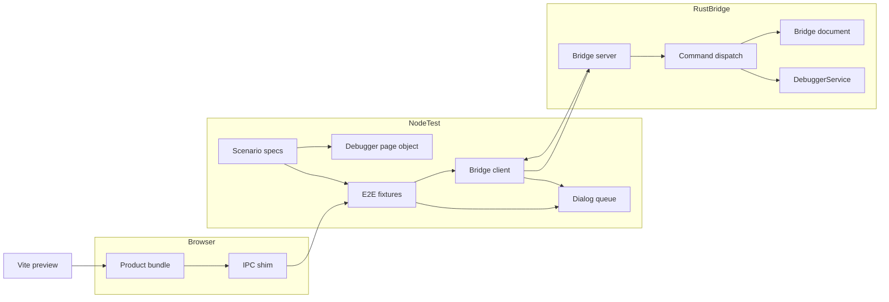
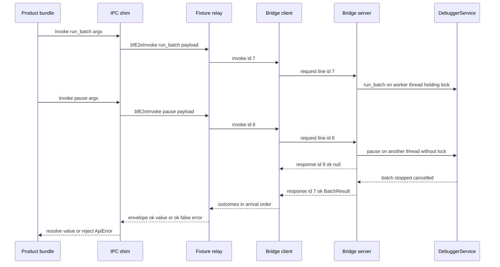
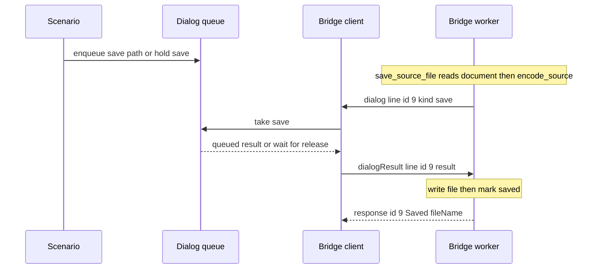

# Design Document(desktop-gui-e2e-browser)

## Overview

**Purpose**: desktop-gui の画面を実際のブラウザエンジン(Chromium)で描画・操作し、アプリと同じ Rust の実装(`brainfuck-gui-api` の `DebuggerService` と `source_file`)を通して振る舞いを確かめる、繰り返し実行できる E2E スイートを提供する。2026-11-07 に一度だけ手作業で行った手動スモーク(`apps/desktop/README.md` の 1〜15)を、ブラウザで観測できる範囲で自動化する。

**Users**: desktop-gui と後続(compiler-comparison など)を変更する開発者が `npm run e2e` で回帰を確認し、CI の運用者が Linux のランナーで同じスイートを実行する。

**Impact**: 製品のソース(`apps/desktop/src/`、`apps/desktop/src-tauri/`、既存の `crates/*/src/`)は変更しない。テスト専用の Rust バイナリ(新しい crate `crates/brainfuck-e2e-bridge`。`publish = false`、配布しない)、`apps/desktop/e2e/` の Playwright 基盤とシナリオ、ツール設定の追記(E2E 用の `tsconfig.e2e.json` を含む)、独立した CI ワークフロー、README と traceability の記録を追加する。

### Goals
- 1 つのコマンドで、配布と同じ手順でビルドした画面を、実際の Rust バックエンドを通して検証する(1.1、2.1、3.1)
- 手動スモーク 1、2、3.1、4〜13、14.1〜14.3、15 のブラウザで観測できる項目を、番号ごとのシナリオで自動化する(4〜9)
- 時間計測を別グループに分け、CI では非必須として可視化する(10、11.2)
- 各スモーク項目の扱い(自動化済み・手動のまま・対象外)を traceability と README で追跡する(12)

### Non-Goals
- 実 WebView2・実ウィンドウでの検証。`desktop-gui-e2e-webview` が扱うのは、実ウィンドウの ×(スモーク 11.1〜11.3、11.5)、実際のリロード(11.6)、WebView2 の右クリックメニュー(11.7)、CSP の実効、13.3 の実 WebView2 での描画、1・3.1・4・9.3 の実 IPC での確認
- ネイティブダイアログの見た目とモーダル性(スモーク 10.1 のダイアログの部分)、ウィンドウの最小サイズの強制(スモーク 12 の実ウィンドウでの縮小)。手動のまま(`desktop-gui-e2e-webview` も対象外)
- スモーク 3.2(Rust の `cli_parity_real.rs` が担う)、14.4(NVDA。手動のまま)
- 画像の差分による見た目の回帰検出(スクリーンショットの基準画像の管理)
- 製品の不具合の修正(見つけた場合は記録のみ)
- 基本 CI(`ci-baseline`)

## Boundary Commitments

### This Spec Owns
- テスト専用ブリッジ(crate `crates/brainfuck-e2e-bridge/`、バイナリ `brainfuck-e2e-bridge`): 行単位の JSON プロトコル、Tauri コマンドと同じ順序でのサービス呼び出し、文書状態、ダイアログの問い合わせ、閉じる判定
- ブリッジと Tauri 層の乖離の検出: コマンド一覧の契約テスト(`names.rs` の `COMMAND_NAMES` が基準)と、複製元の区間の指紋テスト(`apps/desktop/e2e/support/bridge/`)
- Node 側の中継(`apps/desktop/e2e/support/bridge/`): ブリッジの起動・相関・終了、ダイアログの結果の待ち行列、呼び出しの記録
- ブラウザ側の IPC シム(`apps/desktop/e2e/support/ipcShim/`)と、そのビルド設定
- Playwright の設定、準備物の事前確認、フィクスチャ、ページオブジェクト、検証用の補助(コントラスト・フォーカス枠・既定動作の観測・計測・テスト用ファイル)
- 手動スモーク番号ごとのシナリオ(`apps/desktop/e2e/specs/`)
- E2E 用の npm スクリプト、型検査・lint・単体テスト・バージョン管理の範囲の調整
- CI のワークフロー `.github/workflows/e2e-browser.yml`(job は `e2e-browser` の 1 つ)
- `apps/desktop/README.md` の E2E の節と「検証結果の記録」への追記、本 spec の `traceability.md`

### Out of Boundary
- 製品のソースと設定: `apps/desktop/src/**`、`apps/desktop/index.html`、`apps/desktop/vite.config.ts`、`apps/desktop/src-tauri/**`、`crates/*/src/**`(本 spec が新設する `crates/brainfuck-e2e-bridge/` を除く)。`data-testid` の追加も行わない(必要になった場合は本 design の Modified Files を更新してから行う)
- `DebuggerService` / `source_file` / DTO の API 変更(必要なら desktop-gui へ差し戻す)
- 実ウィンドウ・WebView2 固有の挙動。OS の × ボタン、実際のリロード、WebView2 の右クリックメニュー、CSP の実効、実 WebView2 での描画と実 IPC での確認は `desktop-gui-e2e-webview` へ引き渡す。ネイティブダイアログの見た目とモーダル性、最小サイズの強制は手動のまま(webview も対象外)
- 基本 CI のワークフロー(Rust と フロントの build / lint / test)。本 spec のワークフローに含めない
- `.kiro/specs/desktop-gui/traceability.md` の変更

### Allowed Dependencies
- Rust: ブリッジの crate `brainfuck-e2e-bridge` は、`brainfuck-gui-api`(path 依存)の公開 API(`service::DebuggerService`、`source_file::{decode_source, encode_source, display_name, LineEnding, DecodedSource}`、`limits::MAX_SOURCE_BYTES`、`dto::*`)と、外部 crate の `serde`(derive)・`serde_json`(本番依存)、`tempfile`(dev-dependency)だけに依存する。いずれもワークスペースで既に使っている crate で、版はルートの `Cargo.lock` と同一にする(新しい外部 crate は無い)
  - steering の依存方針(外部依存を持つのは GUI 系と WASM 系のみ)との関係: 本 crate は GUI(desktop-gui)のテスト用ツールで、配布しない(`publish = false`、`src-tauri` から依存されない)。GUI 系の crate として扱い、上記以外の外部依存を足さない
  - 依存の向き: `brainfuck-e2e-bridge` → `brainfuck-gui-api`(一方向)。どの crate も `brainfuck-e2e-bridge` に依存しない。後続の spec のコマンド(例: compiler-comparison の `get_comparison_info` / `run_comparison`)をブリッジで扱うときは、本 crate から `brainfuck-compare-api` への依存を足せる(逆向きにならない)。`brainfuck-gui-api` の依存と API は変えない
- Node(devDependencies): `@playwright/test`(~1.65、Apache-2.0)を新規に追加。既存の `vite`、`vitest`、`typescript`、`@tauri-apps/api`(シムで `mocks` と `event` を使う)
- E2E のコードは製品のフロントから `src/ipc/backend.ts` の定数(`COMMANDS`、`CLOSE_REQUESTED_EVENT`)だけを import してよい。それ以外の製品モジュールを import しない
- 依存の向き: シナリオ → ページオブジェクト・フィクスチャ → 中継・補助 → プロトコル。製品のコードは E2E のコードを import しない
- CI: GitHub Actions の `ubuntu-latest`、公式アクション(checkout、setup-node、upload-artifact)、Rust のツールチェーンとキャッシュのアクション

### Revalidation Triggers
- `apps/desktop/src/ipc/backend.ts` の `COMMANDS`・`invokeCommand` の引数の規約(`{ args }`)・`CLOSE_REQUESTED_EVENT` の変更 → ブリッジの対応表とシムを見直す
- `apps/desktop/src-tauri/src/commands/{debugger,files}.rs`、`app_state.rs`、`window.rs` の変更 → ブリッジの `dispatch` と `document` の複製を合わせる(`files.rs`・`app_state.rs`・`window.rs` の複製元の区間は指紋テストが変更を検出して失敗する。複製を直してから指紋を更新する)
- `apps/desktop/src-tauri/src/commands/names.rs` / `commands/mod.rs` へのコマンド追加、`apps/desktop/src/app/screens.ts` への画面追加 → ブリッジの対応表(または契約テストの除外一覧)と、smoke-12・smoke-13 の Tab の順序・到達性の期待を見直す
- `brainfuck-gui-api` の `service.rs`・`source_file.rs`・`dto.rs`・`limits.rs` の変更 → ブリッジのテストと該当シナリオを再実行する
- 画面のアクセシブルな名前・`role`・CodeMirror の装飾クラス(`cm-execution-current` など)の変更 → ページオブジェクトを見直す
- 手動スモーク手順の番号の変更 → traceability とシナリオのファイル名を見直す
- 本 spec のページオブジェクト・Playwright 設定の公開の形を変える → 下流の `desktop-gui-e2e-webview` が再検証する

## Architecture

### Existing Architecture Analysis
- フロントは `tauriBackend`(`invoke` と `listen`)だけで Tauri に触れる。`invoke` と `listen` は呼び出し時に `window.__TAURI_INTERNALS__` を参照する
- Tauri コマンドは `DebuggerService` への薄い委譲で、`async` のため要求ごとに並行に動く。`pause` は `Mutex` を取らず、`run_batch` の実行中でも戻る
- Tauri に固有の処理は、ファイルのダイアログ、終了(`app.exit`)、文書状態(`DocumentState`)、閉じる判定(`close_requires_confirmation`)だけ
- アプリはウィンドウの `keydown` と `contextmenu` で既定動作を抑止する(`src/app/shortcuts.ts`)

### Architecture Pattern & Boundary Map



**Architecture Integration**:
- Selected pattern: 製品の外側にテスト用のアダプタ(シム・中継・ブリッジ)を置く「ポートの差し替え」。製品の IPC 契約(コマンド名・`{ args }`・`ApiError`)をそのまま境界にする
- 境界: ブラウザ(製品のバンドル + シム)/ Node(テストと中継)/ Rust(ブリッジ)の 3 プロセス。テストごとにブリッジのプロセスとブラウザのコンテキストを作り、状態を共有しない
- 既存のパターンの維持: Rust の API 層は変えず、Tauri 層と同じ順序で呼ぶ。ブリッジは独立した crate にし、`brainfuck-gui-api` の `Cargo.toml` と依存を変えない
- Steering compliance: `unsafe` 禁止(ワークスペースの `[workspace.lints]` を継承)、`brainfuck-gui-api` の本番依存を増やさない、ブリッジの crate の外部依存は既存の `serde`・`serde_json`・`tempfile` だけ、Markdown は日本語

### Technology Stack

| Layer | Choice / Version | Role in Feature | Notes |
|-------|------------------|-----------------|-------|
| E2E ランナー | `@playwright/test` ~1.65(新規の devDependency) | ブラウザ操作、フィクスチャ、並列実行、レポート、トレース | Chromium のみ。Node 26 で動作 |
| IPC の模擬 | `@tauri-apps/api` ^2.12.4 の `mocks`(既存) | `window.__TAURI_INTERNALS__` の差し替えとイベントの模擬 | `shouldMockEvents: true` |
| シムのビルド | Vite 8(既存)のライブラリモード、IIFE | シムを 1 ファイルのスクリプトにする | 出力は `e2e/.cache/ipc-shim.js`(コミットしない) |
| 画面の配信 | `vite preview`(既存) | `npm run build` の成果物 `dist/` を配信 | 既定ポート 14273(`E2E_PORT` で変更可)、`--strictPort` |
| ブリッジ | Rust stable、crate `brainfuck-e2e-bridge`(`publish = false`、バイナリ)、`brainfuck-gui-api`(path)、`serde`・`serde_json`(ワークスペースで既存の版) | 実際のサービスとファイル処理 | `cargo build -p brainfuck-e2e-bridge`。単体テストは `cargo test --workspace` に含まれる |
| 型検査 | TypeScript(既存)、`tsconfig.e2e.json`(新規) | E2E のコードの型検査を製品の型検査と分ける | `npm run typecheck` は両方、`npm run build` は製品だけ |
| 単体テスト | Vitest 5(既存)、`cargo test` | 中継・補助・ブリッジの単体テスト | E2E 本体は含めない |
| CI | GitHub Actions `ubuntu-latest` | `e2e-browser` job | 日本語フォント `fonts-noto-cjk` を導入 |

## File Structure Plan

### Directory Structure
```
crates/brainfuck-e2e-bridge/       # テスト専用ブリッジの crate(publish = false、配布しない。ワークスペースの members = ["crates/*"] に自動で入る)
├── Cargo.toml     # [package] publish = false、[lints] workspace = true、依存: brainfuck-gui-api(path)・serde・serde_json、dev: tempfile
└── src/
    ├── main.rs        # バイナリの入口: 標準入出力をサーバへ渡す。標準出力はプロトコル専用、ログは標準エラー。各モジュールを mod で宣言
    ├── protocol.rs    # 行の型(要求・応答・ダイアログの問い合わせと返事)と JSON の読み書き
    ├── server.rs      # 受信ループ、要求ごとのスレッド、ダイアログの返事の振り分け、行単位の書き込み
    ├── dispatch.rs    # 共有の型(BridgeState、DialogPort)と、コマンド名 → サービス呼び出しの対応(Tauri の debugger.rs / files.rs と同じ順序)、制御コマンド
    └── document.rs    # 文書状態(app_state.rs の DocumentState の複製)とファイルの読み書き(files.rs の複製)

apps/desktop/
├── playwright.config.ts            # プロジェクト(chromium / perf)、webServer、出力先、レポータ
├── tsconfig.e2e.json               # E2E の型検査(tsconfig.json を extends。include は e2e・playwright.config.ts・src/ipc/backend.ts)
└── e2e/
    ├── support/
    │   ├── prerequisites.ts        # 準備物(dist、シム、ブリッジ、Chromium)の存在確認と案内。設定の読み込み時に呼ぶ
    │   ├── paths.ts                # リポジトリ・ブリッジ実行ファイル・シムのパスの解決(環境変数を尊重)
    │   ├── bridge/
    │   │   ├── protocol.ts         # Rust と同じ行の型と、読み書き(検証つき)
    │   │   ├── bridgeClient.ts     # 起動・要求の相関・ダイアログの問い合わせへの応答・異常終了の扱い
    │   │   ├── dialogQueue.ts      # テストが指定したダイアログの結果の待ち行列と保留
    │   │   ├── commandContract.test.ts  # ブリッジのコマンド一覧と names.rs の COMMAND_NAMES(除外一覧つき)の一致
    │   │   └── tauriFingerprint.test.ts # ブリッジが複製した src-tauri の区間(files.rs・app_state.rs・window.rs)の指紋の固定
    │   ├── ipcShim/
    │   │   ├── entry.ts            # ブラウザで mockIPC を設定し、転送関数と閉じる要求の発火口を用意
    │   │   ├── envelope.ts         # 封筒({ ok, value | error })を開いて値を返すか拒否する
    │   │   └── vite.config.ts      # シムを IIFE にビルドする設定
    │   ├── fixtures.ts             # Playwright のフィクスチャ(backend、debugger)と後始末の検査
    │   ├── pages/
    │   │   └── DebuggerPage.ts     # ページオブジェクト(アクセシブルな名前のロケータ、エディタ操作)
    │   ├── visual/
    │   │   ├── contrast.ts         # 色の合成・相対輝度・コントラスト比(純粋関数)と、ページからの色の取得
    │   │   └── focusRing.ts        # フォーカス枠の帯の描画の検証
    │   ├── probes.ts               # keydown / contextmenu の defaultPrevented の観測
    │   ├── perf.ts                 # 標本化、変化の最大間隔、計測値の記録、閾値の定数
    │   └── files.ts                # テスト用ファイル(CRLF、Shift_JIS、1 MiB 超、読み取り専用、存在しないディレクトリ)
    └── specs/                      # 手動スモークの番号ごとのシナリオ(下の対応表)
        ├── smoke-01-startup.spec.ts
        ├── smoke-02-editing.spec.ts
        ├── smoke-03-hello-world.spec.ts
        ├── smoke-04-pause-resume.spec.ts
        ├── smoke-05-step.spec.ts
        ├── smoke-06-reset.spec.ts
        ├── smoke-07-breakpoints.spec.ts
        ├── smoke-08-input-limit.spec.ts
        ├── smoke-09-responsiveness.spec.ts
        ├── smoke-10-files-save.spec.ts
        ├── smoke-10-files-open.spec.ts
        ├── smoke-11-close-and-defaults.spec.ts
        ├── smoke-12-layout.spec.ts
        ├── smoke-13-keyboard.spec.ts
        ├── smoke-14-appearance.spec.ts
        └── smoke-15-errors.spec.ts

.github/workflows/e2e-browser.yml   # 本 spec の CI(job: e2e-browser のみ)
.kiro/specs/desktop-gui-e2e-browser/traceability.md   # スモーク 1〜15 の対応表(最終検証で作成)
```

`e2e/support/` の純粋なモジュール(`paths`、`prerequisites`、`files`、`bridge/protocol`、`bridge/bridgeClient`、`bridge/dialogQueue`、`ipcShim/envelope`、`visual/contrast` の純粋関数、`perf` の純粋関数)は、同じディレクトリに `*.test.ts` の単体テストを置く(Vitest、`// @vitest-environment node`)。

### Modified Files
製品のソースの変更は**無い**。変更するのは次の設定・文書だけである。

- `apps/desktop/package.json` — devDependency `@playwright/test` の追加。スクリプト `typecheck:app`、`e2e:bridge`、`e2e:shim`、`e2e:prepare`、`e2e`、`e2e:perf`、`e2e:run` の追加。既存のスクリプトのうち変えるのは次の 2 つだけで、ほかは変えない
  - `typecheck`: `tsc --noEmit -p tsconfig.json && tsc --noEmit -p tsconfig.e2e.json`(製品と E2E の両方。1.9)
  - `build`: `npm run typecheck:app && vite build`(`typecheck:app` は `tsc --noEmit -p tsconfig.json`)。従来の `build` と同じく製品だけを型検査するため、E2E のコードの型の誤りで `npm run build` と `tauri build`(`beforeBuildCommand: npm run build`)が失敗しない
- `apps/desktop/package-lock.json` — 上記に伴う更新
- `apps/desktop/tsconfig.json` — 変更しない(製品の型検査の範囲は従来どおり)。E2E は新規の `tsconfig.e2e.json`(`extends: "./tsconfig.json"`、`include: ["e2e", "playwright.config.ts", "src/ipc/backend.ts"]`、`exclude: ["e2e/.cache"]`)で型検査する。`src/ipc/backend.ts` は E2E が import してよい唯一の製品モジュールで、E2E のファイルがまだ無い段階(1.2)でも入力が空にならない(`tsc` の TS18003 を避ける)ために含める
- `apps/desktop/eslint.config.js` — `ignores` に `test-results`、`playwright-report`、`blob-report`、`e2e/.cache` を追加。`e2e/**` に限り `no-empty-pattern` を無効化(Playwright のフィクスチャの `async ({}, use)` の形のため)
- `apps/desktop/vitest.config.ts` — `include` に `e2e/support/**/*.test.ts` を追加(`e2e/specs/` は含めない)
- `.gitignore`(ルート) — `apps/desktop/test-results/`、`apps/desktop/playwright-report/`、`apps/desktop/blob-report/`、`apps/desktop/e2e/.cache/` を追記(既存行は変えない)
- `Cargo.lock`(ルート) — 新しいワークスペースのメンバー `brainfuck-e2e-bridge` の追加に伴う更新(新しい外部 crate は入らない)
- `Cargo.toml`(ルート) — 変更しない。`[workspace] members = ["crates/*"]` の glob が `crates/brainfuck-e2e-bridge` を自動でメンバーにする(メンバーを個別の列挙に変えた場合は、ここへ追記する)
- `crates/brainfuck-gui-api/**` — 変更しない(`Cargo.toml`・依存・API とも従来どおり)
- `apps/desktop/README.md` — 「E2E テスト(ブラウザ)」の節の追加と、「検証結果の記録」への追記
- `.kiro/steering/structure.md` — Crate の一覧に `brainfuck-e2e-bridge`(テスト専用、`publish = false`、`brainfuck-gui-api` へ一方向で依存、GUI 系の扱い)を追加(discovery 時に追記済み。実装で依存や位置が変わった場合は 7.2 で追随する)

## System Flows

### コマンドの呼び出しと Pause の追い越し



- 中継は常に封筒で resolve し、シムが `ok: false` のときに `error` の値(`ApiError` の JSON、または文字列)で reject する。製品の `normalizeApiError` が実アプリと同じ規則で扱う
- 中継はすべての呼び出しを記録する(コマンド名・引数・結果・開始と終了の時刻)

### ダイアログの代替(保存)



- ブリッジは Tauri と同じ位置(開く: 最初、保存: 変換の検査の後で、紐づけ先が無いか別名のときだけ)で問い合わせる
- 待ち行列に該当する結果が無い、または種類が違うとき、待ち行列は予期しない要求として記録し、キャンセルを返す(処理は止めない)。フィクスチャが後始末で失敗にする(2.4)
- `hold` は、テストが `release` するまで返事を遅らせる(スモーク 10.5)

### 閉じる要求の模擬
1. シナリオが `backend.requestWindowClose()` を呼ぶ
2. 中継がブリッジに `e2e:close_requested` を送り、ブリッジは記録済みの未保存の旗(`set_document_dirty` で更新)で `confirmationRequired` を返す(`window.rs` と同じ規則)
3. 真ならシムの `emitCloseRequested()` をページで実行し、`close-requested` イベントを模擬のイベント機構で発火する。結果は `"eventEmitted"`。偽なら発火せず `"closedWithoutConfirmation"` を返す
4. `confirm_exit` はブリッジでは何もしない(`null` を返す)。回数は中継の記録で数える

## Requirements Traceability

| Requirement | Summary | Components | Interfaces | Flows |
|-------------|---------|------------|------------|-------|
| 1.1 | 1 コマンドで準備から実行 | npm スクリプト、Prerequisites、PlaywrightConfig | `npm run e2e` | — |
| 1.2 | `npm test` と分離 | vitest.config、PlaywrightConfig | `testDir: e2e/specs` | — |
| 1.3 | 既定 headless、明示で表示 | PlaywrightConfig | `--headed` | — |
| 1.4 | WebView2 なしで Windows・Linux | 全体(Tauri 非依存のブリッジ) | — | — |
| 1.5 | 1420 を使わない | PlaywrightConfig | `E2E_PORT`(既定 14273) | — |
| 1.6 | シナリオ間で状態を共有しない | E2eFixtures、BridgeClient | テストごとのブリッジとコンテキスト | — |
| 1.7 | 準備物不足の案内 | Prerequisites、BridgePaths、BridgeClient | `startBridge` の起動確認 | — |
| 1.8 | 失敗時のスクリーンショットとトレース | PlaywrightConfig | `screenshot`、`trace` | — |
| 1.9 | 型検査・lint・除外 | tsconfig.e2e.json、package.json の `typecheck`、eslint.config、.gitignore | `npm run typecheck` | — |
| 2.1 | 実サービスで処理し同じ形で返す | BridgeDispatch、IpcShim、E2eFixtures、CommandContractTest、TauriFingerprintTest | プロトコル、封筒、`COMMAND_NAMES` | 呼び出し |
| 2.2 | Pause の追い越し | BridgeServer、BridgeClient | 要求ごとのスレッド | 呼び出し |
| 2.3 | ダイアログを指定結果で代替 | DialogQueue、BridgeServer、BridgeDocument | `dialog` 行 | ダイアログ |
| 2.4 | 予期しないダイアログで失敗 | DialogQueue、E2eFixtures | 後始末の検査 | ダイアログ |
| 2.5 | 閉じる要求の規則 | BridgeDispatch、E2eFixtures、IpcShim | `e2e:close_requested`、`emitCloseRequested` | 閉じる要求 |
| 2.6 | 終了の確定を記録 | BridgeDispatch、E2eFixtures | 呼び出しの記録 | 閉じる要求 |
| 2.7 | 呼び出しの記録 | E2eFixtures | `backend.calls()` | 呼び出し |
| 2.8 | ブリッジの異常終了 | BridgeClient、E2eFixtures | `BridgeExitedError` | — |
| 3.1 | 配布と同じビルド | npm スクリプト、PlaywrightConfig | `npm run build` → `vite preview` | — |
| 3.2 | シムを配布物に含めない | IpcShim(別ビルド)、E2eFixtures | `addInitScript` | — |
| 3.3 | 変更箇所の一覧 | 本 design の Modified Files | — | — |
| 3.4 | ブリッジを配布しない | BridgeMain(crate `brainfuck-e2e-bridge`、`publish = false`、`src-tauri` から依存されない) | — | — |
| 3.5 | 既存の検証の維持 | 全体、最終検証 | — | — |
| 4.1、4.2、4.3、4.4、4.5 | 起動・編集 | Smoke01、Smoke02、DebuggerPage | — | — |
| 5.1、5.2、5.3、5.4、5.5、5.6、5.7、5.8 | 実行制御・エラー | Smoke03〜06、Smoke08、Smoke15、DebuggerPage | — | 呼び出し |
| 6.1、6.2、6.3、6.4、6.5、6.6 | ブレークポイント・入力・上限 | Smoke07、Smoke08、DebuggerPage | — | — |
| 7.1、7.2、7.3、7.4、7.5、7.6、7.7、7.8 | ファイル操作 | Smoke10Save、Smoke10Open、FixtureFiles、DialogQueue、BridgeDocument | — | ダイアログ |
| 8.1、8.2、8.3、8.4、8.5 | 閉じる確認 | Smoke11、E2eFixtures、IpcShim | `requestWindowClose` | 閉じる要求 |
| 8.6、8.7 | リロード・右クリックの抑止 | Smoke11、Probes | `installDefaultActionProbe` | — |
| 9.1、9.2、9.3 | レイアウト | Smoke12、DebuggerPage | — | — |
| 9.4、9.5、9.6 | キーボード | Smoke13、FocusRing | `expectFocusRingDrawn` | — |
| 9.7、9.8、9.9 | 見た目 | Smoke14、Contrast、FocusRing | `contrastRatio` | — |
| 10.1 | 時間に依存しない応答性 | Smoke09 | — | — |
| 10.2、10.3、10.4 | 計測の分離 | Smoke09、Perf、PlaywrightConfig | `@perf`、`perf` プロジェクト | — |
| 11.1、11.2、11.3、11.4 | CI | CiWorkflow | `e2e-browser` job | — |
| 12.1、12.2、12.3、12.4、12.5 | 追跡と記録 | Traceability、README | — | — |

## Components and Interfaces

| Component | Domain | Intent | Req Coverage | Key Dependencies | Contracts |
|-----------|--------|--------|--------------|------------------|-----------|
| BridgeProtocol | Rust ブリッジ | 行の型と読み書き | 2.1、2.3 | serde_json (P0) | Service |
| BridgeServer | Rust ブリッジ | 受信ループと並行処理 | 2.1、2.2、2.3 | BridgeProtocol (P0) | Service |
| BridgeDispatch | Rust ブリッジ | コマンドの対応 | 2.1、2.5、2.6 | DebuggerService (P0)、BridgeDocument (P0) | Service |
| BridgeDocument | Rust ブリッジ | 文書状態とファイル処理 | 2.3、7.x | source_file (P0) | State |
| BridgeMain | Rust ブリッジ | 起動と標準入出力 | 3.4 | BridgeServer (P0) | — |
| BridgePaths | Node 基盤 | パスの解決 | 1.7 | — | Service |
| CommandContractTest | Node 単体テスト | ブリッジの対応表と `names.rs` の `COMMAND_NAMES` の一致(除外一覧つき) | 2.1 | — | — |
| TauriFingerprintTest | Node 単体テスト | ブリッジが複製した `src-tauri` の区間の変更検出 | 2.1、2.3、2.5 | — | — |
| BridgeProtocolTs | Node 中継 | Rust と同じ行の型 | 2.1 | — | Service |
| BridgeClient | Node 中継 | ブリッジのプロセス管理と相関 | 1.6、1.7、2.2、2.8 | BridgeProtocolTs (P0) | Service |
| DialogQueue | Node 中継 | ダイアログの結果 | 2.3、2.4、7.4 | — | Service、State |
| IpcShim | ブラウザ | IPC の差し替え | 2.1、2.5、3.2 | `@tauri-apps/api/mocks` (P0) | Service |
| E2eFixtures | Node 基盤 | テストごとの組み立てと後始末 | 1.6、2.4〜2.8 | BridgeClient、DialogQueue、IpcShim (P0) | Service |
| DebuggerPage | Node 基盤 | ページオブジェクト | 4〜9 | Playwright (P0) | Service |
| Contrast / FocusRing / Probes / Perf / FixtureFiles | Node 補助 | 検証の補助 | 8.6、8.7、9.5、9.7〜9.9、10.x、7.x | Playwright (P1) | Service |
| Prerequisites / PlaywrightConfig | Node 基盤 | 実行環境 | 1.1〜1.5、1.7、1.8、10.4 | Playwright (P0) | — |
| Smoke01〜Smoke15 | シナリオ | スモーク番号ごとの検証 | 4〜10 | DebuggerPage、E2eFixtures (P0) | — |
| CiWorkflow | CI | Linux での実行 | 11.x | GitHub Actions (P0) | Batch |

### Rust ブリッジ(`crates/brainfuck-e2e-bridge/`)

#### BridgeProtocol

| Field | Detail |
|-------|--------|
| Intent | Node とブリッジの間の 1 行 1 メッセージの JSON の型を定義する |
| Requirements | 2.1、2.3 |

**Contracts**: Service [x]

```rust
/// Node → ブリッジ
#[derive(Deserialize)]
#[serde(tag = "type", rename_all = "camelCase")]
pub enum Inbound {
    Request { id: u64, cmd: String, payload: serde_json::Value },
    DialogResult { id: u64, result: DialogResult },
}

#[derive(Deserialize, Serialize, Clone, PartialEq, Eq, Debug)]
#[serde(tag = "kind", rename_all = "camelCase")]
pub enum DialogResult { Path { path: String }, Cancel }

#[derive(Serialize, Clone, Copy, PartialEq, Eq, Debug)]
#[serde(rename_all = "camelCase")]
pub enum DialogKind { Open, Save }

/// ブリッジ → Node
#[derive(Serialize)]
#[serde(tag = "type", rename_all = "camelCase")]
pub enum Outbound {
    Response { id: u64, ok: bool, #[serde(skip_serializing_if = "Option::is_none")] value: Option<serde_json::Value>,
               #[serde(skip_serializing_if = "Option::is_none")] error: Option<serde_json::Value> },
    Dialog { id: u64, kind: DialogKind },
}
```
- `ok: true` は `value`(`()` の応答は `null`)、`ok: false` は `error`(`ApiError` の JSON、または文字列)を持つ
- 解釈できない行は標準エラーへ記録して読み飛ばす(`id` が取れないため応答しない)。Node 側は応答の無い要求を、ブリッジの終了またはテストのタイムアウトで失敗させる

#### BridgeServer

| Field | Detail |
|-------|--------|
| Intent | 標準入力の受信ループ、要求ごとのスレッド、ダイアログの返事の振り分け、行単位の書き込み(`BridgeState` と `DialogPort` は `dispatch.rs` の定義を使う) |
| Requirements | 2.1、2.2、2.3 |

**Contracts**: Service [x]

```rust
// 共有の型。BridgeState と DialogPort は dispatch.rs に置き(server.rs と dispatch.rs の双方が使う)、骨格のタスクで先に宣言する
pub struct BridgeState { pub service: DebuggerService, pub document: Mutex<BridgeDocument> }

/// 入力が終わる(EOF)まで受信する。要求ごとにスレッドを立て、応答は `output` を行単位でロックして書く。
pub fn serve<R: BufRead, W: Write + Send + 'static>(input: R, output: Arc<Mutex<W>>, state: Arc<BridgeState>);

/// ダイアログの問い合わせ口(ワーカースレッドが使う)。問い合わせ行を書き、返事が届くまでブロックする。
pub trait DialogPort { fn pick(&self, kind: DialogKind) -> Result<Option<PathBuf>, ApiError>; }
```
- 振り分け: `id` ごとの送信口(`Mutex<HashMap<u64, mpsc::Sender<DialogResult>>>`)。返事の `id` が未登録なら標準エラーへ記録して捨てる
- 書き込み: 1 メッセージを 1 行で書き、`flush` する。複数スレッドの行が混ざらない
- 終了: 入力の EOF で `serve` は戻り、`main` がプロセスを終える(実行中のスレッドは待たない)
- `Path` の返事は `PathBuf` に、`Cancel` は `None` に写す(`files.rs` の `to_path` と同じ扱い)

#### BridgeDispatch

| Field | Detail |
|-------|--------|
| Intent | コマンド名と引数を、Tauri 層と同じ順序のサービス呼び出しに写す |
| Requirements | 2.1、2.5、2.6 |

**Contracts**: Service [x]

```rust
/// ブリッジが対応するコマンド(制御コマンド `e2e:*` を除く)。基準は src-tauri の `names.rs` の `COMMAND_NAMES`(契約テストで集合の一致を検査)
pub const COMMANDS: &[&str] = &["load_source", "start_session", "run_batch", "step", "reset", "get_snapshot",
    "get_tape_window", "set_breakpoints", "pause", "new_document", "open_source_file", "save_source_file",
    "set_document_dirty", "confirm_exit"];

pub enum DispatchError { Api(ApiError), InvalidArgs(String), UnknownCommand(String) }

pub fn dispatch(state: &BridgeState, cmd: &str, payload: &serde_json::Value, dialogs: &dyn DialogPort)
    -> Result<serde_json::Value, DispatchError>;
```

| コマンド | 引数(`payload.args`) | 処理(Tauri 層の対応) |
|---|---|---|
| `load_source`、`start_session`、`run_batch`、`step`、`reset`、`get_snapshot`、`get_tape_window`、`set_breakpoints` | 各要求 DTO | `DebuggerService` の同名メソッド(`debugger.rs`) |
| `pause` | `PauseRequest` | `service.pause`、`null`(ロックを取らない) |
| `new_document` | なし | 文書状態を新規へ(`files.rs::new_document`) |
| `open_source_file` | なし | `pick(Open)` → 取消は `Cancelled` → `read_source`(1 MiB 超は中身を読まずに `fileTooLarge`)→ `opened` → `Opened { source, fileName, lossy }` |
| `save_source_file` | `SaveFileRequest` | 文書状態の読み取り → `encode_source`(失敗はダイアログ前に返す)→ 紐づけ先が無いか `saveAs` なら `pick(Save)`(取消は `Cancelled`)→ 書き込み(失敗は `ApiError::io(Write)`)→ `saved` → `Saved { fileName }` |
| `set_document_dirty` | `SetDocumentDirtyRequest` | 未保存の旗を記録 |
| `confirm_exit` | なし | 何もしない(`null`)。終了しない |
| `e2e:ping` | なし | `"pong"`(起動確認) |
| `e2e:close_requested` | なし | `{ "confirmationRequired": dirty }`(`window.rs` と同じ規則。汚染された `Mutex` でも旗の値で判定) |

- 引数の取り出し: `payload` のキー `args` を要求 DTO へデシリアライズする。キーが無い・型が違う・未知のフィールド(`deny_unknown_fields`)は `InvalidArgs`(文字列のエラー。フロントでは `internal` になり、実アプリと同じ)
- 未知のコマンドは `UnknownCommand`(文字列のエラー)
- 応答の JSON は DTO の `Serialize` をそのまま使う(実アプリと同じ形)

#### BridgeDocument

| Field | Detail |
|-------|--------|
| Intent | 文書状態(パス・改行コード・未保存の旗)と、読み込み・書き込みの順序を Tauri 層と同じにする |
| Requirements | 2.3、2.5、7.1〜7.7 |

**Contracts**: State [x]

```rust
pub struct BridgeDocument { pub path: Option<PathBuf>, pub line_ending: LineEnding, pub dirty: bool }
impl BridgeDocument {
    pub fn reset_to_new(&mut self);
    pub fn opened(&mut self, path: PathBuf, line_ending: LineEnding);
    pub fn saved(&mut self, path: PathBuf);
    pub fn set_dirty(&mut self, dirty: bool);
}
pub fn read_source(path: &Path) -> Result<DecodedSource, ApiError>;   // files.rs::read_source と同じ
pub fn write_bytes(path: &Path, bytes: &[u8]) -> Result<(), ApiError>; // ApiError::io(Write) に写す
```
- 既定はパスなし・LF・未保存なし。ファイルの文面にパスを含めない(`ApiError::io` の既存の文面のみ)
- 冒頭のコメントで、複製元(`app_state.rs`、`files.rs`、`window.rs`)と Revalidation Trigger を示す

#### BridgeMain
- `serve(stdin.lock(), Arc::new(Mutex::new(stdout)), Arc::new(BridgeState::default()))` を呼ぶだけの入口。引数は取らない。標準出力にはプロトコルの行以外を書かない
- crate `brainfuck-e2e-bridge` のバイナリターゲット(`src/main.rs`。モジュールはこのバイナリの中に置き、ライブラリターゲットは作らない)。各モジュールの `#[cfg(test)]` の単体テストは `cargo test --workspace` で実行される
- `publish = false`。`src-tauri`(独立ワークスペース)はこの crate に依存しないため、インストーラに含まれない(3.4)

#### コマンド一覧の契約と複製元の指紋(`apps/desktop/e2e/support/bridge/`)
- **CommandContractTest**(`commandContract.test.ts`): 基準は登録の唯一の情報源である `apps/desktop/src-tauri/src/commands/names.rs` の `COMMAND_NAMES`(`commands/mod.rs` の登録一覧との一致は `src-tauri` の `tests/commands.rs` が、フロントの `COMMANDS` との一致は既存の `src/ipc/contract.test.ts` が検査済み)。`crates/brainfuck-e2e-bridge/src/dispatch.rs` の `COMMANDS` を読み、次を検査する
  - `COMMANDS ∪ UNSUPPORTED = COMMAND_NAMES`、`COMMANDS ∩ UNSUPPORTED = ∅`、`UNSUPPORTED ⊆ COMMAND_NAMES`(古い除外を残さない)
  - `UNSUPPORTED` はテストの中に置く明示の除外一覧(コマンド名と理由)。本 spec の時点では空。後続の spec(例: compiler-comparison が `brainfuck-compare-api` に置き、`names.rs` に足す `get_comparison_info` / `run_comparison`)がコマンドを足すと、本テストが失敗し、ブリッジで対応するか、理由つきで除外一覧に入れるかの判断を求める
  - 失敗の文面に、足されたコマンド名と、上の 2 つの対処を示す
- **TauriFingerprintTest**(`tauriFingerprint.test.ts`): ブリッジが複製した `src-tauri` の区間の本文を読み、空白を正規化した SHA-256(`node:crypto`)を、テストに固定した値と比べる
  - 対象の区間: `app_state.rs` の `DocumentState`(構造体・`Default`・`impl`)、`commands/files.rs` の `io_failure`・`save_needs_dialog`・`read_source`・`write_source`・`write_bytes`・`to_path`・`new_document`・`open_source_file`・`save_source_file`・`set_document_dirty`、`window.rs` の `close_requires_confirmation`
  - 区間の取り出しは、項目の宣言の行から対応する閉じ波括弧までを数える小さな関数で行う(同じテストファイルの中。単体テストつき)。区間が見つからない場合も失敗にする
  - 失敗の文面に、変わった区間の名前、複製先(`crates/brainfuck-e2e-bridge/src/document.rs` / `dispatch.rs`)、手順(複製を合わせ、ブリッジの単体テストを更新して通してから、表示された新しい指紋に置き換える)を示す
  - `debugger.rs` はサービスへの薄い委譲で複製が無いため対象にしない(Revalidation Trigger とブリッジの単体テストで扱う)

### Node 中継(`apps/desktop/e2e/support/bridge/`)

#### BridgeProtocolTs

```typescript
export type DialogKind = "open" | "save";
export type DialogResult = { kind: "path"; path: string } | { kind: "cancel" };
export type ToBridge =
  | { type: "request"; id: number; cmd: string; payload: unknown }
  | { type: "dialogResult"; id: number; result: DialogResult };
export type FromBridge =
  | { type: "response"; id: number; ok: true; value: unknown }
  | { type: "response"; id: number; ok: false; error: unknown }
  | { type: "dialog"; id: number; kind: DialogKind };
export function encodeLine(message: ToBridge): string;      // 末尾に改行を付けた 1 行
export function parseLine(line: string): FromBridge;        // 形が違えば ProtocolError を投げる
export class ProtocolError extends Error {}
```

#### BridgeClient

| Field | Detail |
|-------|--------|
| Intent | ブリッジのプロセスを起動し、要求と応答を `id` で対応づけ、ダイアログの問い合わせに答え、異常終了を扱う |
| Requirements | 1.6、1.7、2.2、2.8 |

**Contracts**: Service [x]

```typescript
export type InvokeOutcome = { ok: true; value: unknown } | { ok: false; error: unknown };
export type BridgeExit = { code: number | null; signal: NodeJS.Signals | null };
export interface BridgeTransport { stdin: Writable; stdout: Readable; stderr: Readable; exited: Promise<BridgeExit>; kill(): void }
export interface BridgeClient {
  invoke(cmd: string, payload: unknown): Promise<InvokeOutcome>;   // 異常終了時は BridgeExitedError で reject
  readonly exit: BridgeExit | null;                                // 終了していなければ null
  readonly stderrTail: string;                                     // 調査用に標準エラーの末尾を保持
  close(): Promise<void>;                                          // stdin を閉じ、短い猶予の後に kill
}
export class BridgeExitedError extends Error {}
export function spawnBridge(binPath: string): BridgeTransport;
export function createBridgeClient(transport: BridgeTransport, onDialog: (kind: DialogKind) => Promise<DialogResult>): BridgeClient;
/** 起動して e2e:ping の応答を待つ。readyWithinMs を超えたら、ウイルス対策ソフトの除外を案内するメッセージで失敗する */
export function startBridge(binPath: string, onDialog: (kind: DialogKind) => Promise<DialogResult>, options: { readyWithinMs: number }): Promise<BridgeClient>;
```
- 要求は並行に送れる(応答の到着順に解決)。`id` は 1 から単調増加
- プロセスの終了で、応答待ちの要求をすべて `BridgeExitedError` で reject する(2.8)
- 実行ファイルが無い場合(`ENOENT`)は、パスと `npm run e2e:prepare` を示すエラーにする(1.7)
- `readyWithinMs` の既定は 30,000(環境変数 `E2E_BRIDGE_READY_MS` で変更可)

#### DialogQueue

**Contracts**: Service [x] / State [x]

```typescript
export interface HeldDialog { readonly requested: Promise<void>; release(result: DialogResult): void }
export interface DialogQueue {
  enqueue(kind: DialogKind, result: DialogResult): void;   // 次の同種の問い合わせに返す
  hold(kind: DialogKind): HeldDialog;                      // 次の同種の問い合わせを release まで待たせる
  take(kind: DialogKind): Promise<DialogResult>;           // BridgeClient の onDialog から呼ぶ
  readonly unexpected: readonly DialogKind[];              // 結果が無い・種類が違う問い合わせ
  readonly remaining: number;                              // 使われなかった指定の数
}
export function createDialogQueue(): DialogQueue;
```
- 待ち行列は先入れ先出し。先頭の種類が違う、または空の問い合わせは `unexpected` に記録し、`{ kind: "cancel" }` を返す
- フィクスチャは後始末で `unexpected` が空、`remaining` が 0 であることを検査し、違えばテストを失敗にする(2.4)

### ブラウザ側(`apps/desktop/e2e/support/ipcShim/`)

#### IpcShim

| Field | Detail |
|-------|--------|
| Intent | 製品のスクリプトより前に `mockIPC` を設定し、すべての `invoke` を Node の中継へ転送する |
| Requirements | 2.1、2.5、3.2 |

**Contracts**: Service [x]

```typescript
declare global {
  interface Window {
    /** フィクスチャが exposeFunction で公開する転送関数 */
    __bfE2eInvoke(cmd: string, payload: unknown): Promise<InvokeOutcome>;
    /** シムが公開する操作口 */
    __bfE2e: { emitCloseRequested(): Promise<void> };
  }
}
// entry.ts: mockIPC((cmd, payload) => window.__bfE2eInvoke(cmd, payload ?? null).then(unwrapOutcome), { shouldMockEvents: true })
//           window.__bfE2e = { emitCloseRequested: () => emit(CLOSE_REQUESTED_EVENT) }
// envelope.ts:
export function unwrapOutcome(outcome: InvokeOutcome): Promise<unknown>; // ok なら value、そうでなければ error の値そのもので reject
```
- `plugin:event|*` の呼び出しは `shouldMockEvents` が処理し、中継へは届かない。それ以外はすべて中継へ転送する
- `CLOSE_REQUESTED_EVENT` は `src/ipc/backend.ts` から import する(名前の乖離を防ぐ)
- ビルド: `e2e/support/ipcShim/vite.config.ts` が `entry.ts` を IIFE の 1 ファイル `e2e/.cache/ipc-shim.js` にする(`configFile` は製品の `vite.config.ts` と独立。React のプラグインを含めない)
- 注入: フィクスチャがファイルの内容を読み、`page.addInitScript({ content })` の 1 回で登録する(複数の初期化スクリプトの順序に依存しない)

### Node 基盤(`apps/desktop/e2e/`)

#### E2eFixtures

| Field | Detail |
|-------|--------|
| Intent | テストごとにブリッジとページを組み立て、記録・ダイアログ・閉じる要求の窓口を渡し、後始末で異常を失敗にする |
| Requirements | 1.6、2.4〜2.8 |

**Contracts**: Service [x]

```typescript
export type RecordedCall = { cmd: string; payload: unknown; outcome: InvokeOutcome | null; startedAt: number; endedAt: number | null };
export interface E2eBackend {
  readonly dialogs: DialogQueue;
  calls(cmd?: string): readonly RecordedCall[];
  requestWindowClose(): Promise<"eventEmitted" | "closedWithoutConfirmation">;
}
export const test: TestType<PlaywrightTestArgs & { backend: E2eBackend; debuggerPage: DebuggerPage }, PlaywrightWorkerArgs>;
export { expect } from "@playwright/test";
```
- `backend`(テスト単位、Playwright の `page` に依存。閉じる要求の発火に使う): ダイアログの待ち行列を作り、`startBridge` でブリッジを起動する。後始末でブリッジを閉じ、(a) テスト中にブリッジが異常終了していない、(b) `dialogs.unexpected` が空、(c) `dialogs.remaining` が 0 を検査する。(a) の失敗には `stderrTail` を添付する
- `debuggerPage`(テスト単位、`backend` に依存): `page.exposeFunction("__bfE2eInvoke", 中継)` → `page.addInitScript({ content: シム })` → `goto("/")` → エディタの表示を待つ。中継は呼び出しを記録し、`BridgeExitedError` は `{ ok: false, error: "bridge exited" }` に変えてページへ返す
- 呼び出しの記録には、閉じる要求の模擬(`e2e:` の制御コマンド)を含めない

#### DebuggerPage

| Field | Detail |
|-------|--------|
| Intent | 画面の要素をアクセシブルな名前で特定し、エディタの操作と値の読み取りを提供する |
| Requirements | 4〜9 |

**Contracts**: Service [x]

```typescript
export type ToolbarButton = "Run" | "Pause" | "Step" | "Reset" | "新規" | "開く" | "保存" | "名前を付けて保存" | "全ブレークポイント解除";
export type Region = "操作" | "状態" | "テープ" | "出力" | "通知";
export type StatusTerm = "pc" | "dp" | "現在のセル" | "実行数" | "入力の読み取り済み" | "入力の総数";
export class DebuggerPage {
  constructor(page: Page);
  readonly page: Page;
  goto(): Promise<void>;
  button(name: ToolbarButton): Locator;        // role=button、名前の前方一致(例: "Run (F5)")
  region(name: Region): Locator;               // role=region / toolbar / status 等の aria-label
  readonly editor: Locator;                    // role=textbox、名前 "ソース"(.cm-content)
  readonly editorFrame: Locator;               // フォーカス枠を描く .cm-editor
  readonly statusLabel: Locator;               // data-testid="status-label"(既存)
  readonly documentStatus: Locator;            // data-testid="document-status"(既存)
  readonly outputText: Locator;                // 名前 "出力の内容(テキスト)"
  readonly inputBox: Locator;                  // 名前 "入力"
  inputMode(mode: "テキスト" | "16 進"): Locator;
  readonly stepLimit: Locator; readonly unlimited: Locator;
  readonly confirmDialog: Locator;             // role=alertdialog
  readonly errorBanner: Locator;               // role=alert(見出し「操作エラー」など)
  readonly notices: Locator;                   // 名前 "通知"
  setSource(text: string): Promise<void>;      // エディタにフォーカス → 全選択 → insertText
  pasteIntoEditor(text: string): Promise<void>;// clipboardData を持つ paste イベントを送る(CRLF の貼り付け)
  sourceText(): Promise<string>;
  statusValue(term: StatusTerm): Promise<number>;
  gutterLine(line: number): Locator;           // ブレークポイントのガターの行(.cm-breakpoint-gutter)
  readonly breakpointMarkers: Locator;         // .cm-breakpoint-marker
  readonly currentInstruction: Locator;        // .cm-execution-current
  readonly parseErrors: Locator;               // .cm-parse-error
  readonly bracketMatched: Locator; readonly bracketUnmatched: Locator;
}
```
- ロケータは role とアクセシブルな名前を優先する。CodeMirror と装飾のクラス名は本ファイルの中だけで使い、シナリオに書かない
- 状態の値は「状態」領域の `dt`(項目名)に続く `dd` から読む
- 下流の `desktop-gui-e2e-webview` は本クラスを再利用できる(ブリッジやシムに依存しない)

#### 補助(Contrast / FocusRing / Probes / Perf / FixtureFiles / BridgePaths)

```typescript
// visual/contrast.ts
export type Rgba = { r: number; g: number; b: number; a: number };       // 0..255、a は 0..1
export function composite(top: Rgba, bottom: Rgba): Rgba;
export function relativeLuminance(color: Rgba): number;                    // WCAG 2.x
export function contrastRatio(foreground: Rgba, background: Rgba): number;
/** 要素の文字色と、祖先をたどった背景色の重なりを、ページ内のキャンバスで sRGB の RGBA に正規化して返す */
export function readEffectiveColors(target: Locator): Promise<{ foreground: Rgba; backgrounds: Rgba[] }>;
export const MIN_TEXT_CONTRAST = 4.5;

// visual/focusRing.ts
/** focus を実行して ring を持つ要素の outline の帯(4 辺)を求め、フォーカス時とブラー時の帯の画像が全辺で異なることを検証する */
export function expectFocusRingDrawn(page: Page, options: { focus: () => Promise<void>; ring: Locator }): Promise<void>;

// probes.ts
export type ProbeRecord = { type: "keydown" | "contextmenu"; key: string | null; repeat: boolean; defaultPrevented: boolean; targetEditable: boolean };
export function installDefaultActionProbe(page: Page): Promise<void>;   // アプリの描画後に window へリスナーを足す(アプリより後に呼ばれる)
export function readProbe(page: Page): Promise<readonly ProbeRecord[]>;

// perf.ts
export const PERF_THRESHOLD_MS = 1500;                                     // 要件の 1 秒 × 1.5
export type Sample = { atMs: number; value: number };
export function sample(read: () => Promise<number>, options: { intervalMs: number; durationMs: number }): Promise<Sample[]>;
export function maxGapBetweenChanges(samples: readonly Sample[]): number;
export function recordPerf(testInfo: TestInfo, name: string, valueMs: number, thresholdMs: number): Promise<void>; // 注釈と JSON 添付

// files.ts(いずれも testInfo.outputPath の下に作り、パスを返す)
export function writeCrlfSource(dir: string): string;        // "+\r\n+\r\n."
export function writeShiftJisSource(dir: string): string;     // Shift_JIS の「テスト」(83 65 83 58 83 67)+ 命令
export function writeOversizedSource(dir: string): string;    // 1 MiB + 1 バイト
export function writeReadOnlyFile(dir: string): string | null; // 読み取り専用属性。root で動く環境(書き込めてしまう)では null を返し、呼び出し側が skip
export function missingDirectoryPath(dir: string): string;

// paths.ts
export function bridgeBinaryPath(env: NodeJS.ProcessEnv): string; // E2E_BRIDGE_BIN > CARGO_TARGET_DIR > <repo>/target、debug/brainfuck-e2e-bridge[.exe]
export const SHIM_BUNDLE_PATH: string;                            // apps/desktop/e2e/.cache/ipc-shim.js
export const DIST_INDEX_PATH: string;                             // apps/desktop/dist/index.html
```
- フォーカス枠の検証は算出スタイル(`outline-style` が `none` でないこと)に加えて、画素の変化で「実際に描画され、隠れていない」ことを確かめる(2026-11-07 のエディタの枠の不具合の型)
- 色はページ内のキャンバスで正規化するため、CSS の色の書式(16 進・`oklch` など)に依存しない
- 既定動作の観測: アプリのリスナーと同じ `window` の bubble で、アプリより後に登録する。`defaultPrevented` と、対象が編集可能か(`input`・`textarea`・`contenteditable`)を記録する

#### Prerequisites / PlaywrightConfig / npm スクリプト

- `playwright.config.ts`
  - `testDir: "e2e/specs"`、`outputDir: "test-results"`。設定ファイルの読み込み時(webServer の起動より前)に `assertPrerequisites()` を呼ぶ。`globalSetup` は使わない(`webServer` と `globalSetup` の起動順に依存せず、dist が無いときに `vite preview` の失敗より先に案内を出すため)
  - `use`: `baseURL: http://127.0.0.1:${E2E_PORT}`、`headless: true`(既定)、`viewport: 1280×800`、`screenshot: "only-on-failure"`、`trace: "retain-on-failure"`、`locale: "ja-JP"`
  - `projects`: `chromium`(`grepInvert: /@perf/`)、`perf`(`grep: /@perf/`)。いずれも Desktop Chrome
  - `webServer`: `command: "npx vite preview --host 127.0.0.1 --port ${E2E_PORT} --strictPort"`、`url` で待機、`reuseExistingServer: false`
  - `E2E_PORT` の既定は 14273(1420 と分ける。1.5)。静的配信は状態を持たないため全ワーカーで 1 つを共有し、バックエンドはテストごとのブリッジで独立する(1.6)。ワーカーごとのポートは割り当てない
  - `reporter`: ローカルは `list` と `html`(`open: "never"`)、CI では加えて `github`。`retries`: ローカル 0、CI 1(再試行で通ったものは flaky として報告に残る)
- `e2e/support/prerequisites.ts`: `assertPrerequisites(env): void`。`DIST_INDEX_PATH`、`SHIM_BUNDLE_PATH`、`bridgeBinaryPath()`、Chromium の実行ファイル(`chromium.executablePath()`)の存在を確認し、無いものの一覧と準備のコマンド(`npm run e2e:prepare`、`npx playwright install chromium`)を示す例外を投げる(1.7)。環境変数 `E2E_SKIP_PREREQ=1` のときは確認を省く(`--list`・`show-report`・エディタ拡張での設定の読み込み用)。判定は `missingPrerequisites(paths, exists): string[]` の純粋関数に分け、単体テストする
- npm スクリプト(`apps/desktop/package.json`)
  - `typecheck`(既存を変更): `tsc --noEmit -p tsconfig.json && tsc --noEmit -p tsconfig.e2e.json`
  - `typecheck:app`: `tsc --noEmit -p tsconfig.json`(`build`(既存を変更)は `npm run typecheck:app && vite build`)
  - `e2e:bridge`: `cargo build --manifest-path ../../Cargo.toml -p brainfuck-e2e-bridge`
  - `e2e:shim`: `vite build --config e2e/support/ipcShim/vite.config.ts`
  - `e2e:prepare`: `npm run build && npm run e2e:bridge && npm run e2e:shim`
  - `e2e`: `npm run e2e:prepare && playwright test --project=chromium`(`npm run e2e -- --headed` で表示して実行。1.3)
  - `e2e:perf`: `npm run e2e:prepare && playwright test --project=perf`
  - `e2e:run`: `playwright test`(準備を省いて実行する。CI で準備と実行を分けるため)

### シナリオ(`apps/desktop/e2e/specs/`)

すべてのシナリオは `fixtures.ts` の `test` を使う。ファイル名はスモーク番号に対応する。

| ファイル | スモーク | 主な検証(要件) |
|---|---|---|
| `smoke-01-startup` | 1 | `document.title`、Hello World の表示と「無題」、「未開始」、Run・Step 有効、Pause・Reset 無効(4.1) |
| `smoke-02-editing` | 2.1〜2.4 | 未保存の表示と Ctrl+Z(4.2)、括弧の一致と不一致の表示(4.3)、日本語・絵文字の後の現在命令の文字(4.4)、CRLF の貼り付け後の Step 位置(4.5) |
| `smoke-03-hello-world` | 3.1 | 出力 `Hello World!`、「正常終了」、pc 106・dp 6・実行数 906(5.1)。値は実 Rust の応答 |
| `smoke-04-pause-resume` | 4.1、4.3、4.4 | 上限なしの警告、Pause で「一時停止」と増加の停止、Run で再開、ボタンの有効・無効(5.2)。4.2 の時間計測は `smoke-09` の `@perf` に置く |
| `smoke-05-step` | 5.1〜5.4 | pc の進行、ループの順序、終端で「正常終了」と Step 無効(5.3)、Step とブレークポイント停止での現在命令の表示範囲への追従(5.4) |
| `smoke-06-reset` | 6.1、6.2 | 初期状態への復帰、ブレークポイントと入力の保持、実行中の Reset ボタンと Shift+F5 の無効(5.5) |
| `smoke-07-breakpoints` | 7.1〜7.4 | ガターと F9 の付け外し(6.1)、停止と再開(6.2)、入力欄での F9(6.3) |
| `smoke-08-input-limit` | 8.1〜8.4 | 形式の切り替えと同じバイト列(6.4)、不正な 16 進(6.5)、不正な上限と直前の上限での実行(6.6)、上限での停止(5.6) |
| `smoke-09-responsiveness` | 9.1、4.2・9.2・9.3(`@perf`) | 実行数の増加とホバー・選択への反応(10.1)。`@perf`: Run から Pause の受け付けまで、更新間隔の最大値、Pause 後の表示の追いつき(10.2、10.3)。時間計測のテストはこのファイルだけに置く |
| `smoke-10-files-save` | 10.1(ダイアログ以外)〜10.5 | 保存・別名・キャンセル・書き込み失敗・保留中の編集(7.1〜7.4) |
| `smoke-10-files-open` | 10.6〜10.9 | CRLF の保持・Shift_JIS・1 MiB 超・Ctrl+N / Ctrl+O の確認(7.5〜7.8) |
| `smoke-11-close-and-defaults` | 11.1〜11.7 | 閉じる要求の模擬(8.1〜8.5)、F5 の自動リピート・Ctrl+R・Ctrl+F5 の `defaultPrevented` とナビゲーションなし(8.6)、右クリックの抑止と編集可能要素での非抑止(8.7) |
| `smoke-12-layout` | 12.1〜12.3 | 800×600・1040×768 のはみ出しなしと領域の右端、到達性(9.1)、折り返し(9.2)、1920×1080 の重なりなし(9.3) |
| `smoke-13-keyboard` | 13.1〜13.4 | Tab・Shift+Tab の順序と視覚順(9.4)、ライト・ダークでのフォーカス枠の描画(9.5)、Enter・Space(9.6) |
| `smoke-14-appearance` | 14.1〜14.3 | ライト・ダークのコントラスト比(9.7)、強制配色での枠・ボタン・フォーカス枠・波線(9.8)、波線・枠・マーカー・括弧の描画(9.9) |
| `smoke-15-errors` | 15.1〜15.3、8.4 | 上限到達の実行エラー(5.6)、解析エラーの強調(5.7)、修正後の再実行(5.8) |

シナリオの決め事:
- 検証は自動リトライの assertion(`expect(locator).toHaveText` など)と `expect.poll` で書き、固定の待ち時間(`waitForTimeout`)を使わない
- 「増え続ける」「止まった」は時間の閾値を使わず、値の比較で判定する(例: 2 回の読み取りで値が増えた/Pause 後の 2 回の読み取りで同じ値)
- 配色と強制配色は `page.emulateMedia({ colorScheme: "light" | "dark", forcedColors: "active" | "none" })` で切り替える
- 製品の不具合を見つけたときは、製品を直さず該当テストを `test.fixme` にして、注釈(`type: "issue"`)に現象と追跡先を書き、README と traceability に記録する
- 読み取り専用のファイルは、root で動く環境では書き込めてしまうため、その場合だけ `test.skip` にして理由を注釈に残す

### CI(`.github/workflows/e2e-browser.yml`)

**Contracts**: Batch [x]
- トリガ: `push`(`main`)、`pull_request`
- job `e2e-browser`(`runs-on: ubuntu-latest`、`defaults.run.working-directory: apps/desktop`)
  1. checkout
  2. Node 26 の導入(`actions/setup-node`、`node-version: 26`、npm のキャッシュは `apps/desktop/package-lock.json`)
  3. Rust stable の導入とビルドキャッシュ(ルートの `target/`)
  4. `npm ci`
  5. Playwright のブラウザのキャッシュ(`~/.cache/ms-playwright`、キーは lock ファイルのハッシュ)と `npx playwright install --with-deps chromium`
  6. 日本語フォント `fonts-noto-cjk` の導入
  7. `npm run e2e:prepare`
  8. `npm run e2e:run -- --project=chromium`(失敗で job を失敗にする。11.1)
  9. `npm run e2e:run -- --project=perf`(`continue-on-error: true`。11.2)
  10. 失敗時(`if: failure()`)および perf の失敗時に `playwright-report/` と `test-results/` を成果物として保存(11.3)
- アクションの版は実装時点の最新のメジャー版に固定する。本ファイルに基本 CI の手順(cargo test / clippy / fmt、npm test / lint)を入れない(11.4)

## Error Handling

### Error Strategy
- 準備の不足(dist・シム・ブリッジ・Chromium が無い)は、設定の読み込み時の事前確認で一覧と準備コマンドを示して即座に失敗する
- ブリッジの起動が終わらない(ウイルス対策ソフトによる停止を含む)は、起動確認の待ち時間の上限で失敗し、除外の設定・一時停止・新しい `CARGO_TARGET_DIR` を案内する
- ブリッジの異常終了は、応答待ちを reject し、ページには `internal` 相当の失敗を返し、後始末でテストを失敗にする(標準エラーの末尾を添付)
- 予期しないダイアログは処理を止めずにキャンセルとして続け、後始末で失敗にする(テストが待ち状態で固まらない)
- バックエンドのエラーはアプリと同じ値で画面へ返し、画面の表示(「操作エラー」など)で検証する

### Error Categories and Responses
| 種類 | 発生源 | 応答 |
|---|---|---|
| `ApiError` | `DebuggerService`、ファイル処理 | 値のまま reject(製品の通知文の検証に使う) |
| 引数の不正・未知のコマンド | ブリッジの `dispatch` | 文字列で reject(製品は `internal` に正規化) |
| プロトコルの不正な行 | Node・ブリッジ | 標準エラーへ記録。Node 側は `ProtocolError` でテストを失敗にする |
| プロセスの終了 | ブリッジ | `BridgeExitedError`、後始末で失敗 |

## Testing Strategy

### Rust の単体テスト(`cargo test --workspace`。crate `brainfuck-e2e-bridge` のバイナリ内の `#[cfg(test)]`)
- `protocol`: 要求・ダイアログの返事の解析、応答・問い合わせの直列化(`ok: true` は `value` のみ、`ok: false` は `error` のみ)、不正な行の拒否
- `dispatch`: `load_source` → `start_session` → `run_batch` で `examples/hello.bf` の結果が pc 106・dp 6・実行数 906 になること、引数のキーが無い・未知のフィールドで `InvalidArgs`、未知のコマンドで `UnknownCommand`、`ApiError` がそのまま返ること、`COMMANDS` の全件が対応表にあること
- `dispatch` + `document`(スタブの `DialogPort` と一時ディレクトリ): 開くの取消は文書を変えない、1 MiB 超は中身を読まずに `fileTooLarge`、Shift_JIS は `lossy: true`、CRLF のファイルを開いて保存すると CRLF のまま、変換できない(1 MiB 超の)本文の保存はダイアログを呼ばずに `sourceTooLarge`、紐づけ済みの保存はダイアログを呼ばない、`saveAs` は呼ぶ、書き込み失敗は `io`、`e2e:close_requested` が未保存の旗に従う
- `server`: 2 本の要求を同時に送り、`run_batch`(上限なしの `+[]`、バッチ幅 1,000,000)の応答より先に `pause` の応答が返り得ること、`run_batch` が `cancelled` で終わること、ダイアログの問い合わせ行が出て返事で処理が再開すること、行が混ざらないこと、EOF で `serve` が戻ること

### Node の単体テスト(Vitest。`npm test` に含まれ、ブラウザとブリッジは不要)
- `bridge/protocol.test.ts`: 往復と不正な行
- `bridge/bridgeClient.test.ts`: `PassThrough` の偽の転送路で、並行要求の相関、ダイアログの問い合わせへの応答、終了時の reject、`ENOENT` の案内、起動確認の失敗の文面
- `bridge/dialogQueue.test.ts`: 先入れ先出し、種類違いと空での `unexpected`、`hold` と `release`、`remaining`
- `bridge/commandContract.test.ts`: `crates/brainfuck-e2e-bridge/src/dispatch.rs` の `COMMANDS` と除外一覧の和が `src-tauri` の `names.rs` の `COMMAND_NAMES` と一致し、互いに素で、除外一覧に古い名前が無い(既存の `contract.test.ts` と同じく Rust のソースを読む)
- `bridge/tauriFingerprint.test.ts`: 区間の取り出し(入れ子の波括弧・文字列中の括弧を含まない単純な例)の単体テストと、`files.rs`・`app_state.rs`・`window.rs` の複製元の区間の指紋が固定値と一致
- `ipcShim/envelope.test.ts`: 値の返却と、`error` の値そのものでの reject
- `visual/contrast.test.ts`: 白黒 21:1、同色 1:1、半透明の合成
- `perf.test.ts`: 変化の最大間隔(変化なし・単調増加・途中停止)
- `paths.test.ts`: 環境変数の優先順位と Windows の拡張子
- `prerequisites.test.ts`: 不足の一覧(dist・シム・ブリッジ・Chromium のそれぞれが欠けた場合)と案内のコマンド
- `files.test.ts`: テスト用ファイルのバイト列と大きさ(CRLF、Shift_JIS、1 MiB + 1)、読み取り専用の属性と root での null
- `probes.test.ts`(jsdom): イベントから記録への変換(抑止の有無・自動リピート・編集可能の判定)

### E2E(Playwright。`npm run e2e` / `npm run e2e:perf`)
- 上のシナリオの対応表のとおり。各シナリオは要件 4〜10 の受け入れ基準を 1 つ以上検証し、テスト名の先頭にスモーク番号を付ける(例: `10.6 CRLF のファイルを開いて保存すると CRLF のまま`)
- 重要な流れ: Hello World の実値(5.1)、Pause の追い越し(5.2)、保存の保留中の編集(7.4)、閉じる要求の規則(8.1〜8.5)、エディタのフォーカス枠(9.5)、幅 1040 の右端(9.1)

### 最終検証
- `cargo test --workspace`、`cargo clippy --workspace --all-targets -- -D warnings`、`cargo fmt --all -- --check`、`npm run typecheck`、`npm run lint`、`npm test`、`npm run build`、`npm run e2e`、`npm run e2e:perf` を実行し、件数・失敗・計測値・`fixme` の一覧を README の「検証結果の記録」に記録する
- `npm run build` が E2E のコードを型検査しないこと(`typecheck:app` のみ)と、`cargo tree -i brainfuck-e2e-bridge` に自身以外が現れない(どの crate からも依存されない)ことを確かめる
- `traceability.md` にスモーク 1〜15(枝番を含む)の分類表を作る

## Security Considerations
- ブリッジはネットワークを開かず、標準入出力だけで親プロセスと通信する。テスト専用で配布しない
- ブリッジが扱うパスはテストが指定したもの(`testInfo.outputPath` の下)だけで、エラーの文面にパスを含めない既存の規則(`ApiError::io`)をそのまま使う
- `vite preview` は `127.0.0.1` にだけ待ち受ける

## Performance & Scalability
- テストごとのブリッジの起動は数十ミリ秒程度(初回のみウイルス対策ソフトの検査で遅れることがある)。並列ワーカーの数は Playwright の既定(CI は 2)
- 時間計測の閾値は 1,500 ms(要件の 1 秒の 1.5 倍)。計測は `perf` プロジェクトだけで行い、実測値を注釈と添付に残す
