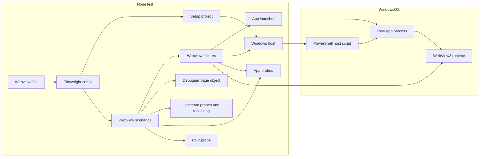
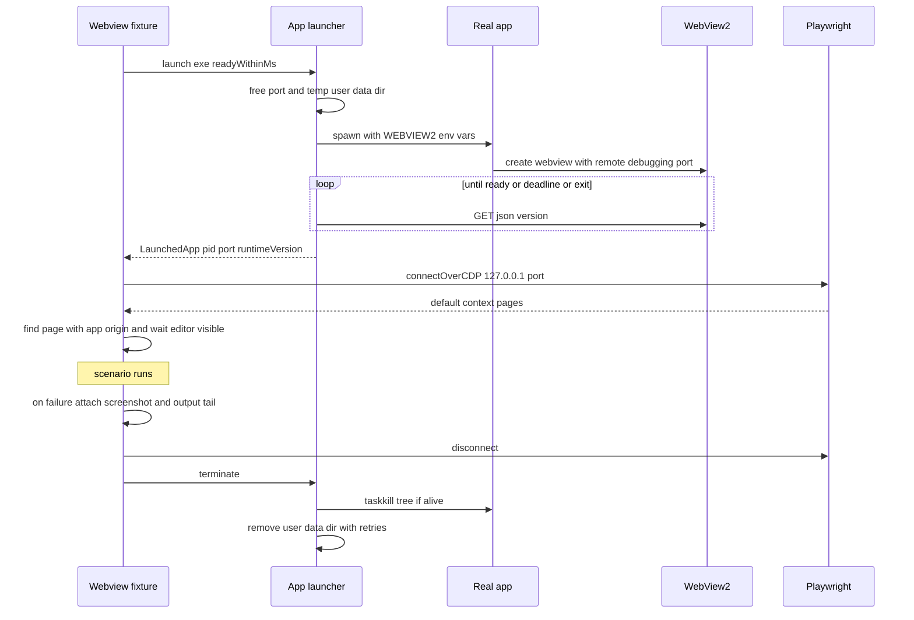
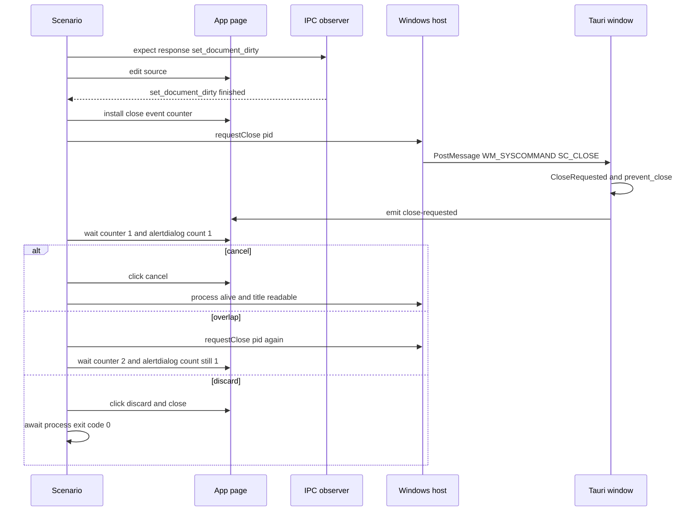

# Design Document(desktop-gui-e2e-webview)

## Overview

**Purpose**: desktop-gui の実アプリ(Tauri 2 + WebView2、Windows)を、配布と同じ画面を組み込んだ debug ビルドで起動し、Playwright の CDP 接続(`connectOverCDP`)で操作して、実配布形でしか起きないこと(実ウィンドウの閉じる要求、WebView2 のリロードと既定の右クリックメニュー、CSP の実効、実 IPC での実行と一時停止、実 WebView2 でのフォーカス枠の描画)を少数のシナリオで繰り返し検証する。

**Users**: desktop-gui と後続を変更する開発者が Windows で `npm run e2e:webview` を実行し、CI の運用者が Windows の job(初期は非必須)で同じスイートを実行する。

**Impact**: 製品のソース・設定・ケイパビリティ(`apps/desktop/src/**`、`apps/desktop/src-tauri/**`、`crates/*/src/**`)は変更しない。上流 `desktop-gui-e2e-browser` の Playwright 設定に opt-in のプロジェクトを追加し、`apps/desktop/e2e/support/webview/` の補助、`apps/desktop/e2e/webview/` のシナリオ、npm スクリプト、独立した Windows のワークフロー、README と traceability の記録を追加する。

### Goals
- Windows で 1 つのコマンドから、実アプリの準備・起動・接続・検証・終了までを行う(1.1、1.2、1.6〜1.8)
- 製品にテスト専用の仕組みを入れず、配布と同じ画面と設定で検証する(2.1〜2.5)
- ブラウザのスイートの設定・ページオブジェクト・補助を再利用し、シナリオを brief の In に限る(3.1〜3.4)
- 「起きなかった」ことの検証(リロード・メニュー・CSP)を陽性対照と組にし、偽の合格を防ぐ(6.2、6.4、7.4)

### Non-Goals
- ネイティブダイアログ、ウィンドウのサイズ変更と最小サイズ、OS の配色と高コントラストの切り替え、NVDA、スモーク 11.4
- 時間計測(`@perf`)。ブラウザのスイートが担う
- 並列実行、Windows 以外の OS、WebdriverIO への移行
- 製品の不具合の修正(見つけた場合は記録のみ)

## Boundary Commitments

### This Spec Owns
- 実アプリのプロセスの管理: 実行ファイルのパスの解決、一時的な利用者データのフォルダの割り当て(デバッグ口のポートは DevToolsActivePort から読む)、環境変数つきの起動、CDP の口の待機、プロセスツリーの終了と後始末(`e2e/support/webview/appProcess.ts`)
- OS の操作の窓口: WebView2 の版の取得、ウィンドウのタイトル、閉じる要求(`SC_CLOSE`)、OS のキー入力、既定のコンテキストメニューの検出(`e2e/support/webview/windowsHost.{ts,ps1}`)
- 実アプリのページの観測の補助: IPC の要求の観測、`close-requested` の受信の計数、ナビゲーションの目印、アプリの抑止の無効化(陽性対照用)、CSP の違反の記録と外部の受け口(`appProbes.ts`、`cspProbe.ts`)
- webview のフィクスチャ、準備物の確認、opt-in のプロジェクト定義、起動のランチャ
- シナリオ(`apps/desktop/e2e/webview/`)、npm スクリプト `e2e:webview*`
- CI のワークフロー `.github/workflows/e2e-webview.yml`(job は `e2e-webview` の 1 つ)
- `apps/desktop/README.md` の「E2E テスト(実アプリ・WebView2)」の節と「検証結果の記録」への追記、本 spec の `traceability.md`

### Out of Boundary
- 製品のソースと設定: `apps/desktop/src/**`、`apps/desktop/index.html`、`apps/desktop/vite.config.ts`、`apps/desktop/src-tauri/**`(`tauri.conf.json`、`Cargo.toml`、`build.rs`、`capabilities/**` を含む)、`crates/*/src/**`。テスト専用のコマンド(`e2e` feature)は採らない
- ブラウザのスイートの部品と設定: `e2e/support/` 直下の既存モジュール(`pages/DebuggerPage.ts`、`probes.ts`、`visual/*`、`fixtures.ts`、`prerequisites.ts`、`paths.ts`、`bridge/*`、`ipcShim/*`)、`e2e/specs/**`、`vitest.config.ts`、`tsconfig.e2e.json`(E2E の型検査)、`eslint.config.js`、`.gitignore`、`.github/workflows/e2e-browser.yml`。`playwright.config.ts` は「`projects` の末尾への展開 1 行と import 1 行」だけを変更する
- `.kiro/specs/desktop-gui/traceability.md`、`.kiro/specs/desktop-gui-e2e-browser/traceability.md`
- 基本 CI(`ci-baseline`)

### Allowed Dependencies
- 上流 `desktop-gui-e2e-browser` の公開の形: `DebuggerPage`(`e2e/support/pages/DebuggerPage.ts`)、`installDefaultActionProbe` / `readProbe` / `ProbeRecord`(`e2e/support/probes.ts`)、`expectFocusRingDrawn`(`e2e/support/visual/focusRing.ts`)、`playwright.config.ts` の `projects` 配列と `E2E_SKIP_PREREQ=1`・`E2E_PORT`、`DIST_INDEX_PATH`(`e2e/support/paths.ts`)
- 上流 `paths.ts` の `REPO_ROOT`(`e2e/support/paths.ts`)の import: `smoke-01`・`smoke-03` が `examples/hello.bf` の読み込みに使う(webview の `paths.ts` は上流を import しないため、ランチャ `cli.ts` の制約とは別に、シナリオだけが上流の値を使う)
- 製品のフロントから import してよいのは、ブラウザの spec と同じく `src/ipc/backend.ts` の定数(`CLOSE_REQUESTED_EVENT`)だけ
- Node(devDependencies): 既存の `@playwright/test`(~1.65、ブラウザの spec が追加)と `@tauri-apps/cli`(既存)。新しい npm 依存は追加しない
- OS: Windows 11、WebView2 Evergreen、`powershell.exe`(Windows PowerShell 5.1。`WScript.Shell`、`System.Windows.Forms`、`UIAutomationClient`、`user32` の P/Invoke)、`taskkill.exe`
- CI: GitHub Actions `windows-latest`、公式アクション(checkout、setup-node、upload-artifact)、`dtolnay/rust-toolchain`、`Swatinem/rust-cache`
- 依存の向き: シナリオ → フィクスチャ → (AppLauncher、WindowsHost、AppProbes、CspProbe、上流の DebuggerPage・probes・focusRing) → パス・型。ブラウザのスイートのコードは webview のコードを import しない

### Revalidation Triggers
- 上流の `DebuggerPage`・`probes.ts`・`focusRing.ts` の公開の形、`playwright.config.ts` の `projects`・`webServer`・`E2E_SKIP_PREREQ` の扱いの変更 → 本 spec のフィクスチャとシナリオを見直す
- `tauri.conf.json` の `build`(`beforeBuildCommand`・`frontendDist`)、`app.windows`(タイトル)、`app.security.csp` の変更 → 準備のコマンドと CSP・起動のシナリオを再実行する
- `src-tauri/src/window.rs`(閉じる判定とイベント名)、`src/app/shortcuts.ts`(キー・右クリックの抑止)、確認ダイアログの文言の変更 → 11.x のシナリオを見直す
- Tauri・wry の更新(IPC の経路: `fetch` 方式の `http://ipc.localhost/<cmd>` が拒否されたときの `customProtocolIpcFailed` による postMessage への切り替え(`scripts/ipc-protocol.js`)、wry の `window.ipc.postMessage` が `window.chrome.webview.postMessage` に渡すこと、要求の JSON の形(`cmd`・`callback`・`error`・`payload`)、Rust からの応答の `window.__TAURI_INTERNALS__.runCallback(id, data)` の `eval` と、それが引く `__TAURI_INTERNALS__.callbacks`(Map のインスタンス)、内部 API の `plugin:event|listen`、配信オリジン `http://tauri.localhost`、wry が WebView2 に渡す既定の追加引数)→ `AppProbes`(IPC の観測の方式を含む)、起動の確認、1.5 のブラウザプロセスのコマンドラインの比較を見直す
- 製品の CSP(`tauri.conf.json` の `app.security.csp`)の `connect-src` の変更(`ipc:`・`http://ipc.localhost` を許すと IPC が Tauri の想定する `fetch` 方式になり、`chrome.webview.postMessage` を通らなくなる)→ `AppProbes` の観測の方式(`window.fetch` の記録への切り替え)を見直す(対応済み: `connect-src 'self' ipc: http://ipc.localhost` を足し、IPC は fetch 方式で流れる。観測は `window.fetch` の記録が主になった)
- 実行ファイル名(`brainfuck-studio`)・`CARGO_TARGET_DIR` の扱いの変更 → `paths.ts` を見直す
- 本 spec の `WebviewApp` の形を変える → 下流(compiler-comparison が同じ基盤に足す場合)が再検証する
- `src-tauri` への path 依存 crate の追加(例: compiler-comparison の `brainfuck-compare-api`)→ ワークフローの `paths` の絞り込みを見直す

## Architecture

### Existing Architecture Analysis
- 実アプリの閉じる要求は `WindowEvent::CloseRequested` → 未保存なら `prevent_close` と `close-requested` の送出 → フロントの確認ダイアログ(`role="alertdialog"`)→ 「破棄して閉じる」で `confirm_exit`(`app.exit(0)`)の流れ。未保存の旗はフロントが `set_document_dirty` で非同期に伝える
- フロントはウィンドウの `keydown`(bubble)でショートカットとリロードのキーを `preventDefault` し、`contextmenu` は編集可能でない対象だけ抑止する
- CSP は `tauri.conf.json` の値を Tauri が配信時に付ける。値そのものは `tests/commands.rs` が固定している
- ブラウザのスイートは `playwright.config.ts`(`testDir: e2e/specs`、`projects: chromium / perf`、`webServer: vite preview`、読み込み時の準備物の確認)を持ち、`DebuggerPage` などは `Page` だけに依存する

### Architecture Pattern & Boundary Map



**Architecture Integration**:
- Selected pattern: 実アプリを外側から操作する黒箱の E2E。入力は CDP(DOM 操作・マウス)と OS(閉じる要求・キー)の 2 経路、観測は CDP(DOM・評価。IPC はページ内の記録器)と OS(タイトル・プロセスの終了・メニュー)
- 境界: Node のテストプロセス / 実アプリのプロセスツリー(アプリ + WebView2)/ PowerShell の補助プロセス。シナリオごとに実アプリを起動し、状態を共有しない
- 既存のパターンの維持: ブラウザのスイートのページオブジェクト・補助・設定の規約(`@perf` の分離、`expect` の自動リトライ、固定の待ち時間を使わない、失敗時の調査材料、`fixme` と注釈による製品の不具合の記録)
- Steering compliance: 製品の `unsafe` 禁止に影響しない(Rust のコードを追加しない)、Markdown は日本語

### Technology Stack

| Layer | Choice / Version | Role in Feature | Notes |
|-------|------------------|-----------------|-------|
| E2E ランナー | `@playwright/test` ~1.65(上流が追加) | `connectOverCDP`、フィクスチャ、setup プロジェクト、レポート | Chromium のダウンロードは不要 |
| 実アプリのビルド | `@tauri-apps/cli` ^2.12.4(既存)`tauri build --debug --no-bundle` | 画面を組み込んだ debug ビルド | 出力 `<target>/debug/brainfuck-studio.exe` |
| 実行環境 | Windows 11、WebView2 Evergreen | 実アプリの描画と CDP の口 | 環境変数 `WEBVIEW2_ADDITIONAL_BROWSER_ARGUMENTS`、`WEBVIEW2_USER_DATA_FOLDER` |
| OS の操作 | Windows PowerShell 5.1(`powershell.exe`) | 閉じる要求・キー入力・メニューの検出・版とタイトルの取得 | 1 回の操作ごとに起動し、1 行の JSON を返す |
| 単体テスト | Vitest 5(既存) | 補助の純粋な部分 | 既存の `include`(`e2e/support/**/*.test.ts`)に入る。OS に依存しない。上流と同じく各ファイルの先頭に `// @vitest-environment node` を置く(既定の環境は jsdom と `src/test/setup.ts`) |
| CI | GitHub Actions `windows-latest` | `e2e-webview` job(非必須) | WebView2 の Evergreen Bootstrapper、Rust のキャッシュ |

## File Structure Plan

### Directory Structure
```
apps/desktop/
├── e2e/
│   ├── support/webview/                 # webview 専用の補助(既存の vitest・tsc・eslint の範囲に入る)
│   │   ├── paths.ts                     # 実行ファイル・補助スクリプト・一時フォルダの根のパス、配信オリジンなどの定数
│   │   ├── prerequisites.ts             # 準備物の不足の判定(純粋関数)と、不足の一覧と準備の案内の文面
│   │   ├── windowsHost.ps1              # OS の操作の本体(動作: runtime / window / close / keys / menu)。結果は 1 行の JSON
│   │   ├── windowsHost.ts               # PowerShell の起動と結果の解析(解析は純粋関数)。pid に束ねた窓口
│   │   ├── appProcess.ts                # 環境変数(デバッグ口はポート 0)、起動、DevToolsActivePort と CDP の口の待機、終了と後始末
│   │   ├── appProbes.ts                 # IPC の観測、close-requested の計数、ナビゲーションの目印、抑止の無効化(陽性対照)
│   │   ├── cspProbe.ts                  # 違反の記録と、外部オリジンの受け口(127.0.0.1 の HTTP サーバ)
│   │   ├── fixtures.ts                  # `app` フィクスチャ(起動・接続・ページの特定・失敗時の添付・終了)
│   │   ├── fixtureFailure.ts            # 失敗の材料を残すかの判定と、アプリ終了後に OS の窓口を呼ばない判定(純粋関数)
│   │   ├── userDataCleanup.ts           # 古い一時フォルダ(scenario-<uuid>)の掃除の対象の選択(純粋関数。削除の I/O は呼び出し側)
│   │   ├── projects.ts                  # opt-in のプロジェクト定義(E2E_WEBVIEW=1 のときだけ返す)
│   │   ├── cli.ts                       # ランチャ: 環境変数を付けて Playwright を webview のプロジェクトで起動
│   │   └── *.test.ts                    # paths / prerequisites / windowsHost / appProcess / appProbes / cspProbe / projects / cli / fixtureFailure / userDataCleanup の単体テスト
│   └── webview/                         # webview のシナリオ(webview プロジェクトの testDir)
│       ├── prerequisites.setup.ts       # setup プロジェクト: 準備物の確認、WebView2 の版の記録、古い一時フォルダの掃除
│       ├── smoke-01-startup.webview.spec.ts
│       ├── smoke-03-hello-world.webview.spec.ts
│       ├── smoke-04-pause-resume.webview.spec.ts     # 4 と 9.3
│       ├── smoke-11-close.webview.spec.ts            # 11.1・11.2・11.3・11.5
│       ├── smoke-11-defaults.webview.spec.ts         # 11.6・11.7 と陽性対照
│       ├── smoke-13-focus-ring.webview.spec.ts       # 13.3
│       └── csp.webview.spec.ts                       # CSP の実効と陽性対照

.github/workflows/e2e-webview.yml        # 本 spec の CI(job: e2e-webview のみ)
.kiro/specs/desktop-gui-e2e-webview/traceability.md   # 最終検証で作成
```

### Modified Files
製品のソースの変更は**無い**。変更するのは次のテスト設定・文書だけである。

- `apps/desktop/playwright.config.ts`(上流が作成)— `webviewProjects` の import 1 行と、`projects` の末尾への `...webviewProjects(process.env)` の展開だけを追加する。既存のプロジェクト・`webServer`・準備物の確認は変えない
- `apps/desktop/package.json` — スクリプト `e2e:webview:prepare`、`e2e:webview:run`、`e2e:webview` を追加する(既存のスクリプトと依存は変えない)
- `apps/desktop/README.md` — 「E2E テスト(実アプリ・WebView2)」の節の追加と、「検証結果の記録」への追記

### ブラウザの spec への変更
- **必要な変更: 無し**。本 spec が使う拡張点(`projects` 配列への追加、`E2E_SKIP_PREREQ=1`、`DebuggerPage`・`probes`・`focusRing` の `Page` だけに依存する形、`e2e/support/**/*.test.ts` の単体テストの範囲)は、ブラウザの spec の design にすべてある
- **任意の改善(提案)**: webview の実行(`E2E_WEBVIEW=1`)では `webServer`(`vite preview`)を起動しない分岐。現状でも `dist/` は準備で作られ、`vite preview` は無害に起動するため必須ではない。採る場合はブラウザの spec の design を更新してから行う

## System Flows

### シナリオごとの起動・接続・終了



- 起動確認の上限は `E2E_APP_READY_MS`(既定 60,000 ms)。上限超過・プロセスの早期終了・実行ファイルが無いことは、それぞれ理由つきの `AppLaunchError` にする(1.5、1.7)
- 終了は、閉じるシナリオで既にプロセスが終わっている場合は `taskkill` を省く。フォルダの削除に失敗したら警告の注釈にし、次回の setup プロジェクトが掃除する(1.8)

### 閉じる確認(11.1・11.2・11.3・11.5)



- 未保存の旗の伝達(5.6): 編集の前に `set_document_dirty` の応答の待ち受けを始め、応答を観測してから閉じる要求を送る。観測の根拠は、`chrome.webview.postMessage` に渡った `set_document_dirty` の要求と、Rust が処理を終えてから返す `runCallback` の応答(AppProbes の postMessage の方式)
- 重ねた要求の到達(5.4): ページ内の `close-requested` の受信の計数が 2 になったことを確かめてから、確認ダイアログが 1 つであることを判定する

## Requirements Traceability

| Requirement | Summary | Components | Interfaces | Flows |
|-------------|---------|------------|------------|-------|
| 1.1 | 準備のコマンド | npm スクリプト、WebviewPaths | `npm run e2e:webview:prepare` | — |
| 1.2 | 実行のコマンド | WebviewCli、WebviewProjects、WebviewFixtures | `npm run e2e:webview:run`、`npm run e2e:webview` | 起動・接続・終了 |
| 1.3 | 既存のコマンドを変えない | WebviewProjects、WebviewCli | `E2E_WEBVIEW=1` の opt-in | — |
| 1.4 | Windows 以外で失敗 | WebviewPrerequisites、SetupProject | `missingWebviewPrerequisites` | — |
| 1.5 | 準備物の不足の案内 | WebviewPrerequisites、SetupProject、AppLauncher | 不足の一覧と案内 | — |
| 1.6 | 順に実行・シナリオごとの起動と分離 | WebviewProjects、AppLauncher、WebviewFixtures | `workers: 1`、デバッグ口のポート 0(DevToolsActivePort から読む)、一時フォルダ | 起動・接続・終了 |
| 1.7 | 起動の上限時間 | AppLauncher | `waitForCdpEndpoint`、`AppLaunchError` | 起動・接続・終了 |
| 1.8 | 終了と後始末 | AppLauncher、WebviewFixtures、SetupProject | `terminate` | 起動・接続・終了 |
| 1.9 | 失敗時の調査材料 | WebviewFixtures、AppLauncher | `outputTail`、スクリーンショットの添付 | 起動・接続・終了 |
| 1.10 | WebView2 の版の記録 | SetupProject、WindowsHost、WebviewFixtures | `runtimeVersion` の注釈 | — |
| 1.11 | 型検査・lint・単体テスト | 全補助の `*.test.ts` | 既存の `npm run typecheck`・`lint`・`test` | — |
| 2.1 | 配布と同じ画面と設定 | npm スクリプト、WebviewFixtures | `tauri build --debug --no-bundle`、`APP_ORIGIN` | — |
| 2.2 | テスト専用の口を追加しない | 全体(製品の変更なし)、WindowsHost | `SC_CLOSE` による閉じる要求 | 閉じる確認 |
| 2.3 | デバッグ口はテストの起動だけ | AppLauncher | `buildAppEnv` | 起動・接続・終了 |
| 2.4 | 変更の一覧 | 本 design の Modified Files | — | — |
| 2.5 | 1420 を使わない・配信サーバと衝突しない | AppLauncher、WebviewCli | 空きポート、組み込みの画面、`E2E_PORT` | — |
| 3.1 | 同じ設定ファイルの独立した単位 | WebviewProjects | `webview-setup`、`webview` | — |
| 3.2 | 上流の部品の再利用 | WebviewFixtures、シナリオ | `DebuggerPage`、`installDefaultActionProbe`、`expectFocusRingDrawn` | — |
| 3.3 | In だけをシナリオに | シナリオの対応表 | — | — |
| 3.4 | 上流の変更の明記 | 本 design の「ブラウザの spec への変更」 | — | — |
| 4.1 | 起動と初期状態 | Smoke01、WindowsHost、DebuggerPage | `host.windowTitle()` | — |
| 4.2 | Hello World と実 IPC | Smoke03、IpcObserver | `ipc.commands()` | — |
| 4.3 | Pause と再開 | Smoke04、DebuggerPage | — | — |
| 4.4 | 実行数の増加 | Smoke04、DebuggerPage | `statusValue("実行数")` | — |
| 5.1、5.2、5.3、5.4 | 閉じる確認 | Smoke11Close、WindowsHost、CloseEventCounter | `host.requestClose()`、`closeEvents.count()`、`app.process.exited` | 閉じる確認 |
| 5.5 | 閉じる要求を送れない | WindowsHost | `HostActionError` | 閉じる確認 |
| 5.6 | 未保存の旗の伝達 | IpcObserver、Smoke11Close | `ipc.armResponse("set_document_dirty")` | 閉じる確認 |
| 6.1、6.2 | リロードの抑止と陽性対照 | Smoke11Defaults、WindowsHost、NavigationMarker、SuppressionBypass、上流の probes | `host.sendKeys()` | — |
| 6.3、6.4 | 右クリックの抑止と陽性対照 | Smoke11Defaults、WindowsHost、SuppressionBypass、上流の probes | `host.contextMenuOpen()` | — |
| 6.5 | OS の入力を届けられない | WindowsHost | `HostActionError` | — |
| 7.1、7.2、7.3、7.4 | CSP の実効と陽性対照 | CspTest、CspProbe | `startExternalSink`、`readCspViolations` | — |
| 8.1、8.2 | フォーカス枠と配色の記録 | Smoke13FocusRing、上流の focusRing | `expectFocusRingDrawn` | — |
| 9.1〜9.6 | Windows の CI | CiWorkflow | `e2e-webview` job | — |
| 10.1、10.2、10.5 | traceability | Traceability | — | — |
| 10.3、10.4 | README の手順と記録 | README | — | — |

## Components and Interfaces

| Component | Domain | Intent | Req Coverage | Key Dependencies | Contracts |
|-----------|--------|--------|--------------|------------------|-----------|
| WebviewPaths | 基盤 | パスと定数 | 1.1、1.5、2.1 | — | Service |
| WebviewPrerequisites | 基盤 | 準備物の判定と案内 | 1.4、1.5 | WebviewPaths (P0) | Service |
| WindowsHost | OS 操作 | 版・タイトル・閉じる・キー・メニュー | 1.10、4.1、5.1〜5.5、6.1〜6.5 | powershell.exe (P0) | Service |
| AppLauncher | 基盤 | 実アプリのプロセス管理 | 1.6〜1.9、2.3、2.5 | WebviewPaths (P0) | Service、State |
| AppProbes | 観測 | IPC・閉じる要求の計数・ナビゲーション・抑止の無効化 | 4.2、5.4、5.6、6.1〜6.4 | Playwright (P0) | Service |
| CspProbe | 観測 | 違反の記録と外部の受け口 | 7.1〜7.4 | node:http (P0) | Service |
| WebviewFixtures | 基盤 | シナリオごとの組み立てと後始末 | 1.6、1.8〜1.10、2.1、3.2 | AppLauncher、WindowsHost、AppProbes、DebuggerPage (P0) | Service |
| WebviewProjects / WebviewCli / SetupProject | 基盤 | opt-in のプロジェクトと起動、準備の確認 | 1.2〜1.5、1.8、1.10、3.1 | Playwright (P0) | — |
| Smoke01 / Smoke03 / Smoke04 / Smoke11Close / Smoke11Defaults / Smoke13FocusRing / CspTest | シナリオ | In の各項目の検証 | 4〜8 | WebviewFixtures (P0) | — |
| CiWorkflow | CI | Windows での実行 | 9.1〜9.6 | GitHub Actions (P0) | Batch |
| README / Traceability | 文書 | 手順・記録・対応表 | 10.1〜10.5 | — | — |

### 基盤(`apps/desktop/e2e/support/webview/`)

#### WebviewPaths

```typescript
/** 組み込みの画面の配信オリジン(Windows の Tauri 2 の既定) */
export const APP_ORIGIN = "http://tauri.localhost";
/** Tauri の `fetch` 方式の IPC の宛先の接頭辞(コマンド名がパスに入る)。製品の CSP が `connect-src` で許すため、AppProbes の記録(`window.fetch` の包み込み)が使う */
export const IPC_URL_PREFIX = "http://ipc.localhost/";
export const APP_EXE_NAME = "brainfuck-studio.exe";
/** E2E_APP_BIN > CARGO_TARGET_DIR/debug > apps/desktop/src-tauri/target/debug の順 */
export function appBinaryPath(env: NodeJS.ProcessEnv): string;
export const WINDOWS_HOST_SCRIPT_PATH: string;       // e2e/support/webview/windowsHost.ps1 の絶対パス
/** 一時的な利用者データのフォルダの根(os.tmpdir() の下の bfstudio-e2e-webview) */
export function userDataRoot(tmpDir: string): string;
```

#### WebviewPrerequisites

```typescript
export type PrerequisiteFacts = {
  platform: NodeJS.Platform;
  appBinaryExists: boolean;
  appBinaryPath: string;
  hostAvailable: boolean;                 // windowsHost.ps1 の runtime 動作が成功した
  webView2Version: string | null;         // 導入されていなければ null
  distExists: boolean;                    // 上流の DIST_INDEX_PATH(配信サーバ vite preview の起動に要る)
};
/** ランチャが Playwright の起動前に使う判定(Windows であることと dist の有無だけ)。配信サーバの失敗より先に案内を出す */
export function missingLaunchPrerequisites(facts: Pick<PrerequisiteFacts, "platform" | "distExists">): string[];
/** 不足の一覧(案内の文面つき)。空なら準備が整っている */
export function missingWebviewPrerequisites(facts: PrerequisiteFacts): string[];
```
- 文面: Windows 以外は「Windows 限定」(1.4)、実行ファイルが無い場合はパスと `npm run e2e:webview:prepare`、`powershell.exe` が使えない場合はその旨、WebView2 が無い場合は Evergreen の導入方法(1.5)

#### WindowsHost

| Field | Detail |
|-------|--------|
| Intent | OS の操作を PowerShell の補助スクリプトに委ね、結果を型つきで返す |
| Requirements | 1.10、4.1、5.1〜5.5、6.1〜6.5 |

**Contracts**: Service [x]

```typescript
export type HostAction = "runtime" | "window" | "close" | "keys" | "menu";
export type HostResult =
  | { action: "runtime"; webView2Version: string | null }
  | { action: "window"; found: boolean; title: string | null }
  | { action: "close"; delivered: boolean; reason: string | null }
  | { action: "keys"; delivered: boolean; reason: string | null }
  | { action: "menu"; menuOpen: boolean };
export class HostActionError extends Error { readonly action: HostAction; readonly reason: string }
/** 1 行の JSON を検証して型に写す。形が違えば HostActionError */
export function parseHostResult(action: HostAction, stdout: string): HostResult;
export function runHostAction(action: "runtime"): Promise<{ webView2Version: string | null }>;
export interface BoundWindowsHost {
  windowTitle(): Promise<string>;              // 見つからなければ HostActionError
  requestClose(): Promise<void>;               // 送れなければ HostActionError(5.5)
  sendKeys(keys: string): Promise<void>;       // SendKeys の記法。前面化や送信に失敗すれば HostActionError(6.5)
  contextMenuOpen(): Promise<boolean>;
}
export function bindWindowsHost(pid: number): BoundWindowsHost;
```

`windowsHost.ps1` の動作(引数 `-Action`、`-ProcessId`、`-Keys`。標準出力は結果の 1 行の JSON だけ、失敗は `{ "error": "..." }` と終了コード 1):

| 動作 | 処理 |
|---|---|
| `runtime` | レジストリの EdgeUpdate の WebView2 のクライアント(`{F3017226-FE2A-4295-8BDF-00C3A9A7E4C5}`)の `pv` を HKLM(WOW6432Node)・HKCU の順に読む |
| `window` | プロセスの主ウィンドウ(表示中で所有者の無いトップレベル)のハンドルとタイトル |
| `close` | 主ウィンドウへ `PostMessage(WM_SYSCOMMAND, SC_CLOSE, 0)`(× ボタンと同じ経路)。ウィンドウが無ければ `delivered: false` と理由 |
| `keys` | 前面化の段階(前面は `GetForegroundWindow` のプロセス ID で確かめる): (1) `WScript.Shell.AppActivate(pid)` を呼び、前面になるまで短く待つ(戻り値は判定に使わない)。(2) 前面にならなければ、最小化の復元と `AttachThreadInput` による `SetForegroundWindow`・`BringWindowToTop`(前面化の要求。キーは送らない)を行い、再び短く待つ。(3) それでも前面にならなければ何も送らず、`delivered: false` と「前面化できません(前面は X のままでした)」。(4) 前面になったら、送信の直前にも前面を確かめ、`System.Windows.Forms.SendKeys.SendWait(keys)` を送り、直後にも前面を確かめる。送信の直前・直後のどちらかで前面が変わっていれば `delivered: false`(キーが別のウィンドウへ届いた可能性を理由に含める) |
| `menu` | 対象プロセスと子孫のプロセス ID(`Win32_Process` の親子)を集める。`EnumWindows` で列挙した可視の最上位ウィンドウのうち、主ウィンドウ以外で、所有プロセスが対象のプロセスツリー内、クラスが `Chrome_WidgetWin_*` のものの UI Automation の部分木(`FromHandle` の `FindFirst(Subtree)`)に `ControlType.Menu` があるか。UIA のルート直下には既定のメニューが現れないため、この方法を使う。結果は `menuOpen` と、検出時の診断 `menu`(ポップアップのクラスと項目の名前。無ければ `null`) |

- 起動は `powershell.exe -NoProfile -NonInteractive -ExecutionPolicy Bypass -File <script> ...`(`execFile`)。補助スクリプトのパスは固定で、利用者の入力を引数に渡さない
- Node 側は `delivered: false` を `HostActionError` に変え、理由をテストの失敗に含める(偽の合格にしない)

#### AppLauncher

| Field | Detail |
|-------|--------|
| Intent | 実アプリをシナリオごとに独立した口とフォルダで起動し、接続可能になるまで待ち、確実に終了させる |
| Requirements | 1.6〜1.9、2.3、2.5 |

**Contracts**: Service [x] / State [x]

```typescript
export type AppExit = { code: number | null; signal: NodeJS.Signals | null };
export type CdpVersion = { browser: string; webSocketDebuggerUrl: string };
export type LaunchOptions = { exePath: string; userDataRoot: string; readyWithinMs: number; userDataDir?: string }; // userDataDir は単体テスト専用
export interface LaunchedApp {
  readonly pid: number;
  readonly cdpEndpoint: string;            // http://127.0.0.1:<port>
  readonly userDataDir: string;
  readonly runtimeVersion: string;         // /json/version の Browser(例: Edg/1xx.x)
  readonly exited: Promise<AppExit>;
  readonly exit: AppExit | null;           // 動いていれば null
  readonly outputTail: string;             // 標準出力と標準エラーの末尾(最大 64 KiB)
  /** 動いていればプロセスツリーを終了し、終了を待ってからフォルダを削除する。削除の失敗は結果で返す(投げない) */
  terminate(): Promise<{ userDataRemoved: boolean }>;
}
export class AppLaunchError extends Error { readonly reason: "notFound" | "exitedEarly" | "notReady"; readonly outputTail: string }
export function parseDevToolsActivePort(content: string): number | null;  // 1 行目がポート、2 行目が /devtools/... のパス(書きかけは null)
export function devToolsActivePortPath(userDataDir: string): string;      // <利用者データ>/EBWebView/DevToolsActivePort
/** 継承した WEBVIEW2_* を除き、デバッグ口(追加の引数)と利用者データの 2 つだけを設定した環境(純粋関数) */
export function buildAppEnv(base: NodeJS.ProcessEnv, userDataDir: string): NodeJS.ProcessEnv;
/** /json/version が応答するまで再試行する。プロセスの終了・上限超過で AppLaunchError(取得とプロセス状態は注入できる) */
export function waitForCdpEndpoint(port: number, deps: { readyWithinMs: number; fetchVersion: (port: number) => Promise<CdpVersion | null>; hasExited: () => boolean }): Promise<CdpVersion>;
export function waitForDevToolsPort(deps: { readyWithinMs: number; readFile: () => Promise<string | null>; hasExited: () => boolean }): Promise<number>;
export function launchApp(options: LaunchOptions): Promise<LaunchedApp>;
```
- 環境変数: `WEBVIEW2_ADDITIONAL_BROWSER_ARGUMENTS=--remote-debugging-port=0`(デバッグ口だけ。空きポートを先に取らず、OS に選ばせる)、`WEBVIEW2_USER_DATA_FOLDER=<userDataRoot>/<一意の名前>`。`tauri.conf.json` は変更しないため、利用者の通常の起動ではデバッグ口は開かない(2.3)
- 配布形との一致(2.1): Microsoft の `CreateCoreWebView2EnvironmentWithOptions` の文書のとおり、`WEBVIEW2_ADDITIONAL_BROWSER_ARGUMENTS` はアプリが渡す追加の引数(wry の `--disable-features=msWebOOUI,...` など)に**追加**される(アプリの指定を置き換える環境変数は `WEBVIEW2_USER_DATA_FOLDER` だけ)。そのため、アプリの既定の引数を環境変数に写さない(写すとスイッチが重複し、wry の既定と食い違ったときに配布形の構成を黙って上書きする)
- 配布形との一致の確認(1.5): 通常の起動とテストの起動のそれぞれで、WebView2 のブラウザプロセス(`msedgewebview2.exe`、アプリの子)のコマンドラインを `Win32_Process` で取り、重複を除いた実効のスイッチの集合を比べる。`--user-data-dir` の値を除いた差が `--remote-debugging-port` だけであること、テストの起動の `--user-data-dir` がシナリオごとの一時フォルダ(`userDataRoot` の下)を指すことを確かめ、README の記録に残す。ほかの差が出た場合(環境変数がアプリの指定を置き換えていた場合など)は、design を更新してから進める
- 起動は `spawn(exePath, [], { env, windowsHide: false, stdio: ["ignore", "pipe", "pipe"] })`(シェルを介さない)。起動の前に `<利用者データ>/EBWebView/DevToolsActivePort` を消し、現れて解析できる 1 行目のポートを `waitForDevToolsPort` で待つ(上限は `E2E_APP_READY_MS`、現れる前の終了は `exitedEarly`、上限超過は `notReady`)。そのあと `waitForCdpEndpoint` で `/json/version` の応答を待つ
- CI(昇格したランナー)では環境変数が無視されるため、job の手順で HKLM のポリシー `AdditionalBrowserArguments`(値 `brainfuck-studio.exe` = `--remote-debugging-port=0`)を書く。ローカルには影響しない
- `notReady` の文面は、ウイルス対策ソフトの除外・一時停止、新しい `CARGO_TARGET_DIR` での再ビルド、固まったプロセスは再起動で消えることを案内する(1.7)
- 終了は `taskkill /PID <pid> /T /F` で WebView2 の子プロセスを含めて終わらせる。フォルダの削除は `fs.rm` の再試行つき(1.8)
- 上限時間は `E2E_APP_READY_MS`(既定 60,000)。DevToolsActivePort を待つ段と CDP の応答を待つ段のそれぞれに上限が適用されるため、合計では最大で上限の 2 倍まで待つことがある

### 観測(`appProbes.ts`、`cspProbe.ts`)

#### AppProbes

```typescript
/** postMessage: ページ内の chrome.webview.postMessage の包み込み(要求)と __TAURI_INTERNALS__.callbacks の get の差し替え(完了)。実アプリで確定した唯一の方式 */
export type IpcObservationMode = "postMessage";
/** フィクスチャが使う方式(既定は "postMessage") */
export const IPC_OBSERVATION_MODE: IpcObservationMode;
export interface IpcObserver {
  readonly mode: IpcObservationMode;
  commands(): Promise<readonly string[]>;                     // 設置以後に観測した要求のコマンド名(順序どおり)
  /** 待ち受けを確定してから返る。completed は、確定以降に Rust から応答が返った(runCallback で callback または error の id が引かれた)そのコマンドで解決し、その応答の成否 ok を返す(error の応答でも解決する) */
  armResponse(command: string): Promise<{ readonly completed: Promise<{ readonly ok: boolean }> }>;
}
/** 接続後に page.evaluate で記録器を設置する(リロードしない)。前提が無ければ理由つきで失敗する */
export function observeIpc(page: Page, mode: IpcObservationMode): Promise<IpcObserver>;
/** ページ内の記録の 1 件。done は完了の単調な連番(未完了は 0) */
export type IpcLogEntry = { id: number; cmd: string; done: number; ok: boolean | null };
/** postMessage の方式の本体(page.evaluate に渡す。単体テストでは偽の window を渡す。公開の名前と引数の型の細部は実装に任せる)。前提を検査し、要求と完了をページ内の記録に残す。元の postMessage・callbacks の get の結果は変えない */
export function installIpcRecorder(win: IpcRecorderTarget): void;

export interface CloseEventCounter { count(): Promise<number> }
/** ページ内で close-requested をもう 1 つ購読し、受信回数を数える(__TAURI_INTERNALS__ の plugin:event|listen) */
export function installCloseEventCounter(page: Page): Promise<CloseEventCounter>;

export interface NavigationMarker { isIntact(): Promise<boolean>; readonly navigations: number }
/** ページに一意の目印を置き、メインフレームの遷移を数える */
export function placeNavigationMarker(page: Page): Promise<NavigationMarker>;

/** 陽性対照用: window の capture で keydown / contextmenu を stopImmediatePropagation し、アプリの抑止を無効にする */
export function bypassAppSuppression(page: Page, kinds: readonly ("keydown" | "contextmenu")[]): Promise<void>;
```
- イベント名は `src/ipc/backend.ts` の `CLOSE_REQUESTED_EVENT` を使う
- `armResponse` は「await で待ち受けを確定し、操作し、その後 `completed` を await する」順で使う(5.6)
- 起動時の IPC は `plugin:event|listen` だけで、CDP の接続より前に終わる。`load_source` は Run の開始の流れ(`runController`)からだけ、`set_document_dirty` は未保存の旗が変わったときだけ呼ばれる。そのため観測の確認は「接続後の編集」(`set_document_dirty`)と「Run の後」(`load_source`・`start_session`・`run_batch`)で行い、起動時の要求は観測の対象にしない
- 実アプリの IPC の経路(実測。Tauri 2.12、WebView2。`connect-src` を足す前の実測で、現在の経路は次の「現在の経路」の項を参照): 追加前の製品の CSP(`connect-src` 未指定で `default-src 'self'` に落ちる)が Tauri の `fetch` 方式の IPC(`http://ipc.localhost/<cmd>`)を拒否するため、Tauri は起動時に `customProtocolIpcFailed` で postMessage の方式に切り替える(`console.warn('IPC custom protocol failed, Tauri will now use the postMessage interface instead')`)。要求は `window.ipc.postMessage`(wry の `Object.freeze({ postMessage: s => window.chrome.webview.postMessage(s) })`)に JSON 文字列(`{"cmd":"set_document_dirty","callback":<id>,"error":<id>,"options":{"customProtocolIpcBlocked":true},"payload":{...}}`)で渡り、Rust はコマンドの処理を終えてから `webview.eval("window.__TAURI_INTERNALS__.runCallback(id, data)")` で応答を返す(`tauri/src/ipc/format_callback.rs`)。IPC はネットワーク要求にならない
- 現在の経路(`connect-src` 追加後): 製品の CSP が `connect-src 'self' ipc: http://ipc.localhost` を許すため、IPC は fetch 方式(`http://ipc.localhost/<cmd>`、ネットワーク要求)で流れ、postMessage には切り替わらない。観測の要求・完了は、主に `window.fetch` の包み込みが記録する。postMessage の包み込みは、Tauri がフォールバックしたときのために残す。方式の名前 `postMessage` は既存の観測との互換のため変えていない
- IPC の観測の仕組み(シナリオは `IpcObserver` だけに依存し、方式を知らない):
  - 設置: フィクスチャが接続後に `page.evaluate` で `installIpcRecorder` を適用する。リロードしない(起動直後のアプリの状態を保つ)。設置の時点で `__TAURI_INTERNALS__.callbacks instanceof Map` と `window.chrome.webview.postMessage` が関数であることを確かめ、満たさなければ理由つきで失敗させる(Tauri の内部 API の変更を早く検出する)
  - 要求の記録: `window.chrome.webview.postMessage`(書き換え可能)を包み、JSON から `cmd`・`callback`・`error` を取り、ページ内の記録に `{ id, cmd, done: 0 }` を足してから元の関数に同じ文字列を渡す。解析できない文字列は記録せずにそのまま渡す
  - 完了の記録: `__TAURI_INTERNALS__.callbacks`(Map のインスタンス)に自前の `get` を置き、`runCallback` が記録済みの callback または error の id を引いた時点で `done = ++seq` と成否(callback なら成功、error なら失敗)を記録し、元の `get` の結果を返す。Rust はコマンドの処理を終えてから `eval` するため、`done` は「Rust 側の処理が終わって応答が返った」ことを意味する。5.6 と 4.2 の確認の根拠は「postMessage の要求と、Rust からの `runCallback` の応答」になる
  - 保険: `window.fetch`(書き換え可能)の `IPC_URL_PREFIX` 宛ての要求も同じ記録に残す(製品の CSP が変わって `fetch` 方式になった場合の検出用)
  - `armResponse(cmd)`: 確定の時点の連番を `armedAt` として取り、`entries.some(e => e.cmd === cmd && e.done > armedAt)` を `page.waitForFunction` で待つ。回数ではなく単調な連番で比べるため、確定より前に完了した同じコマンドを拾わない。待ちが済んだら同じ条件の要求の `ok` を読み、`completed` は `{ ok }` で解決する(シナリオは `ok` が `true` であることを確かめる。エラーの応答で解決しても失敗にできる)
  - 包めないもの: `__TAURI_INTERNALS__` の `invoke`・`ipc`・`postMessage`・`runCallback`・`callbacks` のプロパティ自体は `Object.defineProperty` に `value` だけを渡して定義され、`writable: false`・`configurable: false` のため置き換えられない(包めるのは `window.chrome.webview.postMessage`・`window.fetch` と、`callbacks` の Map のインスタンスの `get`)
- 不成立とした方式(判断の記録。根拠と実測は research.md): `network`(CDP 越しのページのネットワーク要求 `http://ipc.localhost/<cmd>` の購読)は、上記の CSP の拒否により IPC が最初からネットワーク要求にならず、CDP の Network・Fetch ドメインにも `page.on("request")` にも 0 件だったため不成立。`invoke`(`__TAURI_INTERNALS__.invoke` の包み込み)は、プロパティが書き換え不可のため不成立。どちらも廃止し、`ipcCommandFromUrl`・`installInvokeRecorder` は持たない

#### CspProbe

```typescript
export type CspViolation = { effectiveDirective: string; blockedURI: string };
export function installCspViolationCollector(page: Page): Promise<void>;   // securitypolicyviolation を記録
export function readCspViolations(page: Page): Promise<readonly CspViolation[]>;
export interface ExternalSink { readonly origin: string; requestCount(): number; close(): Promise<void> }
/** 127.0.0.1 の空きポートで、受けた要求を数えるだけの HTTP サーバ */
export function startExternalSink(): Promise<ExternalSink>;
```

### フィクスチャ・プロジェクト・起動

#### WebviewFixtures

| Field | Detail |
|-------|--------|
| Intent | シナリオごとに実アプリを起動・接続し、ページ・ページオブジェクト・OS の窓口・観測を渡し、失敗時に材料を残して確実に終了させる |
| Requirements | 1.6、1.8〜1.10、2.1、3.2 |

**Contracts**: Service [x]

```typescript
export interface WebviewApp {
  readonly process: LaunchedApp;
  readonly page: Page;                       // CDP で得たアプリのページ(URL が APP_ORIGIN で始まる)
  readonly debuggerPage: DebuggerPage;       // 上流のページオブジェクト
  readonly host: BoundWindowsHost;           // pid に束ねた OS の窓口
  readonly ipc: IpcObserver;                 // 接続後に設置した記録器による観測(postMessage の方式。設置でリロードしない)
}
export const test: TestType<PlaywrightTestArgs & PlaywrightTestOptions & { app: WebviewApp }, PlaywrightWorkerArgs & PlaywrightWorkerOptions>;
export { expect } from "@playwright/test";
```
- `app`(テスト単位): `launchApp` → `chromium.connectOverCDP(cdpEndpoint)` → 既定のコンテキストのページから `APP_ORIGIN` のページを特定(現れるまで待つ)→ `debuggerPage.editor` の表示を待つ → `observeIpc(page, IPC_OBSERVATION_MODE)`(接続後に `page.evaluate` で記録器を設置する。リロードしないので起動直後のアプリの状態を保つ。接続より前の起動時の IPC は観測しない)→ `use` → 後始末
- 後始末: 失敗なら `page.screenshot` と `outputTail` を添付(1.9)、`runtimeVersion` を注釈(1.10)、CDP を切断、`terminate()`。フォルダの削除の失敗は `warning` の注釈
- シナリオは組み込みの `page`・`context`・`browser` を使わない(使うと Chromium を起動するため)。画面の操作は `app.debuggerPage` と `app.page` だけで行う

#### WebviewProjects / WebviewCli / SetupProject

```typescript
// projects.ts
export const WEBVIEW_ENV_FLAG = "E2E_WEBVIEW";
/** E2E_WEBVIEW=1 のときだけ [webview-setup, webview] を返す。それ以外は空配列 */
export function webviewProjects(env: NodeJS.ProcessEnv): Project[];
// cli.ts
/** Playwright の CLI を現在の Node で起動する指定(純粋関数)。引数はそのまま後ろに渡す */
export function buildWebviewRun(argv: readonly string[], env: NodeJS.ProcessEnv, freePort: number): { command: string; args: string[]; env: NodeJS.ProcessEnv };
```
- `webview-setup`: `testDir: "e2e/webview"`、`testMatch: /prerequisites\.setup\.ts$/`
- `webview`: `testDir: "e2e/webview"`、`testMatch: /\.webview\.spec\.ts$/`、`dependencies: ["webview-setup"]`、`grepInvert: /@perf/`(上流の規約。本 spec は `@perf` を置かない)、`fullyParallel: false`、`workers: 1`、`timeout: 120_000`
- `cli.ts` は Playwright を起動する前に `missingLaunchPrerequisites` で Windows であることと `dist/` の有無を確かめ、不足なら一覧と `npm run e2e:webview:prepare` を示して終了コード 1 で終わる(上流の `webServer` は `dist/` が無いと起動に失敗し、setup プロジェクトより先に止まるため。1.4、1.5)
- `cli.ts` の環境: `E2E_WEBVIEW=1`、`E2E_SKIP_PREREQ=1`(上流の準備物の確認を省く)、`E2E_PORT`(未指定なら空きポート。上流の `webServer` の `vite preview` がブラウザのスイートの配信サーバと衝突しないようにする。2.5)。引数: `test --project=webview --workers=1` + 利用者の引数。Node 26 の型の除去で直接実行する
- `cli.ts` の型の除去の制約: Node の型の除去は、`cli.ts` が推移的に import するすべてのファイルに、相対 import の `.ts` の拡張子と消去可能な構文だけ(`enum`・`namespace`・コンストラクタ引数のプロパティなどを使わない)を求める。この制約を上流のファイルに課さないため、`cli.ts` が値として import するのは本 spec の `prerequisites.ts`(`missingLaunchPrerequisites`。値の import を持たない純粋な判定)と Node の組み込みモジュールだけにし、上流の `paths.ts`(`DIST_INDEX_PATH`)は import しない。`dist/index.html` のパスは `cli.ts` が `import.meta.dirname` から自分で求める(上流の `DIST_INDEX_PATH` と同じ場所を指すことを `cli.test.ts` で比べて検出する。Vitest はこの制約を受けない)。型だけの import は `import type` で書く
- `prerequisites.setup.ts`: `runHostAction("runtime")` と実行ファイルの有無から `missingWebviewPrerequisites` を判定し、不足があれば一覧を示して失敗する。WebView2 の版を注釈と添付に記録し、`userDataRoot` の下の古いフォルダを削除する(失敗は警告)
- npm スクリプト(`apps/desktop/package.json`)
  - `e2e:webview:prepare`: `tauri build --debug --no-bundle`
  - `e2e:webview:run`: `node e2e/support/webview/cli.ts`(`npm run e2e:webview:run -- --headed` は不要。`--grep` などをそのまま渡せる)
  - `e2e:webview`: `npm run e2e:webview:prepare && npm run e2e:webview:run`

### シナリオ(`apps/desktop/e2e/webview/`)

すべてのシナリオは `support/webview/fixtures.ts` の `test` を使い、テスト名の先頭にスモーク番号(CSP は `CSP`)を付ける。固定の待ち時間を使わず、`expect` の自動リトライと `expect.poll` で書く。

| ファイル | 項目 | 主な検証(要件) |
|---|---|---|
| `smoke-01-startup` | 1 | `host.windowTitle()` が `Brainfuck Studio`、エディタの内容が `examples/hello.bf`(リポジトリのファイルを読んで比較)、「無題」、「未開始」、Run・Step 有効、Pause・Reset 無効(4.1) |
| `smoke-03-hello-world` | 3.1 | 出力 `Hello World!`、「正常終了」、pc 106・dp 6・実行数 906。`ipc.commands()` に `load_source`・`start_session`・`run_batch` が含まれる(4.2) |
| `smoke-04-pause-resume` | 4、9.3 | 上限なしの警告、実行中のボタンの状態、実行数が連続 3 回の読み取りで増加(4.4)、Pause で「一時停止」と 2 回の読み取りで同じ値、Run で再び増加、各時点のボタンの状態(4.3) |
| `smoke-11-close` | 11.1、11.2、11.3、11.5 | 閉じる確認の流れ(5.1〜5.4、5.6)。11.3 はプロセスの終了コード 0。各テストは新しいプロセス |
| `smoke-11-defaults` | 11.6、11.7 | 下記 |
| `smoke-13-focus-ring` | 13.3 | Tab の移動でエディタにフォーカスし、`expectFocusRingDrawn(app.page, { focus: () => <エディタの直前の要素から Tab の移動>, ring: debuggerPage.editorFrame })`。`matchMedia("(prefers-color-scheme: dark)")` の結果を注釈(8.1、8.2)。配色のエミュレーションは使わない |
| `csp` | CSP | 下記 |

`smoke-11-defaults` の決め事:
- 11.6(6.1): 編集で未保存にし、`placeNavigationMarker` と上流の `installDefaultActionProbe` を設定し、`host.sendKeys` で F5 を 10 回・`^r`・`^{F5}` を送る。プローブにそれぞれの `keydown` が `defaultPrevented: true` で記録されるのを待ってから、目印が残り遷移が 0 回で、編集内容が残ることを確かめる
- 陽性対照(6.2): 別のテストで `bypassAppSuppression(["keydown"])` の後に `^r` を送り、目印が消える(遷移が 1 回以上)ことを `expect.poll` で確かめる
- 11.7(6.3): 編集可能でない要素(「状態」領域)を CDP のマウスで右クリックし、プローブに `contextmenu` が `defaultPrevented: true` で記録されるのを待ってから、`host.contextMenuOpen()` が偽であることを複数回(3 回)確かめる。メニューの表示は検出時間(陽性対照で約 1.2 秒)より後に起きうるため、1 回の確認では競合で偽の合格になりうる
- 陽性対照(6.4): 別のテストで `bypassAppSuppression(["contextmenu"])` の後に同じ右クリックをし、`expect.poll(host.contextMenuOpen)` が真になることを確かめる。後始末の Esc は `finally` で送り、検出に失敗してもメニューを閉じる
- 11.7 の否定の判定と陽性対照は同じ右クリックの手順を使い、否定の判定は複数回の確認で行う。陽性対照が失敗した場合、11.7 の結果は信頼できないものとして扱う(6.4)

`csp` の決め事(`startExternalSink` と `installCspViolationCollector` を使う):
- インライン(7.1): `<script>` 要素に目印を立てる本文を入れて挿入 → 目印が立たない、`script-src-elem`(または `script-src`)の違反がある
- 外部スクリプト(7.2): 受け口の URL を `src` にした `<script>` を挿入 → 実行されない、受け口の受信数 0、違反の `blockedURI` が受け口のオリジン
- 外部への取得(7.3): 受け口へ `fetch` → 拒否、受信数 0、`connect-src` の違反
- 陽性対照(7.4): `fetch("/")`(`APP_ORIGIN`)が成功し、状態が 200

シナリオの共通の決め事(上流と同じ):
- 製品の不具合を見つけたときは製品を直さず、該当テストを `test.fixme` にして注釈(`type: "issue"`)に現象と追跡先を書き、README と traceability に記録する
- OS の操作が届かない環境(ロック画面など)では理由つきで失敗させる。`skip` にしない

### CI(`.github/workflows/e2e-webview.yml`)

**Contracts**: Batch [x]
- トリガ: `push`(`main`)、`pull_request`、`workflow_dispatch`。`push` と `pull_request` は `paths`(`apps/desktop/**`、`crates/brainfuck-gui-api/**`、`crates/brainfuck-core/**`、`examples/hello.bf`、ワークフロー自身)で絞る(9.1)
- job `e2e-webview`(`runs-on: windows-latest`、`continue-on-error: true`、`timeout-minutes: 60`、`defaults.run.working-directory: apps/desktop`)(9.3)
  1. checkout
  2. Node 26(`actions/setup-node`、npm のキャッシュは `apps/desktop/package-lock.json`)
  3. Rust stable(`dtolnay/rust-toolchain@stable`)と `Swatinem/rust-cache`(`workspaces: apps/desktop/src-tauri -> target`)(9.6)
  4. WebView2 の Evergreen Bootstrapper を取得して `/silent /install` で実行し、`windowsHost.ps1 -Action runtime` で版を出力して job の summary に書く(9.2)
  5. `npm ci`
  6. `npm run e2e:webview:prepare`
  7. `npm run e2e:webview:run`(CI では上流の設定どおり `retries: 1` とレポータ `github` が効く)
  8. `if: failure()` で `playwright-report/` と `test-results/` を成果物として保存(9.4)
- 基本 CI とブラウザのスイートのワークフローは変更しない(9.5)。アクションの版は実装時点の最新のメジャー版に固定する
- 必須への昇格の条件(README に記載): `main` で連続 10 回成功したら `continue-on-error` を外し、必須チェックへの登録を検討する

## Error Handling

### Error Strategy
- 準備の不足(Windows 以外、実行ファイル、PowerShell、WebView2)は setup プロジェクトが一覧と準備の方法を示して失敗し、シナリオは実行されない(1.4、1.5)
- 起動の失敗は `AppLaunchError` の理由(`notFound`・`exitedEarly`・`notReady`)と出力の末尾で報告する。`notReady` はウイルス対策ソフトの案内を含む(1.7)
- OS の操作の失敗(ウィンドウが無い、前面化できない、スクリプトの異常)は `HostActionError` で理由つきの失敗にする(5.5、6.5)
- 陽性対照の失敗は、対応する否定の検証が成り立たないことを示す失敗として報告する(6.2、6.4)
- 後始末の失敗(フォルダの削除)は警告の注釈にとどめ、テストの合否を変えない。次回の setup で掃除する

### Error Categories and Responses
| 種類 | 発生源 | 応答 |
|---|---|---|
| 準備物の不足 | SetupProject | 一覧と準備のコマンドで失敗 |
| `AppLaunchError` | AppLauncher | 理由と出力の末尾で失敗、プロセスを終了 |
| `HostActionError` | WindowsHost | 理由つきで失敗。キー入力は前面にならなければ何も送らずに失敗する(6.5) |
| アプリ終了後の OS の操作の呼び出し | WebviewFixtures(`hostCallRefusal`) | OS の操作を送らず、終了の状態を含む理由つきで失敗(pid の再利用による誤送信の防止) |
| 製品の不具合 | シナリオ | `test.fixme` と注釈、README と traceability に記録 |
| 後始末の失敗 | AppLauncher | 警告の注釈 |

## Testing Strategy

### Node の単体テスト(Vitest。`npm test` に含まれ、OS・実アプリ・ブラウザは不要)
- Vitest の既定の環境は jsdom(`src/test/setup.ts` つき)のため、上流と同じく webview のすべての `*.test.ts` の先頭に `// @vitest-environment node` を置く(`appProcess` の DevToolsActivePort の解析と CDP の口の待機、`cspProbe` の `node:http`、`windowsHost` の子プロセスなどが Node の API を使う)
- `paths.test.ts`: 実行ファイルのパスの優先順位(`E2E_APP_BIN` > `CARGO_TARGET_DIR` > 既定)と拡張子
- `prerequisites.test.ts`: Windows 以外、実行ファイル・PowerShell・WebView2・`dist/` のそれぞれの欠落で(ランチャ用の判定は Windows と `dist/` だけ)、案内の文面(`npm run e2e:webview:prepare` など)が出ること、すべて揃えば空
- `windowsHost.test.ts`: 各動作の結果の解析、`error` の行と形の違う行の拒否、`delivered: false` が `HostActionError` になること
- `appProcess.test.ts`: `buildAppEnv` が継承した `WEBVIEW2_*` を除いて 2 つだけを設定し、追加の引数が `--remote-debugging-port=0` だけ(アプリの既定の引数を含まない)であること、`parseDevToolsActivePort` が 1 行目のポートを返し、取り違え・書きかけ・不正な値を null にすること、`waitForDevToolsPort` がファイルの出現まで待ち、早期終了・上限超過で失敗すること、`waitForCdpEndpoint` が応答で解決・プロセスの終了で `exitedEarly`・上限超過で `notReady`(案内の文面を含む)になること(偽の取得関数)
- `appProbes.test.ts`: `installIpcRecorder` を偽の `window`(偽の `chrome.webview.postMessage` と、`callbacks` の Map を持つ偽の `__TAURI_INTERNALS__`)に適用し、要求の JSON から `cmd` が記録され元の `postMessage` に同じ文字列が渡ること、callback / error の id を `get` で引くと完了(連番と成否)が記録され元の `get` の結果が返ること、解析できない文字列を記録しないこと、前提(`callbacks` が Map でない、`chrome.webview` が無い)を欠くと理由つきで失敗すること、`ipc.localhost` 宛ての `fetch` が保険として記録されること。`armResponse` が確定より前に完了した同じコマンドを拾わず、確定以後の完了で解決すること(競合の防止)
- `cspProbe.test.ts`: 受け口が要求を数え、閉じられること
- `projects.test.ts`: `E2E_WEBVIEW` が無いと空配列、`1` なら 2 つのプロジェクトで `workers: 1`・`dependencies`・`testMatch` が設計どおり
- `cli.test.ts`: `cli.ts` が求める `dist/index.html` のパスが上流の `DIST_INDEX_PATH` と一致すること、`buildWebviewRun` の環境変数(`E2E_WEBVIEW=1`、`E2E_SKIP_PREREQ=1`、`E2E_PORT` は指定があればそのまま・無ければ渡した空きポート)と引数(`--project=webview --workers=1` + 利用者の引数)

### E2E(Windows。`npm run e2e:webview`)
- 上の対応表のとおり。重要な流れ: 実 IPC での Hello World(4.2)、実 IPC の Pause(4.3)、閉じる確認の 4 経路(5.1〜5.4)、リロードと右クリックの抑止と陽性対照(6.1〜6.4)、CSP の 3 種の拒否と陽性対照(7.1〜7.4)、エディタのフォーカス枠(8.1)

### 最終検証
- Windows の開発 PC で、`npm run typecheck`、`npm run lint`、`npm test`、`npm run e2e:webview` を実行し、ブラウザのスイートの `npm run e2e` が従来どおり webview のプロジェクトを含まないこと(`npx playwright test --list` の出力)と、製品のソースに差分が無いこと(`git diff --stat` で `apps/desktop/src`、`src-tauri`、`crates/*/src`)、`apps/desktop/src-tauri` の `cargo test` が成功することを確かめる
- README の「検証結果の記録」に実施日・WebView2 の版・件数・失敗・`fixme` を記録し、`traceability.md` を作る

## Security Considerations
- CDP の口はテストが起動したプロセスにだけ環境変数で開き、`127.0.0.1` に限られる。`tauri.conf.json` とケイパビリティは変えない(2.2、2.3)
- 一時的な利用者データのフォルダはシナリオごとに作って消す。利用者の既定の WebView2 データ(`%LOCALAPPDATA%\dev.brainfuckstudio.desktop`)を使わない
- PowerShell は `-ExecutionPolicy Bypass` でリポジトリ内の固定のスクリプトだけを実行し、引数は数値の pid と、シナリオが定数で持つキーの記法だけを渡す
- CSP の受け口は `127.0.0.1` の空きポートで待ち受け、シナリオの終了で閉じる

## Performance & Scalability
- シナリオごとの起動は debug ビルドで数秒(初回はウイルス対策ソフトの検査で遅れる)。シナリオは約 15 件で、1 回の実行は数分に収まる見込み
- 時間の閾値を伴う検証は置かない(上流の `@perf` が担う)
