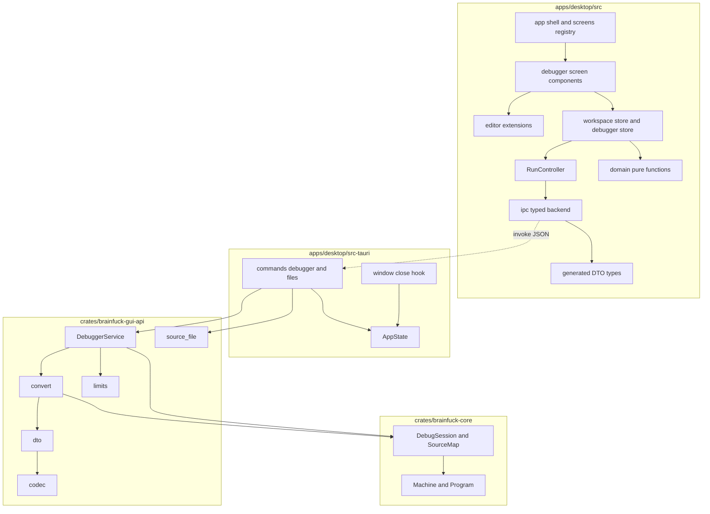
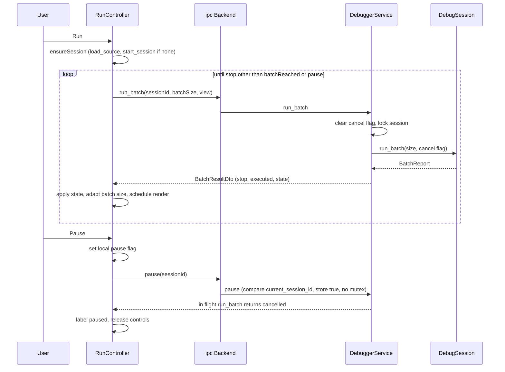
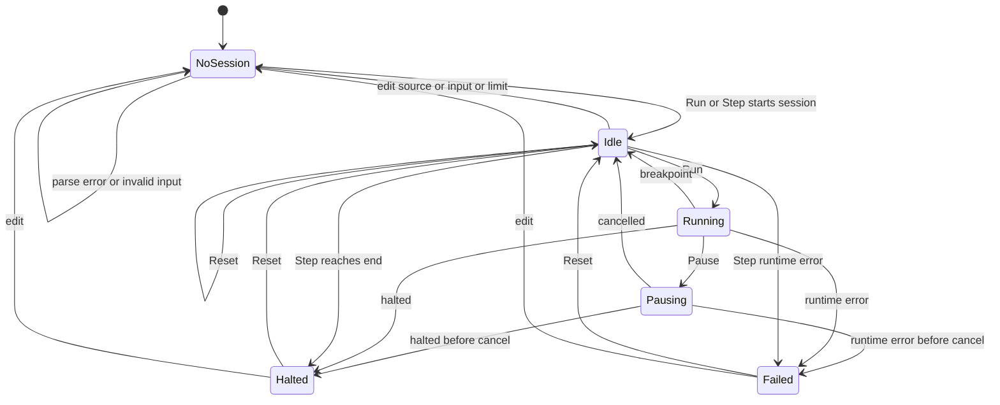
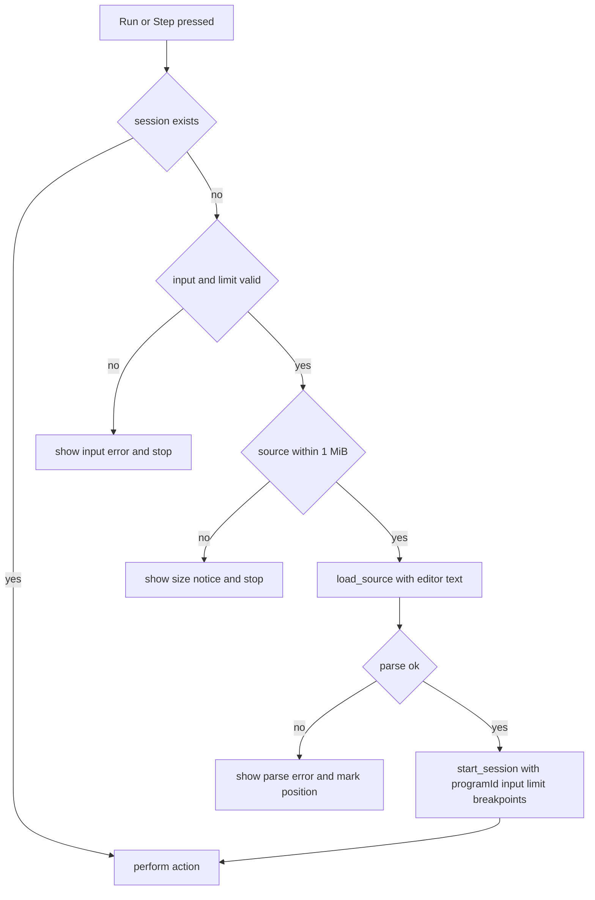

# Design Document: desktop-gui

## Overview

`desktop-gui` は、`debugger-state` が提供するデバッグ契約の上に、Tauri 2 + React + TypeScript + Vite + CodeMirror 6 のデスクトップアプリ(`apps/desktop`)を構築する。ソース編集、Run / Pause / Step / Reset、入力設定、命令数上限、ブレークポイント、テープ・出力・状態・エラー表示を 1 画面で提供し、同一のソース・入力・上限に対して `brainfuck-cli` と同じ結果(出力バイト列、終了時の `pc` / `dp` / 実行済み命令数、失敗の種類)を返す。

**Purpose**: 学習者が実行過程(現在命令、テープ、出力)を観察しながら Brainfuck を実行できるようにする。
**Users**: 学習者(主)、および比較画面を追加する `compiler-comparison` の開発者。
**Impact**: greenfield。新規に Rust クレート `crates/brainfuck-gui-api`(Tauri 非依存の DTO・サービス)、`apps/desktop/src-tauri`(Tauri の薄い層)、`apps/desktop/src`(フロント)を追加する。既存クレート(`brainfuck-core` / `brainfuck-cli`)と上流 spec のファイルは変更しない。ルート `Cargo.toml`(`members = ["crates/*"]`)は変更せず、新クレートは自動的にワークスペースに入る。

### Goals
- 要件 1〜15 を満たす 1 ウィンドウ・1 文書・1 セッションのデバッグ GUI
- 実行意味論・停止理由・ブレークポイント照合・キャンセルを再実装せず、`DebugSession` のラッパとして利用する(JSON DTO は本 spec が定義する)
- `cargo test --workspace` を Web ビューやフロントのビルド成果物なしで成功させつつ、CLI との結果一致を自動検証する
- 後続 `compiler-comparison` が、既存コマンドを変更せずに新画面・新コマンドを追加できる拡張点を明示する

### Non-Goals
- 実行意味論・デバッグロジックの定義(core / debugger-state)、最適化・比較画面、Step Back、Step Over / Out、条件付きブレークポイント、テープ編集
- 複数文書(タブ)、設定の永続化、出力のファイル保存、インストーラ署名・自動更新、ネットワーク通信

## Boundary Commitments

### This Spec Owns
- アプリ全体: `apps/desktop`(フロント + Tauri 層)と `crates/brainfuck-gui-api`(DTO、`DebuggerService`、変換、制限値、ファイルのデコード補助)
- フロントエンド・バックエンド間の JSON 契約: コマンド名と引数/戻り値 DTO、エラー表現(`ApiError`)、位置の単位(UTF-16)、出力差分の規則、ID(`programId` / `sessionId`)による古い応答の排除
- 実行ループ(`RunController`): `StepLimitReached` の間 `run_batch` を反復し、Pause を配線する。バッチ幅の適応、表示更新の間引き
- 画面状態機械(未開始/待機/実行中/停止/エラー)と操作の有効/無効の規則、ラベル導出
- ブレークポイントの UI 表現(編集追従の保持、スナップ規則、バックエンドへの同期)
- 文書管理(新規/開く/保存/未保存確認/改行コード/非 UTF-8 の置換)と、ダイアログ・ファイル I/O(Rust 側のみ)
- 入力の変換(テキスト/16 進)、出力の表示変換(UTF-8/16 進、末尾 64 KiB)、テープ・状態・エラーの表示
- WebView の権限設定(capabilities、CSP)
- CLI との結果一致テスト、アプリの README(開発手順と手動スモーク手順)

### Out of Boundary
- 命令の意味論、`StopReason` の生成規則、ブレークポイント照合、バッチ・キャンセルの規則、テープ窓の計算、命令添字 ↔ ソース範囲の対応(`brainfuck-core` / `debugger-state`。本 spec は呼び出すのみ)
- CLI の挙動・診断文面・終了コード(`brainfuck-cli`。本 spec は結果の基準として参照のみ)
- 最適化/コンパイル実行、比較画面、比較用コマンド(`optimized-interpreter` / `compiler-comparison`)
- `.kiro/steering/` の変更、ルート `Cargo.toml` の変更、上流クレートのコード変更
- 位置変換(行・列・UTF-16 の数え方)、UTF-16 → 命令添字の逆引き、テープ窓の計算の再実装。これらは `debugger-state` が公開する `SourceMap::position_at` / `SourceMap::instruction_at_or_after_utf16` / `DebugSession::tape_window`(`tape_window_of`)を呼ぶのみで、本 spec は DTO への写像だけを持つ(一貫性の検証は `debugger-state` 要件 9.14 側)

### Allowed Dependencies
- Rust(`crates/brainfuck-gui-api`): `brainfuck-core` の公開 API(`debugger-state` で追加された `SourceMap::position_at` / `instruction_at_or_after_utf16` / `tape_window_of` を含む。すべて `brainfuck_core` のクレートルートから import)、`serde`、`base64`、`ts-rs`、(dev)`serde_json` / `tempfile` 相当。`std::fs` / `std::io` / ネットワーク / スレッド生成は使わない(ファイルのデコード補助はバイト列関数のみ)
- Rust(`apps/desktop/src-tauri`): `tauri` 2、`tauri-build`、`tauri-plugin-dialog`、`brainfuck-gui-api`(`path` 依存)。`brainfuck-core` へは直接依存しない。独立ワークスペースのためルートの `[workspace.lints]` を継承できず、`Cargo.toml` に `[lints.rust] unsafe_code = "forbid"` を自前で宣言する(後述 Technology Stack 注記)。`Cargo.lock` は src-tauri 専用のものをコミットし、`serde` / `ts-rs` はルートの `Cargo.lock` と同一バージョンへ固定する(`=` 指定またはロック値の一致確認。API クレートの DTO 契約をバージョン差で変えないため)
- フロント: React、TypeScript(strict)、Vite、`@tauri-apps/api` v2、`@codemirror/{state,view,commands,language}`、(dev)Vitest、Testing Library、jsdom、ESLint
- **依存方向(厳守)**:
  - Rust API クレート: `limits` ← `codec` ← `dto` ← `convert` ← `service` ← `lib`(`source_file` は `limits` と `dto`(`ApiError`)のみに依存し、他のモジュールからは独立。`codec` は自前のエラー型を返し `service` が `ApiError` へ写す)
  - Tauri 層: `commands/*` / `window` → `brainfuck-gui-api`。API クレートは Tauri を import しない
  - フロント: `generated` ← `ipc` ← `domain`(純粋関数) ← `state`(ストア・`RunController`) ← `editor` / `components` ← `app`。`domain` は React・Tauri・CodeMirror を import しない。`editor` 拡張は `state` を import せず、数値位置とコールバックのみを受け取る
- 禁止: フロントが Rust 内部型(機械・プログラム・セッション)を複製・保持すること。WebView からの直接のファイル/プロセス/ネットワークアクセス

### Revalidation Triggers

- `brainfuck-gui-api` が公開する `codec` / `limits` / `ApiError` の構築可否 / `convert` の署名を変えた場合、`compiler-comparison`(別 crate `brainfuck-compare-api`)が再利用しているため再確認する
以下を変更する場合、`compiler-comparison` は統合を再確認する。
- `brainfuck-gui-api` の共通 DTO(`ApiError` / `ParseErrorDto` / `RuntimeErrorDto` / `SourcePositionDto` / `SourceRangeDto` / `OutputChunkDto`)と Base64 コーデック、`limits` の値
- 既存コマンドの名称・引数 DTO・戻り値 DTO、`kind` 判別子の値、位置の単位(UTF-16)
- フロントの `Workspace`(ソース・入力・上限の共有ストア)と画面レジストリ(`screens`)の公開形
- `build.rs` のコマンド一覧 / `capabilities/default.json` の権限構成
- `brainfuck-gui-api::convert` の公開関数(`output_chunk` / `tape_window_dto` / `source_position_dto` / `source_range_dto` / `parse_error_dto` / `runtime_error_dto`)のシグネチャと出力規則(比較画面が出力チャンクとテープ窓の DTO 化に再利用する)。`TapeWindowDto` / `SessionStateDto` の形
- フロントの `Workspace` モジュールが export する `WorkspaceValues` 型、`ipc/backend.ts` の `invokeCommand<T>()`(`ApiError` の正規化を含む)、`commands/mod.rs` を `generate_handler!` の唯一の入力とする規約
- 上流側: `DebugSession` / `BatchReport` / `StateView` / `SourceMap` / `BreakpointSet` の公開シグネチャ。特に本 spec が直接呼ぶ `SourceMap::position_at`(`byte_offset == source.len()` が有効、文字境界でない/範囲外は `None`)・`SourceMap::instruction_at_or_after_utf16`・`tape_window_of` / `DebugSession::tape_window`(いずれも `brainfuck_core` ルートから export)の存在と意味。停止理由の通知順序、`StepLimitReached` の意味、CLI の `--dump-state` 書式と既定上限

## Architecture

### Existing Architecture Analysis
- `brainfuck-core` + `debugger-state` は Tauri / JSON / スレッド非依存の値型。`DebugSession` は `Send`、`CancelSignal` は `AtomicBool` / `Arc<…>` に実装済み。`SourceMap` は命令 → `SourceRange`(UTF-16 を含む)の順引き、バイトオフセット・UTF-16・行からの逆引き、`Program` 不要の位置変換 `SourceMap::position_at` を持つ。テープ窓は `tape_window_of`(スライス版)に一本化されている。したがって本 spec は位置・逆引き・窓の計算を持たず、DTO への写像のみを行う
- `brainfuck-cli` は `state: pc=<N> dp=<N> steps=<N>` と終了コード 0/2/3/4 を持つ結果の基準。GUI は文面ではなく値(出力・`pc` / `dp` / 実行数・失敗の種類とそのフィールド)で一致させる
- steering: UI は薄い境界の外側。フロントは JSON DTO のみ。巨大テープを送らない。`apps/desktop/` が Tauri アプリの置き場

### Architecture Pattern & Boundary Map



**Architecture Integration**:
- Selected pattern: Tauri 非依存の API クレート(DTO + サービス)+ 薄い Tauri 層 + 単方向データフローのフロント(`research.md` の評価参照)
- Domain/feature boundaries: 実行の真実は `DebuggerService`(バックエンド)にあり、フロントは DTO の最新値を「表示用状態」として保持するだけ。文書(ソース・入力・上限・ブレークポイント位置)の真実はフロント(`Workspace`)にあり、バックエンドは `load_source` / `start_session` で受け取った値から導出した読み取り専用の `LoadedProgram`(`Program` + `SourceMap`)のみ保持する
- Existing patterns preserved: `unsafe` 禁止、エラーに機微情報を含めない、`#[non_exhaustive]` 上流型は `_` 付き `match` で DTO へ写す、巨大テープを送らない
- New components rationale: API クレートは `cargo test --workspace` と CLI 一致テストを Web ビューから切り離すため。画面レジストリと `Workspace` は後続画面の拡張点
- Steering compliance: UI は薄い境界の外側、フロントは DTO のみ、バッチ既定 1,000、窓 ±16、命令数上限の既定(CLI と同じ 10,000,000)を GUI が設定

### Technology Stack

| Layer | Choice / Version | Role in Feature | Notes |
|-------|------------------|-----------------|-------|
| Desktop shell | Tauri 2.x(`tauri`、`tauri-build`、`tauri-plugin-dialog`) | IPC、ウィンドウ、ファイルダイアログ(Rust 側のみ) | 実装時に最新安定の 2.x を固定 |
| Rust | stable、edition 2021、`unsafe` 禁止 | API クレート、Tauri 層 | API クレートはルートの `[workspace.lints]` を継承。`src-tauri` は独立 `[workspace]` のため継承できず、自前の `[lints.rust] unsafe_code = "forbid"` を宣言する。`forbid` が tauri のマクロ展開と衝突する場合のみ `deny` へ落とし(タスク 1.5 で早期に確認して記録)、アプリ側のソースには `unsafe` を書かない |
| DTO / 型生成 | `serde`(camelCase)、`ts-rs`(`u64` は `number`) | TypeScript 型の機械生成 | 生成物をコミットし一致テスト |
| バイナリ表現 | `base64` | 入力・出力バイト列の JSON 表現 | フロントは `btoa`/`atob` の薄いラッパ |
| UI | React 19 + TypeScript 5(strict)+ Vite | 画面、状態 | `any` 禁止(ESLint で強制) |
| エディタ | CodeMirror 6(`@codemirror/state` / `view` / `commands` / `language`) | 編集、現在命令、ブレークポイント、括弧対応 | 言語モードなしの平文 |
| テスト | `cargo test`、Vitest + Testing Library + jsdom | Rust 契約・一致、フロント純粋関数・コンポーネント | ウィンドウ起動不要 |
| Runtime | Node 26(`mise.toml`)、npm | ビルド・テスト | `engines` で明示 |

## File Structure Plan

### Directory Structure
```
crates/brainfuck-gui-api/                  # Tauri 非依存。DTO とサービス(新規)
├── Cargo.toml                             # brainfuck-core(path)、serde、base64、ts-rs。ワークスペースの lint を継承(`[lints] workspace = true`)
├── src/
│   ├── lib.rs                             # モジュール宣言と公開型の re-export のみ(`pub mod convert` を含む。比較画面が再利用する)
│   ├── limits.rs                          # MAX_SOURCE_BYTES / MAX_INPUT_BYTES / MAX_BATCH_SIZE / MAX_TAPE_RADIUS / OUTPUT_TAIL_LIMIT / MAX_STEP_LIMIT / DEFAULT_* 定数
│   ├── codec.rs                           # Base64 のエンコード/デコード(上限検査つき)
│   ├── dto.rs                             # 全 DTO(serde + ts-rs)。要求/応答/エラー/位置/状態。後続画面が再利用する共通部品を含む
│   ├── convert.rs                         # core / debugger-state の値 → DTO への写像のみ(位置の計算・逆引きは持たない)。停止理由、実行エラー、解析エラー(位置は SourceMap::position_at)、状態、テープ窓(tape_window_of の結果)、出力チャンク。公開関数は比較画面が再利用
│   ├── service.rs                         # DebuggerService(LoadedProgram / SessionSlot / cancel フラグ / current_session_id / 9 操作)
│   └── source_file.rs                     # ファイルバイト列の検査とデコード(サイズ上限、置換つき UTF-8、改行コード検出と適用)、表示名の抽出
├── examples/export_bindings.rs            # ts-rs の生成物を apps/desktop/src/generated へ書き出す(手動更新用)
└── tests/
    ├── common/mod.rs                      # サービス生成、ソース/入力ヘルパ、バッチ反復ヘルパ、core オラクル実行
    ├── dto_contract.rs                    # 全停止理由・エラーの表現、JSON 形(kind/camelCase)、制限値、不正要求の拒否
    ├── service_flow.rs                    # load → start → run/step/reset/pause/set_breakpoints の一連、ID による古い要求の拒否
    ├── positions.rs                       # DTO 写像のみ: SourcePosition/SourceRange → DTO の各フィールド、ParseError の位置が SourceMap::position_at の値と一致、マルチバイト/サロゲート/CRLF/CR で currentRange・ブレークポイント解決位置が DTO に正しく載ること。位置規則そのものの一貫性は core 側(debugger-state 9.14)
    ├── output_delta.rs                    # 出力差分(連続/ギャップ/末尾 64 KiB/リセット後)
    ├── source_file.rs                     # デコード、サイズ上限、改行コード、表示名(パスを含まない)
    ├── cli_parity.rs                      # core オラクルとの一致(コーパス)+ 実 CLI バイナリとの一致(固定ケース)
    ├── bindings_up_to_date.rs             # 生成した TypeScript とコミット済み generated/ の一致
    └── regression.rs + regression/*.bf    # 不具合ごとの最小ソース

apps/desktop/
├── package.json / package-lock.json       # Node 26、scripts: dev / build / test / typecheck / lint / tauri
├── tsconfig.json / vite.config.ts / vitest.config.ts / eslint.config.js / index.html
├── README.md                              # 前提(mise、Rust、WebView2)、起動・ビルド・テスト、手動スモーク手順、キーボードショートカット表
├── src-tauri/                             # Tauri アプリ(独立ワークスペース `[workspace]`)
│   ├── Cargo.toml / Cargo.lock / build.rs # Cargo.toml: `[lints.rust] unsafe_code = "forbid"` を自前宣言(独立 workspace のためルート継承不可)、serde/ts-rs はルートと同一バージョン。Cargo.lock は src-tauri 専用をコミット。build.rs: AppManifest::commands で全コマンドを列挙
│   ├── tauri.conf.json                    # ウィンドウ(最小 800×600)、CSP、frontendDist
│   ├── capabilities/default.json          # core:event:default + 自アプリコマンドの allow-* のみ
│   └── src/
│       ├── main.rs                        # 起動のみ
│       ├── lib.rs                         # Builder(plugin 登録、manage、invoke_handler、on_window_event)
│       ├── app_state.rs                   # AppState { service: DebuggerService, document: Mutex<DocumentState> }
│       ├── commands/mod.rs                # コマンド一覧(後続 feature はここへモジュールを追加)。`generate_handler!` はこのファイルの一覧からのみ構築する(lib.rs に個別のコマンド名を書かない)
│       ├── commands/debugger.rs           # load_source / start_session / run_batch / step / reset / get_snapshot / get_tape_window / set_breakpoints / pause(薄いラッパ)
│       ├── commands/files.rs              # new_document / open_source_file / save_source_file / set_document_dirty / confirm_exit
│       └── window.rs                      # CloseRequested フック(未保存なら閉じるのを止め、close-requested イベントを発行)
└── src/
    ├── main.tsx
    ├── generated/                         # ts-rs 生成物(手編集禁止、コミット)
    ├── ipc/
    │   ├── backend.ts                     # Backend インタフェース(コマンドごとに型付け)と TauriBackend(invoke 実装。引数は { args } 1 個)。共有ヘルパ `invokeCommand<T>(name, args?)`(invoke 呼び出しと ApiError の正規化を 1 か所に集約。TauriBackend も比較画面のバックエンドもこれを使う)を export
    │   ├── errors.ts                      # ApiError の判別、Japanese メッセージ変換
    │   └── fakeBackend.ts                 # テスト用の Backend(インメモリ。実行は行わず、台本どおりの DTO を返す)
    ├── domain/                            # 純粋関数(React/Tauri/CM 非依存)
    │   ├── inputBytes.ts                  # テキスト/16 進 ↔ バイト列、モード切替、エラー(種類+位置)
    │   ├── base64.ts                      # Uint8Array ↔ Base64
    │   ├── outputBuffer.ts                # 末尾 64 KiB の保持と差分適用(連続/ギャップ/リセット)
    │   ├── outputFormat.ts                # UTF-8 解釈(置換文字、制御文字の可視化)、16 進行の整形、省略表示
    │   ├── stepLimit.ts                   # 上限入力の検証(1〜2^53−1、「上限なし」)
    │   ├── controls.ts                    # UI 状態 → Run/Pause/Step/Reset/編集/ファイル操作の有効可否
    │   ├── runLabel.ts                    # セッション状態 → 状態ラベル(未開始/実行中/…)
    │   ├── instructionScan.ts             # 命令文字集合、行内/カーソル以降の最初の命令へのスナップ
    │   └── batchPolicy.ts                 # 適応バッチ幅(初期 1,000、倍加、上限 1,000,000、目標時間)
    ├── state/
    │   ├── workspace.ts                   # Workspace ストア: ソース、文書(名前/未保存/改行)、入力、上限、ブレークポイント位置(外部ストア)。`type WorkspaceValues = Pick<WorkspaceState, "source" | "input" | "limit">` を export(後続画面がリクエスト導出関数の引数型に使う)
    │   ├── debuggerStore.ts               # セッション表示状態(reducer): sessionId、DTO の最新状態、出力バッファ、エラー、局所 pause フラグ
    │   └── runController.ts               # ensureSession / run / pause / step / reset / setBreakpoints / invalidate、古い応答の破棄、フレーム間引き
    ├── editor/
    │   ├── SourceEditor.tsx               # EditorView の生成と Workspace との同期(read-only 切替)
    │   ├── executionDecorations.ts        # StateField + Effect: 現在命令・エラー位置の mark、可視範囲へのスクロール
    │   ├── breakpoints.ts                 # StateField(RangeSet): 追従・削除、ガター、トグルコマンド、オフセット列の出力
    │   └── bracketMatching.ts             # bracketMatching 設定(maxScanDistance 引き上げ、非対応の見た目)
    ├── components/                        # Toolbar(Run/Pause/Step/Reset/ファイル)、InputPanel、StepLimitField、TapeView、OutputView、StatusPanel、ErrorBanner、ConfirmDialog、NoticeList
    ├── app/
    │   ├── App.tsx                        # AppShell: 画面レジストリを描画(画面が 1 つの間はタブを出さない)
    │   ├── screens.ts                     # ScreenDefinition[] の登録(debugger のみ)
    │   ├── DebuggerScreen.tsx             # 領域のレイアウト(ツールバー / エディタ / 入力 / テープ / 出力 / 状態)
    │   └── shortcuts.ts                   # F5 Run / F6 Pause / F11 Step / Shift+F5 Reset / F9 BP / Ctrl+O,S,Shift+S,N
    └── **/*.test.ts(x)                    # 各モジュールの単体テストを同じ階層に配置
```

> 繰り返し構造: `components/` 配下の表示コンポーネントは 1 ファイル 1 コンポーネントで、`props` は DTO または `domain` の戻り値のみ。`*.test.tsx` は同名ファイルの隣に置く。

### Modified Files
- なし(既存ファイルの変更なし)。新規クレートは `members = ["crates/*"]` により自動でワークスペースへ入る。`.gitignore` への `apps/desktop/node_modules` / `apps/desktop/dist` / `apps/desktop/src-tauri/target` の追記が必要な場合のみ、実装タスクで追記する(新規パターンの追加であり既存行は変更しない)

## System Flows

### Run(バッチ反復と Pause)



フロー上の決定:
- `pause` は `Mutex` を取らない。`run_batch` が 1 バッチの間 `Mutex` を保持し続けるため、`pause` が照合できるよう `DebuggerService` はロック外に `AtomicU64 current_session_id`(`0` = セッションなし)を持つ。`pause` は `req.sessionId == current_session_id.load(Acquire)`(かつ `!= 0`)のときだけキャンセル旗へ `store(true, Release)` する。未知/古い `sessionId`(破棄済み・別セッション)の `pause` は何もせず無視し、エラーも返さない(遅れて届いた Pause が新しいセッションを止めないため)。`current_session_id` は `start_session` の成功時に新 ID を、`load_source` 成功・セッション置換/破棄時に `0` を、それぞれ `Mutex` 保持中に `store(Release)` で更新する。`run_batch` は入口で旗を `false` に戻す(前回の Pause の残りで次の Run が即中断しないため)
- Pause がバッチ間に届いて旗が取りこぼされても、`RunController` の局所フラグで次のバッチを発行しない。局所フラグで止まった場合の状態ラベルは「一時停止」(バックエンドの `lastStop` が `batchReached` 由来で `null` でも)
- `batchReached`(`StepLimitReached`)は常に継続。それ以外(`halted` / `breakpoint` / `cancelled` / `error`)でループを抜ける
- 応答は `sessionId` が現在のセッションと一致するときのみ反映する(破棄済みセッションの遅延応答は捨てる)

### 画面状態機械



操作の有効/無効(`domain/controls.ts` の真理値表、要件 4.8 / 4.10 / 4.11 / 5.10 / 14.3):

| 状態 | Run | Pause | Step | Reset | 編集・入力・上限・ファイル操作・BP 切替 |
|------|-----|-------|------|-------|------------------------------------------|
| NoSession(入力が有効) | 有効 | 無効 | 有効 | 無効 | 有効 |
| NoSession(16 進入力が不正) | 無効 | 無効 | 無効 | 無効 | 有効 |
| Idle | 有効 | 無効 | 有効 | 有効 | 有効(編集等はセッションを破棄) |
| Running | 無効 | 有効 | 無効 | 無効 | 無効(エディタは read-only) |
| Pausing | 無効 | 無効 | 無効 | 無効 | 無効 |
| Halted / Failed | 無効 | 無効 | 無効 | 有効 | 有効(編集等はセッションを破棄) |

### セッション開始(ensureSession)



## Requirements Traceability

| Requirement | Summary | Components | Interfaces | Flows |
|-------------|---------|------------|------------|-------|
| 1.1 | 5 領域のメイン画面 | DebuggerScreen, App | `screens.ts` | - |
| 1.2 | 起動時の Hello World サンプル | Workspace(`hello.bf?raw`) | `createWorkspace` | - |
| 1.3 | 未開始の初期表示 | debuggerStore, TapeView, OutputView, StatusPanel | `initialDisplayState` | 画面状態機械 |
| 1.4 | 1 文書・1 セッション | Workspace, DebuggerService | 単一 `SessionSlot` | - |
| 1.5 | 日本語 UI | components, `ipc/errors.ts` | 文言テーブル | - |
| 2.1, 2.2 | 編集と未保存表示 | SourceEditor, Workspace | `document.dirty` | - |
| 2.3 | 未保存内容を実行 | RunController | `load_source(source)` | ensureSession |
| 2.4 | 明示保存のみ書き込み | files コマンド | `save_source_file`(UI 操作のみが呼ぶ) | - |
| 2.5, 2.6 | 開く・新規 | files コマンド, Workspace | `open_source_file` / `new_document` | - |
| 2.7 | 未保存の破棄確認 | ConfirmDialog, window.rs | `set_document_dirty`, `close-requested`, `confirm_exit` | - |
| 2.8, 2.9, 2.10 | 保存・名前を付けて保存・取消 | files コマンド | `save_source_file` | - |
| 2.11 | 読み書き失敗の通知 | files コマンド, NoticeList | `ApiError.kind = io` | - |
| 2.12 | 非 UTF-8 の置換と通知 | source_file | `decode_source` の `lossy` | - |
| 2.13, 2.14 | 1 MiB 上限 | source_file, DebuggerService, RunController | `MAX_SOURCE_BYTES` | ensureSession |
| 3.1 | 入力 2 モード | InputPanel, inputBytes | `InputModel` | - |
| 3.2, 3.3, 3.4 | テキスト/16 進の変換と不正入力 | inputBytes | `parseInput` | ensureSession |
| 3.5 | 入力 1 MiB 上限 | inputBytes, codec | `MAX_INPUT_BYTES` | - |
| 3.6, 3.7 | モード切替 | inputBytes | `switchMode` | - |
| 3.8, 3.9 | 総バイト数・読み取り済み表示 | InputPanel, StatusPanel | `SessionStateDto.inputConsumed/inputTotal` | - |
| 3.10 | EOF の意味論はコアに従う | DebuggerService(委譲) | `DebugSession` | - |
| 4.1, 4.2 | セッション開始と解析エラー | RunController, DebuggerService | `load_source`, `start_session` | ensureSession |
| 4.3, 4.4, 4.5 | Run / Pause / 再開 | RunController, DebuggerService | `run_batch`, `pause`(未知/古い `sessionId` は無視) | Run |
| 4.6, 4.7 | Step | RunController | `step` | - |
| 4.8, 4.10, 4.11 | 操作の有効/無効 | controls.ts | `availability` | 画面状態機械 |
| 4.9 | Reset | RunController, DebuggerService | `reset` | - |
| 4.12 | 編集等でセッション破棄 | RunController(`invalidate`) | `Workspace` 変更購読 | 画面状態機械 |
| 5.1, 5.2, 5.3, 5.4 | 命令数上限の設定と検証 | stepLimit.ts, StepLimitField, DebuggerService | `StepLimitDto`, `MAX_STEP_LIMIT` | - |
| 5.5 | 上限超過エラー | convert, StatusPanel | `RuntimeErrorDto.stepLimitExceeded` | - |
| 5.6 | バッチ到達は継続 | RunController | `BatchStopDto.batchReached` | Run |
| 5.7, 5.8 | 応答性と Pause 1 秒以内 | RunController, DebuggerService | 非ブロッキング `pause`(`AtomicU64 current_session_id` との照合)、命令ごとのキャンセル確認 | Run |
| 5.9 | 実行中の更新間隔 | RunController, batchPolicy | 目標時間ベースのバッチ幅、`requestAnimationFrame` | Run |
| 5.10 | 実行中の編集不可 | controls.ts, SourceEditor | read-only | 画面状態機械 |
| 6.1, 6.2, 6.3, 6.4 | ブレークポイントの設定とスナップ | breakpoints.ts, instructionScan.ts | `toggleBreakpointAtLine/Cursor`、`BreakpointsDto.unresolved` | - |
| 6.5, 6.6, 6.7 | 停止・再開・ループ内 | DebuggerService(委譲) | `run_batch` | Run |
| 6.8 | 編集追従・削除 | breakpoints.ts | `RangeSet.map` + 検証 | - |
| 6.9, 6.10 | 全解除・文書切替での解除 | breakpoints.ts, Workspace | `clearBreakpoints` | - |
| 6.11 | 停止中の切替 | RunController | `set_breakpoints` | - |
| 6.12 | Step は BP 無視 | DebuggerService(委譲) | `step_into` | - |
| 7.1, 7.3, 7.4 | 現在命令の強調 | executionDecorations.ts | `currentRange` | - |
| 7.2 | 停止時のスクロール | executionDecorations.ts | `EditorView.scrollIntoView` | - |
| 7.5, 7.6 | 括弧対応・非対応 | bracketMatching.ts | `bracketMatching({ maxScanDistance })` | - |
| 7.7 | 色以外の手がかり | executionDecorations.ts, breakpoints.ts, theme | 下線・枠・マーカー形状・ラベル | - |
| 7.8 | 位置の正確さ | convert, SourceMap(上流), executionDecorations.ts | `source_range_dto`(`utf16Offset` の直接利用)、`SourceMap::position_at` | - |
| 7.9, 7.10 | エラー位置の強調 | executionDecorations.ts | `RuntimeErrorDto` 時の `currentRange`、`ParseErrorDto.position` | - |
| 7.11 | 実行中の強調更新 | RunController, executionDecorations.ts | 表示更新ごとの Effect | Run |
| 8.1, 8.4, 8.5, 8.6 | 窓の表示・追従・半径・取得量 | TapeView, DebuggerService, convert | `TapeWindowDto`, `ViewRequestDto.tapeRadius`, `MAX_TAPE_RADIUS` | - |
| 8.2, 8.3 | セルの表示形式とポインタ強調 | TapeView | `cells`, `pointerOffset` | - |
| 8.7 | 未開始の窓 | debuggerStore | `initialDisplayState` | - |
| 8.8 | 値の一致 | convert(`DebugSession::tape_window`) | テープ窓のスライス | - |
| 9.1, 9.2 | 出力の累積と表示切替 | OutputView, outputBuffer | `OutputChunkDto` | - |
| 9.3, 9.4, 9.5 | UTF-8 解釈と文字またがり | outputFormat, outputBuffer | `renderText` | - |
| 9.6, 9.7, 9.8, 9.9 | 16 進・総数・省略・空 | outputFormat, OutputView | `renderHex`, `OUTPUT_TAIL_LIMIT` | - |
| 10.1, 10.2, 10.3 | 状態・ラベル・正常終了 | StatusPanel, runLabel | `SessionStateDto` | - |
| 10.4 | 解析エラー表示 | ErrorBanner | `ParseErrorDto` | ensureSession |
| 10.5, 10.6 | 実行エラー表示と状態保持 | ErrorBanner, DebuggerService | `RuntimeErrorDto` | - |
| 10.7 | 実行結果以外のエラー | NoticeList, ipc/errors.ts | `ApiError` | - |
| 10.8 | エラーの維持 | debuggerStore | エラーのクリア条件 | - |
| 10.9 | 機微情報の除外 | ApiError(固定文言)、source_file | 表示名のみ | - |
| 10.10 | 状態変化の通知 | StatusPanel | `aria-live` 領域 | - |
| 11.1, 11.2 | 出力・終了状態の一致 | DebuggerService | CLI パリティテスト | - |
| 11.3 | hello の既定値 | cli_parity.rs | `pc=106 dp=6 steps=906` | - |
| 11.4 | 失敗の種類とフィールドの一致 | convert, cli_parity.rs | `ParseErrorDto` / `RuntimeErrorDto` | - |
| 11.5 | 分割に依らない結果 | DebuggerService, cli_parity.rs | バッチ幅・Pause・BP・Step の分割テスト | - |
| 11.6 | 出力のバイト保持 | OutputChunkDto, outputBuffer | Base64 | - |
| 11.7 | コメントと改行の非影響 | DebuggerService, SourceMap(上流) | 一貫性は `debugger-state` 9.14 のテスト、本 spec は DTO 写像テスト(`positions.rs`) | - |
| 11.8 | 自動検証コーパス(文書化した対象外を含む) | cli_parity.rs | corpus 定義、対象外一覧(Testing Strategy) | - |
| 12.1 | 6 コマンド + 窓取得 | commands/debugger.rs | コマンド契約表 | - |
| 12.2, 12.3 | load_source / start_session | DebuggerService | `LoadSourceResult`, `SessionStartedDto` | ensureSession |
| 12.4, 12.5 | run_batch / step / reset / get_snapshot | DebuggerService | `BatchResultDto`, `StepResultDto`, `SessionStateDto` | Run |
| 12.6 | 停止理由・エラーの区別 | dto.rs | `BatchStopDto`, `RuntimeErrorDto`, `StopReasonDto` | - |
| 12.7 | JSON DTO のみ | dto.rs, ipc | 全 DTO | - |
| 12.8 | 状態応答の内容 | dto.rs, convert | `SessionStateDto` | - |
| 12.9 | 出力の差分 | convert, outputBuffer | `OutputChunkDto` | - |
| 12.10 | UTF-16 の位置 | convert, SourceMap(上流) | `SourcePositionDto`(`source_position_dto`)、`SourceMap::position_at` | - |
| 12.11 | 不正要求の拒否 | DebuggerService | `ApiError` | - |
| 12.12 | 古い応答の排除 | RunController, DebuggerService | `sessionId` / `programId` | Run |
| 12.13 | 型の機械生成と乖離検出 | ts-rs, bindings_up_to_date.rs | `generated/` | - |
| 12.14 | 後続画面の拡張点 | screens.ts, Workspace, commands/mod.rs, dto.rs | Extension Points 表 | - |
| 13.1, 13.2 | 信頼しない入力、実行範囲の限定 | DebuggerService, tauri.conf.json | 既定上限 10,000,000、コアのみ実行 | - |
| 13.3, 13.4 | 最小権限、ファイルはダイアログ選択のみ | capabilities, commands/files.rs | `AppManifest::commands` | - |
| 13.5 | 通信しない | tauri.conf.json(CSP), 依存方針 | `connect-src` 制限 | - |
| 13.6 | 外部値の上限 | limits.rs | 各 `MAX_*` | - |
| 13.7 | ログ・診断に機微情報なし | ApiError, files コマンド | 固定文言、表示名のみ | - |
| 13.8 | unsafe 禁止 | 全 Rust コード | API クレートは `[lints] workspace = true`、src-tauri は自前 `[lints.rust] unsafe_code = "forbid"` | - |
| 14.1, 14.2 | キーボード操作とショートカット表示 | shortcuts.ts, Toolbar | ショートカット表 | - |
| 14.3 | 無効状態の表示 | controls.ts | `disabled` | 画面状態機械 |
| 14.4 | 色だけに頼らない | theme, 各 View | 形状・ラベル | - |
| 14.5 | 最小ウィンドウ | tauri.conf.json, DebuggerScreen | `minWidth 800` / `minHeight 600` | - |
| 15.1 | 契約テスト | dto_contract.rs ほか | - | - |
| 15.2 | 操作列テスト | service_flow.rs, runController.test.ts | - | - |
| 15.3 | 入力・出力・有効判定・強調位置テスト | domain/*.test.ts, editor/*.test.ts | - | - |
| 15.4 | CLI 一致テスト | cli_parity.rs | - | - |
| 15.5 | workspace テストが成功し続ける | API クレートの分離 | `cargo test --workspace` | - |
| 15.6 | README | apps/desktop/README.md | - | - |
| 15.7 | 回帰テスト運用 | tests/regression.rs | - | - |

## Components and Interfaces

| Component | Domain/Layer | Intent | Req Coverage | Key Dependencies (P0/P1) | Contracts |
|-----------|--------------|--------|--------------|--------------------------|-----------|
| dto / codec / limits | API(Rust) | JSON 契約と制限値 | 3.5, 12.x, 13.6 | serde, ts-rs (P0) | Service, API |
| convert | API(Rust) | 上流の値 → DTO への写像のみ(位置・窓は上流関数の結果を写す) | 5.5, 7.8, 8.8, 10.4-10.6, 12.6, 12.8-12.10 | SourceMap (P0), tape_window_of (P0) | Service |
| DebuggerService | API(Rust) | `DebugSession` の DTO ラッパ | 2.3, 4.x, 5.x, 6.x, 8.x, 11.x, 12.x | DebugSession (P0) | Service, State |
| source_file | API(Rust) | ファイルバイト列の検査・デコード・改行 | 2.12, 2.13 | limits (P0) | Service |
| Tauri commands / window | Tauri 層 | IPC の薄い層、ファイル、閉じる確認 | 2.4-2.11, 12.1, 13.3-13.5 | DebuggerService (P0), dialog (P0) | API, Event |
| ipc Backend | フロント | 型付きコマンド呼び出し | 12.7, 12.13 | generated (P0) | Service |
| domain 関数群 | フロント | 入力/出力/ラベル/有効判定/スナップ/バッチ幅 | 3.x, 9.x, 10.2, 4.8-4.11 | なし | Service |
| Workspace ストア | フロント | ソース・入力・上限・BP・文書の共有状態 | 1.2, 2.x, 3.x, 5.x, 12.14 | domain (P0) | State |
| debuggerStore + RunController | フロント | セッション表示状態と実行ループ | 4.x, 5.6-5.9, 12.12 | ipc (P0), batchPolicy (P0) | State |
| editor 拡張 | フロント | 現在命令・BP・括弧対応 | 6.x, 7.x | CodeMirror (P0) | State |
| 表示コンポーネント | フロント | Toolbar / Input / Tape / Output / Status / Error | 1.x, 8.x, 9.x, 10.x, 14.x | domain (P0) | - |
| app shell / screens | フロント | 画面レジストリ、ショートカット | 1.1, 12.14, 14.1 | components (P0) | State |

### API(Rust): `crates/brainfuck-gui-api`

#### dto / codec / limits

| Field | Detail |
|-------|--------|
| Intent | フロントとバックエンドの JSON 契約を 1 か所で定義する |
| Requirements | 3.5, 12.1-12.14, 13.6 |

**Responsibilities & Constraints**
- すべての DTO は `#[derive(Serialize, Deserialize, TS)]`、`#[serde(rename_all = "camelCase")]`、判別付き enum は `#[serde(tag = "kind", rename_all = "camelCase")]`。`u64` フィールドは `#[ts(type = "number")]`(値は 2^53−1 以下に制限)。上流型への参照を持たない
- 位置の単位: 文字位置は UTF-16(`utf16Offset`)、行・列は 1 始まり(列はスカラ値個数 + 1)
- Tauri のコマンド引数はすべて `args` 1 個の構造体(`#[serde(rename_all = "camelCase")]`)とし、引数名の自動変換に依存しない

**Contracts**: Service [ ] / API [x] / Event [ ] / State [ ]

##### API Contract(DTO。TypeScript 表記は生成物と同形)
```typescript
// 共通部品(compiler-comparison が再利用してよい)
type SourcePositionDto = { byteOffset: number; utf16Offset: number; line: number; column: number };
type SourceRangeDto = { start: SourcePositionDto; end: SourcePositionDto };   // 半開区間
type ParseErrorDto = {
  kind: "unmatchedClosingBracket" | "unmatchedOpeningBracket";
  instructionIndex: number;
  position: SourcePositionDto;            // 括弧文字の位置。範囲は [utf16Offset, utf16Offset + 1)
};
type RuntimeErrorDto =
  | { kind: "pointerOutOfBounds"; pc: number; dp: number; direction: "left" | "right" }
  | { kind: "stepLimitExceeded"; limit: number; pc: number };
type OutputChunkDto = { dataStart: number; totalLen: number; dataBase64: string };
type ApiErrorKind =
  | "invalidArgument" | "sessionNotFound" | "programNotLoaded" | "staleProgram"
  | "sourceTooLarge" | "inputTooLarge" | "fileTooLarge" | "io" | "internal";
type ApiError = { kind: ApiErrorKind; message: string; field: string | null };   // message は固定英語文面。機微情報を含まない

// 要求
type ViewRequestDto = { tapeRadius: number; outputFrom: number };               // tapeRadius 0..=64
type StepLimitDto = { kind: "limited"; maxSteps: number } | { kind: "unlimited" };   // maxSteps 1..=2^53-1
type LoadSourceRequest = { source: string };
type StartSessionRequest = {
  programId: number; inputBase64: string; limit: StepLimitDto;
  breakpointOffsets: number[];            // UTF-16 オフセット。最大 100,000 件
  view: ViewRequestDto;
};
type SessionViewRequest = { sessionId: number; view: ViewRequestDto };
type RunBatchRequest = { sessionId: number; batchSize: number | null; view: ViewRequestDto };   // null = 既定 1,000。1..=1,000,000
type TapeWindowRequest = { sessionId: number; radius: number };
type SetBreakpointsRequest = { sessionId: number; offsets: number[] };
type PauseRequest = { sessionId: number };

// 応答
type LoadSourceResult =
  | { kind: "ok"; programId: number; instructionCount: number; lineCount: number }
  | { kind: "parseError"; error: ParseErrorDto };
type SnapshotDto = { pc: number; dp: number; currentCell: number; stepsExecuted: number; halted: boolean };
type TapeWindowDto = { start: number; cells: number[]; pointerOffset: number };
type StopReasonDto = "halted" | "breakpoint" | "cancelled" | "batchReached";     // 直近の停止理由
type SessionStateDto = {
  sessionId: number; snapshot: SnapshotDto; tapeWindow: TapeWindowDto; output: OutputChunkDto;
  inputConsumed: number; inputTotal: number;
  lastStop: StopReasonDto | null;
  currentRange: SourceRangeDto | null;    // 停止状態では null。実行エラー時はエラーを起こした命令
};
type BatchStopDto =
  | { kind: "halted" } | { kind: "breakpoint" } | { kind: "cancelled" } | { kind: "batchReached" }
  | { kind: "error"; error: RuntimeErrorDto };
type BatchResultDto = { stop: BatchStopDto; executed: number; state: SessionStateDto };
type StepOutcomeDto = { kind: "executed" } | { kind: "halted" } | { kind: "error"; error: RuntimeErrorDto };
type StepResultDto = { outcome: StepOutcomeDto; state: SessionStateDto };
type BreakpointDto = { utf16Offset: number; instructionIndex: number; range: SourceRangeDto };
type BreakpointsDto = { breakpoints: BreakpointDto[]; unresolved: number[] };   // unresolved: 命令が無く設定されなかった入力オフセット
type SessionStartedDto = { state: SessionStateDto; breakpoints: BreakpointsDto };

// ファイル操作(Tauri 層のコマンド用。パスは含まない)
type OpenFileResult = { kind: "opened"; source: string; fileName: string; lossy: boolean } | { kind: "cancelled" };
type SaveFileRequest = { source: string; saveAs: boolean };
type SaveFileResult = { kind: "saved"; fileName: string } | { kind: "cancelled" };
type SetDocumentDirtyRequest = { dirty: boolean };
```
- Preconditions: 要求の値は `limits` の範囲内(範囲外は `invalidArgument` / `sourceTooLarge` / `inputTooLarge`)
- Postconditions: `OutputChunkDto` は `outputFrom ≤ totalLen` のとき `dataStart = max(outputFrom, totalLen − 65,536)`、`outputFrom > totalLen`(リセット・縮小後の古い位置)のとき `dataStart = max(0, totalLen − 65,536)`(この規則が唯一の定義。フロントの `outputFrom` は保持済み末尾 `buf.end` で、`start_session` / `reset` では 0 を送る)から末尾までを返す。`SessionStateDto.currentRange` は `SourceMap::range_of(snapshot.pc)`
- Invariants: すべての DTO は `serde_json` で往復可能。`kind` 値は変更しない(Revalidation Trigger)

`limits`: `MAX_SOURCE_BYTES = 1_048_576`、`MAX_INPUT_BYTES = 1_048_576`、`MAX_BATCH_SIZE = 1_000_000`、`DEFAULT_BATCH_SIZE = 1_000`(debugger-state の定数)、`MAX_TAPE_RADIUS = 64`、`DEFAULT_TAPE_RADIUS = 16`、`OUTPUT_TAIL_LIMIT = 65_536`、`MAX_STEP_LIMIT = 9_007_199_254_740_991`、`DEFAULT_MAX_STEPS = 10_000_000`、`MAX_BREAKPOINT_OFFSETS = 100_000`。`codec` は Base64 のデコード前に長さから上限を検査し、巨大な確保をしない。

#### convert

| Field | Detail |
|-------|--------|
| Intent | 上流の値を DTO へ写すだけの層。位置・逆引き・窓の計算規則は持たない |
| Requirements | 5.5, 7.8, 8.8, 10.4, 10.5, 10.6, 11.7, 12.6, 12.8, 12.9, 12.10 |

**Responsibilities & Constraints**
- 解析エラーの位置: `SourceMap::position_at(source, error_byte_offset)`(`debugger-state` 提供。行区切り `\n` / `\r\n` / `\r`、列はスカラ値個数 + 1、UTF-16 はコード単位数、`byte_offset == source.len()` も有効)の結果を `SourcePositionDto` へ写すのみ。`None`(通常は起こらない)は `ApiError { kind: "internal" }` にする。独自の行・列・UTF-16 の計算は持たない
- テープ窓: `DebugSession::tape_window(radius)`(= `tape_window_of`)の `TapeWindow` を `TapeWindowDto`(`cells` は `to_vec()`)へ写すのみ。窓の切り詰め規則は上流にある
- 出力チャンク: 出力バイト列と要求位置から `OutputChunkDto` を作る規則(`dataStart` の切り詰め)はこの層の 1 か所にだけ置く
- 上流の `#[non_exhaustive]` 型は `_` 付き `match` で `internal` へ写す

```rust
// すべて brainfuck_gui_api::convert の pub fn(compiler-comparison が再利用してよい)
pub fn source_position_dto(p: &SourcePosition) -> SourcePositionDto;
pub fn source_range_dto(r: &SourceRange) -> SourceRangeDto;
pub fn parse_error_dto(source: &str, e: &ParseError) -> Result<ParseErrorDto, ApiError>;   // 位置は SourceMap::position_at
pub fn runtime_error_dto(e: &RuntimeError) -> Result<RuntimeErrorDto, ApiError>; // 未知の種類(non_exhaustive)は internal。stop_reason_dto / batch_stop_dto / step_outcome_dto / session_state_dto / batch_result_dto も Result を返す
pub fn tape_window_dto(w: &TapeWindow<'_>) -> TapeWindowDto;                               // tape_window_of / DebugSession::tape_window の結果
pub fn output_chunk(output: &[u8], output_from: usize) -> OutputChunkDto;                  // 末尾 65,536 バイトの規則を含む
```
- Postconditions: `output_chunk` は `output_from ≤ total` のとき `max(output_from, total − 65,536)`、`output_from > total` のとき `max(0, total − 65,536)` を `dataStart` として末尾までを Base64 で返す。位置の DTO は上流 `SourcePosition` の 4 フィールドをそのまま写す(値の再計算なし)
- 一貫性(`position_at` と `range_of` / `program.source_offset(i)` の一致、UTF-16 逆引きの意味)は `debugger-state` 要件 9.14〜9.16 のテストが保証する。本 spec のテストは DTO への写像(フィールドの取り違えがないこと)のみを確認する

#### DebuggerService

| Field | Detail |
|-------|--------|
| Intent | `DebugSession` を DTO で操作する唯一のバックエンド窓口。Tauri 非依存でテスト可能 |
| Requirements | 2.3, 3.9, 3.10, 4.1-4.9, 5.1-5.8, 6.5-6.7, 6.11, 6.12, 8.1, 8.4-8.6, 8.8, 11.1-11.7, 12.1-12.12, 13.1, 13.2, 13.6 |

**Responsibilities & Constraints**
- 状態: `Mutex<Inner>`、`Arc<AtomicBool>`(キャンセル旗)、`AtomicU64 current_session_id`(ロック外。現在のセッション ID、`0` = なし。`pause` が `Mutex` を待たずに照合するためのもので、`Inner` を更新する箇所(`start_session` / `load_source` / 置換・破棄)で `Mutex` 保持中に同時に更新する)。`Inner { next_id: u64, program: Option<LoadedProgram>, session: Option<SessionSlot> }`。`LoadedProgram { id, program: Program, source_map: SourceMap }`、`SessionSlot { id, program_id, session: DebugSession, input_total: usize }`
- `load_source`: 上限検査 → `Program::parse` → 失敗は `LoadSourceResult::ParseError`(`convert::parse_error_dto` が `SourceMap::position_at` で位置付与)。成功時は新しい `programId` を採番、既存セッションを破棄。解析・`SourceMap` 構築が 1 回の呼び出しで完結する(`SourceMap::new` の `Err` は `internal`)
- `start_session`: `programId` が現在と不一致なら `staleProgram`。入力デコード(上限検査)、`MachineConfig`(`limited` → `with_max_steps`、`unlimited` → `unlimited()`)、`DebugSession::new(program.clone(), input, config)`。ブレークポイントは `set_breakpoints` と同じ正規化で投入し、新しい `sessionId` を採番。既存セッションは置換
- `run_batch`: 旗を `false` にして `session.run_batch(BatchSize::new(n), &*cancel)`。`batchSize = null` は 1,000。`BatchReport.stop` を `BatchStopDto` に写す(`Ok(StepLimitReached)` → `batchReached`、`Err(e)` → `error`)。`#[non_exhaustive]` の未知の停止理由は `internal`
- `step`: `session.step_into()` → `StepOutcomeDto`。`reset`: `session.reset()`(ブレークポイント保持)
- `set_breakpoints`: 各 UTF-16 オフセットを `SourceMap::instruction_at_or_after_utf16` で命令添字へ正規化(重複は 1 件。独自の始点表・二分探索は持たない)、`BreakpointSet` を `clear` + `insert` で置換。命令の無いオフセットは `unresolved`
- すべての状態応答は `session.state_view(radius)` と `source_map.range_of(pc)` から 1 回のロック内で組み立てる(整合した時点の値)。`get_tape_window` は `DebugSession::tape_window(radius)`(`tape_window_of` へ委譲される上流の窓計算)の結果を `convert::tape_window_dto` で写すだけで、窓の計算は持たない
- 不正な `sessionId`(未開始/破棄済み)は `sessionNotFound`。要求の範囲外は `invalidArgument`(`field` に項目名)。状態は変更しない。panic しない(`unwrap` / `expect` を本番コードで使わない)
- ロックの汚染は `PoisonError::into_inner` で回復せず `internal` を返す

**Dependencies**
- Inbound: Tauri `commands/debugger.rs`、パリティテスト — 全操作 (P0)
- Outbound: `DebugSession` / `SourceMap` / `Program` / `BreakpointSet` / `BatchSize` / `MachineConfig` — 実行とデバッグ (P0)
- External: `base64`, `serde` — 表現 (P1)

**Contracts**: Service [x] / State [x]

##### Service Interface
```rust
pub struct DebuggerService { /* Mutex<Inner>, Arc<AtomicBool>, AtomicU64 */ }
impl DebuggerService {
    pub fn new() -> Self;
    pub fn load_source(&self, req: LoadSourceRequest) -> Result<LoadSourceResult, ApiError>;
    pub fn start_session(&self, req: StartSessionRequest) -> Result<SessionStartedDto, ApiError>;
    pub fn run_batch(&self, req: RunBatchRequest) -> Result<BatchResultDto, ApiError>;
    pub fn step(&self, req: SessionViewRequest) -> Result<StepResultDto, ApiError>;
    pub fn reset(&self, req: SessionViewRequest) -> Result<SessionStateDto, ApiError>;
    pub fn get_snapshot(&self, req: SessionViewRequest) -> Result<SessionStateDto, ApiError>;
    pub fn get_tape_window(&self, req: TapeWindowRequest) -> Result<TapeWindowDto, ApiError>;
    pub fn set_breakpoints(&self, req: SetBreakpointsRequest) -> Result<BreakpointsDto, ApiError>;
    pub fn pause(&self, req: PauseRequest);          // Mutex を取らない。sessionId == current_session_id のときだけ旗を立てる。不明/古い sessionId は無視(エラーも返さない)
}
// Send + Sync(コンパイル時検証)
```
- Preconditions: 要求は `limits` の範囲内
- Postconditions: `run_batch` の `executed` は当該呼び出しで実行した命令数。`stop = batchReached` のとき `executed == batchSize`。`error` のとき `state` はエラー直前の状態(`DebugSession` の契約)
- Invariants: 同一ソース・入力・上限に対し、バッチ幅・Pause・ブレークポイント・Step の分割の仕方によらず最終の出力・テープ・`pc` / `dp` / 実行数・エラーが `Machine::run()` と一致する(`DebugSession` の契約に依拠)

**Implementation Notes**
- Integration: Tauri 層は `State<AppState>` から `service` を取り、引数をそのまま渡す。`pause` コマンドはロックを取らず即時に戻る
- Validation: Base64 の長さから先に上限検査(`inputBase64.len() / 4 * 3 ≤ MAX_INPUT_BYTES + 3`)
- Risks: `std::sync::Mutex` を保持したままの長いバッチは `get_snapshot` を待たせる。フロントは実行中に `get_snapshot` を発行せず(`run_batch` の応答を使う)、競合しない

#### source_file

| Field | Detail |
|-------|--------|
| Intent | ファイルバイト列の検査とデコード、改行コードの検出と適用、表示名の抽出(I/O なし) |
| Requirements | 2.8, 2.12, 2.13, 10.9, 13.7 |

```rust
pub struct DecodedSource { pub text: String, pub lossy: bool, pub line_ending: LineEnding }
pub enum LineEnding { Lf, CrLf, Cr }
pub fn decode_source(bytes: &[u8]) -> Result<DecodedSource, ApiError>;     // 1 MiB 超は fileTooLarge。置換つき UTF-8。text は LF に正規化
pub fn encode_source(text: &str, ending: LineEnding) -> Result<Vec<u8>, ApiError>;   // LF → ending。1 MiB 超は sourceTooLarge
pub fn display_name(path: &std::path::Path) -> String;                     // ファイル名のみ(ディレクトリを含まない)
```
- 改行コードは最初に現れた種類を採用(なければ LF)。エディタ上は常に LF(CodeMirror の既定)で、実行対象も LF 正規化後の文字列。命令列は改行コードに影響されない(11.7)

### Tauri 層: `apps/desktop/src-tauri`

#### commands / window / AppState

| Field | Detail |
|-------|--------|
| Intent | `DebuggerService` とファイル操作を IPC へ公開する薄い層。WebView の権限を最小化する |
| Requirements | 2.4-2.11, 12.1, 13.3-13.5, 13.7 |

**Responsibilities & Constraints**
- すべて `#[tauri::command] async fn`。引数は `args` 1 個、戻り値は `Result<T, ApiError>`(`ApiError` は `Serialize`)。`debugger.rs` は検証・変換を行わず `DebuggerService` へ委譲
- `AppState { service: DebuggerService, document: Mutex<DocumentState { path: Option<PathBuf>, line_ending: LineEnding, dirty: bool }> }` を `manage`。パスは Rust から出さない(WebView へは表示名のみ)
- `files.rs`:
  - `new_document` — パスを `None`、改行を LF に
  - `open_source_file` — `blocking_pick_file`(フィルタ `.bf` `.b` `.txt` と全ファイル)→ メタデータでサイズ検査 → `read` → `decode_source` → 状態更新 → `{ kind: "opened", source, fileName, lossy } | { kind: "cancelled" }`
  - `save_source_file(args: { source, saveAs })` — パス未設定または `saveAs` なら `blocking_save_file`(取消は `cancelled`)→ `encode_source` → `std::fs::write`(一時ファイルを作らない)→ `{ kind: "saved", fileName }`
  - `set_document_dirty(args: { dirty })` — 閉じる確認用フラグ。`confirm_exit` — `app.exit(0)`
  - I/O 失敗は `ApiError { kind: "io", message: "failed to <read|write> file: <OS のエラー文>" }`(パスを含めない。標準ライブラリの `io::Error` の `Display` は OS 文のみ)
- `window.rs`: `CloseRequested` で `dirty` なら `prevent_close()` して `close-requested` イベントを発行。未保存でなければそのまま閉じる(フロントが応答しない場合でも閉じられる)
- `build.rs` の `AppManifest::commands` に全コマンドを列挙し、`capabilities/default.json` は `core:event:default` と列挙したコマンドの許可のみ(`fs` / `shell` / `http` / `dialog`(JS)/ `core:window:*` の破棄などは付与しない)
- `tauri.conf.json`: ウィンドウ `minWidth: 800` / `minHeight: 600`、CSP `default-src 'self'; script-src 'self'; style-src 'self' 'unsafe-inline'; img-src 'self' data:; connect-src 'self' ipc: http://ipc.localhost`(IPC の接続先のみ追加。Tauri 2 の CSP の例と同じ値)、`withGlobalTauri: false`

**Contracts**: API [x] / Event [x]

##### API Contract(コマンド一覧)
| コマンド | 引数 | 戻り値 | 備考 |
|----------|------|--------|------|
| `load_source` | `{ source }` | `LoadSourceResult` | 解析。既存セッション破棄 |
| `start_session` | `StartSessionRequest` | `SessionStartedDto` | 入力・上限・BP を指定 |
| `run_batch` | `RunBatchRequest` | `BatchResultDto` | 1 バッチ。旗クリア |
| `step` | `SessionViewRequest` | `StepResultDto` | Step Into |
| `reset` | `SessionViewRequest` | `SessionStateDto` | BP 保持 |
| `get_snapshot` | `SessionViewRequest` | `SessionStateDto` | 現在状態 |
| `get_tape_window` | `TapeWindowRequest` | `TapeWindowDto` | 半径変更時など |
| `set_breakpoints` | `SetBreakpointsRequest` | `BreakpointsDto` | 置換 |
| `pause` | `PauseRequest` | `()` | ロックを取らない |
| `new_document` | `()` | `()` | |
| `open_source_file` | `()` | `OpenFileResult`(`opened` / `cancelled`) | ダイアログは Rust 側 |
| `save_source_file` | `{ source, saveAs }` | `SaveFileResult`(`saved` / `cancelled`) | |
| `set_document_dirty` | `{ dirty }` | `()` | |
| `confirm_exit` | `()` | `()` | |
- Event(Rust → フロント): `close-requested`(ペイロードなし)

### フロントエンド: `apps/desktop/src`

#### ipc Backend

```typescript
interface Backend {
  loadSource(req: LoadSourceRequest): Promise<LoadSourceResult>;
  startSession(req: StartSessionRequest): Promise<SessionStartedDto>;
  runBatch(req: RunBatchRequest): Promise<BatchResultDto>;
  step(req: SessionViewRequest): Promise<StepResultDto>;
  reset(req: SessionViewRequest): Promise<SessionStateDto>;
  getSnapshot(req: SessionViewRequest): Promise<SessionStateDto>;
  getTapeWindow(req: TapeWindowRequest): Promise<TapeWindowDto>;
  setBreakpoints(req: SetBreakpointsRequest): Promise<BreakpointsDto>;
  pause(req: PauseRequest): Promise<void>;
  newDocument(): Promise<void>;
  openSourceFile(): Promise<OpenFileResult>;
  saveSourceFile(req: { source: string; saveAs: boolean }): Promise<SaveFileResult>;
  setDocumentDirty(dirty: boolean): Promise<void>;
  confirmExit(): Promise<void>;
  onCloseRequested(handler: () => void): Promise<() => void>;
}
```
- `TauriBackend` は `invoke(name, { args })` で呼び、拒否値を `ApiError` に判別(`isApiError`)。型は `generated/` のみから import(`any` 禁止)
- 失敗は `ApiError` として reject。未知の形の拒否値は `internal` に正規化

#### domain(純粋関数)の契約

| モジュール | 契約(要点) |
|-----------|-------------|
| `inputBytes` | `parseInput(model): { ok: true; bytes: Uint8Array } | { ok: false; error: { kind: "invalidChar" | "oddDigits" | "tooLarge"; index?: number } }`。テキスト = UTF-8 符号化(`TextEncoder`)、改行の追加/変換なし。16 進 = 空白無視・2 桁組・大小文字無視。`switchMode(model, to)`: テキスト→16 進は常に成功、16 進→テキストは `TextDecoder("utf-8", { fatal: true })` で検証し失敗時は `{ ok: false }` |
| `outputBuffer` | `applyChunk(buf, chunk): OutputBuffer`。`chunk.dataStart === buf.end` なら連結、そうでなければ置換。末尾 65,536 バイトに切り詰め、`totalLen` と `truncated`(= `bufferStart > 0`)を保持。`resetOutput()` で空に |
| `outputFormat` | `renderText(buf)`: 保持バイト全体を連結して `TextDecoder("utf-8")`(非 fatal、置換文字)→ 改行・タブ以外の C0 制御文字と DEL を可視記号(`U+2400` 系)へ。`renderHex(buf)`: 16 バイト/行、行頭に絶対バイト位置、2 桁 16 進 |
| `stepLimit` | `parseStepLimit(text): { ok: true; limit: StepLimitDto } | { ok: false; reason }`。10 進整数のみ、`1 ≤ n ≤ 2^53−1`(`BigInt` で検証)。「上限なし」は別の真偽値 |
| `controls` | `availability(ui: UiState): Controls`(上表)。`UiState = { phase: "noSession" | "idle" | "running" | "pausing" | "halted" | "failed"; inputValid: boolean }` |
| `runLabel` | `deriveRunLabel(ui, session): "未開始" | "実行中" | "一時停止" | "ブレークポイントで停止" | "ステップ実行後" | "正常終了" | "実行エラー"`。`steps == 0 && lastStop == null` は「未開始」、`lastStop == null && steps > 0` は「ステップ実行後」、局所 Pause で止まった場合は「一時停止」 |
| `instructionScan` | `INSTRUCTION_CHARS = "><+-.,[]"`。`firstInstructionInLine(doc, lineNo): number | null`、`firstInstructionFrom(doc, pos): number | null`(UTF-16 位置) |
| `batchPolicy` | `nextBatchSize(prev, elapsedMs): number`。初期 1,000。`elapsedMs < 15` なら 2 倍(上限 1,000,000)、`> 60` なら半分(下限 1,000)。純粋関数 |

#### Workspace ストア / debuggerStore / RunController

| Field | Detail |
|-------|--------|
| Intent | 文書(ソース・入力・上限・BP 位置)と、セッション表示状態、実行ループを管理する |
| Requirements | 1.2-1.4, 2.x, 3.x, 4.x, 5.x, 6.11, 7.11, 10.8, 12.12, 12.14 |

**Responsibilities & Constraints**
- `Workspace`(`useSyncExternalStore` で購読できる外部ストア): `{ source, document: { fileName | null, dirty, lossyNotice }, input: InputModel, limit: { text, unlimited }, tapeRadius, outputMode, breakpoints: number[] }`。ソース/入力/上限/文書の変更を購読者(`RunController`)へ通知する。**画面側は `Workspace` を読み、後続画面も同じストアを共有する**
- `debuggerStore`(`useReducer`): `{ phase, sessionId | null, programId | null, state: SessionStateDto | null, output: OutputBuffer, error: DisplayError | null, localPaused, notices }`。`DisplayError = { category: "parse" | "runtime" | "operation"; … }`(実行結果のエラーと操作エラーを区別)
- `RunController`(`Backend` と各ストアを受け取るクラス/関数群。テストでは `FakeBackend` を注入):
  - `ensureSession()`(開始フロー)、`run()`、`pause()`、`step()`、`reset()`、`setBreakpoints(offsets)`、`invalidate()`
  - 実行中以外の `Workspace` 変更(ソース/入力/上限/文書の置換)で `invalidate()`: `sessionId`/`programId` を `null`、表示状態を未開始に戻す。出力バッファも空にする
  - コマンドは 1 本ずつ直列に発行(`Pause` を除く)。応答の `sessionId` が現在値と異なれば捨てる
  - 応答を受けたら DTO を `debuggerStore` に反映し、描画は `requestAnimationFrame` で間引く(描画の間引きとループの進行は独立させ、ウィンドウが隠れて `requestAnimationFrame` が止まってもループは進む)。ループは各 `invoke` の `await`(IPC は非同期)でイベントループへ制御を返すため、明示的な待機を挟まない
  - テープ半径の変更は `invalidate()` せず、セッションがあれば `get_tape_window` で窓だけを取り直す。ブレークポイントの切替も `invalidate()` せず `set_breakpoints` のみを呼ぶ。命令数上限の入力欄は不正値の間も「直前の有効な値」を保持して使う
  - 実行エラー/解析エラーは `error` を設定し、次の Run / Step / Reset / 編集 / 別文書の読み込みで解除(10.8)
  - 編集中(`noSession`)の画面に出す BP の位置は `Workspace.breakpoints`(エディタが所有)から取得
- 実行エラー時の現在命令強調: `state.currentRange`(エラー直前の `pc`)をエラー位置として装飾種別を切り替える(7.9)

**Contracts**: State [x]

##### State Management
- State model: 上記。`phase` は画面状態機械に従い、遷移は reducer のアクションのみ
- Persistence & consistency: メモリ内のみ(設定の永続化なし)。`debuggerStore` の最新状態はバックエンドの最後の応答と一致する
- Concurrency strategy: 直列化されたコマンドキュー + `sessionId` 照合。Pause だけがキューを追い越す

#### editor 拡張

| Field | Detail |
|-------|--------|
| Intent | CodeMirror 6 上の現在命令・エラー位置・ブレークポイント・括弧対応 |
| Requirements | 6.1-6.4, 6.8-6.10, 7.1-7.11, 14.4 |

**Responsibilities & Constraints**
- `executionDecorations`: `setExecution(range | null, kind: "current" | "runtimeError")` / `setParseError(range | null)` の `StateEffect`。`StateField<DecorationSet>` が `Decoration.mark` を保持(CSS クラスは下線+枠+太字で色以外の手がかり)。範囲は DTO の `utf16Offset` をそのまま使い、ドキュメント長を超える場合は無視。`scrollToExecution` は停止時のみ `EditorView.scrollIntoView(range, { y: "nearest" })`
- `breakpoints`: `StateField<RangeSet<BreakpointMarker>>`(命令文字 1 文字を覆う `[pos, pos+1)`)。編集で `map` し、(a) 範囲が潰れた、(b) 位置の文字が命令文字でなくなった、ものは除去。ガタークリック → `firstInstructionInLine`、コマンド(F9)→ `firstInstructionFrom(selection.head)`。該当なしは `onRejected` コールバック(通知は呼び出し側)。変更時に `onChange(offsets: number[])` を呼ぶ(RunController が `Workspace.breakpoints` と `set_breakpoints` へ反映)。マーカーはガター(●)と文字の下線枠
- `bracketMatching`: `bracketMatching({ maxScanDistance: 1_048_576 })` と、非対応括弧用のスタイル(波線+太字)。言語モードは設定しない(コメント内の括弧も命令)
- `SourceEditor`: `Workspace.source` と双方向同期(`updateListener` → `Workspace`)。`EditorState.readOnly` / `EditorView.editable` を `controls.editing` で切替。新規/開く時にドキュメントを置換。`lineSeparator` は未設定(LF 正規化)
- ブレークポイントの `onChange` は編集のたびではなく、BP 集合が変化したときのみ(マッピングで位置が動いた場合を含む)に通知

#### 表示コンポーネント(要約)
- `Toolbar`: Run / Pause / Step / Reset ボタン(文字ラベル + ショートカット表示)、新規/開く/保存/名前を付けて保存、全ブレークポイント解除(6.9)、`controls` に従い `disabled`
- `InputPanel`: モード切替、テキスト/16 進入力、総バイト数、エラー(種類+位置)、`StepLimitField`(数値入力、「上限なし」チェックと警告)
- `TapeView`: `tapeWindow.cells` を横一列に、添字・10 進・16 進・ASCII を表示。`pointerOffset` のセルを枠+「▼ dp」ラベルで強調。半径セレクタ(0〜64)。未開始は全 0・`dp` 0 の窓
- `OutputView`: テキスト/16 進切替、総バイト数、省略メッセージ、空表示
- `StatusPanel`: `pc` / `dp` / 現在セル / 実行数 / 入力読み取り済み・総数 / 状態ラベル(`aria-live="polite"`)
- `ErrorBanner` / `NoticeList` / `ConfirmDialog`: 実行エラー・解析エラー(種類・命令添字・行/列、PointerOutOfBounds の `pc` / `dp` / 方向、StepLimitExceeded の上限 / `pc`)、操作エラーと通知(置換読込み・上限超過・BP 設定不可 など)、未保存の破棄確認(新規/開く/閉じる)

#### app shell / screens(拡張点)
```typescript
interface ScreenDefinition { id: string; title: string; component: React.ComponentType }
export const screens: readonly ScreenDefinition[];   // 現在は debugger のみ
```
- `App` は `screens.length > 1` のときだけ画面切替 UI(タブ)を描画する。各画面は `useWorkspace()` で `Workspace` を共有する。ショートカットは画面ごとに有効範囲を持つ(デバッガ画面がアクティブな間のみ F5/F6/F11 など)

## Extension Points for compiler-comparison

| 領域 | 追加方法 | 既存への影響 |
|------|----------|--------------|
| 画面 | `screens.ts` に `ScreenDefinition` を 1 件追加。`Workspace`(ソース・入力・上限)を `useWorkspace()` で読む | 既存のデバッガ画面は不変(画面が 2 つになるとタブが出るのみ) |
| コマンド | `src-tauri/src/commands/comparison.rs` を追加し `commands/mod.rs` の登録一覧・`build.rs` の `AppManifest::commands`・`capabilities/default.json` へ追記 | 既存コマンドは不変 |
| DTO | 比較用 DTO は別 crate(`brainfuck-compare-api`)に置き、`brainfuck-gui-api` は変更しない(デバッガ API が wasmi 等に依存しないため)。別 crate が再利用する共通部品として `ApiError`(外部 crate から構築可能)、`ParseErrorDto`、`RuntimeErrorDto`、`SourceRangeDto`、`OutputChunkDto`、`TapeWindowDto`、`convert`、`codec`(Base64)、`limits` を `pub` で公開する。判別子は `kind`、JSON は camelCase、`u64` は `#[ts(type = "number")]` | 既存 DTO は不変。gui-api の `bindings_up_to_date` は `generated/` に他 crate 由来のファイルがあっても失敗しない(ディレクトリ完全一致にしない) |
| 状態 | `AppState` に比較用の管理状態を追加(`manage`)。`DebuggerService` は共有しない(比較はセッションを使わない一括実行を想定) | デバッガのセッションと独立 |
| 入力の受け渡し | `Workspace.input` の `parseInput` 結果(`Uint8Array`)と `Base64` を使い、`inputBase64` で送る。リクエスト導出関数の引数型は `Workspace` モジュールが export する `WorkspaceValues`(= `Pick<WorkspaceState, "source" \| "input" \| "limit">`)を使う | 入力モデルは不変 |
| フロントの呼び出し | 比較画面のバックエンドは `ipc/backend.ts` が export する `invokeCommand<T>(name, args?)` を使う(`{ args }` 1 個の規約と `ApiError` の正規化を再実装しない)。`generate_handler!` は `commands/mod.rs` の一覧からのみ作られるため、`lib.rs` にコマンド名を足さない | 既存 `Backend` は不変 |
| 出力・テープの DTO 化 | 観測した出力バイト列は `brainfuck_gui_api::convert::output_chunk(output, output_from)`、テープ窓は上流の `tape_window_of(tape, dp, radius)` の結果を `convert::tape_window_dto` で `TapeWindowDto` にする(窓の切り詰め・末尾 65,536 バイトの規則を比較側で再実装しない)。位置・エラーの DTO 化も `convert::{source_position_dto, source_range_dto, parse_error_dto, runtime_error_dto}` を使う | 既存 DTO・`convert` は不変 |
| 結果の一致基準 | 比較の「終了状態」は本 spec と同じ `pc` / `dp` / 実行数(定義が異なる場合は比較側で明示)。素朴実装の結果は `brainfuck-core` を基準とし、本 spec の `DebuggerService` 経路を通す必要はない | - |

## Data Models

### Domain Model
- **バックエンド(読み取り専用の導出物)**: `LoadedProgram`(`Program` + `SourceMap`、`programId` で識別)、`SessionSlot`(`DebugSession` + `sessionId` + 入力総数)。永続化なし。不変条件: `SessionSlot.program_id` は作成時の `LoadedProgram.id`。`load_source` の成功ごとに旧セッションは破棄
- **フロント(文書の真実)**: `Workspace`。ブレークポイントは「命令文字の UTF-16 位置」の集合。入力は `InputModel = { mode: "text" | "hex"; text: string }`(バイト列は `parseInput` で導出)
- **フロント(表示用)**: `debuggerStore.state` は最新の `SessionStateDto`、`output` は末尾 64 KiB + 総バイト数。不変条件: `output.totalLen == state.output.totalLen`

### Data Contracts & Integration
- 直列化: JSON(camelCase)。バイト列は Base64(標準、パディングあり)。位置は UTF-16。`u64` は 2^53−1 以下の `number`
- バージョニング: アプリ内部の契約で外部公開はしない。変更は `generated/` の差分と `bindings_up_to_date` テストで検出し、`kind` 値の変更を Revalidation Trigger とする

## Error Handling

### Error Strategy
- 3 分類を型で区別する: (1) 解析エラー(`LoadSourceResult.parseError`)、(2) 実行エラー(`BatchStopDto.error` / `StepOutcomeDto.error`。`DebugSession` の状態は保持される)、(3) 操作/通信エラー(`ApiError`。Promise の reject)。(1)(2)は `ErrorBanner`、(3)は `NoticeList` に出し、互いに混同しない
- `ApiError.message` は固定英語文面(ソース・入力・パスを含まない)。日本語表示は `ipc/errors.ts` が `kind` とフィールドから組み立てる

### Error Categories and Responses
- **入力エラー**: 16 進の不正、上限値の不正、1 MiB 超 → 入力欄の近くに理由を表示し、セッションを開始しない(3.4, 3.5, 5.3, 2.14)
- **解析エラー**: 括弧の不整合 → 種類・命令添字・行/列を表示し、位置を強調。未開始の表示を維持(4.2, 10.4)
- **実行エラー**: `pointerOutOfBounds` / `stepLimitExceeded` → フィールドを表示、エラー直前の状態を保持、Run / Step 無効・Reset のみ(10.5, 10.6)
- **操作エラー**: ファイル I/O、サイズ超過、不正要求、古いセッション、内部エラー → 通知として表示し操作を継続可能に保つ(10.7)。`sessionNotFound` / `staleProgram` は自動で `invalidate()` して未開始に戻す
- **未保存の確認**: ConfirmDialog。取消でドキュメントを変更しない(2.7)

### Monitoring
- ログは Rust 側の `log`/標準エラーに限り、ソース・入力・パスを含めない。テレメトリは送らない(13.5, 13.7)

## Testing Strategy

### Unit / Integration Tests — Rust(`crates/brainfuck-gui-api/tests/`、`cargo test --workspace`)
- **dto_contract.rs**(15.1, 12.6, 12.11): 4 種の `BatchStopDto` と 2 種の `RuntimeErrorDto`・`ParseErrorDto` 2 種の JSON 形(`kind`・camelCase)。`stepLimitExceeded` と `batchReached` が区別できること。バッチ 0・半径 65・不正な `sessionId`・Base64 不正・1 MiB 超の入力/ソース・過大なブレークポイント配列が構造化エラーで拒否され、状態不変であること
- **service_flow.rs**(15.2, 4.x, 5.6, 6.x, 12.12): `load_source` → `start_session` → `run_batch` 反復で `batchReached` の間継続して `halted`。ブレークポイント停止 → 再開で前進、ループ内の反復ごとの停止、Step は BP 無視、Reset 後の BP 保持、`pause` による `cancelled`(開始前の旗を `run_batch` 入口で解除する挙動を含む)、`run_batch` がロックを保持している最中でも `pause` がブロックしないこと、未知/古い `sessionId` の `pause` が旗を立てず無視されること(新しいセッションの実行を止めない)、`load_source` 後の旧 `sessionId` が `sessionNotFound`、古い `programId` が `staleProgram`
- **positions.rs**(7.8, 11.7, 12.10): DTO 写像のみ。ASCII / `あ` / `😀` / `\n` / `\r\n` / `\r` を含むソースで、`currentRange` と解析エラー位置の `SourcePositionDto`(`byteOffset` / `utf16Offset` / `line` / `column`)が上流の `SourceMap::range_of` / `SourceMap::position_at` の値をそのまま写していること、`set_breakpoints` の解決結果(`BreakpointDto.range`)が `instruction_at_or_after_utf16` の結果に対応すること、冪等性(解決済み位置を再送しても同一)。位置規則そのものの一貫性(`position_at` と `range_of` の一致)は core 側の `debugger-state` 要件 9.14 のテストが担い、ここでは再検証しない
- **output_delta.rs**(9.4, 12.9): 連続差分、`outputFrom > totalLen`、64 KiB 超で `dataStart` が切り詰められること、Reset 後、非 UTF-8 バイトが Base64 でそのまま往復すること
- **source_file.rs**(2.8, 2.12, 2.13, 11.7): 不正 UTF-8 の置換と `lossy`、1 MiB ちょうど/超、CRLF / CR / LF の検出と適用、`display_name` がディレクトリを含まないこと
- **cli_parity.rs**(11.1-11.8, 15.4): (a) コーパス(hello、echo(0x00 / 0xFF 入力)、入力尽き、ネスト、ポインタ範囲外 左右、上限超過 `limit` / `pc`、括弧不整合 2 種、コメント(マルチバイト・CRLF)入りソース)を `DebuggerService`(複数バッチ幅 1 / 7 / 1,000 / 全体、Pause 再開、BP 停止再開、Step 反復)と `Machine::run()` の双方で実行し、出力・テープ・`pc` / `dp` / 実行数・エラー種別とフィールドを比較。(b) 実際の `brainfuck-cli` バイナリを `cargo build -p brainfuck-cli --message-format=json` の `executable` で取得して実行し、標準出力バイト列と `--dump-state` の `state: pc=… dp=… steps=…`、終了コードの分類(0 / 2 / 3)を `DebuggerService` の結果と比較。`examples/hello.bf` は `Hello World!\n` と `pc=106 dp=6 steps=906`。
  - **コーパスの文書化した対象外**(要件 11 の一致は GUI が受け付ける入力の範囲に対するものとし、次は意図的に対象としない。`cli_parity.rs` の先頭コメントと README に明記する): (1) 命令数上限 `0` — GUI は `StepLimit` が 1 以上を要求するため受け付けない(要件 5.3)が、CLI は `--max-steps 0` を受け付ける。(2) 非 UTF-8 ファイル — GUI は不正バイトを置換文字へ置き換えて読み込む(要件 2.12)ため、`ParseError` の `byteOffset` は置換後の文字列上の値であり、CLI が実ファイルのバイト列に対して報告するバイトオフセットと異なりうる(命令添字・種類・`pc` / `dp` / 出力は影響を受けない)
- **bindings_up_to_date.rs**(12.13): ts-rs の生成結果を一時ディレクトリに出力し、コミット済み `apps/desktop/src/generated/` と一致すること(不一致は更新手順をメッセージに表示)
- **regression.rs**(15.7): `tests/regression/*.bf` 規約(core / debugger-state と同じ)
- `Send + Sync` の静的検証(`DebuggerService`)

### Unit / Integration Tests — フロント(Vitest、ウィンドウ起動なし)
- **domain**: `inputBytes`(テキスト UTF-8、16 進の空白/大小文字、奇数桁/不正文字の位置、1 MiB 超、モード切替の可否)、`outputBuffer`/`outputFormat`(UTF-8 文字の 2 チャンクまたがり、不正バイト→置換、制御文字の可視化、16 進の行・位置、省略表示、空)、`stepLimit`(1、2^53−1、2^53、0、小数、空、`BigInt` 境界)、`controls`(状態×操作の全組合せ)、`runLabel`、`instructionScan`、`batchPolicy`(倍加・半減・上下限)
- **editor**: `EditorState` 単体で、マルチバイト/サロゲート/改行を含む文書上の現在命令・エラー装飾の範囲、BP の編集追従(前方挿入でシフト、対象文字の削除で除去、コメント化で除去)、ガタークリック/F9 のスナップ、`maxScanDistance` を超える長い対応括弧の一致(固定コーパスで jump_table 相当の対応と照合)
- **state**: `RunController` + `FakeBackend`: ensureSession(解析エラーでセッションなし、入力不正で未開始)、Run が `batchReached` で継続し `halted`/`breakpoint`/`error` で停止、Pause が局所フラグで次のバッチを止める、Pause 後の Run、Reset の出力クリア、編集で `invalidate`、古い `sessionId` の応答の破棄、実行中の `get_snapshot` を発行しないこと、バッチ幅の適応
- **components**(Testing Library): 領域がすべて描画される(1.1)、起動時に hello.bf(1.2)、未開始の初期表示(1.3)、各状態でのボタン `disabled`(14.3)、エラー表示の内容(10.4-10.6)、`aria-live` 領域の更新(10.10)、出力のテキスト/16 進切替(9.2)、確認ダイアログの取消(2.7)

### 手動スモーク(README に手順化、15.6)
編集 → hello.bf を Run して `Hello World!` と `pc=106 dp=6 steps=906` を CLI の `--dump-state` と比較 → `+[]` を上限なしで Run し 1 秒以内に Pause → Step 連打 → Reset → ブレークポイント停止と再開 → 保存/名前を付けて保存/未保存時の閉じる確認 → 最小ウィンドウサイズでの到達性 → キーボードのみの操作

### Performance
- 受け入れ基準に絶対時間は含めない。Pause 1 秒以内と表示更新 1 秒以内のみを手動スモークと `RunController` のタイミング非依存テスト(論理的な順序検証)で確認。バッチ幅の適応は `batchPolicy` の純粋関数テストで担保

## Security Considerations

- 任意ソースは信頼しない入力: 実行は `DebugSession` の中に限られ、命令数上限は既定で有効(10,000,000)。「上限なし」は明示操作 + 警告
- WebView 権限: `capabilities` は自アプリのコマンドと `core:event:default` のみ。ファイルダイアログと読み書きは Rust 側の専用コマンドに閉じ、パスは WebView に渡さない。`fs` / `shell` / `http` プラグインは使わない。CSP で外部オリジンへの読込と通信を禁止
- メモリ: ソース 1 MiB・入力 1 MiB・バッチ幅 ≤ 1,000,000・窓半径 ≤ 64・BP 配列 ≤ 100,000・出力応答 ≤ 64 KiB・開くファイル ≤ 1 MiB。外部値に比例した任意量の確保をしない(Base64 は復号前に長さ検査)
- 診断に機微情報を含めない: `ApiError.message` は固定文面、I/O エラーは OS 文のみ、ファイルは表示名のみ
- `unsafe` 禁止: API クレートはワークスペースの lint を継承、`src-tauri` は独立 `[workspace]` のため自前の `[lints.rust] unsafe_code = "forbid"` を宣言する(`forbid` が tauri のマクロ展開と衝突する場合のみ `deny` へ落とし、その事実と理由を README の検証記録に残す。アプリ側ソースの `unsafe` は禁止のまま)

## Supporting References

- 決定の根拠と代替案: `research.md`(クレート分割、フロント主導ループ、BP の保持、出力の末尾保持、解析エラー位置、権限)
- 上流契約: `.kiro/specs/debugger-state/design.md`、`.kiro/specs/brainfuck-core/design.md`、結果の基準: `.kiro/specs/brainfuck-cli/design.md`
