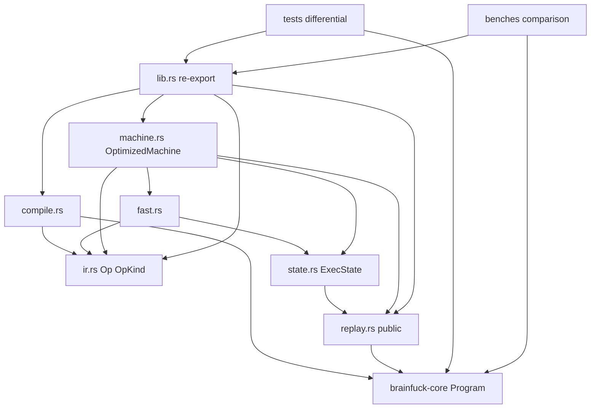
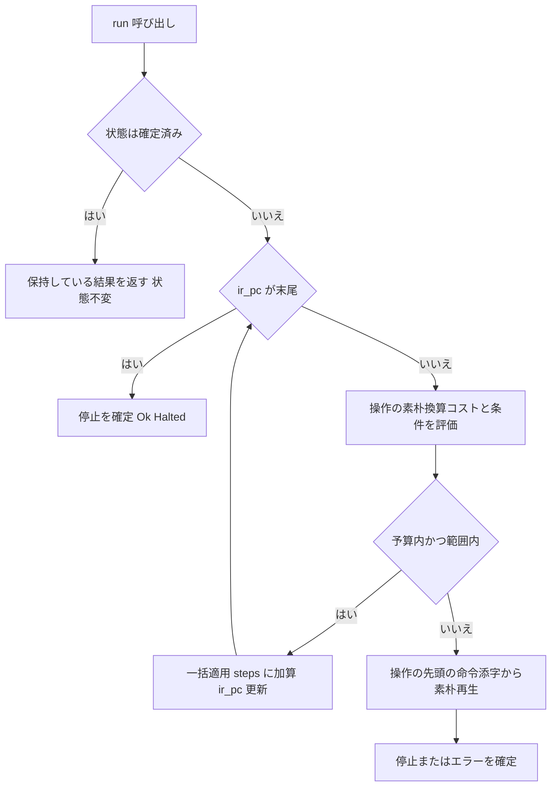

# Design Document: optimized-interpreter

## Overview

`optimized-interpreter` は、`brainfuck-core` が解析した `Program` を中間表現(IR)へ変換し、連続命令の統合と代表的ループの最適化を行ったうえで実行する最適化インタプリタを、新 crate `brainfuck-optimized` として提供する。あわせて、素朴意味論の再生(縮退経路)を公開モジュール `brainfuck_optimized::replay` として、操作の素朴換算コスト式を公開ヘルパ `Op::naive_cost` / `Op::static_reach` として提供し、下流の実装(`compiler-comparison`)が素朴意味論やコスト式を複製せずに再利用できるようにする。素朴インタプリタ(`brainfuck-core`)は**変更せず正解オラクル**として扱い、最適化実装は出力・最終テープ・終了種別に加え、**エラー値のフィールド、エラー時点の状態、実行数まで素朴実装と完全に一致**させる。

**Purpose**: 実行方式による性能差を学習・比較でき、かつ結果は素朴実装と常に同一であることを保証する Phase 3 の実行エンジンを提供する。
**Users**: 学習者(ベンチマークで差を確認)、`compiler-comparison` の実装者(比較対象・実行数定義の参照元)、Phase 3 の受け入れ基準を検証するテスト実装者。
**Impact**: workspace に crate `crates/brainfuck-optimized` を追加する。`brainfuck-core` は変更しない。

### Goals
- `Program` → `OptimizedProgram`(IR)変換: 加減算・同方向移動の統合、クリア/移動・加算・乗算/走査ループの最適化
- 素朴実装との**完全状態一致**(出力、テープ、`dp`、入力位置、`pc`、素朴換算実行数、停止/エラー値)。エラーとステップ制限境界を含む
- 実行数を「素朴実装換算(`steps_executed`)」と「IR 操作実行回数(`ir_ops_executed`)」の 2 種類で報告
- 素朴意味論の再生を**公開モジュール `replay`** として単一実装で提供(最適化機械の縮退経路と下流 crate が同じ実装を共有)。操作の素朴換算コスト式と到達範囲を**公開の純粋ヘルパ**として一元化(FastPath と下流のコード生成・テストが共有)
- 素朴インタプリタをオラクルとした差分テスト(網羅・乱数・パターン・上限掃引・境界・入出力)と、正規テストから分離したベンチマーク

### Non-Goals
- JIT/AOT/WASM、GUI/CLI への配線、`step()` 相当の 1 操作ずつ実行、ブレークポイント/キャンセル/バッチ実行(`compiler-comparison` / `debugger-state` / 後続 spec の責務)
- core の意味論・公開契約の変更、括弧エラーなど解析エラーの再定義
- ピープホール最適化の拡張(`Clear` + `Add` の `Set` 化、`[--]` など正味変化が -1 以外のループ、入れ子ループの解析的最適化)

## Boundary Commitments

### This Spec Owns
- crate `crates/brainfuck-optimized` と、その IR 設計・最適化パス・最適化実行器
- **公開モジュール `replay`**(`ReplayState` / `ReplayParts` / `ReplayStateError` / `Replayed` / `replay`): 素朴意味論の命令単位の再生。最適化機械の縮退経路は、この公開実装そのものである。素朴意味論の再実装は本 crate 内でここ 1 箇所のみ
- **公開ヘルパ `Op::naive_cost` / `Op::static_reach`**: 操作ごとの素朴換算コストの閉形式と、移動を伴う操作の相対到達範囲。FastPath と下流(コード生成・テストのオラクル)が共有する単一の式の出典
- 「素朴実装換算の実行数」と「IR 操作実行回数」の定義と報告
- エラー位置とステップ制限の意味保存方針: **`pc` は常に core の命令添字**、**上限は素朴換算実行数に適用**、**エラー時の状態は素朴実装と完全一致**
- 素朴実装との観測的一致を検証する差分テスト基盤(`tests/common`)と、ベンチマーク(`benches/`)およびその手順書(crate `README.md`)

### Out of Boundary
- 基準意味論(命令遷移、テープ長、EOF、範囲外、上限の境界、`step()` 判定順序)— `brainfuck-core` が所有。本 spec は参照のみで、変更・拡張しない
- ソース解析と括弧エラー — core の `Program::parse`
- コンパイラ生成(JIT/AOT/WASM)・比較画面・GUI/CLI 統合 — `compiler-comparison` / `desktop-gui` / `brainfuck-cli`
- ブレークポイント、キャンセル、バッチ実行、1 命令ずつの実行 — 素朴側(`debugger-state`)
- 公開する `replay` を「第二の公式な素朴インタプリタ」として位置づけること。`replay` は「操作境界の途中状態から素朴意味論を継続する」ための部品であり、基準意味論の所有者は core のまま、検証の基準は常に core の `Machine`。`replay` は core の `Machine` との一致が検証された別実装である(`Machine` 相当の完走 API、デバッグ API、ブレークポイント、キャンセルは持たない)

### Allowed Dependencies
- Rust 標準ライブラリ(`std::time::Instant` と `std::hint::black_box` はベンチのみ。`std::fs`/`std::io`/`std::env` は本体(`src/`)で使用しない)
- `brainfuck-core`(path 依存)の公開 API のみ: `Program`(`instructions()` / `len()` / `matching_bracket()` / `source_offsets()`)、`Instruction`、`MachineConfig`、`StopReason`、`RuntimeError`、`PointerDirection`、`TAPE_SIZE`。テスト/ベンチではさらに `Machine`
- 外部 crate は**一切追加しない**(本番・dev とも)
- 依存方向(厳守): `ir`(`naive_cost` / `static_reach` を含む)← `compile`、`replay`(core のみに依存)← `state`、`ir` / `state` ← `fast`、`fast` / `replay` ← `machine` ← `lib`(re-export。`replay` は公開モジュールとして宣言)。逆向きの import 禁止。`brainfuck-core` から本 crate への依存は存在しない(単方向)
- ベンチマーク(`benches/`)と差分テスト(`tests/`)は `src/` の公開 API(公開 `replay` モジュールと `Op::naive_cost` を含む)と `brainfuck-core` のみに依存する(`pub(crate)` へ到達しない)

### Revalidation Triggers
以下を変更する場合、下流 spec(`compiler-comparison`)は統合を再確認する。
- `steps_executed`(素朴換算)・`ir_ops_executed` の定義、およびその名称
- `pc` の座標系(core の命令添字)とエラー値のフィールド対応
- `OptimizedProgram` / `Op` / `OpKind` / `OptimizedMachine` / `OptimizedSnapshot` の公開シグネチャ
- **公開 `replay` モジュール**(`ReplayState` / `ReplayParts` / `ReplayStateError` / `Replayed` / `replay` の署名)と、`replay` の意味論(判定順序、`start_pc` が命令数以上の扱い、`Replayed.pc` の定義、エラー時に状態を変更しないこと)。変更時は **`compiler-comparison`(`brainfuck-wasm` の離脱後再生)の再検証が必要**
- **`Op::naive_cost` / `Op::static_reach`** の署名・意味論(閉形式の式、`Scan` の反復数 `k` の定義、`static_reach` の適用条件)。変更時は **`compiler-comparison`(`emit` のコスト・範囲条件、コスト式のテスト)の再検証が必要**
- 観測的一致の定義(完全状態一致)の弱化・強化
- core 側: `Program` の公開 API、`RuntimeError` / `MachineConfig` のバリアント・フィールド、`step()` の判定順序、`,` の EOF 規約(入力位置を進めない)、`TAPE_SIZE`(本 spec の再確認トリガ)

## Architecture

### Existing Architecture Analysis
workspace は `crates/brainfuck-core`(意味論の正)を中核とし、依存は一方向(UI/CLI → core)。steering の方針どおり、最適化実装は core の意味論を変更せず別実装として追加する。core の `Machine` は内部状態を外部から書き換える API を持たないため、最適化実行器は自身の状態(`ExecState` = 公開 `ReplayState` + IR 実行位置 + IR 操作実行回数)を保持する。core の `MachineSnapshot` は `#[non_exhaustive]` で外部構築不可のため、独自のスナップショット型を定義する。

### Architecture Pattern & Boundary Map



**Architecture Integration**:
- Selected pattern: **コスト付き IR + 公開の縮退経路(`replay`)**。IR の各操作は「素朴実装換算コストを実行前に計算できる」置換単位であり、予算(上限の残り)・ポインタ範囲が許さない場合のみ、その操作の命令範囲の先頭から素朴意味論で再生する
- Domain boundaries: `compile` は静的構造(IR)のみ、`state` は動的状態のみ、`fast` はホットパス(コスト・範囲は `ir` の公開ヘルパを使用)、`replay` は素朴意味論の最小再現(公開。下流 crate も再利用する)、`machine` はそれらの統括と公開 API を所有
- Existing patterns preserved: core の値型 + 状態機械、`#![forbid(unsafe_code)]`、外部依存ゼロ、エラーは数値/列挙のみ
- New components rationale: 縮退経路を `fast` と分けることでホットパスを単純に保ち、素朴意味論の再実装を 1 ファイル(`replay.rs`)に隔離して差分テストの焦点にする。`replay` を公開することで、`compiler-comparison` が同じ意味論をもう一度書き写す必要をなくし(複製間のずれによる不一致の排除)、コスト式も `Op::naive_cost` に一元化する
- Steering compliance: `unsafe` 禁止、括弧対応は変換時に 1 回だけ確定(実行中探索なし)、Phase 3 の結果は Phase 1 と観測的に完全一致、ベンチは正規テストと分離

### Technology Stack

| Layer | Choice / Version | Role in Feature | Notes |
|-------|------------------|-----------------|-------|
| Language | Rust stable、edition 2021 | 実装全体 | core と同一。`unsafe` 禁止(workspace lint + `#![forbid(unsafe_code)]`) |
| Dependencies | `brainfuck-core`(path)のみ | 解析結果・エラー型・設定型の再利用 | 外部 crate なし(詳細は research.md) |
| Test | `cargo test --workspace` | 単体・差分・回帰テスト | 擬似乱数は自前 xorshift、固定シード |
| Bench | Cargo bench ターゲット(`harness = false`) | 素朴/最適化の時間・実行数比較 | `std::time::Instant` と `std::hint::black_box`。`cargo test` では実行されない |

## File Structure Plan

### Directory Structure
```
crates/
└── brainfuck-optimized/
    ├── Cargo.toml                      # 依存: brainfuck-core(path)のみ。[lints] workspace = true。[[bench]] interpreter_comparison, harness = false
    ├── README.md                       # 概要、実行数の 2 定義、ベンチ実行手順、「ベンチは正しさの証明ではない」注記(12.6, 12.7, 6.5)
    ├── src/
    │   ├── lib.rs                      # #![forbid(unsafe_code)]、モジュール宣言(`pub mod replay`)、公開型の re-export、クレートドキュメント(実行数の定義)
    │   ├── ir.rs                       # Op / OpKind / Term / OptimizedProgram の型定義と読み取り API、純粋ヘルパ Op::naive_cost / Op::static_reach(それ以外のロジックなし)
    │   ├── compile.rs                  # OptimizedProgram::compile: 1 回の線形走査で統合とループ認識を行い IR を生成
    │   ├── replay.rs                   # **公開**: ReplayState / ReplayParts / ReplayStateError / Replayed / replay。素朴意味論(停止→上限→検証→更新)での再生。縮退経路と下流 crate が共有する唯一の実装
    │   ├── state.rs                    # ExecState(ReplayState + ir_ops_executed + ir_pc)。pub(crate)
    │   ├── fast.rs                     # 各 OpKind の一括適用。コストは Op::naive_cost、範囲は Op::static_reach を使用(式を持たない)。予算・範囲が許さない場合 Fallback を返す。pub(crate)
    │   └── machine.rs                  # OptimizedMachine / OptimizedSnapshot、run() のディスパッチ、停止/エラーの確定
    ├── tests/
    │   ├── common/mod.rs               # 差分比較ヘルパ(compare)、網羅列挙、xorshift、パターンテンプレート、上限掃引
    │   ├── ir.rs                       # IR 構造: 統合、パターン認識/非認識、命令範囲、操作数、決定性、空プログラム
    │   ├── replay.rs                   # 公開 replay の外部 crate 視点の契約: ReplayState の生成・検証・読み戻し、core の Machine::run との一致(初期状態から/途中状態から)、上限掃引、start_pc の扱い
    │   ├── cost.rs                     # Op::naive_cost / Op::static_reach の契約: core の step() 実測を独立オラクルとして操作ごとのコストを検証
    │   ├── semantics.rs                # OptimizedMachine の API 契約: 初期状態、停止冪等、エラーの固定、独立性、実行数の例示
    │   ├── diff_smoke.rs               # 比較基盤の自己検証: 手書き数本の一致と、意図的な不一致の検出
    │   ├── diff_exhaustive.rs          # 小規模プログラムの網羅比較(接頭辞プログラム付き)
    │   ├── diff_random.rs              # 固定シード乱数プログラムの比較
    │   ├── diff_patterns.rs            # 各最適化パターンと非適用境界のテンプレート比較
    │   ├── diff_limits.rs              # ステップ上限 0..N+2 の全境界掃引
    │   ├── diff_edges_io.rs            # 左右端の範囲外/成功、入力空/尽きる/0・255 を含む入力
    │   ├── bench_programs.rs           # ベンチ用プログラムの健全性(素朴との一致、IR 操作数 < 換算実行数)。時間計測なし
    │   ├── regression.rs               # tests/regression/*.bf を include_str! で読む回帰テスト
    │   ├── fixtures/{hello.bf,echo.bf} # 結合確認用(core のフィクスチャと同内容の独自コピー)
    │   └── regression/                 # 最小再現 .bf(初期は規約実証用に 1 件)
    └── benches/
        ├── interpreter_comparison.rs   # ベンチ本体: 一致確認 → 計測 → 表形式報告
        └── programs/*.bf               # 固定ベンチ用プログラム(連続命令/クリア/乗算/走査/一般ループ)
```

### Modified Files
- `Cargo.toml`(workspace ルート)— 変更なし(`members = ["crates/*"]` が新 crate を自動で取り込む)。取り込まれない構成だった場合のみ members を確認して追記する。`brainfuck-core` 配下は一切変更しない

## System Flows

### `run()` の決定フロー



**判断**: 予算は `残り = limit - steps_executed`(制限なしは無限)。操作のコスト `c` が `c > 残り` なら再生へ移る。`c == 残り` は一括適用で `steps == limit` に達し、その操作が最後の命令なら正常停止、そうでなければ次の操作の評価で `残り = 0` となり再生へ移り、素朴実装と同じ `StepLimitExceeded { limit, pc }` を返す(`pc` は次の操作の先頭命令添字 = 素朴実装が止まる `pc`)。範囲外が起きうる条件(移動/乗算/走査)は評価時に判定し、起きうるなら再生へ移る。再生は素朴実装と同一の判定順序(停止 → 上限 → 検証 → 更新)で命令単位に進めるため、エラー値と状態が構造的に一致する。再生は一括適用が不適な操作の直前でのみ起動され、その後は再生のまま末尾(停止またはエラー)まで進む。

## Requirements Traceability

| Requirement | Summary | Components | Interfaces | Flows |
|-------------|---------|------------|------------|-------|
| 1.1 | core を変更せず解析結果を入力にする | Workspace, Compiler | `OptimizedProgram::compile(&Program)` | - |
| 1.2 | UI/stdin/fs 非依存 | Workspace, 全 src | 依存制約 | - |
| 1.3 | 入出力はバイト列 | OptimizedMachine | `new(.., input: Vec<u8>, ..)`, `output()` | - |
| 1.4 | unsafe 禁止 | Workspace | lint, `forbid(unsafe_code)` | - |
| 1.5 | 外部プロセス不要でテスト完走 | Test suite | `cargo test --workspace` | - |
| 1.6 | 定数・EOF・ラップを素朴と同一 | ExecState, FastPath, Replay | `TAPE_SIZE` 再利用 | - |
| 1.7 | テープ量は入力に比例しない | ExecState | 固定長テープ | - |
| 2.1 | 変換は失敗しない | Compiler | `compile -> OptimizedProgram` | - |
| 2.2 | 変換は決定的 | Compiler | 純粋関数 | - |
| 2.3 | 操作→命令範囲の参照 | IR | `Op::source_range()` | - |
| 2.4 | IR を読み取り専用で検査 | IR | `OptimizedProgram::ops()`, `Op::kind()` | - |
| 2.5 | 空プログラムは操作 0 個 | Compiler, OptimizedMachine | `ops().is_empty()` | run フロー |
| 2.6 | 括弧対応は変換時に確定 | Compiler, IR | `LoopStart.end` / `LoopEnd.start` | - |
| 2.7 | 操作数 ≤ 命令数 | Compiler | 不変条件 | - |
| 3.1 | 加減算の統合 | Compiler | `OpKind::Add` | - |
| 3.2 | 同方向移動の統合 | Compiler | `OpKind::Move` | - |
| 3.3 | 位置・実行数を変えうる統合の禁止 | Compiler | 逆向き混在は融合しない | - |
| 3.4 | 入出力は統合しない | Compiler | `OpKind::Output` / `Input` | - |
| 3.5 | 正味 0 でも元命令数で換算 | Compiler, FastPath | `Add` のコスト = `source_len` | - |
| 4.1 | クリアループ | Compiler, FastPath | `OpKind::Clear` | run フロー |
| 4.2 | 移動/加算/乗算ループ | Compiler, FastPath | `OpKind::Transfer` | run フロー |
| 4.3 | 走査ループ | Compiler, FastPath | `OpKind::Scan` | run フロー |
| 4.4 | 非対象ループは一般ループ | Compiler | `LoopStart` / `LoopEnd` | - |
| 4.5 | 条件不成立時は素朴状態遷移を再現 | FastPath, Replay | `FastOutcome::Fallback` | run フロー |
| 4.6 | セル 0 到達は `[` 1 命令分のみ | FastPath | コスト式 | - |
| 4.7 | 最適化の有無で結果不変 | Test suite | 差分テスト | - |
| 5.1 | 出力・テープ・終了種別の一致 | OptimizedMachine, Test suite | `compare` ヘルパ | - |
| 5.2 | エラー時点の状態一致 | Replay, Test suite | 縮退再生 | run フロー |
| 5.3 | 停止時の `dp`/入力位置/実行数の一致 | OptimizedMachine, FastPath | `snapshot()` | - |
| 5.4 | エラー値のフィールド一致 | Replay | `RuntimeError`(core 型) | run フロー |
| 5.5 | 同値性で検証できる観測結果 | OptimizedSnapshot | `PartialEq` 実装 | - |
| 5.6 | エラー以外の失敗なし | 全 src | panic しない不変条件 | - |
| 6.1 | 素朴換算の実行数 | ExecState, FastPath | `steps_executed` | - |
| 6.2 | 操作が表す命令数を加算 | FastPath | コスト式(research.md) | - |
| 6.3 | IR 操作実行回数を別値で報告 | ExecState | `ir_ops_executed` | - |
| 6.4 | 実行単位数 ≤ 換算実行数 | FastPath | 各操作のコスト ≥ 1 | - |
| 6.5 | 2 定義を名称/文書で区別 | OptimizedSnapshot, README | フィールド名とドキュメント | - |
| 6.6 | エラー中断時も換算値が一致 | Replay | 再生は 1 命令ごとに +1 | run フロー |
| 6.7 | 最適化効果の決定的な観測 | OptimizedSnapshot, Test suite | `ir_ops_executed < steps_executed` の例示テスト | - |
| 7.1 | 上限は換算値に適用 | FastPath, Replay | 残り予算評価 | run フロー |
| 7.2 | ちょうど上限は正常停止 | FastPath | `c <= 残り` で一括適用 | run フロー |
| 7.3 | 上限 -1 でエラー | Replay | 再生で上限判定 | run フロー |
| 7.4 | 操作途中の上限で素朴と同一状態 | Replay | 再生 | run フロー |
| 7.5 | 上限 0 かつ非空 → エラー | OptimizedMachine, Replay | 評価時に残り 0 | run フロー |
| 7.6 | 上限 0 かつ空 → 停止 | OptimizedMachine | `ir_pc == len` を先に判定 | run フロー |
| 7.7 | 制限なしは停止しない | FastPath | 残り = `u64::MAX` | - |
| 7.8 | 上限エラー後は同じエラー | OptimizedMachine | 確定結果の保持 | run フロー |
| 8.1 | 範囲外エラーの `pc`/`dp`/方向一致 | Replay | 再生 | run フロー |
| 8.2 | 融合移動の途中の範囲外 | Replay | 再生(`Move` 先頭から) | run フロー |
| 8.3 | 最適化ループ内の範囲外 | FastPath, Replay | 範囲事前判定 + 再生 | run フロー |
| 8.4 | エラー時に実行数・状態不変 | Replay | 検証→更新の 2 段 | run フロー |
| 8.5 | 境界上の移動は成功 | FastPath | 範囲判定 `0..=TAPE_SIZE-1` | - |
| 8.6 | セル 0 なら本体を評価しない | FastPath | `v == 0` 経路 | - |
| 9.1 | 出力は順序どおり追加 | FastPath, Replay | `Output` | - |
| 9.2 | 入力は 1 バイト格納、位置 +1 | FastPath, Replay | `Input` | - |
| 9.3 | EOF は 0 | FastPath, Replay | `Input` | - |
| 9.4 | バイト列として扱う | ExecState | `Vec<u8>` | - |
| 9.5 | 入出力を含むループは非最適化 | Compiler | 認識条件 | - |
| 10.1 | 初期状態 | OptimizedMachine, ExecState | `new` | - |
| 10.2 | 正常終了は `Ok(Halted)` | OptimizedMachine | `run` | run フロー |
| 10.3 | 停止済みの再実行は状態不変 | OptimizedMachine | `run` | run フロー |
| 10.4 | 状態の読み取り専用参照 | OptimizedMachine | `snapshot`/`tape`/`output`/`input_position` | - |
| 10.5 | `pc` を命令添字で参照 | OptimizedMachine | `OptimizedSnapshot.pc` | - |
| 10.6 | 機械の独立 | OptimizedMachine | 状態を機械ごとに所有 | - |
| 10.7 | IR の共有と不変性 | OptimizedProgram | `&'p OptimizedProgram` を借用 | - |
| 11.1 | 差分テスト(オラクル) | Test suite | `compare` | - |
| 11.2 | 網羅列挙 | Test suite | `diff_exhaustive` | - |
| 11.3 | 固定シード乱数 | Test suite | `diff_random` | - |
| 11.4 | パターン + 非適用境界 | Test suite | `diff_patterns` | - |
| 11.5 | 上限掃引 | Test suite | `diff_limits` | - |
| 11.6 | 左右端 | Test suite | `diff_edges_io` | - |
| 11.7 | 入力のバリエーション | Test suite | `diff_edges_io` | - |
| 11.8 | 回帰の構成 | Test suite | `tests/regression/*.bf` | - |
| 11.9 | 全テスト成功、ベンチは非実行 | Test suite, Bench | `harness = false` ベンチターゲット | - |
| 12.1 | ベンチの分離 | Bench | `benches/` | - |
| 12.2 | 固定プログラムで時間計測 | Bench | `benches/programs` | - |
| 12.3 | 実行数・比の報告と定義明示 | Bench | 表形式出力 | - |
| 12.4 | 計測前の一致確認 | Bench | 一致しなければ失敗 | - |
| 12.5 | 時間を成否に使わない | Bench, Test suite | 設計制約 | - |
| 12.6 | 実行手順の文書化 | README | `cargo bench -p brainfuck-optimized` | - |
| 12.7 | 正しさの証明ではない旨の明記 | README, Bench | 出力ヘッダと文書 | - |
| 13.1 | 同一のエラー型を使用 | OptimizedMachine | `RuntimeError`(core 型を再利用) | - |
| 13.2 | 解析エラーを新設しない | Compiler | 入力は解析済み `Program` | - |
| 13.3 | 機微情報を含めない | OptimizedMachine | エラーは core 型(数値のみ) | - |
| 14.1 | 素朴再生を公開モジュールとして提供 | Replay | `brainfuck_optimized::replay`(`ReplayState` / `Replayed` / `replay`) | - |
| 14.2 | 途中状態の検証付き生成・読み戻し | Replay | `ReplayState::new` / `from_parts` / `into_parts` / アクセサ、`ReplayStateError` | - |
| 14.3 | 判定順序は core の step と同一、エラーで状態不変 | Replay | `replay`(停止 → 上限 → 検証 → 更新) | run フロー |
| 14.4 | core の完走実行との一致(初期状態/途中状態) | Replay, Test suite | `tests/replay.rs` | - |
| 14.5 | 終了 `pc` と結果の返却、`limit: Option<u64>`、`start_pc` が命令数以上は停止 | Replay | `Replayed { pc, result }` | - |
| 14.6 | 縮退経路は公開再生そのもの(第二の実装なし) | OptimizedMachine, ExecState | `ExecState` が `ReplayState` を保持、`machine` が `replay::replay` を呼ぶ | run フロー |
| 14.7 | 操作の素朴換算コストの公開ヘルパと閉形式の文書化 | IR | `Op::naive_cost(start_cell, scan_iterations)` | - |
| 14.8 | 移動を伴う操作の相対到達範囲の公開ヘルパ | IR | `Op::static_reach()` | - |
| 14.9 | 一括適用が公開ヘルパを使い式を重複させない | FastPath | `fast.rs` は `naive_cost` / `static_reach` のみを使用 | run フロー |

## Components and Interfaces

| Component | Domain/Layer | Intent | Req Coverage | Key Dependencies | Contracts |
|-----------|--------------|--------|--------------|------------------|-----------|
| Workspace | Build | crate 追加と lint/依存制約 | 1.1, 1.2, 1.4, 1.5 | brainfuck-core (P0) | - |
| IR | Domain | 操作・命令範囲・括弧対応の型、素朴換算コストと到達範囲の公開ヘルパ | 2.3, 2.4, 2.6, 3.1, 3.2, 3.4, 4.1, 4.2, 4.3, 4.4, 14.7, 14.8 | brainfuck-core (P0) | Service |
| Compiler | Domain | 統合とループ認識による IR 生成 | 2.1, 2.2, 2.5, 2.7, 3.1-3.5, 4.1-4.4, 9.5, 13.2 | IR (P0), Program (P0) | Service |
| ExecState | Runtime | 実行状態(内部)。`ReplayState` + IR 実行位置 + IR 操作実行回数 | 1.6, 1.7, 6.1, 6.3, 9.4, 14.6 | Replay (P0) | State |
| FastPath | Runtime | 操作の一括適用(コスト・範囲は IR の公開ヘルパで評価) | 4.5, 4.6, 6.1-6.4, 7.1, 7.2, 7.7, 8.3, 8.5, 8.6, 9.1-9.3, 14.9 | IR (P0), ExecState (P0) | Service |
| Replay(**公開** `replay.rs`) | Runtime | 素朴意味論の再生。縮退経路かつ下流 crate 共有の部品 | 4.5, 5.2, 5.4, 6.6, 7.3-7.5, 8.1-8.4, 14.1-14.5 | Program (P0) | Service, State |
| OptimizedMachine | Runtime | 公開の実行・観測 API | 1.3, 5.1, 5.3, 5.5, 5.6, 7.5-7.8, 10.1-10.7, 13.1, 13.3, 14.6 | FastPath (P0), Replay (P0) | Service, State |
| Test suite | QA | 差分テスト・IR 構造・API 契約・回帰・公開 replay とコストヘルパの契約 | 1.5, 4.7, 6.7, 11.1-11.9, 14.4, 14.7, 14.8 | 全 Component (P0), core Machine (P0) | - |
| Bench | QA | 素朴/最適化の比較計測 | 12.1-12.7 | OptimizedMachine (P0), core Machine (P0) | - |

### Domain

#### IR(`ir.rs`)

| Field | Detail |
|-------|--------|
| Intent | 最適化後の操作列を、元の命令範囲付きで不変に保持し、読み取り専用で公開する |
| Requirements | 2.3, 2.4, 2.6, 3.1, 3.2, 3.4, 4.1, 4.2, 4.3, 4.4, 14.7, 14.8 |

**Responsibilities & Constraints**
- 型と読み取り API に加え、副作用のない純粋ヘルパ `Op::naive_cost` / `Op::static_reach`(下記)のみをロジックとして持つ。`Op` は不変。構築は crate 内部の `pub(crate) fn new` 系コンストラクタ(`Op::new(kind, source_start, source_len)` / `OptimizedProgram::from_parts(source, ops)`)経由で `compile` だけが行う(フィールドは非公開のまま別モジュールから生成するため)
- `source_range()` は半開区間 `source_start .. source_start + source_len`(core の命令添字)。操作列の `source_range` は連続し重ならず、全体で `0..program.len()` を過不足なく覆う
- `LoopStart.end` / `LoopEnd.start` は IR 操作添字(命令添字ではない)で、`compile` が確定する(実行中に括弧を探索しない)

##### Service Interface
```rust
#[derive(Debug, Clone, Copy, PartialEq, Eq)]
pub struct Term {
    /// 開始セルからの相対位置(0 は含まない)。
    pub offset: isize,
    /// 加算係数(mod 256、0 は含まない)。
    pub factor: u8,
}

#[derive(Debug, Clone, PartialEq, Eq)]
#[non_exhaustive]
pub enum OpKind {
    /// `+`/`-` の連続。正味量(mod 256)を加える。コスト = source_len。
    Add(u8),
    /// 同方向 `>`/`<` の連続。正は右、負は左。|n| = source_len。コスト = |n|。
    Move(isize),
    Output,
    Input,
    /// 最適化対象外ループの `[`。`end` は対応する LoopEnd の IR 添字。
    LoopStart { end: usize },
    /// 最適化対象外ループの `]`。`start` は対応する LoopStart の IR 添字。
    LoopEnd { start: usize },
    /// `[-]`(increments = false)/ `[+]`(increments = true)。
    Clear { increments: bool },
    /// 開始セルの正味変化が -1、ポインタ正味移動 0 の `+ - > <` のみのループ。
    /// `body_len` は本体の命令数。`reach_min <= 0 <= reach_max` は本体が到達する相対位置の範囲。
    Transfer { terms: Box<[Term]>, body_len: usize, reach_min: isize, reach_max: isize },
    /// 同方向移動のみの本体。stride の符号が向き、|stride| が 1 反復の移動命令数。
    Scan { stride: isize },
}

#[derive(Debug, Clone, PartialEq, Eq)]
pub struct Op { /* kind, source_start, source_len (private) */ }
impl Op {
    pub fn kind(&self) -> &OpKind;
    pub fn source_range(&self) -> std::ops::Range<usize>;

    /// この操作を素朴実装が実行した場合に数える実行数(素朴実装換算コスト)。純粋関数。
    /// `start_cell` は操作開始時の現在セル値。`scan_iterations` は `Scan` で
    /// `start_cell != 0` のときだけ参照する反復数 `k`(同方向に stride ずつ進んで
    /// 最初に 0 のセルに至るまでの反復数。1 以上)で、それ以外の操作では無視される。
    /// 演算は飽和演算で、panic しない。結果は常に 1 以上。
    pub fn naive_cost(&self, start_cell: u8, scan_iterations: u64) -> u64;

    /// 移動を伴う操作が、現在位置 `dp` からの相対位置 `min..=max` をすべてテープ内に
    /// 収める必要があるときの `(min, max)`(0 を含む)。範囲条件は
    /// `dp as isize + min >= 0 && dp as isize + max <= TAPE_SIZE as isize - 1`。
    /// `Move(n)` は `(min(0, n), max(0, n))`。`Transfer` は `(reach_min, reach_max)` で、
    /// **開始セルが 0 でないときだけ**評価が必要(0 のときは本体を実行しないため範囲外にならない)。
    /// それ以外(`Scan` を含む)は `None`。`Scan` の範囲は走査中のセル値に依存するため静的には決まらない。
    pub fn static_reach(&self) -> Option<(isize, isize)>;
}

#[derive(Debug, Clone, PartialEq, Eq)]
pub struct OptimizedProgram { /* source: Program, ops: Vec<Op> (private) */ }
impl OptimizedProgram {
    pub fn compile(program: &Program) -> OptimizedProgram; // compile.rs で実装
    pub fn ops(&self) -> &[Op];
    pub fn source(&self) -> &Program;
}
```
- Preconditions: `program` は `Program::parse` の成功結果(括弧が完全に対応)
- Postconditions: `ops().len() <= source().len()`。`source_range` の連結が `0..source().len()` に一致(空プログラムは操作 0 個)
- Invariants: `OptimizedProgram` は構築後に不変。`OpKind` は `#[non_exhaustive]`(最適化パターンの追加を後方互換で行うため。下流の `match` はワイルドカード必須)

**`Op::naive_cost` の閉形式**(`v` = `start_cell`、`L` = `source_len`、`B` = `body_len`、`m` = `|stride|`、`k` = `scan_iterations`)。この表が素朴換算コストの**唯一の出典**であり、`fast.rs`・テスト・下流のコード生成/テストはこれに従う。根拠は research.md の「実行数の閉形式」(素朴実装は `[` を 1 回、各反復で本体 `B` 命令と `]` 1 命令を実行し、`]` が 0 で抜けるときに `[` へは戻らない)。

| OpKind | `naive_cost` |
|--------|--------------|
| `Add(_)` | `L`(正味 0 でも `L`) |
| `Move(n)` | `|n|`(= `L`) |
| `Output` / `Input` / `LoopStart` / `LoopEnd` | 1 |
| `Clear { increments: false }` | `v == 0` なら 1、そうでなければ `1 + 2v` |
| `Clear { increments: true }` | `v == 0` なら 1、そうでなければ `1 + 2(256 - v)` |
| `Transfer { body_len: B, .. }` | `v == 0` なら 1、そうでなければ `1 + v(B + 1)` |
| `Scan { stride }` | `v == 0` なら 1、そうでなければ `1 + k(m + 1)` |

- `OpKind` は `#[non_exhaustive]` だが、`naive_cost` / `static_reach` は同一 crate 内の `match` で全バリアントを列挙する(バリアント追加時にコンパイルエラーで更新漏れを防ぐ)
- `Scan` で `v != 0` かつ `k == 0` が渡された場合(契約違反)は `1` を返し panic しない

#### Compiler(`compile.rs`)

| Field | Detail |
|-------|--------|
| Intent | `Program` を 1 回の線形走査で IR に変換する |
| Requirements | 2.1, 2.2, 2.5, 2.7, 3.1, 3.2, 3.3, 3.4, 3.5, 4.1, 4.2, 4.3, 4.4, 9.5, 13.2 |

**Responsibilities & Constraints**
- 変換は純粋かつ全域(失敗しない)。入力の命令列と core の `matching_bracket` のみに依存
- 走査規則(命令添字 `i` の命令により分岐):
  - `+`/`-`: 連続する `+`/`-` を 1 つの `Add(net)` へ(正味 0 でも操作は残し、コストは `source_len`)
  - `>`/`<`: **同方向のみ**連続を 1 つの `Move(±n)` へ。逆向きの隣接(`><`)は別操作(融合すると `dp=29999` での `>` エラーが消えるため。3.3)
  - `.`/`,`: 単体の `Output`/`Input`(統合・削除しない。3.4)
  - `[`: 対応する `]`(`matching_bracket`)までを本体として次の順に判定し、最初に該当した形で 1 操作へ置換して `]` の次へ進む
    1. 本体が正確に `-` → `Clear{false}`、正確に `+` → `Clear{true}`
    2. 本体が同方向の `>` のみ/`<` のみ(1 命令以上)→ `Scan{stride}`
    3. 本体が `+ - > <` のみ(括弧・入出力なし)、ポインタ正味移動 0、開始セル(相対位置 0)への加減算の正味が -1(mod 256)→ `Transfer`。`terms` は相対位置ごとの正味係数(mod 256)を相対位置昇順に集約し、係数 0 と相対位置 0 を除く。`reach_min`/`reach_max` は本体を先頭から辿る相対位置の最小/最大(0 を含む)。`body_len` は本体の命令数
    4. 上記以外(入出力・入れ子の括弧・その他の本体)→ `LoopStart`/`LoopEnd` の一般ループとして出力し、本体は同じ規則で再帰的に(走査の続きとして)変換する(入れ子の内側ループは個別に最適化されうる)
- 一般ループの IR 添字対応はスタックで 1 回だけ確定し、`LoopStart.end`/`LoopEnd.start` に格納する

**Dependencies**
- Inbound: OptimizedMachine 利用者(テスト/ベンチ/後続 spec)(P0)
- Outbound: IR 型 (P0); `Program::instructions()`, `matching_bracket()` (P0)

**Contracts**: Service [x]

**Implementation Notes**
- Integration: 命令の判定は `Instruction` の列挙体(`brainfuck-core`)を直接 `match` する。`Program` が括弧対応済みなので、スタック不足などの不整合は到達しない前提。万一到達しても panic せず一般ループとして出力しない(`debug_assert!` で検出)
- Validation: `tests/ir.rs` で操作数 ≤ 命令数、命令範囲の連続性、パターン別の認識/非認識を検証する
- Risks: 本体の解析で `isize` の算術がオーバーフローしないこと(本体長は命令数以下であり、`isize` に収まるが、`checked_add` を用いて不成立時は一般ループへ倒す)

### Runtime

#### ExecState(`state.rs`、crate 内部)

| Field | Detail |
|-------|--------|
| Intent | 一括適用と縮退再生が共有する実行状態。再生の状態(公開 `ReplayState`)に IR 固有の項目を足したもの |
| Requirements | 1.6, 1.7, 6.1, 6.3, 9.4, 14.6 |

**Contracts**: State [x]

##### State Management
- State model: `replay: ReplayState`(`tape`(長さ `TAPE_SIZE` 固定)、`dp`、`steps_executed`(素朴換算)、`input`、`input_pos`、`output`。フィールドは crate 内 `pub(crate)` で `fast.rs` が直接更新する)、`ir_ops_executed: u64`、`ir_pc: usize`。`tape` 等を `ExecState` に二重に持たない
- Invariants: `ReplayState` の不変条件(`dp <= TAPE_SIZE - 1`、`input_pos <= input.len()`)、`ir_ops_executed <= replay.steps_executed`、縮退経路(`replay::replay`)は `ReplayState` しか受け取らないため `ir_ops_executed` を構造的に変更できない
- Persistence & consistency: メモリ内のみ。`FastPath` と `Replay`(`ExecState.replay` を介して)は同じ状態を排他的に更新する(同時に走らない)

#### FastPath(`fast.rs`、crate 内部)

| Field | Detail |
|-------|--------|
| Intent | 1 つの IR 操作を、素朴換算コスト計算つきで一括適用する。適用できなければ縮退を返す |
| Requirements | 3.5, 4.5, 4.6, 6.1, 6.2, 6.4, 7.1, 7.2, 7.7, 8.3, 8.5, 8.6, 9.1, 9.2, 9.3, 14.9 |

**Responsibilities & Constraints**
- シグネチャ(内部): `fn execute(op: &Op, st: &mut ExecState, remaining: u64) -> FastOutcome`、`enum FastOutcome { Applied, Fallback }`。`remaining` は上限の残り予算(制限なしは `u64::MAX`)
- 判定は「コスト `c` を `Op::naive_cost` で求める → `c > remaining` なら `Fallback` → 範囲条件を `Op::static_reach` で評価して満たさなければ `Fallback` → 適用」の順。`Scan` のみ、先に走査して `k` を求めてから `naive_cost(v, k)` を呼ぶ。**`Fallback` を返す場合、`ExecState` を一切変更しない**
- 操作別規則(`v` = 現在セル値)。**コストは `Op::naive_cost(v, k)`、移動を伴う操作の範囲条件は `Op::static_reach()` を呼ぶだけで、`fast.rs` は式を持たない**(14.9)。閉形式の出典は IR 節の `naive_cost` の表:

  | OpKind | コスト `c` | 範囲条件(Fallback 条件) | 適用 |
  |--------|-----------|--------------------------|------|
  | `Add(n)` | `naive_cost` | なし | セル `wrapping_add(n)`、`ir_pc+1` |
  | `Move(n)` | `naive_cost` | `static_reach()` が現在の `dp` でテープ範囲外 | `dp += n`、`ir_pc+1` |
  | `Output` / `Input` | `naive_cost` | なし | 出力追加 / 入力 1 バイト格納(尽きれば 0 を格納し位置は進めない) |
  | `LoopStart{end}` | `naive_cost` | なし | セル 0 なら `ir_pc = end+1`、非 0 なら `ir_pc+1` |
  | `LoopEnd{start}` | `naive_cost` | なし | セル非 0 なら `ir_pc = start+1`、0 なら `ir_pc+1` |
  | `Clear{inc}` | `naive_cost` | なし | セル = 0 |
  | `Transfer` | `naive_cost` | `v != 0` かつ `static_reach()` が現在の `dp` でテープ範囲外 | `v != 0` のとき各 term の相対位置のセルへ `v * factor`(ラップ)を加算し、セル = 0 |
  | `Scan{stride}` | `naive_cost(v, k)`(`k` は FastPath が走査して求める反復数。`v == 0` なら `k` は不要) | 0 のセルに至る前にテープ範囲を出る | `dp = dp + k*stride` |

- 適用時の共通更新: `steps_executed += c`(`saturating_add`)、`ir_ops_executed += 1`
- `Scan` の走査は残り予算を超える反復数に達した時点で打ち切って `Fallback`(無駄な走査を避ける)
- `naive_cost` は常に 1 以上のため `ir_ops_executed <= steps_executed` が成り立つ(6.4)

##### Service Interface
```rust
pub(crate) enum FastOutcome { Applied, Fallback }
pub(crate) fn execute(op: &Op, st: &mut ExecState, remaining: u64) -> FastOutcome;
```
- Preconditions: `st.ir_pc` が `op` の IR 添字。`op` は `OptimizedProgram` の操作
- Postconditions: `Applied` → 素朴実装が当該 `source_range` を実行した後の状態(`pc` を除く)と一致し、`steps_executed` がその実行数ぶん増える。`Fallback` → `ExecState` 不変
- Invariants: インデックス演算はすべて範囲条件の検査後にのみ行う(panic しない。5.6)

#### Replay(`replay.rs`、**公開モジュール** `brainfuck_optimized::replay`)

| Field | Detail |
|-------|--------|
| Intent | 素朴意味論を命令単位で再生し、エラー・上限到達時の状態を素朴実装と一致させる。最適化機械の縮退経路であり、下流 crate(`brainfuck-wasm`)が離脱後の再生に再利用する単一の実装 |
| Requirements | 4.5, 5.2, 5.4, 6.6, 7.3, 7.4, 7.5, 8.1, 8.2, 8.3, 8.4, 14.1, 14.2, 14.3, 14.4, 14.5 |

**Responsibilities & Constraints**
- 開始命令添字 `start_pc` から、**core の `step()` と同一の判定順序**(停止 `pc >= len` → 上限 `steps >= limit` → 命令実行: 検証 → 更新)で、停止またはエラーまで進める
- 更新は `ReplayState.steps_executed` の `+1`(`saturating_add`)のみ。エラーは検証段で返すため状態は変更されない。`ir_ops_executed` は `ReplayState` に存在しないため、縮退経路は構造的にそれを更新しない
- 命令意味論は仕様書 §5 の表のとおり。括弧のジャンプは `Program::matching_bracket(pc) + 1`(探索なし。`None` は到達しない前提で `debug_assert!` とし、release では `pc + 1`)。`,` は尽きたらセルに 0 を格納し入力位置を進めない
- 上限 `limit: Option<u64>`: `None` は制限なし(無限ループは返らない。core と同じ)。`Some(n)` は `steps_executed >= n` で `StepLimitExceeded { limit: n, pc }`(`ReplayState` を上限超過の状態で生成した場合も panic せず即エラー)
- `start_pc >= program.len()` は停止として扱う: 状態を変更せず `Replayed { pc: program.len(), result: Ok(StopReason::Halted) }`(停止判定が上限判定より先。上限 0 でも停止)
- 呼び出し元の追加責務はない: 操作境界の状態さえ渡せば、結果は素朴実装が同じ状態・上限から継続した場合に一致する

##### Service Interface
```rust
/// 素朴再生の実行状態。不変条件: tape.len() == TAPE_SIZE, dp < TAPE_SIZE, input_pos <= input.len()。
#[derive(Debug, Clone, PartialEq, Eq)]
pub struct ReplayState { /* tape: Box<[u8]>, dp, steps_executed, input, input_pos, output (crate 内 pub(crate)) */ }

/// 途中状態の各項目(生成時の入力、取り出し時の出力に使うプレーンな値)。
#[derive(Debug, Clone, PartialEq, Eq)]
pub struct ReplayParts {
    pub tape: Vec<u8>,
    pub dp: usize,
    pub steps_executed: u64,
    pub input: Vec<u8>,
    pub input_pos: usize,
    pub output: Vec<u8>,
}

#[derive(Debug, Clone, Copy, PartialEq, Eq)]
#[non_exhaustive]
pub enum ReplayStateError {
    InvalidTapeLength { actual: usize },
    DataPointerOutOfRange { dp: usize },
    InputPositionOutOfRange { input_pos: usize, input_len: usize },
}
// Display(英語の固定文面。数値のみを含む)と std::error::Error を実装

impl ReplayState {
    /// 初期状態: テープ全 0、dp = 0、steps_executed = 0、input_pos = 0、出力は空。
    pub fn new(input: Vec<u8>) -> ReplayState;
    /// 途中状態から生成する。不変条件を満たさなければ、panic せずエラーを返す。
    pub fn from_parts(parts: ReplayParts) -> Result<ReplayState, ReplayStateError>;
    /// 所有権を返して取り出す(テープの再コピーなし)。
    pub fn into_parts(self) -> ReplayParts;
    pub fn tape(&self) -> &[u8];            // 長さ TAPE_SIZE
    pub fn data_pointer(&self) -> usize;
    pub fn steps_executed(&self) -> u64;    // 素朴換算の実行数
    pub fn input(&self) -> &[u8];
    pub fn input_position(&self) -> usize;
    pub fn output(&self) -> &[u8];
}

/// 再生の結果。`pc` は終了時の core の命令添字(停止は命令数、エラーはエラーが報告する pc)。
#[derive(Debug, Clone, Copy, PartialEq, Eq)]
#[non_exhaustive]
pub struct Replayed {
    pub pc: usize,
    pub result: Result<StopReason, RuntimeError>,
}

/// `start_pc` から core の `step()` と同一の判定順序で、停止またはエラーまで進める。
/// 停止の結果は `Ok(StopReason::Halted)`。上限エラーは `Err(StepLimitExceeded)`(`StepLimitReached` は返さない)。
pub fn replay(program: &Program, limit: Option<u64>, start_pc: usize, state: &mut ReplayState) -> Replayed;
```
- Preconditions: `state` は不変条件を満たす(`ReplayState` の生成 API だけが構築手段なので型で保証)。`start_pc` は操作境界の命令添字、または `program.len()` 以上(停止扱い)
- Postconditions: `result` と終了時 `pc` は、素朴実装が同じ状態・上限から継続した場合の結果と一致。`Err` のとき `state` は当該エラー直前の状態(当該命令の効果なし)で、`steps_executed` はエラーの発生ステップで増えない
- Invariants: panic しない。`Replayed` は `#[non_exhaustive]`(下流は読み取り専用)。`ReplayState` のフィールドは非公開で、構築は `new` / `from_parts` に限る

**Implementation Notes**
- Integration: `OptimizedMachine` は縮退時に `replay(program.source(), config.max_steps, op_start_pc, &mut state.replay)` を呼び、返った `Replayed` を確定結果として保持する。下流の `brainfuck-wasm` は、線形メモリのテープ等を `ReplayParts` に詰めて `ReplayState::from_parts` → `replay(program, Some(limit), start_pc, &mut st)` → `into_parts` で読み戻す(テープのコピーは 30,000 バイト 1〜2 回で、離脱時のみ)
- Validation: モジュール内の単体テストと、公開 API のみを使う `tests/replay.rs`(core の `Machine::run` との一致、初期状態から/途中状態から、上限掃引)
- Risks: 素朴意味論の再実装であるため、差分テスト(core をオラクルとする `tests/replay.rs` と、全差分テストが縮退経由で再生を踏む構造)で保護する。縮退が不必要に早く起動しても結果は正しい(性能のみ劣化)ため、FastPath の条件は「素朴実装がエラーまたは上限到達になる場合のみ」を厳密に満たすよう設計する

#### OptimizedMachine(`machine.rs`)

| Field | Detail |
|-------|--------|
| Intent | 1 つの `OptimizedProgram` の実行を保持し、完走実行と観測を提供する公開 API |
| Requirements | 1.3, 5.1, 5.3, 5.5, 5.6, 7.5, 7.6, 7.8, 10.1-10.7, 13.1, 13.3, 14.6 |

**Responsibilities & Constraints**
- `run()` は上記フローを実行する。停止/エラーが確定したら結果を保持し、以降の `run()` は同じ結果を返して状態を変更しない(7.8, 10.3)
- 先頭で `ir_pc == ops.len()`(空プログラム、または全操作完了)を判定する。これにより上限 0 の空プログラムは正常停止(7.6)、上限 0 の非空プログラムは最初の操作でコスト ≥ 1 > 残り 0 となり縮退経路(公開 `replay`)が `StepLimitExceeded { limit: 0, pc: 0 }` を返す(7.5)
- `pc` の定義: 実行前・実行中は `ops[ir_pc].source_range().start`(末尾なら命令数)、停止は命令数、エラー確定後は再生が返した `pc`
- `OptimizedProgram` を `&'p` で借用し、IR を変更しない(10.7)。機械ごとに `ExecState` を所有し互いに独立(10.6)
- 実行エラー型は core の `RuntimeError` をそのまま使用(13.1)。新しい実行エラー種別を追加しない
- 縮退経路は公開 `replay::replay` の呼び出しのみで実現し、同 crate 内に素朴意味論の別実装を持たない(14.6)

##### Service Interface
```rust
pub struct OptimizedMachine<'p> { /* program, config, state, outcome (private) */ }

impl<'p> OptimizedMachine<'p> {
    pub fn new(program: &'p OptimizedProgram, input: Vec<u8>, config: MachineConfig) -> Self;
    /// 完走またはエラーまで実行する。ステップ制限は `Err(RuntimeError::StepLimitExceeded)`。
    /// 制限なし設定で無限ループするプログラムは終了しない(呼び出し側が上限を設定する)。
    pub fn run(&mut self) -> Result<StopReason, RuntimeError>;
    pub fn snapshot(&self) -> OptimizedSnapshot;
    pub fn tape(&self) -> &[u8];          // 長さ TAPE_SIZE
    pub fn output(&self) -> &[u8];
    pub fn input_position(&self) -> usize;
    pub fn is_halted(&self) -> bool;
    pub fn program(&self) -> &OptimizedProgram;
}

#[derive(Debug, Clone, Copy, PartialEq, Eq)]
#[non_exhaustive]
pub struct OptimizedSnapshot {
    /// core の命令添字(停止時は命令数、エラー時はエラーが報告する pc)。
    pub pc: usize,
    pub data_pointer: usize,
    pub current_cell: u8,
    /// 素朴実装換算の実行数。素朴実装が同一時点で数える値と常に一致する。
    pub steps_executed: u64,
    /// IR 操作を実行した回数(方式固有)。常に steps_executed 以下。
    pub ir_ops_executed: u64,
    pub halted: bool,
    pub input_position: usize,
}
```
- Preconditions: `new` は任意の `OptimizedProgram` / 入力 / 設定を受け付ける(失敗しない)
- Postconditions: `run()` 後の `snapshot()` の `pc`・`data_pointer`・`current_cell`・`steps_executed`・`halted` は、同一条件で実行した core の `Machine::snapshot()` の同名項目と一致し、`tape()`・`output()`・`input_position()` も一致する。`Result<StopReason, RuntimeError>` も `==` で一致する
- Invariants: `halted` は `Ok(Halted)` 確定後のみ真。`ir_ops_executed` は一括適用のみを数え、縮退再生の命令は数えない(ドキュメントに明記)

##### State Management
- State model: `ExecState` + 設定 + 確定結果(`Option<Result<StopReason, RuntimeError>>`)+ 縮退後の最終 `pc`
- Concurrency strategy: `&mut self` の排他借用のみ。内部可変性・スレッド共有なし

**Implementation Notes**
- Integration: 差分テストとベンチは、同一ソース・入力・設定で core の `Machine` と本機械を実行し、上記 Postconditions の全項目を比較する。`compiler-comparison` は `OptimizedSnapshot` の 2 種類の実行数を、名称どおりに別列で表示する
- Validation: `tests/semantics.rs` で初期状態、停止後冪等、エラー後の固定、機械の独立、IR の共有を検証する
- Risks: 制限なし + 無限ループは終了しない(core と同じ。ドキュメントコメントに明記)

### QA

#### Test suite

| Field | Detail |
|-------|--------|
| Intent | 素朴実装をオラクルとして最適化の観測的一致を継続的に検証する |
| Requirements | 1.5, 4.7, 6.7, 11.1-11.9, 14.4, 14.7, 14.8 |

- `tests/common/mod.rs`(共通基盤のみ。パターンテンプレートや乱数プログラム生成器は各テストファイル内に置き、`common` を共有編集しない):
  - `compare_observations(oracle, optimized) -> Result<(), String>`: 収集済みの観測結果の組を比較し、不一致項目を文字列で返す(基盤自体の検証に使う)
  - `compare(source, input, config)`: core の `Machine` と `OptimizedMachine` を実行して観測結果を収集し、`Result<StopReason, RuntimeError>`、`pc`/`data_pointer`/`current_cell`/`steps_executed`/`halted`、`tape()`、`output()`、`input_position()` を `compare_observations` で比較。不一致時は **ソース・入力・設定・不一致項目**をメッセージに含めて panic。さらに `ir_ops_executed <= steps_executed` を毎回検査
  - `sweep_limits(source, input)`: 上限 `None` の素朴実行(停止しないプログラムは小さな打ち切り上限、省略可能な引数、64〜256 程度、までで打ち切る)で必要実行数 `N` を求め、上限 `Some(0..=N+2)` で `compare`
  - `enumerate_balanced(alphabet, max_len)`: 括弧が対応するプログラムを深さ優先で列挙
  - `XorShift64`(固定シード指定可)。失敗時にシードを出力
- `tests/regression.rs`: `tests/regression/*.bf` を `include_str!` で読み、1 ファイル 1 テスト関数の規約。初期ケースとして「セル 0 で到達した範囲外に触れうる乗算ループは本体を評価しない」(`[<+>-]` が実行数 1 で停止、8.6)を置く

## Data Models

### Domain Model
- `OptimizedProgram`(値オブジェクト・不変): 元の `Program` と `Vec<Op>`。`Op` は IR 添字順に並び、`source_range` が命令添字空間を過不足なく分割する
- `OptimizedMachine`(エンティティ・可変): `&OptimizedProgram` を借用し `ExecState` を所有
- 不変条件: 停止 ⇔ `Ok(Halted)` 確定。エラーは状態を変更せず確定結果として保持。`steps_executed` は素朴実装と常に同値

## Error Handling

### Error Strategy
- 実行エラーは core の `RuntimeError`(`PointerOutOfBounds` / `StepLimitExceeded`)のみ。生成はすべて公開 `replay`(素朴再生)の検証段に限定する。`FastPath` は新しいエラーを生成しない
- 解析エラーは扱わない(入力は解析済み `Program`)
- panic しない: インデックスは範囲条件検査後のみ、算術は `saturating`/`checked`。IR の不変条件違反が検出された場合は debug ビルドで `debug_assert!`、release ビルドでは一般ループ化せず該当操作を縮退再生へ倒す(結果は常に素朴意味論)
- エラーは数値・列挙値のみ(core 型)で、ソース・入力・パスを含まない

### Error Categories and Responses
- **Runtime(範囲外)**: `pc` = 範囲外へ移動しようとした元の命令の添字、`dp` = 移動前の位置、方向 = 移動方向。融合 `Move` の途中・乗算ループ内・走査内のいずれで起きても素朴再生が同じ値を生成する
- **Runtime(上限)**: `limit` = 設定上限、`pc` = 次に実行されるはずだった命令の添字。操作の途中で上限に達する場合も素朴再生が同じ `pc` を生成する
- **ベンチ不一致**: ベンチマークは、一致確認に失敗した場合に計測せず非ゼロ終了する(12.4)

## Testing Strategy

### Unit / Integration Tests(`crates/brainfuck-optimized/tests/`)
- **ir.rs**(2.x, 3.x, 4.x, 9.5): `+++--` → `Add(1)`、`+-` → `Add(0)`(操作は残る)、`>>><<` → `Move(3)` と `Move(-2)`、`><` が融合されない、`[-]`/`[+]` → `Clear`、`[->+<]` `[->>+++<<]` `[->+>+<<]` → `Transfer`(`terms`/`reach`/`body_len` を検証)、`[>]` `[<]` `[>>]` → `Scan`、`[--]` `[>.]` `[,]` `[>[-]<-]`(外側は一般、内側は `Clear`)の非最適化/部分最適化、`source_range` の連続性・被覆、操作数 ≤ 命令数、同一入力の再変換が同一、空プログラムは操作 0 個
- **replay.rs**(14.1-14.5。公開 API のみ使用): `ReplayState::new` の初期状態、`from_parts` の検証(テープ長不一致/`dp` 範囲外/入力位置超過がそれぞれエラーで panic しない)と `into_parts` での往復、小規模プログラム(長さ ≤ 4 の全文字列のうち解析成功したもの。停止しないものは小さな打ち切り上限 64〜256 程度までを対象にし、上限 `None` は停止するものだけ)× 上限 `None` と `Some(0..=N+2)` で、`start_pc = 0` の初期状態から `replay` した結果(`Replayed`、状態の全項目)が core の `Machine::run` と一致、素朴実装を上限 `L1` まで進めた途中状態(`StepLimitExceeded` の `pc` と観測 API から `from_parts`)から `replay` して `L1` 以上の上限 `L2` で止めた結果が、上限 `L2` で最初から実行した core と一致(`L1 <= L2` のみ)、`start_pc >= len` は状態不変で停止(上限 0 でも)、エラー時に状態が不変
- **cost.rs**(14.7, 14.8): core の `Machine::step()` と `snapshot()` を独立オラクルとして、`compile` した IR の各操作について「`pc` が操作の先頭に達した時点のセル値 `v` から `pc` が範囲を出るまでの素朴実装の実行数」が `Op::naive_cost(v, k)` と等しいことを、全操作種別(`Scan` は `k` をテストがテープから独立に求める)、`v` ∈ {0, 1, 2, 127, 128, 255}、一般ループ内で複数回実行される操作を含めて検証。`static_reach` は `Move`/`Transfer` が期待値、その他が `None` で、`dp` を端へ運んだプログラムで `static_reach` の範囲条件の成否と core の範囲外エラーの有無が一致することを検証
- **semantics.rs**(1.x, 6.x, 10.x, 13.x): 初期状態、停止後の再 `run` が状態不変かつ `Ok(Halted)`、エラー後の再 `run` が同じエラーで状態不変、同一 `OptimizedProgram` から複数機械が独立、実行数の例示(`+++++[-]` は `steps_executed == 16`、`ir_ops_executed == 2`、`[<+>-]`(セル 0)は `steps_executed == 1`)、`ir_ops_executed < steps_executed` の決定的な確認、Hello World と echo(0x00/0xFF を含む)の結合確認
- **diff_exhaustive.rs**(11.2): 全 8 文字・長さ ≤ 5 と、`+-<>[]`・長さ ≤ 8 の括弧対応プログラムを網羅。各プログラムを接頭辞 `""` / `"++"` / `"+++>++<"` / `"-"` の 4 つの後ろに置き(ループが実際に反復するようにするため)、小さな安全上限(例 512)と固定入力で `compare`
- **diff_random.rs**(11.3): 固定シード N 本(例 2,000 本)の乱数プログラム(長さ 5〜80、括弧は対応するよう生成、`+ - > <` を高め配分)を `compare`。失敗メッセージにシードとソース
- **diff_patterns.rs**(11.4, 4.x): 各パターンのテンプレート(ランダムな係数・オフセット・初期セル値)と、非適用境界の近傍形(正味変化 -2、ポインタ正味非 0、本体に `.`/`,`/`[]`、逆向き混在の走査 `[><]`)を `compare`。初期セル値は 0・1・2・127・128・255 を含む
- **diff_limits.rs**(11.5, 7.x): 代表プログラム群(融合操作、`[-]`、`[+]`、乗算、走査、一般ループ、空、`+[]`)で `sweep_limits`。上限 0、`N-1`、`N`、`N+1` と操作途中の上限が全数カバーされる
- **diff_edges_io.rs**(11.6, 11.7, 8.x, 9.x): `dp` を 29,990〜29,999 へ運ぶ接頭辞(`>` 連続)の後に、`>` 連続・乗算ループ・走査ループ・`<` 連続を置いて範囲外エラー/境界上の成功の双方を比較。`dp = 0` からの左側。セル 0 で乗算ループ本体が範囲外に触れうる場合(8.6)。入力が空/尽きる/`0x00,0xFF` を含む場合の `,`(EOF = 0、入力位置)
- **regression.rs**(11.8): 規約と初期 1 件

### Performance(ベンチマーク。正規テストとは別。`benches/interpreter_comparison.rs`)
- 実行: `cargo bench -p brainfuck-optimized`(`harness = false`、bench プロファイル)。`cargo test --workspace` では実行されない(11.9, 12.1)
- 固定プログラム(`benches/programs/*.bf`。いずれも入力なし・停止する・素朴実装で数百万命令程度。`tests/bench_programs.rs` が debug ビルドで実行するため上限は数百万に抑える): 連続命令主体(`runs.bf`)、クリア主体(`clear.bf`)、移動/加算/乗算主体(`multiply.bf`)、走査主体(`scan.bf`)、最適化されにくい一般ループ主体(`general.bf`)
- 手順: 各プログラムで (1) 両実装を実行して観測結果が一致することを確認(`tests/common` はベンチターゲットから参照できないため、ベンチ内に最小の比較処理を持つ)、不一致なら計測せず非ゼロ終了(12.4)、(2) ウォームアップ 1 回の後、各 5 回計測し中央値を採用、(3) 表形式で `名前 | steps_executed(素朴換算)| ir_ops_executed | 素朴 ms | 最適化 ms | 倍率` を出力。ヘッダに各列の定義と「ベンチマークは最適化の正しさの証明ではない」旨を出力(12.3, 12.7)
- 目標(非強制): パターン主体のプログラムで素朴実装比 3 倍以上。一般ループ主体は 1 倍前後で、差が小さいこと自体が学習材料。時間の大小は成否判定に使わない(12.5)

## Security Considerations

- 任意ソースは信頼しない入力: テープ 30,000 セル固定、IR サイズはソース長に比例、`Transfer.terms` は本体長以下。ステップ制限は素朴換算で素朴実装と同じ境界に適用され、最適化によって上限を回避できない(7.1)
- `unsafe` は `#![forbid(unsafe_code)]` と workspace lint の二重で禁止(1.4)
- エラー型は core のもので数値と列挙値のみ。入力バイト列・ソース・パスを保持しない(13.3)

## Cross-Spec Decisions(下流 spec への契約)

- **実行数の定義**: `steps_executed` = 素朴実装換算(素朴実装と常に同値、エラー中断時も)、`ir_ops_executed` = IR 操作実行回数(方式固有、縮退再生は数えない)。`compiler-comparison` の比較画面は、両者を別名・別定義として表示する。AOT/WASM が換算値を数えられない場合は「換算なし」と明示するか、同じ換算を採用するかを同 spec の設計で決める
- **エラー位置の定義**: 実行エラーの `pc` は常に core の命令添字。`dp` は core と同じく「エラー直前の位置」。エラー時点のテープ・出力・入力位置・実行数も素朴実装と一致する。下流のコンパイラ出力が同一の保証を提供しない場合は、保証の弱さ(例: エラー種別のみ一致)を比較画面で明示する
- **オラクルの使い方**: 比較の基準は常に core の `Machine`。`OptimizedMachine` は第二のオラクルではなく、core との一致が検証された「別実装」である
- **素朴再生の共有(14.1-14.6)**: 離脱後・縮退後の素朴再生は、本 spec が公開する `brainfuck_optimized::replay`(`ReplayState` / `ReplayParts` / `ReplayStateError` / `Replayed` / `replay`)を唯一の実装とする。`compiler-comparison` の `brainfuck-wasm` は `replay.rs` の自前コピーを持たず、これを使う(線形メモリのテープ等を `ReplayParts` に詰めて `ReplayState::from_parts`、`replay(program, Some(limit), start_pc, &mut st)`、`into_parts` で読み戻す)。`replay` は core の `Machine` との一致が検証された別実装であり、第二のオラクルではない
- **コスト式・範囲条件の共有(14.7-14.9)**: 操作の素朴換算コストの閉形式は `Op::naive_cost`、移動を伴う操作の相対到達範囲は `Op::static_reach` が出典。`brainfuck-wasm` の `emit`(生成コードの式は WASM 命令なので転記は不可避)は、これらを仕様として生成し、コスト式のテストでは `naive_cost` をオラクルとして使う。署名・意味論を変更する場合は再検証が必要(Revalidation Triggers)
